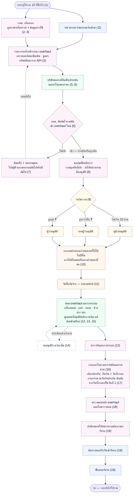

# Overhaul — กระบวนการฉบับใหม่ (ตามคำตอบของเจ้าของงาน 6 ต.ค. 2569)

> 🎯 **ผังนี้คือกระบวนการเป้าหมาย — ต้นแบบยังไม่ได้ทำตาม**
> วาดจากบอร์ดกระบวนการ overhaul ที่เจ้าของงานส่งมา และคำตอบ 19 ข้อของเจ้าของงาน (6 ต.ค. 2569 — เก็บไว้ใน `plan.md`)
>
> - ผังของสิ่งที่**ต้นแบบทำอยู่จริง**ยังอยู่ที่ [07-overhaul.md](07-overhaul.md) (คัดรถเข้าข่าย · แผน + หัวหน้าอนุมัติ · งานรายคัน 7 ขั้น)
> - เลขในวงเล็บท้ายกล่อง = ข้อของคำตอบเจ้าของงาน
> - **กล่องเส้นประ** = ทางเลือก ไม่ได้เกิดทุกครั้ง · ❓ = ยังไม่รู้ ต้องถามต่อ (รายการอยู่ท้ายไฟล์)

**สีพื้นกล่อง = ผู้ทำ** · ฟ้า = หน่วยงานเจ้าของรถ · ชมพู = กบค. · เขียว = บริษัท/ผู้รับจ้าง · เหลือง = ผู้อนุมัติ · ส้ม = งบประมาณและจัดซื้อจัดจ้าง
⚠️ ผู้ทำของบางกล่องเป็นการตีความของผู้วาด เจ้าของงานยังไม่ได้ระบุ: ใครออกใบตรวจสอบ · ใครกรอกอะไหล่และประกัน · ใครเป็นผู้ตรวจรับรายระบบ

## ขั้นในผัง เทียบกับของที่มีในต้นแบบ

| ขั้นในผัง | ข้อของคำตอบ | ต้นแบบตอนนี้ |
|---|---|---|
| เกณฑ์อายุ 10 ปี | 1 | ยังเป็น 15 ปี (`maintainance-yearly/mock-yearly.js` `OVERHAUL_DEFAULTS.ageYears`) |
| หน่วยงานแจ้ง / กบค. เลือกเอง | 2, 4 | มีแค่ทาง กบค. เปิดดูรถที่ระบบคัดให้ ([07-overhaul.md](07-overhaul.md)) |
| มูลค่าทรัพย์สินจาก API | 3 | ไม่มี |
| บริษัทประเมิน + ใบเสนอราคา | 5, 6 | ไม่มี |
| กบค. ตัดสินใจรายคัน · คันที่ไม่เข้าไปคิวแรกรอบถัดไป | 6, 7 | ไม่มี |
| ขออนุมัติหลักการ แบ่งระดับตามวงเงิน | 8, 9 | มีแค่หัวหน้าคนเดียวอนุมัติทั้งแผน (แอป `app/` · `/overhaul`) |
| กองงบประมาณกำหนดงบของปี | 10 | แผนมีช่องงบประมาณช่องเดียว |
| จัดซื้อจัดจ้าง | 11 | ไม่มี |
| ซ่อมแยกรายระบบ · ผูกแผนเดิมข้ามปี · ขอวงเงินเพิ่ม | 12–15 | มีขั้น "ดำเนินการ Overhaul" รายคัน ไม่แยกระบบ ไม่มีขอวงเงินเพิ่ม |
| ตรวจรับแยกรายระบบ | 12 | ไม่มี |
| อะไหล่แยกรายคันและรายส่วน | 16 | มีรายคัน ไม่แยกรายส่วน |
| ประกัน: กรอกจำนวนวัน | 17 | ตายตัว 180 วัน ระบบคำนวณเอง (`app/src/components/overhaul-exec/StepPost.tsx`) |
| ตรวจสอบหลัง overhaul + ใบตรวจสอบ | 18 | มีตรวจสภาพหลัง + ใบรับรองความปลอดภัย |
| นัดหมายรับรถ → ต้นทางตอบรับ → รับรถ | 19 | มีนัดหมายวันคืนรถและรอต้นทางยืนยัน แต่ลำดับเป็นนัดคืนก่อนตรวจหลัง · ยังไม่มีขั้นตอนรับรถ |

## ยังไม่รู้ ต้องถามต่อ

1. ขั้นเอกสาร 11 ขั้นในสเปก (`JO1-Tech-Data-Spec.md` ข้อ 6.0 — กรรมการ · หนังสือ · บัญชี) ยังใช้อยู่ หรือกระบวนการนี้มาแทน
2. เส้นแบ่งวงเงินของรองผู้ว่าและผู้ว่า (รู้แค่ผู้ช่วยไม่เกิน 20 ล้าน) · "หน่วยงานอื่น" ที่อนุมัติคือหน่วยงานไหน · สายงานอนุมัติ 3 รอง (แผนงาน · งบประมาณ · ปฏิบัติการ) บนบอร์ดเกี่ยวกับขั้นนี้อย่างไร
3. ถ้าไม่อนุมัติหลักการ เรื่องไปทางไหน
4. ถ้ากองงบประมาณให้งบไม่ครบ คันไหนได้ซ่อมก่อน และคันที่เหลือรออย่างไร
5. รถที่ถูกคัดออก รอบถัดไปต้องประเมินใหม่ไหม · ชื่อแท็ก
6. จัดซื้อจัดจ้าง "ทำตามปกติ" คือทำนอกระบบแล้วระบบรับผล หรือต้องมีหน้าจอ
7. รายชื่อระบบที่ใช้แบ่งการซ่อมและตรวจรับ
8. ประกัน 2 ส่วนบนบอร์ด (ของบริษัทตามสัญญา / กบค. กับหน่วยงาน) ช่องกรอกจำนวนวันใช้กับส่วนไหน · TOR ข้อ 7.4.2-04 เขียน 180 วัน
9. ขั้นตอนรับรถ ใช้ของโฟลว์งานซ่อมเดิมได้เลยไหม
