# 08 — Overhaul: ใครทำอะไร · ระบบทำอะไร · แสดงอะไร

> **ร่าง 6 ต.ค. 2569** — มุมมอง "ใครทำ / ระบบทำ / สถานะ" ของ Overhaul ทั้งเส้น ตั้งแต่คัดรถจนปิดแผน
> คู่กับ [07-overhaul](07-overhaul.md) (เกณฑ์ + state ของแผน + 7 ขั้นรายคันในแอป `app/`) — ไฟล์นี้ไม่ได้แทนที่
>
> **ผัง FigJam:** https://www.figma.com/board/IUDh0O6crVhuiUBaUOIEA4 — แบ่ง 2 section
> **1/2 คัดรถ + ขออนุมัติก่อน Overhaul (รายคัน)** · **2/2 แผน + ดำเนินการรายคัน + ปิดงาน / ปิดแผน**
> เลน = ใครทำ · 🟧 เลนล่างสุด = สถานะ + แจ้งเตือน · คำถามเป็น sticky เหลืองข้างขั้นที่ถาม (1/2 มี 13 ข้อ · 2/2 มี 10 ข้อ)
>
> ⚠️ **Overhaul ไม่มีในหลักเกณฑ์ยานพาหนะ พ.ศ. 2569** — ทุกขั้นมาจาก JO / Project Board / เจ้าของงานเคาะ

## ที่มาแต่ละแหล่งบอกอะไร

| แหล่ง | บอกอะไร | อ้างในผังเป็น |
|---|---|---|
| **Project Board (10)** ถอดไว้ที่ `JO1-Tech-Data-Spec.md` 6.0 | ขออนุมัติก่อน Overhaul **11 ขั้นเส้นตรง** + สถานะหลังแต่ละขั้น + business rule (6.0.7) | `[Board n]` · `[spec 6.0.x]` |
| `JO1-Tech-Data-Spec.md` 6.2.1 | เงื่อนไขคัดรถ **12 ข้อ** (เจ้าของงานเพิ่ม 30 ก.ย. 2569) | `[spec 6.2.1]` |
| ใบสั่งงาน JO1 ข้อ 7.4.1–7.4.2 | วางแผน (ชื่อ · ปี · งบ · รถ · checklist · ติดตามหลัง Overhaul) · ดำเนินการ (ตรวจก่อน/หลัง · ใบรับรอง · รับประกัน 180 วัน · % เทียบราคารถ · Smart Inventory) | `[JO 7.4.x-nn]` |
| [07-overhaul](07-overhaul.md) + แอป `app/` | เกณฑ์ 4 ข้อ (❓ ยังไม่ใช่ของจริง) · แผน DRAFT → PENDING → ACTIVE → CLOSING → CLOSED · ปิดรายคันครบแล้วจึงปิดแผน | `[07-overhaul]` · `[เคาะ วันที่]` |
| เจ้าของงานเคาะ 29 ก.ย.–1 ต.ค. | เครื่องมือกลเท่านั้น · กบค. ทำเอง · อะไหล่ประจำรุ่นรู้ล่วงหน้า · ค่าแรงกรอกตอนปิดงาน · 7 ขั้นยึดงานซ่อมระบบจริง | `[เคาะ วันที่]` · `[งานซ่อมจริง]` |

### ⚠️ จุดที่แหล่งขัดกัน

| เรื่อง | แหล่ง A | แหล่ง B | ในผังใช้ |
|---|---|---|---|
| **ลำดับ:** ขออนุมัติรายคัน กับ สร้างแผน | spec 6.0.7: รถเข้าแผนได้เมื่อเคสอนุมัติแล้ว (ติด "ต้องยืนยัน") | แอป `app/`: สร้างแผนใส่รถได้เลย ไม่มีขั้นรายคัน | **รายคันก่อน → เข้าแผน** `[เสนอ]` (เจ้าของงาน 6 ต.ค.: "ยังไม่แน่ใจแต่ทำรายคันมาก่อน") → 1/2 Q13 |
| **ขอบเขตงาน** | JO 7.4.2-03 มีงานตัวรถ (เครื่องยนต์ · เกียร์ · เบรก · สี) | เคาะ 29 ก.ย.: เครื่องมือกลเท่านั้น | ตามที่เคาะ → 2/2 Q5 🔴 |
| **ใครซ่อม** | Board 3: อู่/ศูนย์บริการ เสนอราคาได้ | เคาะ 30 ก.ย.: กบค. ทำเอง ไม่มีอู่ | อู่อยู่แค่ขั้นเสนอราคา → 1/2 Q5 |
| **เกณฑ์คัดรถ** | แอป: 4 ข้อ (อายุ > 15 ปีเป็นตัวอย่าง) | spec 6.2.1: 12 เงื่อนไข | ระบบคัด 4 ข้อ → กบค. คัดตาม 12 ข้อ → 1/2 Q1 |
| **เกณฑ์ 30%** | Overhaul: 30% ของราคาแรกที่ได้มา ขึ้น flag (Board 3) | จำหน่าย: ค่าซ่อม > 30% = เข้าข่ายจำหน่าย (ระเบียบข้อ 24) | flag อย่างเดียว ไม่แตกทาง → 1/2 Q6 🔴 |

## 1/2 — คัดรถ + ขออนุมัติก่อน Overhaul (รายคัน)

เลน: กบค. / เจ้าหน้าที่ ❓ · หน่วยงานเจ้าของรถ · คณะกรรมการตรวจสอบ · **นักบัญชีทรัพย์สิน / ฝ่ายบัญชี** · ผู้เสนอราคาซ่อม ❓ · กรย. · ผู้ช่วย 1 ❓ · ระบบ · 🟧

| # | ใคร | ทำอะไร (คน / ระบบ) | 🟧 สถานะหลังขั้น · 🔔 แจ้งใคร | ที่มา |
|---|---|---|---|---|
| A1 | ระบบ | ประเมินรายคัน → เข้าข่าย / ใกล้เกณฑ์ / ยังไม่ถึง | — | 07-overhaul · เกณฑ์ ❓ |
| A2 | กบค. | คัดรถตามเงื่อนไข 12 ข้อ | รถ → ถูกคัดเข้าพิจารณา · 🔔 เจ้าของรถ `[เสนอ]` | spec 6.2.1 |
| — | — | กบค. → เจ้าของรถ (เส้นประ) | — | `[เสนอ]` → Q2 |
| B1 | หน่วยงานเจ้าของรถ | ตั้งกรรมการตรวจสอบหน้างาน + คำสั่งแต่งตั้ง | ตั้งกรรมการแล้ว (`COMMITTEE_APPOINTED`) · 🔔 นักบัญชี | Board 1 |
| B2 | **นักบัญชีทรัพย์สิน** | แจ้งมูลค่าที่ได้มา (ราคาแรก) | ได้มูลค่าทรัพย์สิน (`ASSET_VALUED`) · 🔔 ผู้เสนอราคา | Board 2 · Q4 |
| B3 | ผู้เสนอราคา ❓ | เสนอราคาซ่อม + ใบเสนอราคา | — | Board 3 · Q5 |
| B3s | ระบบ | คำนวณราคาซ่อมเทียบมูลค่าที่ได้มา · **เกิน 30% ขึ้น flag** | เสนอราคาแล้ว (`QUOTED`) · 🔔 กรรมการ | Board 3 · spec 6.0.7 · Q6 |
| B4 | คณะกรรมการตรวจสอบ | checklist ประเมินสภาพรถ + รูป | ประเมินสภาพแล้ว (`ASSESSED`) | Board 4 |
| B5 | คณะกรรมการตรวจสอบ | รายงานผล + ลงนาม | กรรมการรายงานผลแล้ว (`COMMITTEE_REPORTED`) · 🔔 เจ้าของรถ | Board 5 · Q7 |
| B5s | ระบบ | เช็กเอกสาร 1–5 ครบก่อนเปิดทำหนังสือ | — | spec 6.0.7 |
| B6 | หน่วยงานเจ้าของรถ | รวบรวม 1–5 ทำหนังสือเสนอ กรย. | ส่งเรื่องแล้ว (`SUBMITTED`) · 🔔 กรย. | Board 6 · Q8 |
| B7 ◆ | กรย. | ตั้งคณะกรรมการพิจารณา → เห็นชอบ? | กรย. พิจารณาแล้ว (`UNDER_REVIEW` → `REVIEWED`) · 🔔 ฝ่ายบัญชี · **ไม่เห็นชอบ ❓** | Board 7 · Q9 |
| B8 | **นักบัญชีทรัพย์สิน / ฝ่ายบัญชี** | ทำหนังสือส่ง ผู้ช่วย 1 | รออนุมัติ (`PENDING_APPROVAL`) · 🔔 ผู้ช่วย 1 | Board 8 |
| B9 ◆ | ผู้ช่วย 1 ❓ | อนุมัติ? | `APPROVED` / `REJECTED` · 🔔 เจ้าของรถ + กบค. | Board 9 · Q9–Q10 |
| B9s | ระบบ | เปลี่ยนสถานะรถได้เมื่อแนบหนังสืออนุมัติแล้ว | รถ → รอ Overhaul ❓ · 🔔 กบค. | spec 6.0.7 · Q11 |
| B10 | กบค. / เจ้าหน้าที่ ❓ | สแกนเอกสารส่งเจ้าของรถ | แจ้งเจ้าของแล้ว (`NOTIFIED_OWNER`) · 🔔 เจ้าของรถ | Board 10 · spec 6.0.7 · Q12 |
| B11 | หน่วยงานเจ้าของรถ | รับทราบหนังสือ | ปิดเคส (`CLOSED`) · รถพร้อมเข้าแผน · 🔔 กบค. | Board 11 |

## 2/2 — แผน + ดำเนินการรายคัน + ปิดงาน / ปิดแผน

เลน: กบค. (ผู้วางแผน / ช่าง) · หัวหน้า กบค. · หน่วยงานเจ้าของรถ · คลังอะไหล่ / Smart Inventory · ระบบ · 🟧

| # | ใคร | ทำอะไร (คน / ระบบ) | 🟧 สถานะหลังขั้น · 🔔 แจ้งใคร | ที่มา |
|---|---|---|---|---|
| C1 | กบค. | สร้างแผน (ชื่อ · ปี · งบ) + ใส่รถที่ผ่านเคส | แผน → ร่าง (DRAFT) · ยกเลิกได้ทุกเมื่อก่อนปิด (ต้องมีเหตุผล) | JO 7.4.1-01/02 · เคาะ 29 ก.ย. |
| C1b | กบค. | กำหนด checklist / รายการงานรายคัน + ภาพ · เอกสาร | — | JO 7.4.1-04/06 |
| C2 ◆ | หัวหน้า กบค. | อนุมัติแผน? · ไม่อนุมัติต้องมีเหตุผล → กลับเป็นร่าง | รออนุมัติ (PENDING · ล็อกแก้ไข) · 🔔 หัวหน้า กบค. | เคาะ 29 ก.ย. · Q1 · Q3 |
| ① | กบค. → คลัง | เบิกอะไหล่ (ตั้งจากอะไหล่ประจำรุ่น) → จองผ่าน Smart Inventory | แผน → ACTIVE · งาน → รอเบิกอะไหล่ · 🔔 กบค. | เคาะ 30 ก.ย. · JO 7.4.2-08/09 · Q4 |
| ② ◆ | กบค. → เจ้าของรถ | นัดหมายวันซ่อม → เจ้าของรถยืนยัน / ขอแก้นัด | รอนัดหมาย → รอต้นทางยืนยันนัดหมาย · 🔔 เจ้าของรถ | งานซ่อมจริง |
| ③ | กบค. | ตรวจสภาพก่อน: เอกสารรับรถ 13 ข้อ + ตรวจ 24 ข้อ | ตรวจสภาพก่อน | JO 7.4.2-01 |
| ④ ◆ | กบค. (+ คลัง) | ดำเนินการ · พบอาการเพิ่ม → เบิกอะไหล่เพิ่ม | ดำเนินการ Overhaul | JO 7.4.2-02 · Q5 🔴 |
| ⑤ ◆ | กบค. → เจ้าของรถ | นัดหมายวันคืนรถ → เจ้าของรถยืนยัน | รอต้นทางยืนยันรับรถ · 🔔 เจ้าของรถ | งานซ่อมจริง |
| ⑥ | กบค. + ระบบ | ตรวจหลัง 24 ข้อ · ทดสอบความปลอดภัย · ใบรับรอง → ระบบเริ่มนับรับประกัน 180 วัน | รอ กบค. ตรวจสภาพหลัง | JO 7.4.2-04 · Q6 |
| ⑦ | กบค. + ระบบ | รายงานปิดงาน (อะไหล่เก่า · ค่าแรง · เอกสาร 15 ข้อ) → ระบบรวมค่าใช้จ่ายเทียบราคารถ (%) | รอ กบค. ส่งรายงาน → รออนุมัติปิดงาน · 🔔 หัวหน้า กบค. | JO 7.4.2-06/10 · Q7–Q8 |
| E8 ◆ | หัวหน้า กบค. | อนุมัติปิดงานรายคัน / ตีกลับ + เหตุผล | ปิดงานแล้ว · แผน → ปิดงาน x/n · 🔔 กบค. + เจ้าของรถ | เคาะ 1 ต.ค. |
| P1 ◆ | ระบบ | ปิดงานครบทุกคัน? (ยังไม่ครบ → รอคันอื่น) | — | เคาะ 1 ต.ค. · Q9 |
| P2–P3 ◆ | กบค. → หัวหน้า กบค. | สรุปปิดแผน (อะไหล่ · ค่าแรง · % · งบคงเหลือ) → อนุมัติปิดแผน / ตีกลับ | CLOSING · 🔔 หัวหน้า กบค. → CLOSED · ⏰ รับประกันครบ 180 วัน | เคาะ 1 ต.ค. |
| P4 | ระบบ | ติดตามการใช้งานหลัง Overhaul | — | JO 7.4.1-07 · ⬜ ยังไม่ทำ · Q10 |

## Mermaid (อ่านบน GitHub)

```mermaid
flowchart LR
    subgraph S1["1/2 คัดรถ + ขออนุมัติก่อน Overhaul (รายคัน)"]
        direction LR
        A1["ระบบประเมินรายคัน"] --> A2["กบค. คัดรถ 12 ข้อ"]
        A2 -.->|"แจ้งเจ้าของรถ [เสนอ]"| B1["เจ้าของรถตั้งกรรมการ"]
        B1 --> B2["นักบัญชีแจ้งมูลค่าที่ได้มา"] --> B3["เสนอราคาซ่อม ❓"]
        B3 --> B3s["ระบบเทียบ 30% → flag"] --> B4["กรรมการ checklist"] --> B5["กรรมการรายงานผล"]
        B5 --> B6["เจ้าของรถทำหนังสือ"] --> B7{"กรย. เห็นชอบ?"}
        B7 -.->|"ไม่"| B7x(["❓"])
        B7 -->|"เห็นชอบ"| B8["บัญชีทำหนังสือส่ง ผู้ช่วย 1"] --> B9{"ผู้ช่วย 1 อนุมัติ? ❓"}
        B9 -.->|"ไม่"| B9x(["❓"])
        B9 -->|"อนุมัติ"| B10["สแกนส่งเจ้าของรถ"] --> B11["เจ้าของรถรับทราบ"]
    end
    subgraph S2["2/2 แผน + ดำเนินการ + ปิดงาน / ปิดแผน"]
        direction LR
        C1["กบค. สร้างแผน + checklist"] --> C2{"หัวหน้า กบค. อนุมัติแผน?"}
        C2 -->|"ไม่ + เหตุผล"| C1
        C2 -->|"อนุมัติ"| E1["① เบิกอะไหล่"] --> E2["② นัดซ่อม"] --> E3["③ ตรวจก่อน"] --> E4{"④ พบอาการเพิ่ม?"}
        E4 -->|"พบ"| E4s["เบิกเพิ่ม"] --> E5["⑤ นัดคืนรถ"]
        E4 -->|"ไม่พบ"| E5
        E5 --> E6["⑥ ตรวจหลัง + ใบรับรอง"] --> E7["⑦ รายงานปิดงาน"] --> E8{"อนุมัติปิดงานรายคัน?"}
        E8 -->|"ตีกลับ"| E7
        E8 -->|"อนุมัติ"| P1{"ครบทุกคัน?"}
        P1 -->|"ครบ"| P2["สรุปปิดแผน"] --> P3{"อนุมัติปิดแผน?"}
        P3 -->|"ตีกลับ"| P2
        P3 -->|"อนุมัติ"| P4["ติดตามหลัง Overhaul ⬜"]
    end
    B11 -->|"รายคันก่อน → เข้าแผน [เสนอ]"| C1
    classDef sys fill:#C6FAF6,stroke:#5AD8CC,color:#101828
    classDef act fill:#C2E5FF,stroke:#3DADFF,color:#101828
    classDef dec fill:#DCCCFF,stroke:#874FFF,color:#101828
    class A1,B3s,P4 sys
    class A2,B1,B2,B3,B4,B5,B6,B8,B10,B11,C1,E1,E2,E3,E4s,E5,E6,E7,P2 act
    class B7,B9,C2,E4,E8,P1,P3 dec
```

## คำถามที่ต้องถาม กฟภ. (แยกตามจุด)

### 1/2 — คัดรถ + ขออนุมัติก่อน Overhaul

| # | คำถาม | ขั้น | ถามใคร |
|---|---|---|---|
| Q1 | เกณฑ์คัดรถจริงคืออะไร — 4 ข้อในระบบ (อายุ > 15 ปีเป็นแค่ตัวอย่าง) หรือ 12 เงื่อนไข · ค่าตัวเลขเท่าไร | A1–A2 | กบค. |
| Q2 | คัดรถแล้วใครเปิดเคส — กบค. แจ้งเจ้าของรถ หรือเจ้าของรถยื่นเอง | A2 → B1 | กบค. |
| Q3 | ชื่อสถานะ + ผู้รับแจ้งในเลนส้มถูกไหม · ช่องทางแจ้งเตือน: ในแอป / อีเมล / PEA Life? | ทุกขั้น | ผู้ใช้หน้างาน + IT |
| Q4 | มูลค่าที่ได้มา กรอกเอง หรือดึงจาก SAP / ทะเบียนทรัพย์สิน (spec #17) | B2 | นักบัญชีทรัพย์สิน |
| Q5 | ใครเสนอราคาซ่อม — อู่ / ผยค. กรย. / กบค. · ขัดกับที่เคาะว่า กบค. ทำเองไหม | B3 | กบค. |
| **Q6** 🔴 | ราคาซ่อม**เกิน 30%** แล้วไปทางไหน — Overhaul / **จำหน่าย** / แค่ประกอบการพิจารณา (spec #12) · เกณฑ์เดียวกับจำหน่าย ข้อ 24 | B3s | กบค. + กรย. |
| Q7 | กรรมการขั้น 1 กับขั้น 7 คนละคณะเสมอไหม · ต้องลงนามในระบบไหม (spec #18) | B1 · B5 · B7 | กรย. |
| Q8 | หนังสือขั้น 6 / 8 / 9 ออกจากระบบนี้ หรือออกจากระบบสารบรรณแล้วแนบไฟล์ (spec #16) | B6 · B8 · B9 | ฝ่ายพัสดุ / IT |
| **Q9** 🔴 | กรย. ไม่เห็นชอบ / ผู้ช่วย 1 ไม่อนุมัติ → ย้อนไปขั้นไหน หรือปิดเคส (spec #13) | B7 · B9 | กรย. |
| **Q10** 🔴 | "ผู้ช่วย 1" คือตำแหน่งไหน (ผู้ช่วยผู้ว่าการ?) · อนุมัติเสมอ หรือขึ้นกับวงเงิน (spec #14) | B9 | ฝ่ายพัสดุ |
| Q11 | ขั้น 9 เปลี่ยนสถานะรถเป็นอะไร (เช่น "รอ Overhaul") (spec #15) | B9s | กบค. |
| Q12 | ใครสแกน / ส่งเอกสาร — เจ้าหน้าที่หน่วยไหน · ส่งผ่านแจ้งเตือนในระบบพอไหม | B10 | กบค. |
| **Q13** 🔴 | **ยืนยันลำดับ:** ทุกคันต้องผ่านขั้น 1–11 ก่อนเข้าแผนไหม (spec 6.0.7 "ต้องยืนยัน") · แอปตอนนี้สร้างแผนได้เลย | B11 → C1 | กบค. |

### 2/2 — แผน + ดำเนินการ + ปิดงาน / ปิดแผน

| # | คำถาม | ขั้น | ถามใคร |
|---|---|---|---|
| Q1 | แผนที่อนุมัติแล้ว แก้ได้โดยไม่ต้องขออนุมัติซ้ำ — ถูกไหม | C1–C2 | กบค. |
| Q2 | ชื่อสถานะ + ผู้รับแจ้งในเลนส้มถูกไหม · ช่องทางแจ้งเตือน | ทุกขั้น | ผู้ใช้หน้างาน + IT |
| Q3 | ผู้อนุมัติแผนคือหัวหน้า กบค. จริงไหม · ต้องแยกสิทธิ์ผู้ส่งกับผู้อนุมัติ | C2 | กบค. |
| Q4 | จองอะไหล่ผ่าน Smart Inventory — ขอ API spec / สถานะการจอง (spec #4) | ① | ทีม Smart Inventory |
| **Q5** 🔴 | ขอบเขต: เครื่องมือกลเท่านั้น (เคาะ 29 ก.ย.) แต่ JO 7.4.2-03 มีงานตัวรถ · กบค. ทำเอง หรือส่งอู่ได้ | ④ | เจ้าของงาน + กบค. |
| Q6 | ทดสอบความปลอดภัยตามมาตรฐานไหน · รอบตามกฎหมาย (spec #6) · แบบฟอร์มใบรับรอง | ⑥ | กบค. |
| Q7 | รายงานปิดงานต้องตามแบบฟอร์ม กฟภ. ไหน (JO 7.4.2-10) · ค่าแรงคิดยังไง | ⑦ | กบค. |
| Q8 | "ราคารถ" ที่เทียบ % ใช้มูลค่าที่ได้มาตัวเดียวกับผัง 1/2 ไหม | ⑦ | นักบัญชีทรัพย์สิน |
| Q9 | ปิดแผนได้ไหมถ้าบางคันยกเลิก / ไม่ได้ทำ | P1–P2 | กบค. |
| Q10 | ติดตามหลัง Overhaul ดูอะไร นานเท่าไร · เคลมรับประกัน 180 วันทำยังไง | P4 | กบค. |

🔴 = บล็อกการออกแบบ ถามก่อน
