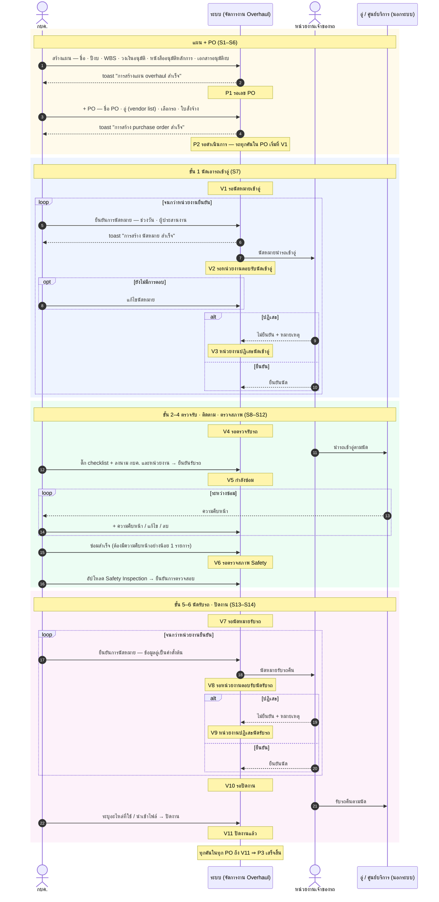

# Overhaul — ตารางสถานะ + sequence diagram (16 ต.ค. 2569)

> **ไฟล์นี้ตอบว่า "ตอนนี้เรื่องอยู่สถานะไหน และอะไรทำให้สถานะเปลี่ยน"** ของงาน Overhaul ช่วง**หลังมีแผน**
>
> **ที่มา:** userflow "จัดการงาน Overhaul" ของเจ้าของงาน (14 scenario · เมนู "จัดการงาน Overhaul" · url `/overhaul-utility-vehicle`) ส่งมา 14 ต.ค. 2569 และส่งซ้ำ 16 ต.ค. 2569
> **เจ้าของงานเคาะ 16 ต.ค. 2569:** ขอบเขต = **แผนหลังมี PO** · userflow ชุดนี้ **ใช้แทนแผนเดิม** (PO ผูกกับแผน 1 ใบหลายคัน · หน้างานรายคัน 6 ขั้น แทน 5 ขั้นของ wireframe 12 ต.ค. และ 7 ขั้นของแอป `app/`)
>
> - ช่วงก่อนมีแผน (คัดรถ · ประเมิน · อนุมัติหลักการ · งบ) อยู่ที่ผัง [08-overhaul-กระบวนการใหม่.md](08-overhaul-กระบวนการใหม่.md) — ใน userflow ชุดนี้ กบค. สร้างแผนหลังได้อนุมัติแล้ว โดยแนบหนังสืออนุมัติหลักการ + เอกสารอนุมัติงบเข้ามา
> - 🔴 **ชื่อสถานะเป็นร่างของผู้เขียน** userflow บอกขั้นและปุ่ม แต่ไม่ได้ตั้งชื่อสถานะไว้ · ❓ = ยังไม่รู้ (รายการท้ายไฟล์)
> - scenario อ้างเป็น **S1–S14** ตามลำดับใน userflow · ตารางนี้มีฉบับ CSV ที่ [12-overhaul-สถานะ.csv](12-overhaul-สถานะ.csv) — แก้ที่ไหนต้องแก้อีกที่ให้ตรงกัน
> - สิทธิ์ตาม userflow: **กบค. ดูและแก้ไข · หน่วยงานดูอย่างเดียว**

## 1. ตารางสถานะ

### P — แผน Overhaul (S1–S3)

userflow มีคอลัมน์ "สถานะ" ในรายการแผน (ใช้กรองและเรียงได้) แต่ไม่ได้บอกค่า — เงื่อนไขตีความจาก flow · **ชื่อ P1 P2 ตามที่ PO confirm 21 ต.ค. 2569** (ชีตแท็บ "1 รายการแผน": ยังไม่มี PO → รอเลข PO · ดำเนินการ → รอดำเนินการ) · ⚠ แท็บ "Overhaul (PEA) 1 draft" คอลัมน์ status final ให้อีกชุด (รอเลข PO · กำลังดำเนินการ PO · อนุมัติ PO และชื่อ V อีกชุด) ขัดกับแท็บหน้า — ยังไม่ใช้ รอเคาะ

| รหัส | สถานะ | เข้าสถานะนี้เมื่อ | ทำอะไรได้ในสถานะนี้ | ไปต่อได้ | scenario | ที่มา |
|---|---|---|---|---|---|---|
| P1 | รอเลข PO | กบค. สร้างแผน → บันทึกสำเร็จ (toast "สร้างแผน Overhaul {เลขแผน} สำเร็จ") | ดูรายละเอียด · แก้ไข · ลบ · + PO | P2 · ลบแผน | S1 · S2 · S3 | ชื่อ: PO confirm 21 ต.ค. 2569 · เงื่อนไข: ตีความ (flow มีทางแยก "มีแผน ?" / "มี PO ?") |
| P2 | รอดำเนินการ | สร้าง PO ใบแรกสำเร็จ ⇒ รถทุกคันใน PO เริ่มงานที่ V1 | เหมือน P1 + จัดการ PO | P3 · กลับ P1 ถ้าลบ PO หมด ❓ | S4 · S5 · S6 | ชื่อ: PO confirm 21 ต.ค. 2569 · เงื่อนไข: ตีความ |
| P3 | เสร็จสิ้น | รถทุกคันในทุก PO ของแผนถึง V11 ปิดงานแล้ว | ดูรายละเอียด | — | (ไม่มีใน userflow) | ตีความ |

> PO **ไม่มีคอลัมน์สถานะ** ใน userflow (รายการ PO มีแค่ หมายเลข PO · ชื่อ PO · ศูนย์บริการ/อู่ · จำนวนรถ) ⇒ ไม่ตั้งสถานะให้ PO

### V — งานรายคัน 6 ขั้น (S7–S14)

ขั้นของ stepper: **นัดเอารถเข้าอู่ → ตรวจรับรถ → ติดตามงานซ่อม → ตรวจสภาพ → นัดรับรถ → ปิดงาน**

| รหัส | ขั้น | สถานะ | เข้าสถานะนี้เมื่อ | รอใคร | ทำอะไรได้ในสถานะนี้ | ไปต่อได้ | scenario |
|---|---|---|---|---|---|---|---|
| V1 | 1 นัดเอารถเข้าอู่ | รอนัดหมายเข้าอู่ | รถถูกเลือกเข้า PO (ขั้น 1 เป็นค่าตั้งต้น) | กบค. | กรอกช่วงวันนำรถเข้า (ห้ามก่อนวันนี้) · ผู้ประสานงาน กบค. (เบอร์ดึงอัตโนมัติ) · ข้อมูลอู่แสดงจาก PO → ยืนยันการนัดหมาย | V2 | S7 |
| V2 | 1 นัดเอารถเข้าอู่ | รอหน่วยงานตอบรับนัดเข้าอู่ | ยืนยันการนัดหมายสำเร็จ (toast "การสร้าง นัดหมาย สำเร็จ") | หน่วยงานเจ้าของรถ | แก้ไขนัดหมายได้ ตราบใดที่ปลายทางยังไม่ตอบ | V3 · V4 | S7 |
| V3 | 1 นัดเอารถเข้าอู่ | หน่วยงานปฏิเสธนัดเข้าอู่ | หน่วยงานตอบกลับว่าไม่ยืนยัน | กบค. | เห็นหมายเหตุที่ปฏิเสธ → แก้นัดแล้วยืนยันใหม่ | V2 | S7 |
| V4 | 2 ตรวจรับรถ | รอตรวจรับรถ | หน่วยงานยืนยันนัด | กบค. + หน่วยงาน | ติ๊กรายการตรวจสอบ + หมายเหตุ · ลงนามรับรถ 2 ฝ่าย (กบค. · หน่วยงาน) → ยืนยันรับรถ | V5 | S8 |
| V5 | 3 ติดตามงานซ่อม | กำลังซ่อม | ยืนยันรับรถ | กบค. | + ความคืบหน้า (วันที่/เวลา · หมายเหตุ) · แก้ไข · ลบได้เมื่อมีมากกว่า 1 รายการ · ปุ่ม "ซ่อมสำเร็จ" กดไม่ได้จนกว่าจะมีความคืบหน้าอย่างน้อย 1 รายการ | V6 | S9 · S10 · S11 |
| V6 | 4 ตรวจสภาพ | รอตรวจสภาพ Safety | กด "ซ่อมสำเร็จ" | กบค. | อัปโหลดเอกสาร Safety Inspection (ถ้ามี) → ยืนยันการตรวจสภาพ | V7 | S12 |
| V7 | 5 นัดรับรถ | รอนัดหมายรับรถ | ยืนยันการตรวจสอบ | กบค. | กรอกช่วงวัน · ผู้ประสานงาน · ข้อมูลอู่เป็นค่าตั้งต้น → ยืนยันการนัดหมาย | V8 | S13 |
| V8 | 5 นัดรับรถ | รอหน่วยงานตอบรับนัดรับรถ | ยืนยันการนัดหมายรับรถสำเร็จ | หน่วยงานเจ้าของรถ | แก้ไขนัดหมายได้ ตราบใดที่ปลายทางยังไม่ตอบ | V9 · V10 | S13 |
| V9 | 5 นัดรับรถ | หน่วยงานปฏิเสธนัดรับรถ | หน่วยงานตอบกลับว่าไม่ยืนยัน | กบค. | เห็นหมายเหตุที่ปฏิเสธ → แก้นัดแล้วยืนยันใหม่ | V8 | S13 |
| V10 | 6 ปิดงาน | รอปิดงาน | หน่วยงานยืนยันนัดรับรถ | กบค. | ระบุอะไหล่ที่ใช้ หรือนำเข้าไฟล์ → ปิดงาน (ต้องระบุอะไหล่ก่อน — flow มีทางแยก "ระบุอะไหล่ที่ใช้ ?") | V11 | S14 |
| V11 | 6 ปิดงาน | ปิดงานแล้ว | กดปิดงาน | — | ดูอย่างเดียว | (นับเข้า P3) | S14 |

## 2. เทียบกับสถานะที่ต้นแบบใช้อยู่ (ของเดิมที่ชุดนี้มาแทน)

| ใหม่ | แอป `app/` (`app/src/lib/overhaulExec.ts` `EXEC_STAGE_LABEL` · 7 ขั้น) | wireframe 12 ต.ค. (`design-mock/overhaul-mock.js` `OH_STAGE` · 5 ขั้น) |
|---|---|---|
| — | ยังไม่เริ่ม · รอเบิกอะไหล่ (ชุดใหม่ย้ายอะไหล่จากคลังไปไว้ที่แผน) | รอบันทึก PO (ชุดใหม่ PO ผูกแผน ⇒ กลายเป็น P1) |
| V1 | รอนัดหมายวันซ่อม | — |
| V2 | รอต้นทางยืนยันนัดหมาย | — |
| V3 | — | — |
| V4 | รอตรวจสภาพก่อน Overhaul | — |
| V5 | ดำเนินการ Overhaul | กำลังดำเนินการ |
| V6 | รอ กบค. ตรวจสภาพหลัง Overhaul (แอปตรวจ**หลัง**นัดคืน · ชุดใหม่ตรวจ**ก่อน**นัด) | — |
| V7 | รอนัดหมายวันคืนรถ | — |
| V8 | รอต้นทางยืนยันรับรถ | รอหน่วยงานตอบรับนัด |
| V9 | — | หน่วยงานปฏิเสธนัด |
| V10 | รอ กบค. ส่งรายงานปิดงาน | รอหน่วยงานรับรถ · รอปิดงาน |
| — | รออนุมัติปิดงาน (ชุดใหม่ไม่มีขั้นอนุมัติปิดงาน) | — |
| V11 | ปิดงานแล้ว | ปิดงานแล้ว |

## 3. Sequence diagram

> โน้ตสีเหลือง = สถานะเปลี่ยนเป็นอะไร ณ จุดนั้น · `loop` = ทำซ้ำได้จนกว่าจะผ่าน · `opt` = ไม่ได้เกิดทุกครั้ง
> อู่/ศูนย์บริการไม่ได้ใช้ระบบ ใน userflow กบค. เป็นคนบันทึกความคืบหน้าแทน

## 4. ยังไม่รู้ ต้องถามต่อ

1. **ชื่อสถานะ** — P1–P3 PO confirm แล้ว 21 ต.ค. 2569 (รอเลข PO · รอดำเนินการ · เสร็จสิ้น) แต่แท็บ "Overhaul (PEA) 1 draft" ของชีตเดียวกันให้ชื่ออีกชุด (กำลังดำเนินการ PO · อนุมัติ PO และ V เช่น หน่วยงานตอบรับเข้าอู่แล้ว · อยู่ระหว่างตรวจ · อยู่ระหว่างปิดงาน) — ต้องเคาะว่าชุดไหนคือของจริง · V1–V11 ยังใช้ชื่อร่าง (PO CF หน้า 3 ว่า "ป้าย 11 สถานะ" โดยไม่แก้ชื่อ)
2. **หน่วยงานตอบรับ/ปฏิเสธนัดจากหน้าไหน** — userflow ให้หน่วยงาน "ดูอย่างเดียว" แต่ขั้น 1 และ 5 ต้องรอหน่วยงานตอบกลับ ⇒ น่าจะเป็นหน้าจอของฝั่งหน่วยงานที่ยังไม่มีใน userflow
3. **ลบแผน / ลบ PO / เอารถออกจาก PO ได้ทุกสถานะไหม** — เช่น รถใน PO ถึง V5 กำลังซ่อมแล้ว · ถ้าลบ PO หมด แผนกลับเป็น P1 ไหม
4. **ระหว่าง V10 ไม่มีขั้นส่งมอบรถคืน** (ขั้น 2 มีลงนามรับรถ 2 ฝ่าย แต่ขากลับไม่มี) — ต้องมีลงนามส่งมอบไหม และปิดงานได้ก่อนวันรับรถจริงไหม
5. **ย้อนขั้นได้ไหม** — เช่น ตรวจสภาพไม่ผ่าน (V6) กลับไปซ่อมต่อ (V5) · userflow มีแค่ทางผ่าน
6. แผนถึง P3 เสร็จสิ้นเองเมื่อทุกคันปิดงาน หรือ กบค. ต้องกดปิดแผน
