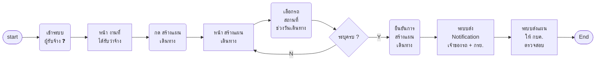
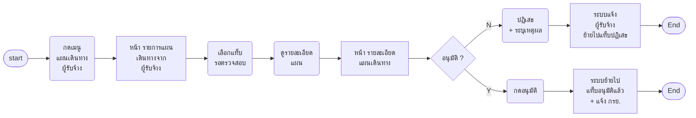
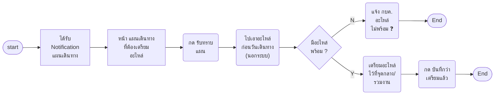

# บำรุงรักษาตามวาระ — scenario ที่พักไว้ (30 ต.ค. 2569) · ตัดออกแล้ว 2 พ.ย. 2569

> ✂ **เจ้าของงานสั่งตัดออก 2 พ.ย. 2569:** _"s3 ตัดออก"_ ⇒ เก็บไฟล์นี้ไว้เป็นประวัติเท่านั้น ไม่นำกลับเข้าเส้นงาน · ฟังก์ชัน planIssue headPartCheck poForm ในปลั๊กอินไม่ถูกเรียกแล้ว

> เจ้าของงานสั่ง 30 ต.ค. 2569: _"อนุมัติเลขงาน ไม่ต้องมีในระบบแล้ว แยกออกไปก่อน ตอนนี้เป็นแผนปีเฉยๆ"_ และ _"การอนุมัติแผนยังมีเหมือนเดิม แต่ว่าไม่ต้องผ่าน ผพจ ส่งอนุมัติทั่วไปได้เลย"_
> ⇒ ย้าย S3 ออกจาก [14-บำรุงรักษา-userflow.md](14-บำรุงรักษา-userflow.md) มาเก็บไว้ที่นี่ เนื้อหาคงเดิม ไม่ขึ้นบอร์ด FigJam และไม่อยู่ในปลั๊กอิน Figma จนกว่าจะเอากลับ
> S2 ยังอยู่ในไฟล์ 14 แต่เปลี่ยนผู้อนุมัติจาก ผพจ. เป็นสายอนุมัติทั่วไป
> ⚠ S3 มีเรื่องจัดซื้ออะไหล่และใบ PO อยู่ด้วย ถ้ายังต้องการส่วนจัดซื้อ ต้องบอกว่าจะให้อยู่ขั้นไหน

## Scenario 3 · ผพจ. ออกเลขงานและจัดซื้ออะไหล่

**ช่วงงาน:** ออกเลขงาน → เบิก/จัดหาอะไหล่ · **เข้าจาก:** แผนที่อนุมัติแล้ว (S2) · **จบที่:** มีเลขงาน + ใบ PO · **ที่มา:** `[บอร์ด]` เลน ผพจ. "ออกเลขงาน (เลขของแผนบำรุงรักษา) → นำส่งหัวหน้า ผพจ. ให้ตรวจสอบรายการอะไหล่ที่จะใช้ในแผนบำรุงรักษา → อนุมัติ? → ทำเรื่องซื้ออะไหล่ (ที่ไหน อย่างไร) → ออกใบ PO" · ทางไม่อนุมัติ "เพราะอะไหล่ที่จะใช้ในไตรมาสไม่ถูกต้อง → ทำเรื่องคืนอะไหล่"

```text
flowchart LR
    S([start]) --> D1["หน้า รายละเอียด<br/>แผน<br/>(อนุมัติแล้ว)"]
    D1 --> A1("กด<br/>ออกเลขงาน")
    A1 --> D2["ระบบออก<br/>เลขงาน<br/>ของแผน"]
    D2 --> A2("ส่งรายการ<br/>อะไหล่ให้<br/>หัวหน้า ผพจ.")
    A2 --> D3["หน้า รายการ<br/>อะไหล่รอ<br/>หัวหน้าตรวจ"]
    D3 --> A3("หัวหน้า ผพจ.<br/>ตรวจสอบ<br/>รายการ")
    A3 --> Q1{"อนุมัติ ?"}
    Q1 -->|N| A4("ระบุเหตุผล<br/>อะไหล่<br/>ไม่ถูกต้อง")
    A4 --> A5("ทำเรื่อง<br/>คืนอะไหล่ ❓")
    A5 --> E1([End])
    Q1 -->|Y| A6("ทำเรื่อง<br/>ซื้ออะไหล่ ❓")
    A6 --> D4["ระบบบันทึก<br/>ใบ PO"]
    D4 --> E([End])
    %% Q: D2 | Q4 ❓ รูปแบบเลขงาน — เจ้าของงานบอกว่ามีเกณฑ์ของจริง ยังไม่ได้ส่ง
    %% Q: A5 | Q5 ❓ อะไหล่ไม่ถูกต้องแล้ว "ทำเรื่องคืนอะไหล่" คือคืนอะไร ยังไม่ได้ซื้อ — หรือหมายถึงแก้รายการแล้วส่งใหม่
    %% Q: A6 | Q6 ❓ ซื้ออะไหล่ "ที่ไหน อย่างไร" (คำถามบนบอร์ด) · ซื้อผ่าน Smart Inventory/SAP หรือบันทึกผลอย่างเดียว
```

**Wireframe**
- **หน้า รายละเอียดแผน (อนุมัติแล้ว)** — ปุ่ม "ออกเลขงาน" · เลขงานแสดงที่หัวแผนหลังออก `[บอร์ด]`
- **หน้า รายการอะไหล่รอหัวหน้าตรวจ** `[เสนอ]` — รายการ · จำนวนตามแผน · คงเหลือ · ต้องซื้อ · ปุ่ม "อนุมัติรายการ" · "ส่งกลับ (ระบุเหตุผล)"
- **ฟอร์มใบ PO** `[เสนอ]` — เลขที่ PO · ผู้ขาย · รายการ/จำนวน · วงเงิน · เอกสารแนบ

**Condition**

| ส่วน | เงื่อนไข | ที่มา |
|---|---|---|
| เลขงาน | 1 เลขต่อแผน · รูปแบบ (ยังไม่รู้) | บอร์ด "เลขของแผนบำรุงรักษา" |
| หัวหน้า ผพจ. | เป็นคนละคนกับผู้ออกเลขงาน — ต้องมีสิทธิ์แยก (ยังไม่รู้ว่าแยก scenario ไหม) | บอร์ด |
| ฟอร์ม PO | ช่องทั้งหมด (ยังไม่รู้) | เสนอ |

---

## S4 เดิม และ S5 — ตัด/รวมเข้า S4 ใหม่ 2 พ.ย. 2569

> เจ้าของงาน _"S4 จะไม่ได้เป็นการตรวจความพร้อมของรถ แต่จะเป็นการตรวจความคืบหน้าอะไหล่แทน โดยเห็นรายการว่ามีความต้องการเบิกอะไร และเห็นว่าใน smart inventory มีจำนวนเท่าไร"_ + เลือก รวม S4 S5 เป็นหน้าเดียว ยุบ S5 ออก · เห็นต้องเบิกเทียบคงเหลือ Smart Inventory + สถานะการเบิกรายรายการ · เฉพาะไตรมาสที่กำลังทำ · ตัดการตรวจรถทิ้งทั้งหมด
> ⇒ S4 เดิม (ตรวจจำนวนรถ · ความพร้อม · นำรถโอน/รอยุบออก) ตัดทิ้ง · S5 (เบิกผ่านระบบจองอะไหล่) รวมเข้า S4 ใหม่ "ติดตามความคืบหน้าและเบิกอะไหล่ของไตรมาส" · เก็บเนื้อหาเดิมไว้เป็นประวัติ

### (เดิม) Scenario 4 · กบค. ตรวจสอบจำนวนรถปัจจุบันตามแผน

**ช่วงงาน:** เบิก/จัดหาอะไหล่ · **เข้าจาก:** แผนที่อนุมัติแล้ว เปิดแผนแล้วเลือกไตรมาส (30 ต.ค. — ไม่มีเลขงานแล้ว) · **จบที่:** ยืนยันจำนวนรถ · **ที่มา:** `[บอร์ด]` "ตรวจสอบจำนวนรถปัจจุบันตามแผน (สถานะต้องไม่ใช่ รอยุบ หรือ โอน)" + sticky "จะเห็นรถที่ พร้อม / ไม่พร้อม (เป็นการแปลงจากขั้นตอนโทรถามให้กลายเป็นระบบติดตามได้)"

```text
flowchart LR
    S([start]) --> A0("เปิดแผน<br/>เลือกไตรมาส")
    A0 --> D1["หน้า รายการรถ<br/>ในแผน<br/>พร้อม / ไม่พร้อม"]
    D1 --> A1("ตรวจสอบ<br/>สถานะรถ<br/>รายคัน")
    A1 --> Q1{"มีรถสถานะ<br/>รอยุบ/โอน ?"}
    Q1 -->|Y| A2("นำรถออก<br/>จากแผน")
    A2 --> D1
    Q1 -->|N| Q2{"จำนวนรถ<br/>ตรงแผน ?"}
    Q2 -->|N| A3("ปรับจำนวน<br/>รถในแผน")
    A3 --> D1
    Q2 -->|Y| A4("ยืนยัน<br/>จำนวนรถ")
    A4 --> E([End])
    %% Q: D1 | Q7 ❓ "พร้อม / ไม่พร้อม" ใครเป็นคนตอบ และตอบจากหน้าไหน — ต้นแบบมีขั้นยืนยันรถให้หน่วยงานเจ้าของรถตอบ แต่บอร์ดนี้ไม่มีเลนตอบ
    %% Q: A2 | Q8 ❓ นำรถออกจากไตรมาสหลังแผนอนุมัติแล้ว ต้องส่งอนุมัติใหม่ไหม และรายการอะไหล่ปรับเองหรือไม่
```

**Wireframe**
- **หน้า รายการรถในแผน** — ทะเบียน · ยี่ห้อ/รุ่น · หน่วยงานเจ้าของ · สถานะรถ (ปกติ · ซ่อม · รอยุบ · โอน) `[บอร์ด]` · ความพร้อม (พร้อม · ไม่พร้อม · ยังไม่ตอบ) `[บอร์ด sticky]` · ปุ่ม "นำออกจากแผน" `[เสนอ]` · แถบสรุป: ตามแผน / พร้อม / ไม่พร้อม · ปุ่ม "ยืนยันจำนวนรถ" `[เสนอ]`

**Condition**

| ส่วน | เงื่อนไข | ที่มา |
|---|---|---|
| สถานะรถ | รอยุบ / โอน → ขึ้นป้ายเตือนแดงที่แถว + ปุ่มนำออก (ไม่ตัดอัตโนมัติ) | บอร์ด + เสนอ |
| ความพร้อม | Display · ที่มาของค่า (ยังไม่รู้ — Q7) | บอร์ด sticky |
| ยืนยันจำนวนรถ | กดได้เมื่อไม่มีรถสถานะรอยุบ/โอนเหลือ · มี confirm modal | เสนอ |

### (เดิม) Scenario 5 · กบค. ตรวจสอบและเบิกอะไหล่ผ่านระบบจองอะไหล่

**ช่วงงาน:** เบิก/จัดหาอะไหล่ · **เข้าจาก:** S4 · **จบที่:** อะไหล่พร้อม แล้วเลือกว่าจ้าง/ตรวจเอง · **ที่มา:** `[บอร์ด]` "ตรวจสอบและเบิกอะไหล่ผ่านระบบจองอะไหล่ → มีอะไหล่พร้อม → ว่าจ้างหรือไม่?"
· **ปรับ 2 พ.ย. 2569 (เจ้าของงาน):** _"แก้ S5 ให้เบิกรายไตรมาสต่อเลย"_ ⇒ เบิกเฉพาะไตรมาสที่ทำอยู่ ไม่เบิกยอดทั้งแผน · เปิดมาพร้อมอะไหล่ที่เลือกไว้ตอนวางแผน ไม่ต้องเลือกซ้ำ · ไตรมาสที่ยังไม่มีอะไหล่ในแผนเลือกจากคลังได้ เพราะตอนวางแผนไม่บังคับ

```text
flowchart LR
    S([start]) --> D1["หน้า อะไหล่<br/>ของไตรมาสนี้<br/>ตามแผน"]
    D1 --> A1("ตรวจสอบ<br/>ยอดคงเหลือ")
    A1 --> A2("กด เบิก/จอง<br/>อะไหล่")
    A2 --> D2["ระบบจอง<br/>อะไหล่<br/>(ระบบภายนอก)"]
    D2 --> Q1{"มีอะไหล่<br/>พร้อม ?"}
    Q1 -->|N| D3["แสดงรายการ<br/>ที่ขาด<br/>รอจัดซื้อ"]
    D3 --> E1([End])
    Q1 -->|Y| D4["ระบบแสดง<br/>สถานะ<br/>อะไหล่พร้อม"]
    D4 --> Q2{"ว่าจ้าง ?"}
    Q2 -->|N| E2(["ไป S6<br/>กบค. ทำแผน<br/>เดินทาง"])
    Q2 -->|Y| E3(["ไป S7<br/>ผู้รับจ้าง<br/>ทำแผนเดินทาง"])
    %% Q: D1 | Q41 ❓ อะไหล่ที่เหลือจากไตรมาสหนึ่ง คืนคลังหรือยกไปใช้ไตรมาสถัดไป (ตอนนี้ใส่ไว้ก่อนว่าคืนคลังตามเดิม)
    %% Q: D2 | Q9 ❓ "ระบบจองอะไหล่" คือระบบไหน (Smart Inventory / App ขออะไหล่) เชื่อมกับ VMS+ ยังไง
    %% Q: Q2 | Q10 ❓ ตัดสินใจว่าจ้างต่อแผนทั้งใบ หรือต่อคัน/ต่อพื้นที่
```

**Wireframe**
- **หน้า เบิก/จองอะไหล่ ของไตรมาส** — เฉพาะไตรมาสที่ทำอยู่ · รายการ · จำนวนตามแผน · คงเหลือในคลัง · จองแล้ว · สถานะ (พร้อม / ขาด) · ปุ่ม "เบิก/จองอะไหล่" `[บอร์ด]` · ตัวเลือก "ดำเนินการเอง / ว่าจ้าง" `[เสนอ]` บันทึกที่แผน

**Condition**

| ส่วน | เงื่อนไข | ที่มา |
|---|---|---|
| ขอบเขตการเบิก | เฉพาะรถของไตรมาสที่ทำอยู่ หลังหักรถที่นำออกที่ S4 · ไตรมาสอื่นยังไม่ถูกเบิก · จำนวนตามแผนมาจากอะไหล่ที่เลือกตอนวางแผน | เจ้าของงาน 2 พ.ย. |
| ไตรมาสที่ไม่มีอะไหล่ในแผน | แสดงรายการว่าง เลือกจากคลังได้ · ปุ่มเบิก/จองกดได้เมื่อมีรายการ | เจ้าของงาน 2 พ.ย. + เสนอ |
| เบิก/จอง | เรียกระบบจองอะไหล่ · ผลกลับมาเป็นสถานะรายรายการ (ยังไม่รู้รูปแบบ) | บอร์ด |
| ว่าจ้าง? | เลือกครั้งเดียวต่อแผน `[เสนอ]` · เปลี่ยนทีหลังได้ไหม (ยังไม่รู้) | บอร์ด |

---

## ย้ายมา 3 พ.ย. 2569 — S7 S8 เดิม (เส้นผู้รับจ้างทำแผนเดินทาง) และ S9 (ตัดออก)

> เจ้าของงาน 3 พ.ย. 2569: _"s9 ไม่ทำ เรื่องเตรียมอะไหล่ เป็นการติดต่อกันเอง"_ · _"s7 เป็นเรื่องอนุมัติแผนการเดินทาง · S8 เป็นเรื่อง noti ไปที่ กรย และหน่วยงานเจ้าของรถ"_
> ⇒ S7 S8 ในไฟล์ 14 เป็นเรื่องใหม่แล้ว เนื้อหาเดิมเก็บไว้ที่นี่ · เส้นว่าจ้างจะออกแบบใหม่ตามหัวข้อ 2.1 ของไฟล์ 14 (กบค. สร้างแผนว่าจ้าง เลือกผู้รับจ้างและรถ)

### (เดิม) Scenario 7 · ผู้รับจ้างทำแผนเดินทาง (ว่าจ้าง)

**ช่วงงาน:** จ้างดำเนินการ (สายว่าจ้าง) · **เข้าจาก:** S4 เลือกว่าจ้าง · **จบที่:** แผนรอ กบค. ตรวจสอบ · **ที่มา:** `[บอร์ด]` เลนผู้รับจ้าง "ทำแผนเดินทาง → ระบุรายละเอียดแผนการเดินทาง · ทำเรื่องซื้ออะไหล่" + กล่อง "ผู้รับจ้าง ระบุข้อมูล: เลือกรถ · สถานที่ · ช่วงวัน · ยืนยัน · Notification → เจ้าของรถ · กรย."



**Wireframe**
- **หน้า งานที่ได้รับว่าจ้าง** `[เสนอ]` — แผน · จำนวนรถ · ไตรมาส · สถานะแผนเดินทาง · ปุ่ม "สร้างแผนเดินทาง"
- **หน้า สร้างแผนเดินทาง (ผู้รับจ้าง)** — ช่องเดียวกับ S6 ยกเว้นไม่มีพนักงาน กบค. และค่าใช้จ่าย `[บอร์ด]` (กล่องของผู้รับจ้างไม่มี 4 ข้อนี้)

**Condition** — เหมือน S6 ยกเว้น: ไม่มีพนักงาน/ค่าใช้จ่าย `[บอร์ด]` · ยืนยันแล้วสถานะ "รอ กบค. ตรวจสอบ" `[เสนอ]` · ส่ง Notification ก่อนหรือหลัง กบค. อนุมัติ (ยังไม่รู้ — บอร์ดวางไว้ก่อน)

### (เดิม) Scenario 8 · กบค. ตรวจสอบแผนเดินทางของผู้รับจ้าง

**ช่วงงาน:** จ้างดำเนินการ · **เข้าจาก:** เมนู · **จบที่:** อนุมัติ หรือ ปฏิเสธ · **ที่มา:** `[บอร์ด]` "แสดงรายการแผนการเดินทางที่ได้รับจากผู้รับจ้างทั้งหมด และสามารถดูรายละเอียดของแผน เพื่อดำเนินการตรวจสอบได้: รายการที่รอตรวจสอบ · รายการที่อนุมัติแล้ว · รายการที่ปฏิเสธ" · "ตรวจสอบแผนการเดินทาง → อนุมัติหรือไม่" · ทางไม่อนุมัติมีคำถามบนบอร์ด 4 ข้อ



**Wireframe**
- **หน้า รายการแผนเดินทางจากผู้รับจ้าง** — แท็บ รอตรวจสอบ · อนุมัติแล้ว · ปฏิเสธ `[บอร์ด]` · คอลัมน์ `[เสนอ]`: ผู้รับจ้าง · แผน · รถ (คัน) · สถานที่ · ช่วงวัน · วันที่ส่ง
- **หน้า รายละเอียดแผนเดินทาง** — ข้อมูลตาม S7 (Display) · ปุ่ม "ปฏิเสธ (ระบุเหตุผล)" `[เสนอ]` · "อนุมัติ" `[บอร์ด]`

**Condition**

| ส่วน | เงื่อนไข | ที่มา |
|---|---|---|
| เหตุผลปฏิเสธ | Freetext บังคับ | เสนอ |
| ปฏิเสธแล้ว | ผู้รับจ้างเสนอใหม่ได้ไหม / กี่ครั้ง (ยังไม่รู้ — Q15) | บอร์ด |
| อนุมัติแล้ว | แจ้ง กรย. ให้เตรียมอะไหล่ (S9) | เสนอ (บอร์ด: กรย. "ได้รับทราบแผน") |

### (เดิม) Scenario 9 · กรย. เตรียมอะไหล่ไว้ที่จุดรวมงาน

**ช่วงงาน:** จ้างดำเนินการ → ก่อนออกเดินทาง · **เข้าจาก:** Notification จาก S6/S8 · **จบที่:** อะไหล่อยู่ที่จุดรวมงาน · **ที่มา:** `[บอร์ด]` เลน กรย. "ได้รับทราบแผนการเข้ามาตรวจบำรุงรถ → เดินทางไปเอาอะไหล่ก่อนวันเดินทาง → มีอะไหล่พร้อมหรือไม่? → ใช่ → เตรียมอะไหล่ไว้ที่จุดกลาง/รวมงาน"



**Wireframe**
- **หน้า แผนเดินทางที่ต้องเตรียมอะไหล่ (ฝั่ง กรย.)** `[เสนอ]` — แผน · ผู้ทำ (กบค./ผู้รับจ้าง) · จุดรวมงาน · วันเดินทาง · รายการอะไหล่ที่ต้องวาง · ปุ่ม "รับทราบ" · "บันทึกว่าเตรียมแล้ว"

**Condition** — รับทราบ/เตรียมแล้ว เป็นสถานะรายใบเดินทาง `[เสนอ]` · กบค. เห็นสถานะนี้ที่ S6/S10 `[เสนอ]`

