# บำรุงรักษาตามวาระ — userflow 18 scenario (ร่าง 19 ต.ค. 2569)

> **ที่มา:** บอร์ด *User Journey — Smart Mechanical Service Management (บำรุงรักษา To-be)* ที่เจ้าของงานส่งเป็น**ข้อความก๊อปจากบอร์ด** 19 ต.ค. 2569
> (ข้อความดิบเก็บนอกรีโป `~/PEA/Maintain-D/userflow/บำรุงรักษา-ข้อความจากบอร์ด-2569-10-19.txt`) · เจ้าของงานสั่ง _"ลองเขียน userflow ขึ้นตาม flow ที่ส่งให้ ให้พร้อม export figjam"_
>
> บอร์ดต้นทางเป็น**ผังระดับกระบวนการ** 6 เลน (กบค. · ผพจ. · กรย. · ผู้รับจ้าง · หน่วยงาน · เจ้าของรถ) × 8 ช่วงงาน
> ไฟล์นี้แตกเป็น **userflow ระดับหน้าจอ** แบบเดียวกับชุด Overhaul: **1 scenario = 1 บทบาทเดินบนหน้าจอเพื่อทำงานหนึ่งอย่างให้จบ**
>
> **ป้ายที่มา:** `[บอร์ด]` = บอร์ดเขียนไว้ · `[ภาพ ก.ค.]` = บอร์ดเดียวกันฉบับภาพที่ถอดไว้ใน `maintainance-yearly/maintannance-yearly.md` · `[เสนอ]` = ผู้เขียนเติมเพื่อให้เส้นจบ/หน้าจอเปิดได้ · `❓` = ยังไม่รู้ ต้องถาม (รวมไว้หัวข้อ 3) · `(ยังไม่รู้)` ในตาราง Condition = ไม่เดา
>
> ⚠️ **ยึดบอร์ดเป็นหลัก** ตามคำสั่ง 19 ต.ค. — จุดที่ขัดกับที่เคาะไว้ในต้นแบบ/ผัง 00–06 (ผพจ. อนุมัติแผน · ตรวจรับหลังบำรุง · สถานะรถ · ชื่อค่าใช้จ่าย) ลิสต์ไว้หัวข้อ 4 **ยังไม่แก้ผัง 00–06 และต้นแบบ** จนกว่าเจ้าของงานจะเคาะ
>
> **สัญลักษณ์ 4 แบบ (ตามหัวบอร์ด):** start/End = `([ ])` · **Display** หน้าจอ/สิ่งที่ระบบแสดง = `[ ]` · **Action** สิ่งที่ผู้ใช้ทำ = `( )` · **Decision/Condition** = `{ }` ลงท้าย `?` ตามด้วย `Y`/`N`
> · บรรทัด `%% Q: <node> | <ข้อความ>` ในผัง = sticky คำถามที่จะไปโผล่ข้าง node นั้นบน FigJam (mermaid มองเป็นคอมเมนต์)
>
> **ขึ้นบอร์ด FigJam:** `node figma-export/8-flow-userflow.js` → `node figma-export/3-figjam-board.js --maintainance --only --out=board-maintainance.json` → ปลั๊กอิน figjam ใส่ `board-maintainance.json` · section ละ scenario · รูปทรงตาม Template บอร์ด Planning 1-2 (วงกลมขาว = start/End · วงกลมฟ้า = Action · สี่เหลี่ยมเขียว = Display · ข้าวหลามตัดม่วง = Decision)

## 0. ภาพรวม — scenario × ช่วงงาน × บทบาท

| # | scenario | ช่วงงาน (คอลัมน์บอร์ด) | บทบาท | กล่องบนบอร์ดที่ใช้ |
|---|---|---|---|---|
| S1 | กบค. สร้างแผนบำรุงรักษา | เตรียมดำเนินการ | กบค. | สร้างแผนบำรุงรักษา |
| S2 | ผพจ. ตรวจสอบและอนุมัติแผนบำรุงรักษา | เตรียมดำเนินการ | ผพจ. | ตรวจสอบแผน · อนุมัติ? · ระบุเหตุผล · แผนของ กบค. ไม่ถูกต้อง → กบค. จัดการแก้ไข · ตรวจ/เตรียมอะไหล่เพื่อใช้ในไตรมาส |
| S3 | ผพจ. ออกเลขงานและจัดซื้ออะไหล่ | ออกเลขงาน → เบิก/จัดหา | ผพจ. + หัวหน้า ผพจ. | ออกเลขงาน (เลขของแผน) · นำส่งหัวหน้า ผพจ. ตรวจรายการอะไหล่ · อนุมัติ? · อะไหล่ไม่ถูกต้อง → ทำเรื่องคืนอะไหล่ · ทำเรื่องซื้ออะไหล่ · ออกใบ PO |
| S4 | กบค. ตรวจสอบจำนวนรถปัจจุบันตามแผน | เบิก จัดหาอะไหล่ | กบค. | ตรวจสอบจำนวนรถปัจจุบันตามแผน (สถานะต้องไม่ใช่รอยุบ/โอน) · "จะเห็นรถที่พร้อม/ไม่พร้อม" |
| S5 | กบค. ตรวจสอบและเบิกอะไหล่ผ่านระบบจองอะไหล่ | เบิก จัดหาอะไหล่ | กบค. | ตรวจสอบและเบิกอะไหล่ผ่านระบบจองอะไหล่ · มีอะไหล่พร้อม · ว่าจ้างหรือไม่? |
| S6 | กบค. ทำแผนเดินทาง (ตรวจเอง) | จ้างดำเนินการ | กบค. | ทำแผนเดินทาง · กบค. ระบุข้อมูล (พนักงาน 2-3 คน · เบี้ยเลี้ยง · ที่พัก · เดินทาง · เลือกรถ · สถานที่ · ช่วงวัน · ยืนยัน · Notification เจ้าของรถ + กรย.) |
| S7 | ผู้รับจ้างทำแผนเดินทาง (ว่าจ้าง) | จ้างดำเนินการ | ผู้รับจ้าง | ผู้รับจ้าง ระบุข้อมูล (เลือกรถ · สถานที่ · ช่วงวัน · ยืนยัน · Notification) · ทำเรื่องซื้ออะไหล่ |
| S8 | กบค. ตรวจสอบแผนเดินทางของผู้รับจ้าง | จ้างดำเนินการ | กบค. | แสดงรายการแผนเดินทางจากผู้รับจ้าง (รอตรวจสอบ · อนุมัติแล้ว · ปฏิเสธ) · ตรวจสอบแผนการเดินทาง · อนุมัติหรือไม่ |
| S9 | กรย. เตรียมอะไหล่ไว้ที่จุดรวมงาน | จ้างดำเนินการ | กรย. | ได้รับทราบแผน · เดินทางไปเอาอะไหล่ก่อนวันเดินทาง · มีอะไหล่พร้อม? · เตรียมอะไหล่ไว้ที่จุดกลาง/รวมงาน |
| S10 | กบค./ผู้รับจ้าง บันทึกงานบำรุงรักษารายคัน | ดำเนินการบำรุงรักษา | กบค. หรือ ผู้รับจ้าง | เดินทางไปจุดรวมงาน · รับอะไหล่ · ไปหน้างาน · บำรุงรักษาได้? · สาเหตุที่ทำไม่ได้ · ภาพก่อน/หลัง · บันทึกงานและอะไหล่ (จำนวนจริง) · เก็บตัวอย่างน้ำมัน · บำรุงคันอื่นต่อ |
| S11 | กบค. ตรวจสอบงานจากผู้รับจ้างและรับคืนอะไหล่ | ตรวจรับ | กบค. | ตรวจสอบข้อมูลที่ได้รับจากผู้รับจ้าง · ผ่าน? · รับคืนอะไหล่/น้ำมันที่ไม่ได้ใช้ · ใช้อะไหล่ครบไหม? |
| S12 | กบค. บันทึกผลตรวจน้ำมันไฮโดรลิก | ตรวจรับ | กบค. | ตรวจสภาพการนำไฟฟ้าน้ำมันไฮโดรลิก · บันทึกข้อมูลผลตรวจ · เจ้าของรถได้รับแจ้งเตือนผลตรวจน้ำมัน |
| S13 | หน่วยงาน/เจ้าของรถ ยอมรับผลการตรวจบำรุงรถรายคัน | ตรวจรับ | หน่วยงาน / เจ้าของรถ | ได้รับการแจ้งเตือนทาง e-mail และ VMS+ · กดยอมรับผลการตรวจบำรุงรถ · แสดงรายการการตรวจบำรุงรถที่รอตรวจสอบ · ใบตรวจสภาพอะไหล่ · ใบตรวจสภาพงานบำรุงรักษา · ปุ่มยอมรับผล |
| S14 | หน่วยงาน/เจ้าของรถ ตรวจสอบหลักฐานและประเมินความพึงพอใจ (ครบทุกคัน) | ตรวจรับ | หน่วยงาน / เจ้าของรถ | บำรุงรักษาครบทุกคันตามแผนหรือไม่? · ได้รับการแจ้งเตือน · ตรวจสอบเอกสารหลักฐานการตรวจบำรุงรถ · ประเมินความพึงพอใจ (ต้องทำทุกครั้ง?) · กดยอมรับผลการตรวจบำรุงรถ |
| S15 | กบค. บันทึกและส่งประวัติงานบำรุงรักษา | จัดทำรายงานการบำรุงรักษา | กบค. | บำรุงรักษาเสร็จทั้งหมดหรือไม่? · บันทึกประวัติ · ส่งประวัติ · แสดงข้อมูลประวัติงานบำรุงรักษาทั้งหมด |
| S16 | หัวหน้า กบค. ตรวจสอบประวัติงานบำรุงรักษา | จัดทำรายงานการบำรุงรักษา | หัวหน้า กบค. | หัวหน้า กบค. ตรวจสอบประวัติ · ผ่านหรือไม่? · บันทึกประวัติ · (ไม่ผ่าน) กบค. จัดการแก้ไข |
| S17 | กบค. ออกรายงานผลและปิดงาน | จัดทำรายงานการบำรุงรักษา | กบค. | รายงานผลการบำรุงรักษา (Download ได้) · ปิดงาน |
| S18 | กบค. คำนวณต้นทุนการบำรุงรักษา | คำนวณต้นทุน | กบค. | คำนวณต้นทุน (ค่าแรง · ที่พัก · เดินทาง) · Download Excel · Summary ต้นทุน |

ลำดับหลักตามบอร์ด: S1 → S2 → S3 → S4 → S5 → (ตรวจเอง S6 | ว่าจ้าง S7 → S8) → S9 → S10 → (ว่าจ้าง S11) → S12 → S13 → S14 → S15 → S16 → S17 → S18

## 1. Permission (ตามเลนบอร์ด · `[เสนอ]` ทั้งตาราง — บอร์ดนี้ไม่มีกล่อง Permission)

| บทบาท | ดู | แก้ไข/กด |
|---|---|---|
| กบค. | ทุกหน้าในเรื่องนี้ | S1 · S4 · S5 · S6 · S8 · S10 · S11 · S12 · S15 · S17 · S18 |
| ผพจ. / หัวหน้า ผพจ. | แผน + รายการอะไหล่ | S2 · S3 |
| กรย. | แผนเดินทางที่เกี่ยวกับรถในเขตตน | S9 |
| ผู้รับจ้าง | เฉพาะงานที่ได้รับว่าจ้าง | S7 · S10 |
| หน่วยงาน / เจ้าของรถ | เฉพาะรถของตน | S13 · S14 |
| หัวหน้า กบค. | ประวัติงานที่ส่งมา | S16 |

## 2. Scenario

### Scenario 1 · กบค. สร้างแผนบำรุงรักษา

**ช่วงงาน:** เตรียมดำเนินการ · **เข้าจาก:** เมนู · **จบที่:** แผนรอ ผพจ. ตรวจสอบ · **ที่มา:** `[บอร์ด]` กล่อง "สร้างแผนบำรุงรักษา" · ช่องในฟอร์มจาก `[ภาพ ก.ค.]` ช่วงที่ 1
· **ปรับ 22 ต.ค. 2569 (เจ้าของงาน):** _"เรื่องการยื่นของบ ไม่ทำ จะเริ่มตั้งแต่สร้างแผนเลย ใส่ชื่อแผน เลือกรถ โดยเลือกรถจะแยกเป็นเลือกตามภาค ตามประเภทรถ แทน ตัดช่วงที่สร้างแผน ของบ ออก"_ + _"เขียนยาวๆ มาก่อน เดวตัดออกเอง"_
⇒ เรื่องเริ่มที่สร้างแผน ไม่มีขั้นยื่นของบ/ทำแผนล่วงหน้า/รอบทบทวน (ของผัง 00–02 เดิม) · ตัดช่อง **ปีงบประมาณ** และ **เกณฑ์เลือกรถ ทรัค/เนต** · เลือกรถ = **เลือกภาค + ประเภทรถ → ระบบแสดงรถที่เข้าเงื่อนไข → ติ๊กเลือก/เอาออกรายคัน** (แทนช่องค้นหาทะเบียน + ชิป) · ไตรมาสคงไว้ก่อน (มาจาก `[ภาพ ก.ค.]` ไม่ใช่เรื่องงบ — เจ้าของงานตัดเองได้)

```mermaid
flowchart LR
    S([start]) --> A0("กดเมนู<br/>บำรุงรักษา<br/>ตามวาระ")
    A0 --> D1["หน้า รายการ<br/>แผนบำรุงรักษา"]
    D1 --> A1("กด<br/>สร้างแผน")
    A1 --> D2["หน้า สร้างแผน<br/>บำรุงรักษา"]
    D2 --> A2("ระบุ<br/>ชื่อแผน<br/>+ ไตรมาส")
    A2 --> A3("เลือกภาค<br/>+ ประเภทรถ")
    A3 --> D4["ระบบแสดง<br/>รถที่เข้า<br/>เงื่อนไข"]
    D4 --> A4("ติ๊กเลือก/<br/>เอาออก<br/>รายคัน")
    A4 --> Q1{"ระบุครบ ?"}
    Q1 -->|N| D2
    Q1 -->|Y| D3["ระบบแสดง<br/>รายการอะไหล่<br/>ที่ต้องใช้"]
    D3 --> A5("บันทึก<br/>+ ส่งให้ ผพจ.<br/>ตรวจสอบ")
    A5 --> E([End])
    %% Q: A3 | Q29 ❓ เลือกได้ทีละภาค หรือหลายภาคในแผนเดียว · ประเภทรถเลือกได้หลายประเภทไหม · ประเภทรถอ้างรายการจากทะเบียนรถ VMS+ ชุดไหน
    %% Q: D4 | Q30 ❓ รถที่เข้าเงื่อนไขติ๊กไว้ให้ทั้งหมดก่อน (เอาออกได้) หรือว่างให้เลือกเอง · รถสถานะรอยุบ/โอน ไม่แสดงตั้งแต่ตรงนี้ หรือแสดงแต่ติ๊กไม่ได้
    %% Q: D3 | Q2 ❓ รายการอะไหล่ที่ระบบคำนวณ ให้ กบค. แก้ได้ไหม หรือเป็น Display อย่างเดียว
```

**Wireframe**
- **หน้า รายการแผนบำรุงรักษา** `[เสนอ]` — ตาราง: เลขงาน · ชื่อแผน · ภาค · ประเภทรถ · ไตรมาส · จำนวนรถ · สถานะ (รอ ผพจ. ตรวจสอบ · ส่งกลับแก้ไข · อนุมัติแล้ว · ดำเนินการ · ปิดงานแล้ว) · วันที่สร้าง · ปุ่ม "…" (ดูรายละเอียด · แก้ไข · ลบ) · ปุ่ม "สร้างแผน" · ค้นหา (เลขงาน · ชื่อแผน) · ตัวกรอง (ภาค · ประเภทรถ · ไตรมาส · สถานะ)
  ~~ปีงบประมาณ~~ ตัดออก (22 ต.ค. — ไม่ทำเรื่องของบ)
- **หน้า สร้างแผนบำรุงรักษา**
  - section **ข้อมูลแผน**: ชื่อแผน `[เสนอ]` · ไตรมาส `[ภาพ ก.ค.]`
  - section **เลือกรถเข้าแผน** (ปรับ 22 ต.ค.): ภาค (dropdown — ภาค 1 เหนือ · ภาค 2 ตะวันออกเฉียงเหนือ · ภาค 3 กลาง · ภาค 4 ใต้) · ประเภทรถ (dropdown — รถกระเช้า · รถเครน · รถขุด · …) · ตารางรถที่เข้าเงื่อนไข: ☐ ทะเบียน · ยี่ห้อ/รุ่น · หน่วยงานเจ้าของรถ (การไฟฟ้าเขต/จุดรวมงาน) · สถานะรถ · ติ๊กหัวตาราง = เลือกทั้งหมด · ข้อความ "เลือกแล้ว x จาก y คัน"
  - section **รายการอะไหล่ที่ต้องใช้** (ระบบคำนวณจากรถที่ติ๊ก) `[ภาพ ก.ค.]`: รายการ · รหัส · หมวด · จำนวนตามแผน · หน่วย
  - ปุ่ม ย้อนกลับ · บันทึกและส่งตรวจสอบ
  - ~~ปีงบประมาณ~~ · ~~เกณฑ์เลือกรถ ทรัค/เนต~~ · ~~ช่องค้นหาทะเบียน + ชิป~~ ตัดออก (22 ต.ค.)

**Condition**

| ส่วน | เงื่อนไข | ที่มา |
|---|---|---|
| ชื่อแผน | Freetext · บังคับ · ความยาว (ยังไม่รู้) · error "กรุณาระบุชื่อแผน" | เสนอ |
| ไตรมาส | dropdown select Q1–Q4 · บังคับ · error "กรุณาเลือกไตรมาส" | ภาพ ก.ค. |
| ภาค | dropdown select · บังคับ · เลือกก่อนจึงเลือกประเภทรถได้ · เปลี่ยนภาคแล้วรายการรถล้างใหม่ (ถ้าติ๊กไว้แล้ว มี confirm "รถที่เลือกไว้จะถูกล้าง") · error "กรุณาเลือกภาค" · เลือกหลายภาคได้ไหม (ยังไม่รู้ — Q29) | เจ้าของงาน 22 ต.ค. + เสนอ |
| ประเภทรถ | dropdown select · บังคับ · ตัวเลือกมาจากประเภทในทะเบียนรถ (ยังไม่รู้ว่าชุดไหน — Q29) · error "กรุณาเลือกประเภทรถ" | เจ้าของงาน 22 ต.ค. + เสนอ |
| รถที่เข้าเงื่อนไข | Display ตาราง + checkbox รายคัน · เลือกภาค+ประเภทครบแล้วจึงแสดง · ก่อนหน้านั้นแสดง Empty state "เลือกภาคและประเภทรถเพื่อแสดงรายการรถ" · ไม่มีรถเข้าเงื่อนไข = "ไม่มีรถที่ตรงกับภาคและประเภทรถที่เลือก" · ค่าตั้งต้นติ๊กทั้งหมดหรือว่าง (ยังไม่รู้ — Q30) · ต้องเลือกอย่างน้อย 1 คัน error "กรุณาเลือกรถเข้าแผนอย่างน้อย 1 คัน" · สถานะรถเป็นข้อมูลประกอบ (เงื่อนไขกั้นอยู่ S4 — Q30) | เจ้าของงาน 22 ต.ค. + เสนอ |
| รายการอะไหล่ | Display — ระบบคำนวณจากรถที่ติ๊ก (น้ำมัน · ไส้กรอง · อะไหล่ตามรอบ) · ยังไม่ติ๊กรถ = Empty state "เลือกรถเข้าแผนก่อน ระบบจะคำนวณน้ำมัน ไส้กรอง และอะไหล่ตามรอบให้เอง" | ภาพ ก.ค. |
| ปุ่มย้อนกลับ | มีการแก้ไข มี confirm modal "ยืนยันการออก — ข้อมูลที่กรอกไว้จะไม่ถูกบันทึก" · ไม่มีการแก้ไข ไม่มี CF modal | เสนอ (ตามแบบ Overhaul) |
| บันทึก | สำเร็จ → สถานะ "รอ ผพจ. ตรวจสอบ" · กลับหน้ารายการ · toast "การสร้างแผนบำรุงรักษาสำเร็จ" · ไม่สำเร็จ toast general error | เสนอ |
| ~~ปีงบประมาณ~~ | ตัดออก 22 ต.ค. 2569 — ไม่ทำเรื่องยื่นของบ (เดิม: dropdown default ปีปัจจุบัน ไม่มีปีย้อนหลัง) | เจ้าของงาน |
| ~~เกณฑ์เลือกรถ ทรัค/เนต~~ | ตัดออก 22 ต.ค. 2569 — แทนด้วยภาค + ประเภทรถ | เจ้าของงาน |

### Scenario 2 · ผพจ. ตรวจสอบและอนุมัติแผนบำรุงรักษา

**ช่วงงาน:** เตรียมดำเนินการ · **เข้าจาก:** เมนู/แจ้งเตือน · **จบที่:** แผนอนุมัติแล้ว หรือ ส่งกลับ กบค. · **ที่มา:** `[บอร์ด]` เลน ผพจ. "ตรวจสอบแผนบำรุงรักษา → อนุมัติ? → ใช่ → ตรวจ/เตรียม อะไหล่ เพื่อเตรียมใช้ในไตรมาส" · ทางไม่อนุมัติ "ระบุเหตุผล → เพราะแผนของ กบค. ไม่ถูกต้อง? → กบค. จัดการแก้ไข"

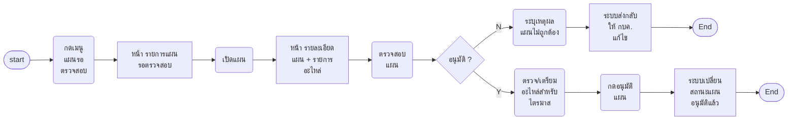

**Wireframe**
- **หน้า รายการแผนรอตรวจสอบ** `[เสนอ]` — ชื่อแผน · กบค. ผู้สร้าง · ปีงบ · ไตรมาส · จำนวนรถ · วันที่ส่ง · ปุ่มเปิด
- **หน้า รายละเอียดแผน (ฝั่ง ผพจ.)** — ข้อมูลแผน (Display ดึงจาก S1) · รายการรถ · รายการอะไหล่ที่ต้องใช้ · ปุ่ม "ส่งกลับแก้ไข" (ต้องระบุเหตุผล) `[บอร์ด]` · ปุ่ม "อนุมัติ"

**Condition**

| ส่วน | เงื่อนไข | ที่มา |
|---|---|---|
| เหตุผลที่ส่งกลับ | Freetext · บังคับเมื่อกดส่งกลับ | บอร์ด "ระบุเหตุผล" |
| ส่งกลับ | แผนกลับสถานะ "ส่งกลับแก้ไข" · กบค. เห็นเหตุผล แล้วแก้ที่ S1 ส่งใหม่ | บอร์ด "กบค. จัดการแก้ไข" |
| อนุมัติ | มี confirm modal · toast คำว่า (ยังไม่รู้) | เสนอ |

### Scenario 3 · ผพจ. ออกเลขงานและจัดซื้ออะไหล่

**ช่วงงาน:** ออกเลขงาน → เบิก/จัดหาอะไหล่ · **เข้าจาก:** แผนที่อนุมัติแล้ว (S2) · **จบที่:** มีเลขงาน + ใบ PO · **ที่มา:** `[บอร์ด]` เลน ผพจ. "ออกเลขงาน (เลขของแผนบำรุงรักษา) → นำส่งหัวหน้า ผพจ. ให้ตรวจสอบรายการอะไหล่ที่จะใช้ในแผนบำรุงรักษา → อนุมัติ? → ทำเรื่องซื้ออะไหล่ (ที่ไหน อย่างไร) → ออกใบ PO" · ทางไม่อนุมัติ "เพราะอะไหล่ที่จะใช้ในไตรมาสไม่ถูกต้อง → ทำเรื่องคืนอะไหล่"

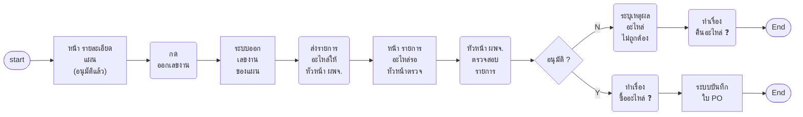

**Wireframe**
- **หน้า รายละเอียดแผน (อนุมัติแล้ว)** — ปุ่ม "ออกเลขงาน" · เลขงานแสดงที่หัวแผนหลังออก `[บอร์ด]`
- **หน้า รายการอะไหล่รอหัวหน้าตรวจ** `[เสนอ]` — รายการ · จำนวนตามแผน · คงเหลือ · ต้องซื้อ · ปุ่ม "อนุมัติรายการ" · "ส่งกลับ (ระบุเหตุผล)"
- **ฟอร์มใบ PO** `[เสนอ]` — เลขที่ PO · ผู้ขาย · รายการ/จำนวน · วงเงิน · เอกสารแนบ

**Condition**

| ส่วน | เงื่อนไข | ที่มา |
|---|---|---|
| เลขงาน | 1 เลขต่อแผน · รูปแบบ (ยังไม่รู้) | บอร์ด "เลขของแผนบำรุงรักษา" |
| หัวหน้า ผพจ. | เป็นคนละคนกับผู้ออกเลขงาน — ต้องมีสิทธิ์แยก (ยังไม่รู้ว่าแยก scenario ไหม) | บอร์ด |
| ฟอร์ม PO | ช่องทั้งหมด (ยังไม่รู้) | เสนอ |

### Scenario 4 · กบค. ตรวจสอบจำนวนรถปัจจุบันตามแผน

**ช่วงงาน:** เบิก/จัดหาอะไหล่ · **เข้าจาก:** แผนที่มีเลขงานแล้ว · **จบที่:** ยืนยันจำนวนรถ · **ที่มา:** `[บอร์ด]` "ตรวจสอบจำนวนรถปัจจุบันตามแผน (สถานะต้องไม่ใช่ รอยุบ หรือ โอน)" + sticky "จะเห็นรถที่ พร้อม / ไม่พร้อม (เป็นการแปลงจากขั้นตอนโทรถามให้กลายเป็นระบบติดตามได้)"

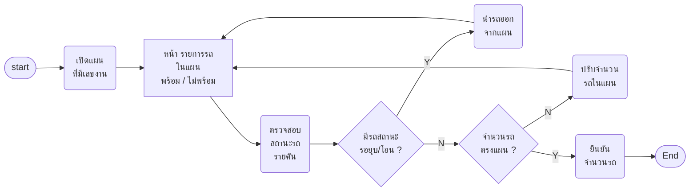

**Wireframe**
- **หน้า รายการรถในแผน** — ทะเบียน · ยี่ห้อ/รุ่น · หน่วยงานเจ้าของ · สถานะรถ (ปกติ · ซ่อม · รอยุบ · โอน) `[บอร์ด]` · ความพร้อม (พร้อม · ไม่พร้อม · ยังไม่ตอบ) `[บอร์ด sticky]` · ปุ่ม "นำออกจากแผน" `[เสนอ]` · แถบสรุป: ตามแผน / พร้อม / ไม่พร้อม · ปุ่ม "ยืนยันจำนวนรถ" `[เสนอ]`

**Condition**

| ส่วน | เงื่อนไข | ที่มา |
|---|---|---|
| สถานะรถ | รอยุบ / โอน → ขึ้นป้ายเตือนแดงที่แถว + ปุ่มนำออก (ไม่ตัดอัตโนมัติ) | บอร์ด + เสนอ |
| ความพร้อม | Display · ที่มาของค่า (ยังไม่รู้ — Q7) | บอร์ด sticky |
| ยืนยันจำนวนรถ | กดได้เมื่อไม่มีรถสถานะรอยุบ/โอนเหลือ · มี confirm modal | เสนอ |

### Scenario 5 · กบค. ตรวจสอบและเบิกอะไหล่ผ่านระบบจองอะไหล่

**ช่วงงาน:** เบิก/จัดหาอะไหล่ · **เข้าจาก:** S4 · **จบที่:** อะไหล่พร้อม แล้วเลือกว่าจ้าง/ตรวจเอง · **ที่มา:** `[บอร์ด]` "ตรวจสอบและเบิกอะไหล่ผ่านระบบจองอะไหล่ → มีอะไหล่พร้อม → ว่าจ้างหรือไม่?"

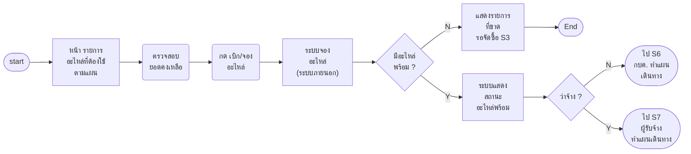

**Wireframe**
- **หน้า รายการอะไหล่ที่ต้องใช้ตามแผน** — รายการ · จำนวนตามแผน · คงเหลือในคลัง · จองแล้ว · สถานะ (พร้อม / ขาด) · ปุ่ม "เบิก/จองอะไหล่" `[บอร์ด]` · ตัวเลือก "ดำเนินการเอง / ว่าจ้าง" `[เสนอ]` บันทึกที่แผน

**Condition**

| ส่วน | เงื่อนไข | ที่มา |
|---|---|---|
| เบิก/จอง | เรียกระบบจองอะไหล่ · ผลกลับมาเป็นสถานะรายรายการ (ยังไม่รู้รูปแบบ) | บอร์ด |
| ว่าจ้าง? | เลือกครั้งเดียวต่อแผน `[เสนอ]` · เปลี่ยนทีหลังได้ไหม (ยังไม่รู้) | บอร์ด |

### Scenario 6 · กบค. ทำแผนเดินทาง (ตรวจเอง)

**ช่วงงาน:** จ้างดำเนินการ (สายไม่ว่าจ้าง) · **เข้าจาก:** S5 เลือกไม่ว่าจ้าง · **จบที่:** ส่ง Notification · **ที่มา:** `[บอร์ด]` "ทำแผนเดินทาง → ระบุรายละเอียดแผนการเดินทาง" + กล่อง "กบค. ระบุข้อมูล: พนักงาน กบค.ซ่อม จำนวน 2-3 คน · ค่าเบี้ยเลี้ยง · ค่าที่พัก · ค่าเดินทาง · เลือกรถที่จะบำรุงรักษา · ระบุสถานที่บำรุงรักษา · กำหนดวันที่เดินทางไปเป็นช่วง · ยืนยันการสร้างแผนเดินทาง · ส่ง Notification หาวันที่เข้าตรวจ → เจ้าของรถ · กรย."

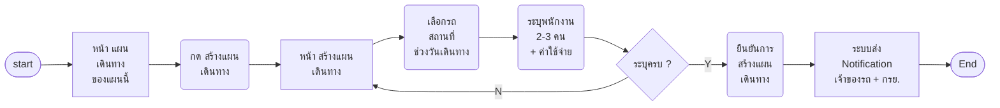

**Wireframe**
- **หน้า แผนเดินทางของแผนนี้** `[เสนอ]` — รายการใบเดินทาง: สถานที่ · ช่วงวัน · จำนวนรถ · ผู้ทำ · สถานะ · ปุ่ม "สร้างแผนเดินทาง"
- **หน้า สร้างแผนเดินทาง** — เลือกรถที่จะบำรุงรักษา (จากรถในแผน) `[บอร์ด]` · สถานที่บำรุงรักษา `[บอร์ด]` · วันที่เดินทาง (ช่วง) `[บอร์ด]` · พนักงาน กบค. ซ่อม 2-3 คน `[บอร์ด]` · ค่าเบี้ยเลี้ยง · ค่าที่พัก · ค่าเดินทาง `[บอร์ด]` · ปุ่ม ย้อนกลับ · "ยืนยันการสร้างแผนเดินทาง" `[บอร์ด]`

**Condition**

| ส่วน | เงื่อนไข | ที่มา |
|---|---|---|
| เลือกรถ | multi select จากรถที่ยืนยันใน S4 · หนึ่งคันอยู่ได้ใบเดียว `[เสนอ]` | บอร์ด |
| สถานที่บำรุงรักษา | Freetext หรือ dropdown จุดรวมงาน (ยังไม่รู้ — Q11) | บอร์ด |
| วันที่เดินทาง | date range · ไม่สามารถเลือกน้อยกว่าวันนี้ | บอร์ด "เป็นช่วง" + เสนอ |
| พนักงาน | search select · อย่างน้อย 2 ไม่เกิน 3 คน | บอร์ด "จำนวน 2-3 คน" |
| ค่าเบี้ยเลี้ยง / ที่พัก / เดินทาง | Text number (บาท) · ไปรวมที่ S18 | บอร์ด |
| ยืนยัน | สำเร็จ → Notification ถึงเจ้าของรถ + กรย. · toast คำว่า (ยังไม่รู้) | บอร์ด |

### Scenario 7 · ผู้รับจ้างทำแผนเดินทาง (ว่าจ้าง)

**ช่วงงาน:** จ้างดำเนินการ (สายว่าจ้าง) · **เข้าจาก:** S5 เลือกว่าจ้าง · **จบที่:** แผนรอ กบค. ตรวจสอบ · **ที่มา:** `[บอร์ด]` เลนผู้รับจ้าง "ทำแผนเดินทาง → ระบุรายละเอียดแผนการเดินทาง · ทำเรื่องซื้ออะไหล่" + กล่อง "ผู้รับจ้าง ระบุข้อมูล: เลือกรถ · สถานที่ · ช่วงวัน · ยืนยัน · Notification → เจ้าของรถ · กรย."

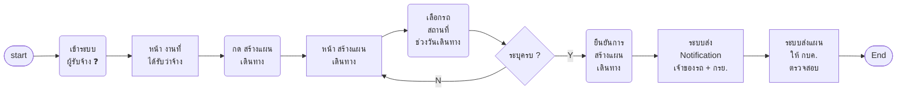

**Wireframe**
- **หน้า งานที่ได้รับว่าจ้าง** `[เสนอ]` — แผน · จำนวนรถ · ไตรมาส · สถานะแผนเดินทาง · ปุ่ม "สร้างแผนเดินทาง"
- **หน้า สร้างแผนเดินทาง (ผู้รับจ้าง)** — ช่องเดียวกับ S6 ยกเว้นไม่มีพนักงาน กบค. และค่าใช้จ่าย `[บอร์ด]` (กล่องของผู้รับจ้างไม่มี 4 ข้อนี้)

**Condition** — เหมือน S6 ยกเว้น: ไม่มีพนักงาน/ค่าใช้จ่าย `[บอร์ด]` · ยืนยันแล้วสถานะ "รอ กบค. ตรวจสอบ" `[เสนอ]` · ส่ง Notification ก่อนหรือหลัง กบค. อนุมัติ (ยังไม่รู้ — บอร์ดวางไว้ก่อน)

### Scenario 8 · กบค. ตรวจสอบแผนเดินทางของผู้รับจ้าง

**ช่วงงาน:** จ้างดำเนินการ · **เข้าจาก:** เมนู · **จบที่:** อนุมัติ หรือ ปฏิเสธ · **ที่มา:** `[บอร์ด]` "แสดงรายการแผนการเดินทางที่ได้รับจากผู้รับจ้างทั้งหมด และสามารถดูรายละเอียดของแผน เพื่อดำเนินการตรวจสอบได้: รายการที่รอตรวจสอบ · รายการที่อนุมัติแล้ว · รายการที่ปฏิเสธ" · "ตรวจสอบแผนการเดินทาง → อนุมัติหรือไม่" · ทางไม่อนุมัติมีคำถามบนบอร์ด 4 ข้อ

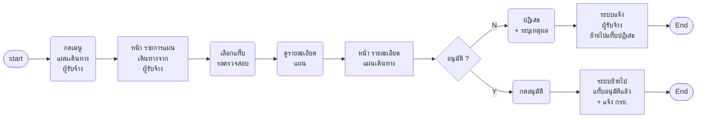

**Wireframe**
- **หน้า รายการแผนเดินทางจากผู้รับจ้าง** — แท็บ รอตรวจสอบ · อนุมัติแล้ว · ปฏิเสธ `[บอร์ด]` · คอลัมน์ `[เสนอ]`: ผู้รับจ้าง · แผน · รถ (คัน) · สถานที่ · ช่วงวัน · วันที่ส่ง
- **หน้า รายละเอียดแผนเดินทาง** — ข้อมูลตาม S7 (Display) · ปุ่ม "ปฏิเสธ (ระบุเหตุผล)" `[เสนอ]` · "อนุมัติ" `[บอร์ด]`

**Condition**

| ส่วน | เงื่อนไข | ที่มา |
|---|---|---|
| เหตุผลปฏิเสธ | Freetext บังคับ | เสนอ |
| ปฏิเสธแล้ว | ผู้รับจ้างเสนอใหม่ได้ไหม / กี่ครั้ง (ยังไม่รู้ — Q15) | บอร์ด |
| อนุมัติแล้ว | แจ้ง กรย. ให้เตรียมอะไหล่ (S9) | เสนอ (บอร์ด: กรย. "ได้รับทราบแผน") |

### Scenario 9 · กรย. เตรียมอะไหล่ไว้ที่จุดรวมงาน

**ช่วงงาน:** จ้างดำเนินการ → ก่อนออกเดินทาง · **เข้าจาก:** Notification จาก S6/S8 · **จบที่:** อะไหล่อยู่ที่จุดรวมงาน · **ที่มา:** `[บอร์ด]` เลน กรย. "ได้รับทราบแผนการเข้ามาตรวจบำรุงรถ → เดินทางไปเอาอะไหล่ก่อนวันเดินทาง → มีอะไหล่พร้อมหรือไม่? → ใช่ → เตรียมอะไหล่ไว้ที่จุดกลาง/รวมงาน"

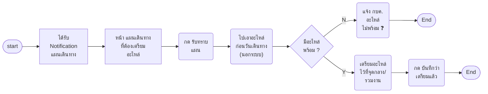

**Wireframe**
- **หน้า แผนเดินทางที่ต้องเตรียมอะไหล่ (ฝั่ง กรย.)** `[เสนอ]` — แผน · ผู้ทำ (กบค./ผู้รับจ้าง) · จุดรวมงาน · วันเดินทาง · รายการอะไหล่ที่ต้องวาง · ปุ่ม "รับทราบ" · "บันทึกว่าเตรียมแล้ว"

**Condition** — รับทราบ/เตรียมแล้ว เป็นสถานะรายใบเดินทาง `[เสนอ]` · กบค. เห็นสถานะนี้ที่ S6/S10 `[เสนอ]`

### Scenario 10 · กบค./ผู้รับจ้าง บันทึกงานบำรุงรักษารายคัน

**ช่วงงาน:** ดำเนินการบำรุงรักษา · **เข้าจาก:** วันเดินทางตามแผน · **จบที่:** ทำครบทุกคันในแผนเดินทาง · **ที่มา:** `[บอร์ด]` "ก่อนออกเดินทาง → เดินทางไปจุดรวมงาน → รับอะไหล่ที่จุดรวมงาน → เดินทางไปหน้างานที่จะบำรุงรักษา → บำรุงรักษาได้? → ใช่ → ถ่ายรูปรถก่อนบำรุงรักษา → ดำเนินการตรวจและบำรุงรักษา + เก็บตัวอย่างน้ำมันไฮโดรลิกไปทดสอบ → บันทึกงานบำรุงรักษาและอะไหล่ (ยืนยันจำนวนอะไหล่ที่ใช้จริง) … บำรุงรักษาคันอื่น ๆ ต่อจนครบตามแผน" + กล่อง Display "แสดง Field ให้ระบุสาเหตุที่ไม่สามารถบำรุงรักษาได้" · "แสดง Field ให้ Upload ภาพที่ต้องถ่ายก่อนเริ่มงาน" · "แสดง Field ให้ Upload ภาพที่ต้องถ่ายตอนจบงาน"

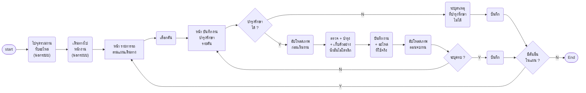

**Wireframe**
- **หน้า รายการรถตามแผนเดินทาง** `[เสนอ]` — ทะเบียน · ยี่ห้อ/รุ่น · หน่วยงานเจ้าของ · สถานะงาน (ยังไม่ทำ · ทำแล้ว · ทำไม่ได้) · ปุ่ม "บันทึกงาน"
- **หน้า บันทึกงานบำรุงรักษารายคัน** — ข้อมูลรถ (Display) · **ภาพก่อนเริ่มงาน:** รูปรถ + ทะเบียน · อะไหล่ใหม่ `[บอร์ด]` · **รายการงาน/อะไหล่ที่ใช้** (ยืนยันจำนวนจริง) `[บอร์ด]` · เก็บตัวอย่างน้ำมันไฮโดรลิก (ติ๊ก) `[บอร์ด]` · **ภาพตอนจบงาน:** รูปรถ + ทะเบียน · อะไหล่เก่า · อะไหล่ใหม่ที่เหลือ · จุดที่บำรุงรักษา (อะไหล่ใหม่) · เลขไมล์รถ · ชั่วโมงเครื่องจักร `[บอร์ด]` · **กรณีทำไม่ได้:** สาเหตุที่ไม่สามารถบำรุงรักษาได้ `[บอร์ด]`

**Condition**

| ส่วน | เงื่อนไข | ที่มา |
|---|---|---|
| อัปโหลดภาพ | รูปละ 1 ช่องตามรายการบอร์ด · จำนวนสูงสุด/ชนิดไฟล์/ขนาด (ยังไม่รู้) · preview ได้ `[เสนอ]` | บอร์ด |
| อะไหล่ที่ใช้จริง | Text number ต่อรายการ · default = จำนวนตามแผน · น้อยกว่าแผน → เหลือคืน (S11) | บอร์ด + เสนอ |
| เลขไมล์ | Text number | บอร์ด |
| ชั่วโมงเครื่องจักร | ภาพถ่าย หรือ กรอก (ยังไม่รู้ — Q18) | บอร์ด |
| สาเหตุที่ทำไม่ได้ | Freetext บังคับเมื่อเลือก "ทำไม่ได้" · ฟอร์มเดียวกันหรือแยก (ยังไม่รู้ — Q19) | บอร์ด |
| stamp เวลา | ก่อนเริ่ม → จบงาน (ยังไม่รู้ — Q17) | บอร์ด |
| บันทึก | toast คำว่า (ยังไม่รู้) · บันทึกแล้วแก้ได้ไหม (ยังไม่รู้) | — |

### Scenario 11 · กบค. ตรวจสอบงานจากผู้รับจ้างและรับคืนอะไหล่

**ช่วงงาน:** ตรวจรับ (สายว่าจ้าง) · **เข้าจาก:** ผู้รับจ้างบันทึกงานครบ (S10) · **จบที่:** ผลตรวจสอบบันทึกแล้ว · **ที่มา:** `[บอร์ด]` "ตรวจสอบข้อมูลการบำรุงรักษาที่ได้รับจากผู้รับจ้าง → ตรวจสอบผ่านหรือไม่? → รับคืนอะไหล่/น้ำมันที่ไม่ได้ใช้งาน … ใช้อะไหล่ครบไหม?"

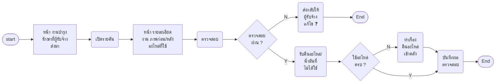

**Wireframe**
- **หน้า งานบำรุงรักษาที่ผู้รับจ้างส่งมา** `[เสนอ]` — รถ · วันที่ทำ · ผู้รับจ้าง · สถานะตรวจสอบ (รอ · ผ่าน · ส่งกลับ)
- **หน้า รายละเอียดงาน** — ข้อมูลจาก S10 (Display) · ช่องรับคืน: รายการ · จำนวนที่ใช้ · จำนวนที่คืน `[บอร์ด]` · ปุ่ม "ส่งกลับแก้ไข" `[เสนอ]` · "ผ่าน/บันทึกผลตรวจสอบ"

**Condition** — จำนวนที่คืน Text number ≤ จำนวนที่เบิก − ที่ใช้ `[เสนอ]` · "ทำเรื่องคืนอะไหล่เข้าคลัง" ทำผ่านระบบจองอะไหล่ (ยังไม่รู้) `[ภาพ ก.ค.]`

### Scenario 12 · กบค. บันทึกผลตรวจน้ำมันไฮโดรลิก

**ช่วงงาน:** ตรวจรับ · **เข้าจาก:** ผลทดสอบตัวอย่างน้ำมันกลับมา · **จบที่:** แจ้งเจ้าของรถ · **ที่มา:** `[บอร์ด]` "ตรวจสภาพการนำไฟฟ้าน้ำมันไฮโดรลิก → บันทึกข้อมูลผลตรวจน้ำมันไฮโดรลิก" + เลนเจ้าของรถ "เจ้าของรถได้รับแจ้งเตือนผลตรวจน้ำมันไฮโดรลิก"

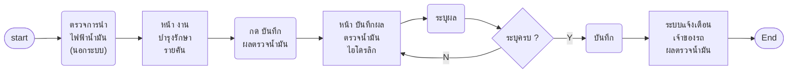

**Wireframe**
- **หน้า บันทึกผลตรวจน้ำมันไฮโดรลิก** — รถ (Display) · วันที่เก็บตัวอย่าง (จาก S10) · ค่าการนำไฟฟ้า / ผล `[บอร์ด]` · แนบไฟล์ผล `[เสนอ]` · ปุ่ม บันทึก

**Condition** — ค่าผล (ยังไม่รู้ — Q21) · แจ้งเตือนเจ้าของรถทาง e-mail + VMS+ `[บอร์ด เลนหน่วยงาน]`

### Scenario 13 · หน่วยงาน/เจ้าของรถ ยอมรับผลการตรวจบำรุงรถรายคัน

**ช่วงงาน:** ตรวจรับ · **เข้าจาก:** แจ้งเตือนหลังบันทึกงานแต่ละคัน (S10) · **จบที่:** ยอมรับผลรายคัน · **ที่มา:** `[บอร์ด]` เลนหน่วยงาน รอบแรก "ได้รับการแจ้งเตือนทาง e-mail และ VMS+ → กดยอมรับผลการตรวจบำรุงรถ → บำรุงรักษาครบทุกคันตามแผนหรือไม่?" + เลนเจ้าของรถ "แสดงรายการการตรวจบำรุงรถที่รอตรวจสอบ · รายการตรวจบำรุงรถ: ใบตรวจสภาพอะไหล่ · ใบตรวจสภาพงานบำรุงรักษา · ปุ่มยอมรับผลการตรวจบำรุงรถ"
· บอร์ดวางการยอมรับไว้ **2 รอบ** (รายคัน → ครบทุกคัน) scenario นี้คือรอบแรก · รอบสองดู S14

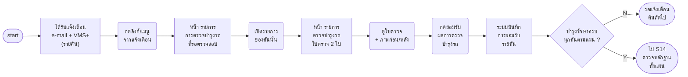

**Wireframe**
- **หน้า รายการการตรวจบำรุงรถที่รอตรวจสอบ** `[บอร์ด]` — ทะเบียน · วันที่บำรุง · ผู้ทำ (กบค./ผู้รับจ้าง) · สถานะ (รอยอมรับ · ยอมรับแล้ว) `[เสนอ]`
- **หน้า รายการตรวจบำรุงรถ (รายคัน)** — ใบตรวจสภาพอะไหล่ `[บอร์ด]` · ใบตรวจสภาพงานบำรุงรักษา `[บอร์ด]` · ภาพก่อน/หลัง + อะไหล่ที่ใช้จริง (จาก S10) `[เสนอ]` · กรณีบำรุงรักษาไม่ได้: สาเหตุ (จาก S10) `[บอร์ด]` · ปุ่ม "ยอมรับผลการตรวจบำรุงรถ" `[บอร์ด]`

**Condition**

| ส่วน | เงื่อนไข | ที่มา |
|---|---|---|
| แจ้งเตือน | e-mail และ VMS+ · ส่งเมื่อ S10 บันทึกงานคันนั้น | บอร์ด |
| ปุ่มยอมรับ | กดได้ทันที · ไม่มีปุ่มไม่ยอมรับ (Q23) | บอร์ด |
| กรณีบำรุงรักษาไม่ได้ | ใช้ฟอร์มเดียวกันหรือแยก (ยังไม่รู้ — Q19) | บอร์ด |
| ยอมรับแล้ว | สถานะคัน "หน่วยงานยอมรับแล้ว" · กบค. เห็นใน S15 | เสนอ |

### Scenario 14 · หน่วยงาน/เจ้าของรถ ตรวจสอบหลักฐานและประเมินความพึงพอใจ (ครบทุกคัน)

**ช่วงงาน:** ตรวจรับ · **เข้าจาก:** แจ้งเตือนเมื่อบำรุงรักษาครบทุกคันตามแผน · **จบที่:** ยอมรับผลทั้งแผน · **ที่มา:** `[บอร์ด]` เลนหน่วยงาน รอบสอง "บำรุงรักษาครบทุกคันตามแผนหรือไม่? → ได้รับการแจ้งเตือนทาง e-mail และ VMS+ → ตรวจสอบเอกสารหลักฐานการตรวจบำรุงรถ → ประเมินความพึงพอใจ → กดยอมรับผลการตรวจบำรุงรถ" + เลนเจ้าของรถ "ประเมินความพึงพอใจ (ต้องทำทุกครั้ง?)"

```mermaid
flowchart LR
    S([start]) --> D0["ได้รับแจ้งเตือน<br/>e-mail + VMS+<br/>(ครบทุกคัน)"]
    D0 --> A0("กดลิงก์/เมนู<br/>จากแจ้งเตือน")
    A0 --> D1["หน้า รายการ<br/>การตรวจบำรุงรถ<br/>ที่รอตรวจสอบ"]
    D1 --> A1("เปิดรายการ<br/>ของแผน")
    A1 --> D2["หน้า เอกสาร<br/>หลักฐานการตรวจ<br/>บำรุงรถทั้งแผน"]
    D2 --> A2("ตรวจสอบ<br/>เอกสาร<br/>หลักฐาน")
    A2 --> A3("ประเมิน<br/>ความพึงพอใจ")
    A3 --> A4("กดยอมรับ<br/>ผลการตรวจ<br/>บำรุงรถ")
    A4 --> D3["ระบบบันทึก<br/>การยอมรับ<br/>+ แจ้ง กบค."]
    D3 --> E([End])
    %% Q: A3 | Q22 ❓ (บอร์ด) ประเมินความพึงพอใจ (ต้องทำทุกครั้ง?) · แบบประเมินมีข้อ/สเกลอะไร
    %% Q: A4 | Q28 ❓ การยอมรับ 2 รอบ (รายคัน S13 + ทั้งแผน S14) จำเป็นทั้งคู่ไหม หรือรอบเดียวพอ
```

**Wireframe**
- **หน้า รายการการตรวจบำรุงรถที่รอตรวจสอบ** `[บอร์ด]` — หน้าเดียวกับ S13 เพิ่มแถวระดับแผน "ครบทุกคันแล้ว รอตรวจสอบหลักฐาน" `[เสนอ]`
- **หน้า เอกสารหลักฐานการตรวจบำรุงรถทั้งแผน** `[บอร์ด]` — สรุปรายคัน: ใบตรวจสภาพอะไหล่ · ใบตรวจสภาพงานบำรุงรักษา · การยอมรับรายคัน (S13) `[เสนอ]` · แบบประเมินความพึงพอใจ `[บอร์ด]` · ปุ่ม "ยอมรับผลการตรวจบำรุงรถ" `[บอร์ด]`

**Condition**

| ส่วน | เงื่อนไข | ที่มา |
|---|---|---|
| แจ้งเตือน | e-mail และ VMS+ · ส่งเมื่อทุกคันในแผนบันทึกงานแล้ว | บอร์ด |
| ประเมินความพึงพอใจ | บังคับทุกครั้งหรือไม่ (ยังไม่รู้ — Q22) · ข้อ/สเกล (ยังไม่รู้) | บอร์ด |
| ปุ่มยอมรับ | กดได้เมื่อประเมินแล้ว (ถ้าบังคับ) | เสนอ |
| ยอมรับแล้ว | แจ้ง กบค. → ส่งประวัติได้ (S15) | เสนอ |

### Scenario 15 · กบค. บันทึกและส่งประวัติงานบำรุงรักษา

**ช่วงงาน:** จัดทำรายงาน · **เข้าจาก:** แผน · **จบที่:** รอหัวหน้า กบค. ตรวจ · **ที่มา:** `[บอร์ด]` "บำรุงรักษาเสร็จทั้งหมดหรือไม่? → ใช่ → บันทึกประวัติงานบำรุงรักษา → ส่งประวัติงานบำรุงรักษา" + Display "แสดงข้อมูลประวัติงานบำรุงรักษาทั้งหมด"

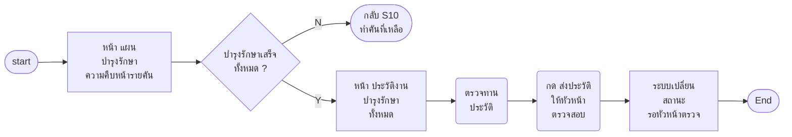

**Wireframe**
- **หน้า ประวัติงานบำรุงรักษาทั้งหมด** `[บอร์ด]` — รายคัน: วันที่ · งานที่ทำ · อะไหล่ที่ใช้ · ภาพ · ผลน้ำมัน · ผู้ทำ · การยอมรับของเจ้าของรถ (S13 · S14) `[เสนอ]` · ปุ่ม "ส่งประวัติให้หัวหน้าตรวจสอบ" `[บอร์ด]`

**Condition** — ส่งได้เมื่อครบทุกคัน `[บอร์ด]` (คันที่ทำไม่ได้ — Q24) · ส่งแล้วแก้ไม่ได้จนกว่าถูกตีกลับ `[เสนอ]`

### Scenario 16 · หัวหน้า กบค. ตรวจสอบประวัติงานบำรุงรักษา

**ช่วงงาน:** จัดทำรายงาน · **เข้าจาก:** เมนู/แจ้งเตือน · **จบที่:** ผ่าน หรือ ตีกลับ · **ที่มา:** `[บอร์ด]` "หัวหน้า กบค. ตรวจสอบประวัติงานบำรุงรักษา → ผ่านหรือไม่? → ใช่ → บันทึกประวัติ" · ไม่ผ่าน → "กบค. จัดการแก้ไข" `[ภาพ ก.ค.]`

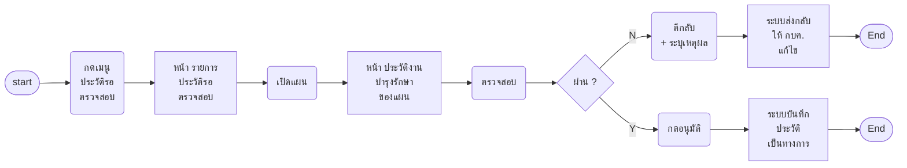

**Wireframe** — หน้า รายการประวัติรอตรวจสอบ `[เสนอ]`: แผน · กบค. ผู้ส่ง · จำนวนรถ · วันที่ส่ง · หน้า ประวัติของแผน = หน้าเดียวกับ S15 (Display) + ปุ่ม "ตีกลับ (ระบุเหตุผล)" `[เสนอ]` · "อนุมัติ" `[บอร์ด "ผ่าน"]`

**Condition** — เหตุผลตีกลับ Freetext บังคับ `[เสนอ]` · ตีกลับ → แผนกลับสถานะให้ กบค. แก้แล้วส่งใหม่ (S15) `[ภาพ ก.ค.]`

### Scenario 17 · กบค. ออกรายงานผลและปิดงาน

**ช่วงงาน:** จัดทำรายงาน · **เข้าจาก:** ประวัติผ่านแล้ว (S16) · **จบที่:** ปิดงาน · **ที่มา:** `[บอร์ด]` "รายงานผลการบำรุงรักษา → ปิดงาน" + Display "แสดงรายงานผลงานบำรุงรักษา (Download ได้)"

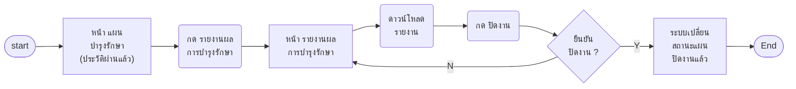

**Wireframe** — หน้า รายงานผลการบำรุงรักษา `[บอร์ด]`: สรุปรายคัน/รายแผน (หัวข้อ ยังไม่รู้ — Q25) · ปุ่ม "ดาวน์โหลด" `[บอร์ด]` · ปุ่ม "ปิดงาน" `[บอร์ด]`

**Condition** — ปิดงาน มี confirm modal `[เสนอ]` · ปิดแล้วแก้ไม่ได้ `[เสนอ]` · toast คำว่า (ยังไม่รู้)

### Scenario 18 · กบค. คำนวณต้นทุนการบำรุงรักษา

**ช่วงงาน:** คำนวณต้นทุน · **เข้าจาก:** แผนที่ปิดงานแล้ว · **จบที่:** Summary ต้นทุน · **ที่มา:** `[บอร์ด]` "คำนวณต้นทุนการบำรุงรักษา → ได้รับ Summary ต้นทุน" + Display "คำนวณต้นทุน: ค่าแรง · ค่าที่พัก · ค่าเดินทาง · สามารถ Download excel ได้ · แสดงผลลัพธ์ Summary ของต้นทุน"

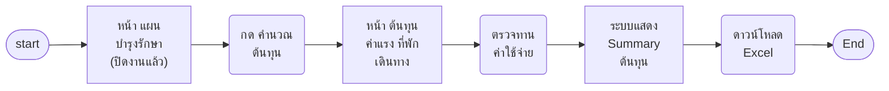

**Wireframe** — หน้า ต้นทุนการบำรุงรักษา `[บอร์ด]`: ตารางรายคัน/รายใบเดินทาง: ค่าแรง · ค่าที่พัก · ค่าเดินทาง · รวม `[บอร์ด]` · ยอดตั้งต้นดึงจากแผนเดินทาง S6 `[เสนอ]` · Summary ของต้นทุน `[บอร์ด]` · ปุ่ม "ดาวน์โหลด Excel" `[บอร์ด]`

**Condition** — ค่าใช้จ่าย Text number แก้ได้ก่อนยืนยัน `[เสนอ]` · Excel มีคอลัมน์อะไร (ยังไม่รู้)

## 3. คำถาม — ❓ ทั้งชุด (Q บนบอร์ดเขียนกำกับว่า "บอร์ด")

| # | คำถาม | scenario | ถามใคร |
|---|---|---|---|
| Q1 | ผพจ. ย่อจากอะไร เป็นหน่วยเดียวกับ "ฝ่ายพัสดุ" ที่ผังเดิมเรียกไหม · "หัวหน้า ผพจ." เป็นอีกบทบาทที่ต้องแยก scenario ไหม | S2 · S3 | เจ้าของงาน |
| Q2 | รายการอะไหล่ที่ระบบคำนวณ ให้ กบค. แก้ได้ไหม | S1 | เจ้าของงาน |
| Q3 | "ตรวจ/เตรียมอะไหล่เพื่อใช้ในไตรมาส" ทำในระบบหรือนอกระบบ | S2 | เจ้าของงาน |
| Q4 | รูปแบบเลขงาน (เจ้าของงานบอกว่ามีเกณฑ์ของจริง ยังไม่ส่ง) | S3 | กฟภ. |
| Q5 | ไม่อนุมัติรายการอะไหล่แล้ว "ทำเรื่องคืนอะไหล่" คือคืนอะไร | S3 | เจ้าของงาน |
| Q6 | (บอร์ด) ซื้ออะไหล่ "ที่ไหน อย่างไร" · ผ่าน Smart Inventory/SAP หรือบันทึกผลอย่างเดียว | S3 | กฟภ. |
| Q7 | "พร้อม / ไม่พร้อม" ของรถ ใครตอบ จากหน้าไหน (ต้นแบบมีขั้นยืนยันรถให้หน่วยงานตอบ บอร์ดนี้ไม่มี) | S4 | เจ้าของงาน |
| Q8 | นำรถออกจากแผนหลังมีเลขงานแล้ว ต้องแจ้ง ผพจ. ปรับอะไหล่ไหม | S4 | เจ้าของงาน |
| Q9 | "ระบบจองอะไหล่" คือระบบไหน เชื่อมกับ VMS+ ยังไง | S5 | กฟภ. |
| Q10 | ตัดสินใจว่าจ้างต่อแผนทั้งใบ หรือต่อคัน/พื้นที่ | S5 | เจ้าของงาน |
| Q11 | "สถานที่บำรุงรักษา" = จุดรวมงานที่ กรย. วางอะไหล่ไหม ใครกำหนดรายชื่อจุด | S6 · S9 | กฟภ. |
| Q12 | Notification ส่งช่องทางไหน · เจ้าของรถต้องตอบรับวันไหม | S6 · S7 | เจ้าของงาน |
| Q13 | ผู้รับจ้างเข้า VMS+ ทางไหน มีบัญชีภายนอกไหม | S7 | กฟภ. |
| Q14 | "ทำเรื่องซื้ออะไหล่" ของผู้รับจ้าง ทำนอกระบบหรือบันทึกในระบบ | S7 | เจ้าของงาน |
| Q15 | (บอร์ด) ผู้รับจ้างต้องเสนอแผนใหม่? มี limit ไหม? ต้องบอกใครบ้าง? ใครต้องทำอะไรต่อบ้าง? | S8 | กฟภ. |
| Q16 | กรย. พบอะไหล่ไม่พร้อม แจ้งใคร ผ่านระบบไหม | S9 | เจ้าของงาน |
| Q17 | (บอร์ด) ระบบต้อง stamp ระยะเวลาจากภาพก่อนเริ่มถึงจบงานไหม | S10 | กฟภ. |
| Q18 | (บอร์ด) ชั่วโมงเครื่องจักร (ภาพถ่ายหรือกรอกข้อมูล?) · อะไหล่เก่า? · อะไหล่ใหม่ (ถ้าเหลือ?) | S10 | กฟภ. |
| Q19 | (บอร์ด) กรณีที่ไม่สามารถบำรุงรักษาได้ จำเป็นต้องใช้ form รูปแบบเดียวกันไหม? หากแยกกันจะต้องมี field อะไรบ้าง? | S10 · S13 | กฟภ. |
| Q20 | ตรวจสอบงานผู้รับจ้างไม่ผ่าน ส่งกลับยังไง | S11 | เจ้าของงาน |
| Q21 | ผลตรวจน้ำมันเป็นตัวเลขหรือผ่าน/ไม่ผ่าน · แนบใบผลแล็บไหม | S12 | กฟภ. |
| Q22 | (บอร์ด) ประเมินความพึงพอใจ (ต้องทำทุกครั้ง?) · แบบประเมินมีข้อ/สเกลอะไร | S14 | กฟภ. |
| Q23 | เจ้าของรถไม่ยอมรับผล ทำยังไง · "หน่วยงาน" กับ "เจ้าของรถ" คนเดียวกันไหม | S13 | เจ้าของงาน |
| Q24 | คันที่บำรุงรักษาไม่ได้ นับว่าเสร็จไหม ส่งประวัติได้ไหม | S15 | เจ้าของงาน |
| Q25 | รายงานผลมีหัวข้ออะไร รูปแบบไฟล์ | S17 | กฟภ. |
| Q26 | "ค่าแรง" กับ "ค่าเบี้ยเลี้ยง" รายการเดียวกันไหม · ต้นทุนรวมอะไหล่/ค่าจ้างไหม | S18 | เจ้าของงาน |
| Q28 | การยอมรับผล 2 รอบ (รายคัน S13 + ครบทุกคัน S14) จำเป็นทั้งคู่ไหม หรือรอบเดียวพอ | S13 · S14 | เจ้าของงาน |
| Q29 | เลือกภาคได้ทีละภาค หรือหลายภาคในแผนเดียว · ประเภทรถเลือกได้หลายประเภทไหม · ประเภทรถอ้างรายการจากทะเบียนรถ VMS+ ชุดไหน | S1 | เจ้าของงาน |
| Q30 | รถที่เข้าเงื่อนไขติ๊กไว้ให้ทั้งหมดก่อน หรือว่างให้เลือกเอง · รถสถานะรอยุบ/โอนซ่อนตั้งแต่ตอนเลือก หรือแสดงแต่ติ๊กไม่ได้ | S1 | เจ้าของงาน |
| Q27 | ชื่อ scenario หัวบอร์ด "กบค.ทำงานรายการซ่อม หลังจากได้รับใบงานการแจ้งซ่อม" เป็นของบอร์ดนี้จริงไหม | — | เจ้าของงาน |

## 4. จุดที่บอร์ดขัดกับที่เคาะไว้ในต้นแบบ/ผัง 00–06 (ยังไม่แก้ฝั่งไหน — รอเคาะว่าอันไหนชนะ)

| เรื่อง | บอร์ด (ไฟล์นี้ยึดตาม) | ต้นแบบ / ผัง Diagram 00–06 | วันที่เคาะของเดิม |
|---|---|---|---|
| ใครอนุมัติแผน + ออกเลขงาน | ผพจ. อนุมัติ 2 ชั้น แล้วออกเลข (S2 · S3) | กบค. ออกเลขเอง · ฝ่ายพัสดุแค่รับทราบ | 8 ส.ค. 2569 |
| สถานะรถตอนเข้าแผน | ต้องไม่ใช่รอยุบ/โอน (S4) | เลือกได้ทุกสถานะ เป็นแค่คำเตือน | 17 ส.ค. 2569 |
| ยืนยันรถกับหน่วยงาน | มีแค่ sticky "เห็นรถพร้อม/ไม่พร้อม" ไม่มีเลนตอบ (S4) | ถาม-ตอบ 2 รอบ (ยืนยันรถ · เลือกวันนัด) | 9 ส.ค. 2569 |
| ตรวจรับ | หลังบำรุง = หน่วยงาน/เจ้าของรถยอมรับผล 2 รอบ + ประเมินความพึงพอใจ (S13 · S14) | เปลี่ยนเป็น "ตรวจสภาพก่อนซ่อม" ย้ายไปก่อนลงมือ · ผัง 03 บอกผู้รับทราบคือ "หน่วยงานพัสดุ" | 20 ส.ค. 2569 |
| สายว่าจ้าง | ผู้รับจ้างทำแผนเดินทาง กบค. อนุมัติ (S7 · S8) | ยังไม่ทำในต้นแบบ | — |
| ต้นทุน | ค่าแรง · ที่พัก · เดินทาง หลังปิดงาน (S18) | เบี้ยเลี้ยง · ที่พัก · เดินทาง กรอกตอนรายงาน แล้วเฟสต้นทุนแสดงรวม + ส่งอนุมัติปิดแผนไตรมาส | 17 ส.ค. 2569 |
| โครงแผน | 1 แผน = 1 ไตรมาส (บอร์ดพูดถึง "ไตรมาส" ครั้งเดียวที่ ผพจ.) | 1 แผน = ทั้งปีงบ รถแยกรายไตรมาส · แผนล่วงหน้า 2 ปี · รอบทบทวน · หน้าไตรมาส 6 แท็บ | 17–28 ส.ค. 2569 |
| ยื่นของบ / ทบทวนแผน | ✅ **เคาะแล้ว 22 ต.ค. 2569 — ไม่ทำ** เริ่มที่สร้างแผน (S1) · ชื่อแผน + เลือกรถตามภาค/ประเภทรถ · ไม่มีปีงบประมาณ ไม่มีรอบทบทวน | แผนล่วงหน้า 2 ปี (ทำปี N ได้แผน N+2) + รอบทบทวน "สรุปแผนก่อนออกปฏิบัติงาน" ปลายปีงบ (ผัง 00 · 01 · 02 + ต้นแบบ maintainance-yearly) — **ยังไม่ได้แก้ผัง 00–02 และต้นแบบเดิม** | 17 ส.ค. 2569 |
