# บำรุงรักษาตามวาระ — userflow 21 scenario (5 พ.ย. S1 S19 ภาค เขต ประเภทยานพาหนะ ย้ายเข้าแผงตัวกรอง · 5 พ.ย. S10 ขั้นตอนบำรุงรักษา 2 ขั้นตามรีวิว + ตัวนับตรวจแล้ว x/y · 5 พ.ย. เพิ่ม S25 ย้ายยานพาหนะที่บำรุงรักษาไม่ได้ไปไตรมาสอื่น · 4 พ.ย. ตัด S23 มุมผู้รับจ้าง และ S11 ตรวจรับทีละคัน · กบค. ปิดงานรายคันของแผนจ้างเองที่ S10 · ร่าง 19 ต.ค. 2569 · 30 ต.ค. แผนปี + จัดยานพาหนะรายไตรมาส · อนุมัติทั่วไป · S3 ตัดออก (2 พ.ย.) · เพิ่ม S19 แก้ไขแผน S20 ลบแผน · 2 พ.ย. เลือกภาค เขต ประเภทยานพาหนะ แล้วค้นยานพาหนะแบบ Overhaul · เพิ่ม S21 อะไหล่ของยานพาหนะแต่ละคัน · 3 พ.ย. S7 อนุมัติแผนเดินทาง · S8 แจ้งเตือน กรย. และเจ้าของยานพาหนะ · S9 เดิมตัดออก แทนด้วย S9 แผนเดินทางจ้างดำเนินการ · เส้นว่าจ้างแยกเป็น scenario ใหม่ · S10 อะไหล่ส่งคืนเมื่อบำรุงรักษาไม่ได้)

> **ที่มา:** บอร์ด *User Journey — Smart Mechanical Service Management (บำรุงรักษา To-be)* ที่เจ้าของงานส่งเป็น**ข้อความก๊อปจากบอร์ด** 19 ต.ค. 2569
> (ข้อความดิบเก็บนอกรีโป `~/PEA/Maintain-D/userflow/บำรุงรักษา-ข้อความจากบอร์ด-2569-10-19.txt`) · เจ้าของงานสั่ง _"ลองเขียน userflow ขึ้นตาม flow ที่ส่งให้ ให้พร้อม export figjam"_
>
> บอร์ดต้นทางเป็น**ผังระดับกระบวนการ** 6 เลน (กบค. · ผพจ. · กรย. · ผู้รับจ้าง · หน่วยงาน · เจ้าของยานพาหนะ) × 8 ช่วงงาน
> ไฟล์นี้แตกเป็น **userflow ระดับหน้าจอ** แบบเดียวกับชุด Overhaul: **1 scenario = 1 บทบาทเดินบนหน้าจอเพื่อทำงานหนึ่งอย่างให้จบ**
>
> **ป้ายที่มา:** `[บอร์ด]` = บอร์ดเขียนไว้ · `[ภาพ ก.ค.]` = บอร์ดเดียวกันฉบับภาพที่ถอดไว้ใน `maintainance-yearly/maintannance-yearly.md` · `[เสนอ]` = ผู้เขียนเติมเพื่อให้เส้นจบ/หน้าจอเปิดได้ · `❓` = ยังไม่รู้ ต้องถาม (รวมไว้หัวข้อ 3) · `(ยังไม่รู้)` ในตาราง Condition = ไม่เดา
>
> ⚠️ **ยึดบอร์ดเป็นหลัก** ตามคำสั่ง 19 ต.ค. — จุดที่ขัดกับที่เคาะไว้ในต้นแบบ/ผัง 00–06 (ผพจ. อนุมัติแผน · ตรวจรับหลังบำรุง · สถานะยานพาหนะ · ชื่อค่าใช้จ่าย) ลิสต์ไว้หัวข้อ 4 **ยังไม่แก้ผัง 00–06 และต้นแบบ** จนกว่าเจ้าของงานจะเคาะ
>
> **สัญลักษณ์ 4 แบบ (ตามหัวบอร์ด):** start/End = `([ ])` · **Display** หน้าจอ/สิ่งที่ระบบแสดง = `[ ]` · **Action** สิ่งที่ผู้ใช้ทำ = `( )` · **Decision/Condition** = `{ }` ลงท้าย `?` ตามด้วย `Y`/`N`
> · บรรทัด `%% Q: <node> | <ข้อความ>` ในผัง = sticky คำถามที่จะไปโผล่ข้าง node นั้นบน FigJam (mermaid มองเป็นคอมเมนต์)
>
> **ขึ้นบอร์ด FigJam:** `node figma-export/8-flow-userflow.js` → `node figma-export/3-figjam-board.js --maintainance --only --out=board-maintainance.json` → ปลั๊กอิน figjam ใส่ `board-maintainance.json` · section ละ scenario · รูปทรงตาม Template บอร์ด Planning 1-2 (วงกลมขาว = start/End · วงกลมฟ้า = Action · สี่เหลี่ยมเขียว = Display · ข้าวหลามตัดม่วง = Decision)

## 0. ภาพรวม — scenario × ช่วงงาน × บทบาท

| # | scenario | ช่วงงาน (คอลัมน์บอร์ด) | บทบาท | กล่องบนบอร์ดที่ใช้ |
|---|---|---|---|---|
| S1 | กบค. สร้างแผนบำรุงรักษาประจำปี และจัดยานพาหนะลงไตรมาส | เตรียมดำเนินการ | กบค. | สร้างแผนบำรุงรักษา · (30 ต.ค.) เลือกปีงบประมาณได้ทุกปี · จัดยานพาหนะลงไตรมาส 1 ถึง 4 · ส่งอนุมัติ |
| S2 | ผู้อนุมัติ ตรวจสอบและอนุมัติแผนบำรุงรักษา | เตรียมดำเนินการ | ผู้อนุมัติ (สายอนุมัติทั่วไป · 30 ต.ค. ไม่ผ่าน ผพจ.) | ตรวจสอบแผน · อนุมัติ? · ระบุเหตุผล · แผนของ กบค. ไม่ถูกต้อง → กบค. จัดการแก้ไข |
| ~~S3~~ | ~~ผพจ. ออกเลขงานและจัดซื้ออะไหล่~~ ⏸ พักไว้ 30 ต.ค. 2569 · ✂ **ตัดออก 2 พ.ย. 2569** (เจ้าของงาน _"s3 ตัดออก"_) ย้ายไป [14-…-พักไว้-S3.md](14-บำรุงรักษา-userflow-พักไว้-S3.md) | — | — | — |
| S4 | กบค. ติดตามความคืบหน้าและเบิกอะไหล่ของไตรมาส | เบิก จัดหาอะไหล่ | กบค. | เจ้าของงาน 2 พ.ย. 2569 · แทนตรวจจำนวนยานพาหนะ · รวม S5 เดิม · ต้องเบิกเทียบคงเหลือ Smart Inventory · สถานะการเบิกรายรายการ |
| ~~S5~~ | ~~กบค. ตรวจสอบและเบิกอะไหล่ผ่านระบบจองอะไหล่~~ ✂ **รวมเข้า S4 2 พ.ย. 2569** (เจ้าของงาน _"รวบ s4 s5 เป็นหน้าเดียวกัน ยุบ S5 ออกไปก่อนเลย"_) เนื้อหาเดิมอยู่ [14-…-พักไว้-S3.md](14-บำรุงรักษา-userflow-พักไว้-S3.md) | — | — | — |
| S6 | กบค. ทำแผนเดินทาง (ตรวจเอง) | จ้างดำเนินการ | กบค. | ทำแผนเดินทาง · กบค. ระบุข้อมูล (ชื่อแผนเดินทาง · พนักงาน 2-3 คน · เบี้ยเลี้ยง · ที่พัก · เดินทาง · เพิ่มยานพาหนะ · สถานที่รายคัน · ช่วงวัน) · ส่งอนุมัติ (S7) · ถูกส่งกลับแล้วแก้ไขส่งใหม่ |
| S7 | ผู้อนุมัติ ตรวจสอบและอนุมัติแผนเดินทาง | จ้างดำเนินการ | ผู้อนุมัติตามสายงาน | เจ้าของงาน 3 พ.ย. 2569 · แทน S7 ผู้รับจ้างทำแผนเดินทางเดิม · ผลการพิจารณาแบบ S2 (อนุมัติ / ส่งกลับแก้ไข + เหตุผล) |
| S8 | กรย. และหน่วยงานเจ้าของยานพาหนะ ได้รับแจ้งเตือนแผนเดินทาง | จ้างดำเนินการ | กรย. · หน่วยงานเจ้าของยานพาหนะ | เจ้าของงาน 3 พ.ย. 2569 · แทน S8 กบค. ตรวจแผนผู้รับจ้างเดิม · แจ้งเตือนหลังอนุมัติ · เปิดดูแผนเดินทางแบบอ่านอย่างเดียว |
| S9 | กบค. สร้างแผนเดินทางจ้างดำเนินการ (vendor) | จ้างดำเนินการ | กบค. | เจ้าของงาน 3 พ.ย. 2569 · แทน S9 เดิม (กรย. เตรียมอะไหล่ ตัดออก ย้ายไป [14-…-พักไว้-S3.md](14-บำรุงรักษา-userflow-พักไว้-S3.md)) · ฟอร์มเดียวกับ S6 เลือก "จ้างดำเนินการ" แล้วเลือกผู้รับจ้างจาก vendor list · ผ่าน S7 และ S8 |
| S10 | กบค. บันทึกงานบำรุงรักษารายคัน | ดำเนินการบำรุงรักษา | กบค. | หน้ารายละเอียดแผนเดินทาง (สถานะงานรายคัน) · เลือกยานพาหนะทีละคัน · เริ่มงาน (รับยานพาหนะ + ลงนาม + ภาพก่อน) · ปิดงาน (อะไหล่จำนวนจริงและที่คืน · ค่าใช้จ่ายรายคัน · เลขไมล์ · ลงนามส่งคืน (ตรวจสภาพยานพาหนะปิดงานตัดออก 5 พ.ย.) · น้ำมันไฮโดรลิก + ผลการทดสอบ (ถ้ามี) · ไม่มีภาพตอนจบงาน 3 พ.ย.) · บำรุงรักษาไม่ได้ (สาเหตุ + อะไหล่ส่งคืน) · ทำคันอื่นต่อ · จบที่ S10 ไม่ต้องส่งตรวจ · (4 พ.ย.) แผนจ้างดำเนินการ กบค. ปิดงานรายคันแทนผู้รับจ้างด้วยหน้าเดียวกัน ไม่มีส่งตรวจงานและตรวจรับรายคัน · (4 พ.ย.) Safety Inspection รถเครนและกระเช้า แนบตอนปิดงาน (ถ้ามี) หรือเพิ่มภายหลังที่หน้างานรายคัน |
| S12 | กบค. บันทึกผลตรวจน้ำมันไฮโดรลิก | ตรวจรับ | กบค. | (4 พ.ย.) ไม่มี popup · ใส่ผลตอนปิดงาน (ถ้ามี) หรือภายหลังที่หน้ารายละเอียดงานรายคัน · ผลการทดสอบ ผ่าน/ไม่ผ่าน + แนบไฟล์ (ถ้ามี) · ป้าย "รอผลตรวจน้ำมัน" / "น้ำมันไม่ผ่าน" ที่สถานะงาน · เก็บผลในข้อมูลยานพาหนะ แก้ได้ภายหลัง · ยังไม่แจ้งเจ้าของยานพาหนะ |
| S13 | หน่วยงาน/เจ้าของยานพาหนะ ยอมรับผลการตรวจบำรุงยานพาหนะรายคัน | ตรวจรับ | หน่วยงาน / เจ้าของยานพาหนะ | ได้รับการแจ้งเตือนทาง e-mail และ VMS+ · กดยอมรับผลการตรวจบำรุงยานพาหนะ · แสดงรายการการตรวจบำรุงยานพาหนะที่รอตรวจสอบ · ใบตรวจสภาพอะไหล่ · ใบตรวจสภาพงานบำรุงรักษา · ปุ่มยอมรับผล |
| S14 | หน่วยงาน/เจ้าของยานพาหนะ ตรวจสอบหลักฐานและประเมินความพึงพอใจ (ครบทุกคัน) | ตรวจรับ | หน่วยงาน / เจ้าของยานพาหนะ | บำรุงรักษาครบทุกคันตามแผนหรือไม่? · ได้รับการแจ้งเตือน · ตรวจสอบเอกสารหลักฐานการตรวจบำรุงยานพาหนะ · ประเมินความพึงพอใจ (ต้องทำทุกครั้ง?) · กดยอมรับผลการตรวจบำรุงยานพาหนะ |
| S15 | กบค. บันทึกและส่งประวัติงานบำรุงรักษา | จัดทำรายงานการบำรุงรักษา | กบค. | บำรุงรักษาเสร็จทั้งหมดหรือไม่? · บันทึกประวัติ · ส่งประวัติ · แสดงข้อมูลประวัติงานบำรุงรักษาทั้งหมด |
| S16 | หัวหน้า กบค. ตรวจสอบประวัติงานบำรุงรักษา | จัดทำรายงานการบำรุงรักษา | หัวหน้า กบค. | หัวหน้า กบค. ตรวจสอบประวัติ · ผ่านหรือไม่? · บันทึกประวัติ · (ไม่ผ่าน) กบค. จัดการแก้ไข |
| S17 | กบค. ออกรายงานผลและปิดงาน | จัดทำรายงานการบำรุงรักษา | กบค. | รายงานผลการบำรุงรักษา (Download ได้) · ปิดงาน |
| S18 | กบค. คำนวณต้นทุนการบำรุงรักษา | คำนวณต้นทุน | กบค. | 🔴 (4 พ.ย.) ยังไม่ออกแบบ — เจ้าของงาน "หน้าต้นทุนยังไม่ได้คิด … หน้าสรุปของแผนแต่ละแผน ว่าใช้งบประมาณไปเท่าไร" · ร่างเดิม: ค่าแรง ที่พัก เดินทาง · Download Excel · Summary ต้นทุน |
| S19 | กบค. แก้ไขแผนบำรุงรักษา แล้วส่งอนุมัติใหม่ | เตรียมดำเนินการ | กบค. | เจ้าของงานเพิ่ม 30 ต.ค. 2569 · แก้ได้ก่อนเริ่มงาน แล้วกลับไปอนุมัติที่ S2 |
| S20 | กบค. ลบแผนบำรุงรักษาที่ยังไม่อนุมัติ | เตรียมดำเนินการ | กบค. | เจ้าของงานเพิ่ม 30 ต.ค. 2569 · ไม่มียกเลิกแผน |
| S21 | กบค. จัดการอะไหล่ของยานพาหนะแต่ละคันในแผน | เตรียมดำเนินการ | กบค. | เจ้าของงานเพิ่ม 2 พ.ย. 2569 · ทำระหว่าง S1 หรือ S19 |
| S22 | กบค. คลัง รับทราบรายการอะไหล่รายไตรมาส | เบิก จัดหาอะไหล่ | กบค. คลัง | เจ้าของงานเพิ่ม 2 พ.ย. 2569 · ต่อจาก S2 อนุมัติ ก่อน S4 |
| S24 | กบค. ติดตามข้อมูลการบำรุงรักษารายคันและกำหนดครั้งถัดไป | หลังปิดงาน (ข้อมูลยานพาหนะ) | กบค. · หน่วยงานเจ้าของยานพาหนะ (ดู) | เจ้าของงานเพิ่ม 4 พ.ย. 2569 (เลขชั่วคราว) · แท็บ "การบำรุงรักษา" ของ Vehicle Management ยานพาหนะทุกคัน ค้นหาและกรองได้ · บันทึกจากการปิดงาน · กำหนดครั้งถัดไปจากรอบเวลา ชั่วโมง/ระยะทาง น้ำมันไฮโดรลิก Safety Inspection · ใกล้ครบ = เหลือไม่เกิน 6 เดือน |
| S25 | กบค. ย้ายยานพาหนะที่บำรุงรักษาไม่ได้ไปไตรมาสอื่น | ดำเนินการบำรุงรักษา | กบค. | เจ้าของงานเพิ่ม 5 พ.ย. 2569 (เลขชั่วคราว) · ทางเข้าหน้าไตรมาส (S6) เมนู "…" ของยานพาหนะที่บำรุงรักษาไม่ได้ · ย้ายได้เฉพาะไตรมาสถัดไปของแผนเดียวกัน (ไตรมาส 4 กดไม่ได้) · ยานพาหนะออกจากไตรมาสเดิม ขึ้นในไตรมาสใหม่เป็นยังไม่มีแผนเดินทาง · อะไหล่ตามแผนย้ายตาม · ไม่ต้องอนุมัติใหม่ |

**ตัด S11 และ S23 (เจ้าของงาน 4 พ.ย. 2569):** _"อยากตัด scen ผู้รับจ้าง หรือ vendor ตรวจรับทีละคัน ออก คือ S23 และ S11 ที่อยากเอาออก"_ ⇒ เอาออกทั้ง scenario ไม่เก็บไว้ในไฟล์พัก · เลข S11 และ S23 ว่าง (บล็อก J และ V ในปลั๊กอินว่าง เลขอื่นไม่เลื่อน) · แผนจ้างดำเนินการ กบค. ปิดงานรายคันเองที่ S10 ด้วยหน้างานรายคันและหน้าปิดงานเดียวกัน (กรอกแทนผู้รับจ้าง) แล้วเดินต่อ S12 ถึง S17 ตามเดิม

**ทางเข้าเมนู (เจ้าของงาน 4 พ.ย. 2569):** _"ทางเข้าหน้า เป็น url = maintenance-utility-vehicle เป็นเมนูจาก sidebar กดแล้ว expand ออกมา"_ ⇒ Sidebar navigation (Expanded) กลุ่ม "งานซ่อมและบำรุงรักษา" (กดแล้วกางเมนูย่อย ตามหน้า Sidebar Navigation ของ UI Release#2) → เมนูย่อย "บำรุงรักษาตามวาระ" → `/maintenance-utility-vehicle` = หน้ารายการแผน (S1)

ลำดับหลัก (30 ต.ค. 2569 · S21 ทำระหว่าง S1 และ S19): S1 → S2 (ส่งกลับหรือแก้ไข S19 แล้วกลับ S2 · ลบก่อนอนุมัติ S20) → S22 ส่งรายการอะไหล่รายไตรมาสให้ กบค. คลังรับทราบ (2 พ.ย.) → แล้วทำรายไตรมาส: S4 ความคืบหน้าและเบิกอะไหล่ → แผนเดินทาง (S6 กบค. ดำเนินการเอง | S9 จ้างดำเนินการ เลือกในฟอร์มเดียวกัน) → S7 ผู้อนุมัติอนุมัติแผนเดินทาง (ส่งกลับ แก้ที่ฟอร์มแผนเดินทางแล้วส่งใหม่) → S8 แจ้งเตือน กรย. และหน่วยงานเจ้าของยานพาหนะ → S10 กบค. บันทึกงานรายคัน (ทั้งแผนดำเนินการเองและแผนจ้าง) → S12 → S13 → S14 → S15 → S16 → S17 → S18 · S3 ตัดออก · S5 รวมเข้า S4 · S9 เดิมตัดออก แทนด้วยแผนจ้างดำเนินการ (3 พ.ย.) · S11 และ S23 ตัดออก 4 พ.ย. 2569 กบค. ปิดงานรายคันของแผนจ้างเองที่ S10 (หัวข้อ 2.1)

## 1. Permission (ตามเลนบอร์ด · `[เสนอ]` ทั้งตาราง — บอร์ดนี้ไม่มีกล่อง Permission)

| บทบาท | ดู | แก้ไข/กด |
|---|---|---|
| กบค. | ทุกหน้าในเรื่องนี้ | S1 · S4 · S6 · S9 · S10 (รวมปิดงานรายคันของแผนจ้างแทนผู้รับจ้าง) · S12 · S15 · S17 · S18 · S19 · S20 · S21 · S24 |
| ผู้อนุมัติ (สายอนุมัติทั่วไป) | แผนและแผนเดินทางที่ส่งมาให้อนุมัติ | S2 · S7 · (ผพจ. / หัวหน้า ผพจ. ไม่อยู่ในเส้นแล้ว 30 ต.ค. — S3 พักไว้) |
| กบค. คลัง | รายการอะไหล่รายไตรมาสของแผนที่อนุมัติแล้ว | S22 (กดรับทราบ) |
| กรย. | แผนเดินทางที่อนุมัติแล้วซึ่งมียานพาหนะในเขตตน (ดูอย่างเดียว) | — (S8 ดูอย่างเดียว) |
| ผู้รับจ้าง | ยังไม่มีหน้าในระบบ (S23 ตัดออก 4 พ.ย. 2569 · กบค. บันทึกงานแทนที่ S10) · จะให้ดูหรือรับแจ้งเตือนในระบบหรือไม่ยังไม่เคาะ (Q13) | — |
| หน่วยงาน / เจ้าของยานพาหนะ | เฉพาะยานพาหนะของตน (แผนเดินทางที่อนุมัติแล้ว ดูอย่างเดียวที่ S8) | S13 · S14 |
| หัวหน้า กบค. | ประวัติงานที่ส่งมา | S16 |

## 2. Scenario

### Scenario 1 · กบค. สร้างแผนบำรุงรักษาประจำปี และจัดยานพาหนะลงไตรมาส

**ช่วงงาน:** เตรียมดำเนินการ · **เข้าจาก:** เมนู · **จบที่:** แผนรออนุมัติ · **ที่มา:** `[บอร์ด]` กล่อง "สร้างแผนบำรุงรักษา" · ช่องในฟอร์มจาก `[ภาพ ก.ค.]` ช่วงที่ 1
· **ปรับ 22 ต.ค. 2569 (เจ้าของงาน):** _"เรื่องการยื่นของบ ไม่ทำ จะเริ่มตั้งแต่สร้างแผนเลย ใส่ชื่อแผน เลือกรถ โดยเลือกรถจะแยกเป็นเลือกตามภาค ตามประเภทรถ แทน"_ ⇒ ไม่มีขั้นยื่นของบ แผนล่วงหน้า และรอบทบทวน · เลือกยานพาหนะตามภาคและประเภทยานพาหนะ
· **ปรับ 30 ต.ค. 2569 (เจ้าของงาน):** _"สิ่งที่อยากได้คือการสร้างแผนของปีนั้นๆ เลย เช่น ตอนนี้ปี 69 สร้างแผนของปี 70 และก็เข้าสู่การเลือกรถที่จะไปแต่ละไตรมาส"_ + _"เลือกสร้างแผนปีได้ ไม่จำกัดปี"_ + _"การอนุมัติแผนยังมีเหมือนเดิม แต่ว่าไม่ต้องผ่าน ผพจ ส่งอนุมัติทั่วไปได้เลย"_ + เลขงาน "ไม่ต้องมีในระบบแล้ว แยกออกไปก่อน"
⇒ **1 แผน = 1 ปีงบประมาณ** (เลือกปีได้ทุกปี) แล้วจัดยานพาหนะลงไตรมาส 1 ถึง 4 ในฟอร์มเดียวกัน · บันทึกแล้วส่งอนุมัติทั่วไป (S2) ไม่ผ่าน ผพจ. · ไม่มีเลขงาน (S3 พักไว้ ดู `14-บำรุงรักษา-userflow-พักไว้-S3.md`)
· **ปรับ 2 พ.ย. 2569 (เจ้าของงาน):** _"อยากให้การเลือกรถ เหมือน Overhaul แต่ว่าจังหวะเลือกรถ อยากให้สามารถเลือก เขตได้ด้วย"_ + _"ภาคเหนือ มี 3 เขต เขาก็จะเลือก ภาค แล้วจึงเลือก เขต ภายใต้ภาค แล้วถึงเห็นรถ"_ ⇒ ลำดับเป็น ภาค แล้ว เขต แล้ว ประเภทยานพาหนะ · เลือกยานพาหนะด้วยช่องค้นหา + ชิปแบบ Overhaul (R24) แทนตารางติ๊ก · ยังเลือกรายไตรมาสด้วยแท็บเหมือนเดิม
· **ปรับ 2 พ.ย. 2569 (เจ้าของงาน):** _"พาทอะไหล่ อยากให้มีปุ่มเพิ่มอะไหล่ ไม่มี suggest มาให้เลย ให้เลือกเอง"_ + _"หัวข้ออะไหล่ เป็นอะไหล่ในไตรมาสนั้นๆ"_ ⇒ ระบบไม่คำนวณหรือแนะนำอะไหล่ ตั้งต้นว่าง กบค. เลือกเอง · หัวข้ออะไหล่แสดงตามแท็บไตรมาสที่เปิด แทนยอดทั้งปี · ปุ่ม "เพิ่มอะไหล่" อยู่ที่หัวข้อนี้
· **ปรับ 2 พ.ย. 2569 (เจ้าของงาน):** _"ภาค เขต ประเภทรถ อยากให้มัลติซีเล็คได้"_ ⇒ ภาค เขต และประเภทยานพาหนะเลือกได้หลายค่า ค่าที่เลือกเป็นชิปในช่อง · แผนเดียวมีหลายภาค หลายเขต และหลายประเภทได้
· **ปรับ 2 พ.ย. 2569 (เจ้าของงาน):** _"ไม่อยากได้แสดงเป็นชิปแล้ว เพราะว่าเลือกแล้วข้อมูลแสดงข้างล่างอยู่แล้ว"_ (ชิปยานพาหนะใต้ช่องเลือกยานพาหนะ) ⇒ ไม่มีชิปยานพาหนะใต้ช่องเลือกยานพาหนะ ยานพาหนะที่เลือกแสดงในตาราง อะไหล่ของยานพาหนะแต่ละคัน · เอายานพาหนะออกด้วยการกดคันที่ติ๊กไว้ในรายการเลือกยานพาหนะอีกครั้ง ตารางรายคันมีแค่ไอคอนแก้ไข (ตามภาพที่เจ้าของงานส่ง _"ตอนเลือกรถให้เป็นแบบนี้"_)
· **ปรับ 2 พ.ย. 2569 (เจ้าของงาน):** _"ตรงเลือกรถ ต้องบอกว่าเป็นรถที่เลือกในไตรมาส ด้านหลังของรถ"_ + _"อะไหล่ต้องมีไอคอนแก้ไข และลบด้วย"_ ⇒ รายการยานพาหนะทุกคันที่จัดแล้วมี "ไตรมาส n" ต่อท้ายทะเบียน · ตารางอะไหล่ในไตรมาสมีไอคอนแก้ไข (ไปหน้า S21) และลบ (ถามยืนยัน แล้วเอาออกจากยานพาหนะทุกคันในไตรมาส)
· **ปรับ 2 พ.ย. 2569 (เจ้าของงาน):** _"ตั้งใจเป็น section ของรถที่เลือกมาไตรมาสนั้น ทำให้เป็นแบบนั้นหน่อย"_ ⇒ ตารางรายคันเปลี่ยนเป็น section **ยานพาหนะในไตรมาส n** แสดงยานพาหนะที่เลือกของแท็บที่เปิด · ไตรมาสที่ยังไม่มียานพาหนะแสดง Empty state
· **ปรับ 2 พ.ย. 2569 (เจ้าของงาน):** _"ไอคอนอยากให้มีไอคอนลบรถออกจากไตรมาสได้ด้วย"_ ⇒ section ยานพาหนะในไตรมาส มีไอคอนแก้ไขและไอคอนลบท้ายแถว ลบ = เอายานพาหนะออกจากไตรมาสนั้น
· ✅ **ยึดเป็นแบบหลัก 2 พ.ย. 2569 (เจ้าของงาน):** _"เซฟ scen 1 ไว้ว่ายึดตามนี้"_ ⇒ S1 ฉบับนี้ (บล็อก A 14 state) คือแบบที่ใช้ export และออกแบบครั้งถัดไป แก้เมื่อเจ้าของงานสั่งเท่านั้น · ภาค เขต ประเภทยานพาหนะ เลือกได้หลายค่า · เลือกยานพาหนะด้วยช่องค้นหา รายการบอก "ไตรมาส n" ไม่มีชิปใต้ช่อง · section ยานพาหนะในไตรมาส (แก้ไข · ลบ) · section อะไหล่ในไตรมาส ตั้งต้นว่าง กบค. เลือกเอง ปุ่มเพิ่มอะไหล่ (แก้ไข · ลบ)
· **ปรับ 5 พ.ย. 2569 (รีวิวทีมออกแบบ):** รายการแผน _"เพิ่มกรณีที่ไม่มีรายการ (empty)"_ + _"ปุ่ม Primary "สร้างแผน" ต้องแสดงด้านขวาของปุ่ม "ตัวกรอง""_ ⇒ ปุ่มสร้างแผนย้ายจากหัวหน้าไปอยู่ขวาของปุ่มตัวกรองในแถบค้นหา · ยังไม่มีแผนแสดง Empty state พร้อมปุ่มสร้างแผน
· **รีวิว 5 พ.ย. 2569 (ทีมออกแบบ) เรื่องฟอร์มสร้างแผน:** _"แยกไตรมาสตั้งแต่แรก แบ่งเป็น 4 ไตรมาส"_ + _"แต่ละไตรมาส สามารถ Filter ภาค, เขต, ประเภทรถ ได้"_ + _"เลือกรถจาก pool เข้าไตรมาส"_ + _"หากมีการลบ Filter ใดก็ตาม จะไม่ส่งผลเกี่ยวต่อรถที่ถูกเลือกเข้าในไตรมาส เช่น การลบเขต จะไม่ลบรถของเขตนั้นที่ถูกเลือกลงในไตรมาสแล้วเด็ดขาด"_ ⇒ **ข้อ "แยกไตรมาสตั้งแต่แรก / filter ในแต่ละไตรมาส" ถูกแทนด้วยแบบ A ที่เจ้าของงานเลือก (ข้อถัดไป)** · ข้อเอาตัวกรองออกแล้วยานพาหนะที่เลือกไว้ไม่หาย คงไว้ ไม่มี confirm เอายานพาหนะออกแล้ว
· **ปรับ 5 พ.ย. 2569 (เจ้าของงานเลือกแบบ A):** _"อยากออกแบบหน้าสร้างแผนให้ เห็นรถหมายทุกคัน เหมือนหน้ารวมที่มีรถทุกคันแล้ว มีค้นหา มี กรอง"_ + _"หน้าตอนที่เลือก ภาค เลือกเขต อยากให้แสดงรถทั้งหมด ของภาคหรือเขตนั้นๆเลย ที่เลือกมา แล้วค่อยเข้าสู่กระบวนการเลือกรถเข้าไตรมาส"_ ⇒ เลือกภาค เขต ประเภทยานพาหนะ แล้วตารางแสดงยานพาหนะทุกคันของพื้นที่นั้น (แท็บ ทั้งหมด) · ค้นหา + ตัวกรอง · ติ๊กยานพาหนะแล้วกด "จัดลงไตรมาส" เลือกไตรมาสใน popup · แท็บ ไตรมาส 1 ถึง 4 ดูยานพาหนะที่จัดแล้ว · แทนช่องค้นหาเลือกยานพาหนะแบบ dropdown + ชิป (R24) · ลอกโครงหน้า Vehicle Management (Vehicle list · Export reports - Select vehicles) ของ UI Release#2
· **ปรับ 5 พ.ย. 2569 (เจ้าของงาน · ภาพตัวเลือก "เอาออกจากไตรมาส (ยังไม่จัด)" ใน popup):** _"เอาตัวเลือกนี้ออก"_ ⇒ popup จัดลงไตรมาสเลือกได้เฉพาะไตรมาส 1 ถึง 4 ใช้ย้ายยานพาหนะที่จัดแล้วไปไตรมาสอื่น · วิธีเอายานพาหนะออกจากแผนหรือกลับเป็นยังไม่จัดยังไม่เคาะ (Q56)
· **ปรับ 5 พ.ย. 2569 (เจ้าของงาน · ภาพแท็บไตรมาส 1 ที่มี "อะไหล่ในไตรมาส 1" ด้านล่าง):** _"หน้านี้จะเห็นรถในไตรมาส แต่จะยังไม่เห็นอะใหล่ อยากให้จัดการสิ่งที่ต้องทำของรถแต่ละคัน เช่น รถตันนี้ ต้องเปลี่ยนน่ำมันไฮดรอลิก รถตันนี้ต้องเก็บตัวอย่างน้ำมันไฮดรอลิก น้ำมันเบอร์อะไร รหัสอะไร ใช้กี่ลิตร  ต้องเปลี่ยนใส้กรอง ระบุ ชื่อ ยี่ห้อกรอง รุ่นกรอง รหัสกรอง เป็นต้น"_ + เจ้าของงานแก้ต่อ _"ข้อ 2 ไม่ได้ให้เอาออกจากการสร้างแผน แต่ให้เอารายการอะใหล่ออก เป็น empty ก่อน แล้วค่อยให้เลือกจัดการอะใหล่ ทีละคัน แล้วค่อยเอามาลงในรายการอะใหล่ตอนจะส่งอนุมัติ โดยหน้าจัดอะใหล่อยากกให้เป็นอีกหน้า โดยมี section เลือกว่า น้ำมันไฮดอลิกเปลี่ยน หรือ เก็บตัวอย่าง และอะใหล่อื่นๆ เช่นใส้กรอง เป็นต้น"_ ⇒ **หัวข้อ "อะไหล่ในไตรมาส n" คงไว้แต่ตั้งต้นว่าง** (ไม่มีรายการให้ก่อน · ไม่มีปุ่มเพิ่มอะไหล่) · แท็บไตรมาส n ตารางยานพาหนะบอกสิ่งที่ต้องทำรายคัน (น้ำมันไฮโดรลิก · อะไหล่อื่นๆ) + ไอคอนแก้ไขไปหน้าจัดการอะไหล่ของยานพาหนะ (S21 หน้าแยก) · บันทึกแล้วอะไหล่ของยานพาหนะคันนั้นรวมลงหัวข้ออะไหล่ในไตรมาส ก่อนส่งอนุมัติ
· **ปรับ 5 พ.ย. 2569 (เจ้าของงาน รอบ 3):** ภาพช่องภาค เขต ประเภทยานพาหนะ ที่ประเภทยานพาหนะเป็น Disabled _"ตรงที่เลือก ไม่ต้องมี disable เลือกตรงใหนก็ได้"_ ⇒ ภาค เขต ประเภทยานพาหนะ เลือกได้ทุกช่องไม่ต้องเรียงลำดับ · ยังไม่เลือกภาค รายการเขตแสดงทุกเขต · เลือกช่องใดช่องหนึ่งก็แสดงยานพาหนะที่ตรง (R69)
· **คำถามจากรีวิว 5 พ.ย. 2569:** _"ตัวเลือกของเขต แสดงตามจำนวนภาคที่เลือกใช่หรือไม่ เช่น มีทั้งหมด 4 ภาค / ภาคละ 10 เขต ถ้าเลือก 2 ภาคก็จะแสดง 10 เขต"_ — **คำตอบ (เจ้าของงาน 5 พ.ย. 2569):** ภาคเลือกได้หลายภาค และรายการเขตแสดงเขตของทุกภาคที่เลือกรวมกัน เลือก 2 ภาค ภาคละ 10 เขต ก็แสดง 20 เขต
· **ปรับ 5 พ.ย. 2569 (รีวิวทีมออกแบบ):** _"A.11 ไม่ถูกต้อง : ระบบเราใช้ Validate แบบต้องกรอกข้อมูลที่ require ครบถึงจะ enable ปุ่ม ดังนั้น เคสที่ enable ตอนกรอกครบจะไม่มีอยู่จริง และเคสนี้จะต้องเปลี่ยน scenario เป็น "Validation กรณีไม่ได้ระบุข้อมูล, Out of focus""_ ⇒ ปุ่ม "บันทึกและส่งอนุมัติ" Disabled จนกว่าช่องบังคับครบ · ช่องที่ออกจากช่องโดยยังว่างขึ้นข้อความ error ใต้ช่อง · เลิกจอ "กดบันทึกโดยยังไม่ครบ"
· **ปรับ 5 พ.ย. 2569 (รีวิวทีมออกแบบ):** _"เพิ่มกรณีเข้าดูแผนหลังจากส่งอนุมัติ (หน้า detail) — กรณีที่รออนุมัติจะเห็นยังไง · กรณีที่อนุมัติแล้วจะเห็นยังไง · กรณีที่ถูกปฏิเสธจะเห็นยังไง (ถ้ามี)"_ ⇒ เจ้าของงานเคาะ: ถูกปฏิเสธ = ส่งกลับแก้ไข (ไม่มีผลปฏิเสธแยก) · รออนุมัติ ดูอย่างเดียว · อนุมัติแล้ว · ส่งกลับแก้ไข มีกล่องเหตุผลและปุ่มแก้ไขไป S19
· **ปรับ 5 พ.ย. 2569 (เจ้าของงาน · ภาพแท็บ "ไตรมาส 3" ที่ยังไม่มียานพาหนะ):** _"ทำให้หน้า ไตรมาสยังไม่่มีรถสามารถเพิ่มรถจากจุดนี้ได้ด้วย"_ ⇒ แท็บไตรมาสที่ยังไม่มียานพาหนะมีปุ่ม "เพิ่มยานพาหนะเข้าไตรมาส n" เปิด popup ยานพาหนะที่ยังไม่อยู่ในไตรมาสใด ติ๊กแล้วเพิ่มเข้าไตรมาสนั้นได้ทันที (จอ A.23–A.27 ต่อท้ายบล็อก รหัสเดิมไม่เลื่อน)
· **ปรับ 5 พ.ย. 2569 (เจ้าของงาน):** คอลัมน์ภาคและประเภทยานพาหนะในรายการแผน สรุปจากยานพาหนะที่อยู่ในแผนจริง เช่น "ภาค 2, ภาค 3" · "รถกระเช้า, รถเครน" (ช่องเดียว 2 บรรทัด ภาคบรรทัดบน ประเภทยานพาหนะบรรทัดรอง เพราะตารางเต็ม 8 คอลัมน์)
· **ปรับ 5 พ.ย. 2569 (เจ้าของงาน · ยืนยันในต้นแบบเว็บแล้ว):** _"อยากย้ายสิ่งที่ filter ด้านบน มาไว้ที่เมนู filter ด้านล่างแทน"_ + _"อยากให้เอาสิ่งที่ต้องเลือก 3 อย่างนี้ ไปอยู่ใน filter เลย และปุ่ม filter and search มีขึ้นมาเลย หัวตารางมาเลย แล้วมี icon car empty มาแสดง ถ้ายังไม่ได้เลือกรถ"_ ⇒ เลิกแถวช่อง ภาค · เขต · ประเภทยานพาหนะ บนสุดของ section · แท็บ (ทั้งหมด · ไตรมาส 1 ถึง 4) และแถบเหนือตาราง (หัวตาราง · ค้นหา · ปุ่ม "ตัวกรอง" · ปุ่ม "จัดลงไตรมาส (n)") แสดงตั้งแต่เข้าหน้า · ยังไม่เลือกตัวกรองแสดงภาพยานพาหนะกับแว่นขยาย "ยังไม่มีรายการยานพาหนะ" "กดตัวกรองเพื่อเลือกภาค เขต หรือประเภทยานพาหนะ ตารางจะแสดงยานพาหนะทั้งหมดที่ตรงกัน" · ภาค เขต ประเภทยานพาหนะ อยู่ในแผงตัวกรอง (desktop แผงด้านขวา · มือถือ bottom sheet) ทุกช่อง (ถ้ามี) เลือกได้หลายค่า กด "ตกลง" จึงใช้ · หลังตกลงค่าที่เลือกเป็นชิปใต้แถวค้นหา กดกากบาทเอาออกได้ · กติกาเดิมคงไว้: ช่องเป็นอิสระต่อกัน (R69) · เขตแสดงตามภาคที่เลือก · เอาตัวกรองออกยานพาหนะที่จัดแล้วไม่หาย
· **ปรับ 6 พ.ย. 2569 (เจ้าของงาน):** _"มีกรย ที่สร้างแผนบำรุงรักษาได้ หน่วยงานที่ใช้ flow นี้ มี กกฟ1 2 และ กรย"_ + _"กกฟ กรย สร้างแผนได้ ทำเอง ไม่เกี่ยวกับ กบค … กบค แค่เห็นแผนทั้งหมด"_ + _"บังคับให้กรอกอะใหล่ทุกคัน ไปหน้าต่อไปไม่ได้"_ (เลือกหน้าเดียว) + _"ไตรเป็นตามปีปฎิทิน"_ + _"ต้องเอารถเข้า ไตรมาสทุกคัน"_ (ยานพาหนะทุกคันของหน่วยงาน) + _"อยากให้ กดที่ทะเบียน newtab ไปข้อมูลรถได้"_ + _"อยากเพิ่มการเบิก โดยอยากให้มีการเลือกว่า ว่าเบิกอะใหล่ หรือไม่เบิก"_ ⇒ ผู้สร้างแผนเป็นหน่วยงาน กกฟ.1 กกฟ.2 กรย. · กบค. ดูแผนทั้งหมดอย่างเดียว · ไตรมาสตามปีปฏิทิน · ปุ่มส่งอนุมัติกดได้เมื่อยานพาหนะทุกคันอยู่ในไตรมาสและกำหนดอะไหล่ครบ · เลือกเบิกหรือไม่เบิกอะไหล่ที่ S21 · เลขทะเบียนเป็นลิงก์เปิดแท็บใหม่ · ไม่มี scenario ใหม่ เสริมของเดิม (จอ A.28–A.32 ต่อท้ายบล็อก)
· **ปรับ 6 พ.ย. 2569 รอบ 2 (เจ้าของงาน):** _"กฝช ส่งให้ กบค เป็นผู้ดำเนินการ"_ + ตอบคำถาม _"กบค จะทำแผนจะมีรถของ กฝช. ด้วย"_ ⇒ กบค. สร้างแผนได้อีกหน่วยงาน ยานพาหนะในแผนของ กบค. มียานพาหนะของ กฝซ. ด้วย · รายการแผนของ กบค. มีปุ่ม "สร้างแผน" แผนของ กบค. เองเมนู "…" ตามสถานะ แผนของหน่วยงานอื่นยังดูอย่างเดียว (จอ A.31 A.32 เปลี่ยนชื่อ state ตาม)
· **ปรับ 6 พ.ย. 2569 (เจ้าของงาน · R80):** _"คำว่า รถ ที่อยู่ใน โปรแกรม อยากให้เปลี่ยนเป็นคำว่า ยานพาหนะ แทน โดยถ้าเป็นข้อมูลที่ดึงมาจาก api จะไม่ต้องแก้ไข"_ ⇒ ข้อความบนจอและในเอกสารนี้ใช้ "ยานพาหนะ" แทน "รถ" · ข้อมูลจาก API เช่นชื่อประเภทยานพาหนะ (รถกระเช้า รถเครน รถขุด) และชื่อแผนที่ผู้ใช้ตั้งคงตามเดิม · คำพูดเจ้าของงานที่ยกมาคงตามจริง
· ข้อที่ผู้เขียนถือตามที่เสนอไว้ และเจ้าของงานไม่ได้ทักท้วง 30 ต.ค.: ปีเดียวกันมีหลายแผนได้ · 1 คันอยู่ได้ไตรมาสเดียวต่อแผน (ตามที่สั่งไว้ 17 ส.ค. ในต้นแบบเดิม) · ยานพาหนะทุกคันในแผนต้องมีไตรมาส แต่ไตรมาสว่างได้ · ขั้น S4 เป็นต้นไปทำรายไตรมาส

```mermaid
flowchart LR
    S([start]) --> A0("กดเมนู<br/>บำรุงรักษา<br/>ตามวาระ")
    A0 --> D1["หน้า รายการ<br/>แผนบำรุงรักษา"]
    D1 --> Q4{"มีแผน<br/>แล้ว ?"}
    Q4 -->|Y| A1("กด สร้างแผน<br/>ขวาของ<br/>ตัวกรอง")
    Q4 -->|N| D0["หน้ารายการว่าง<br/>ไม่มีแผน<br/>+ ปุ่มสร้างแผน"]
    D0 --> A1
    A1 --> D2["หน้า สร้างแผน<br/>บำรุงรักษา"]
    D2 --> A2("ระบุชื่อแผน<br/>+ เลือก<br/>ปีงบประมาณ")
    A2 --> Q8{"ใช้ตัวกรอง<br/>อยู่ ?"}
    Q8 -->|N| D17["แท็บ + หัวตาราง<br/>แสดงเสมอ<br/>ยังไม่มีรายการยานพาหนะ"]
    Q8 -->|Y| D4
    D17 --> A3("กด<br/>ตัวกรอง")
    D4 -->|เปลี่ยน<br/>ตัวกรอง| A3
    A3 --> D18["แผงตัวกรอง<br/>ภาค เขต<br/>ประเภทยานพาหนะ<br/>ถ้ามี หลายค่า"]
    D18 -->|ยกเลิก<br/>หรือปิด| Q8
    D18 --> A7("เลือกช่องไหน<br/>ก่อนก็ได้<br/>แล้วกด ตกลง")
    A7 --> D4["ตารางยานพาหนะทุกคัน<br/>ที่ตรงตัวกรอง<br/>+ ชิปตัวกรอง"]
    D4 --> A8("ค้นหา หรือ<br/>เอาชิป<br/>ตัวกรองออก")
    A8 --> D7["แถวที่เห็นเปลี่ยน<br/>ยานพาหนะที่จัดแล้ว<br/>ยังอยู่"]
    D7 --> D4
    D4 --> A5("ติ๊กยานพาหนะ<br/>แล้วกด<br/>จัดลงไตรมาส")
    A5 --> D6["popup เลือก<br/>ไตรมาส 1 ถึง 4<br/>ย้ายไตรมาสได้"]
    D6 --> A4("กด<br/>ยืนยัน")
    A4 --> D3["ป้ายไตรมาส<br/>ในตาราง ตัวเลข<br/>บนแท็บเปลี่ยน"]
    D3 --> A12("เปิดแท็บ<br/>ไตรมาส n")
    A12 --> D12["ยานพาหนะของไตรมาส<br/>+ อะไหล่ในไตรมาส<br/>รวมจากรายคัน"]
    D12 --> Q3{"กำหนด<br/>สิ่งที่ต้องทำ<br/>ของยานพาหนะ ?"}
    Q3 -->|Y| A9("กดไอคอนแก้ไข<br/>ที่แถวยานพาหนะ<br/>ไปที่ S21")
    A9 --> D12
    D12 -->|ไตรมาสนี้<br/>ยังไม่มียานพาหนะ| D13["แท็บไตรมาสว่าง<br/>+ ปุ่มเพิ่มยานพาหนะ<br/>เข้าไตรมาส n"]
    D13 --> A13("กด เพิ่มยานพาหนะ<br/>เข้าไตรมาส n")
    A13 --> Q7{"มียานพาหนะที่ยังไม่อยู่<br/>ในไตรมาสใด ?"}
    Q7 -->|Y| D14["popup ยานพาหนะในพื้นที่<br/>ที่ยังไม่อยู่<br/>ในไตรมาสใด"]
    Q7 -->|N| D16["popup ว่าง<br/>จัดครบแล้ว"]
    D16 --> D13
    D14 --> A14("ติ๊กยานพาหนะ แล้วกด<br/>เพิ่มเข้าไตรมาส n")
    A14 --> D15["แท็บไตรมาส n มียานพาหนะ<br/>toast ตัวเลข<br/>บนแท็บเปลี่ยน"]
    D15 --> D12
    Q3 -->|N| Q2{"จัดยานพาหนะครบ<br/>ทุกไตรมาส<br/>ที่ต้องการ ?"}
    Q2 -->|N| D4
    Q2 -->|Y| Q1{"ช่องบังคับ<br/>ครบ ?"}
    Q1 -->|Y| A6("บันทึก<br/>+ ส่งอนุมัติ")
    Q1 -->|N| D8["ปุ่มบันทึก Disabled<br/>ช่องที่ว่างขึ้น error<br/>เมื่อออกจากช่อง"]
    D8 --> D2
    A6 --> D5["แผนอยู่ใน<br/>รายการ<br/>สถานะรออนุมัติ"]
    D5 --> A11("เปิดรายละเอียด<br/>แผน")
    A11 --> Q6{"สถานะ<br/>แผน ?"}
    Q6 -->|รออนุมัติ| D9["รายละเอียดแผน<br/>ดูอย่างเดียว"]
    Q6 -->|อนุมัติแล้ว| D10["รายละเอียดแผน<br/>อนุมัติแล้ว"]
    Q6 -->|ส่งกลับแก้ไข| D11["รายละเอียดแผน<br/>เหตุผล + ปุ่ม<br/>แก้ไข"]
    D9 --> E([End])
    D10 --> E
    D11 --> E2(["ไป S19<br/>แก้ไขแผน"])
    %% Q: A2 | Q31 ❓ รายการปีงบประมาณในช่องเลือก แสดงย้อนหลังและล่วงหน้ากี่ปี (เจ้าของงาน "ไม่จำกัดปี")
    %% Q: A7 | Q29 ❓ ประเภทยานพาหนะอ้างรายการจากทะเบียนยานพาหนะ VMS+ ชุดไหน
    %% Q: D4 | Q30 ❓ ยานพาหนะสถานะรอยุบ/โอน ซ่อนตั้งแต่ตอนเลือก หรือแสดงแต่เลือกไม่ได้
    %% Q: A6 | Q32 ❓ ส่งอนุมัติไปที่ใคร (ผู้บังคับบัญชาตามสาย หรือหัวหน้า กบค.) กบค. ต้องเลือกผู้อนุมัติเองไหม
    %% Q: D6 | Q56 ❓ ยานพาหนะที่จัดลงไตรมาสแล้ว กบค. เอาออกจากแผน หรือกลับเป็นยังไม่จัด ได้อย่างไร (popup ไม่มีตัวเลือกเอาออกแล้ว)
    %% Q: D9 | Q53 ❓ แผนรออนุมัติดูอย่างเดียว แต่ S19 S20 ยังให้แก้ไขและลบแผนรออนุมัติได้ ต้องเอาปุ่มแก้ไขและลบออกจากสถานะรออนุมัติไหม
```

**Wireframe**
- **หน้า รายการแผนบำรุงรักษา** `[เสนอ]` — แถบค้นหา (เลขที่ MR · ชื่อแผน) + ปุ่ม "ตัวกรอง" + ปุ่ม Primary **"สร้างแผน" ขวาของปุ่มตัวกรอง** (5 พ.ย. · หัวหน้าไม่มีปุ่มแล้ว) · ตาราง: **เลขที่ MR** (เช่น MR Z7000001) · ชื่อแผน (บรรทัดรอง ปีงบประมาณ) · **ภาค / ประเภทยานพาหนะ** (5 พ.ย. ช่องเดียว 2 บรรทัด สรุปจากยานพาหนะในแผน เช่น "ภาค 2, ภาค 3" บรรทัดรอง "รถกระเช้า, รถเครน") · จำนวนยานพาหนะ · ยานพาหนะรายไตรมาส (2 บรรทัด เช่น "ไตรมาส 1: 3 · ไตรมาส 2: 2" และ "ไตรมาส 3: 1 · ไตรมาส 4: 0") · คลังรับทราบ (ก่อนอนุมัติ "-" · หลังอนุมัติ "x/n ไตรมาส" จาก S22) · สถานะ (รออนุมัติ · ส่งกลับแก้ไข · อนุมัติแล้ว · ดำเนินการ · ปิดงานแล้ว) · ปุ่ม "…" แสดงตามสถานะแผน (ดูรายละเอียด · แก้ไข S19 · ลบ S20) · ตัวกรอง (ปีงบประมาณ · ภาค · ประเภทยานพาหนะ · สถานะ)
- **หน้า รายการแผน (ยังไม่มีแผน)** (5 พ.ย.) — Empty state ภาพประกอบ "ไม่มีแผนบำรุงรักษา" · "เมื่อสร้างแผนบำรุงรักษา รายการแผนจะแสดงที่นี่" · ปุ่ม "สร้างแผน" · ไม่มีแถบค้นหาและตาราง
- **หน้า สร้างแผนบำรุงรักษา** (แบบ A 5 พ.ย.)
  - section **ข้อมูลแผน**: ชื่อแผน · ปีงบประมาณ (เลือกได้ทุกปี)
  - section **เลือกยานพาหนะเข้าแผนและจัดลงไตรมาส** (ป้าย "ในแผน n คัน") — ไม่มีแถวช่องภาค เขต ประเภทยานพาหนะ บนสุดแล้ว (5 พ.ย. ย้ายเข้าแผงตัวกรอง)
  - แสดงตั้งแต่เข้าหน้า: แท็บ **ทั้งหมด n · ไตรมาส 1 n · ไตรมาส 2 n · ไตรมาส 3 n · ไตรมาส 4 n** · แถบเหนือตาราง หัว "ยานพาหนะในพื้นที่ที่เลือก" (แท็บไตรมาส = "ยานพาหนะในไตรมาส n") + ป้าย "n คัน" · ช่องค้นหา "เลขทะเบียน, ยี่ห้อ, รุ่น" · ปุ่ม "ตัวกรอง" (ตัวเลขจำนวนตัวกรอง) · ปุ่ม "จัดลงไตรมาส (n)" (n = คันที่ติ๊ก · กดไม่ได้เมื่อยังไม่ติ๊ก) · ชิปตัวกรองใต้แถวค้นหา (ภาค เขต ประเภทยานพาหนะที่ใช้อยู่ ภาคแสดงชื่อย่อ เช่น "ภาค 2") กดกากบาทเอาออกได้
  - ยังไม่มีตัวกรอง (แท็บทั้งหมด): Empty state ภาพยานพาหนะกับแว่นขยาย "ยังไม่มีรายการยานพาหนะ" · "กดตัวกรองเพื่อเลือกภาค เขต หรือประเภทยานพาหนะ ตารางจะแสดงยานพาหนะทั้งหมดที่ตรงกัน"
  - **แผงตัวกรอง** (5 พ.ย.): desktop แผงด้านขวา หัว "ตัวกรอง" ข้อความรอง "กรองข้อมูลให้แสดงเฉพาะข้อมูลที่ต้องการ" ปุ่ม ล้างตัวกรอง · ยกเลิก · ตกลง · มือถือ bottom sheet "ตัวกรอง" ปุ่ม "ล้างตัวกรอง" ด้านบน "ยกเลิก" / "ตกลง" ด้านล่าง · ช่อง ภาค (ถ้ามี) · เขต (ถ้ามี) · ประเภทยานพาหนะ (ถ้ามี) เรียงลง เลือกได้หลายค่า ค่าที่เลือกเป็นชิปในช่อง · ไม่มี Disabled เลือกช่องไหนก่อนก็ได้
  - ตาราง: ทะเบียน (ช่องติ๊ก + บรรทัดรอง ยี่ห้อ/รุ่น) · ประเภทยานพาหนะ · เขต / หน่วยงานเจ้าของยานพาหนะ · ไตรมาส (ป้าย "ไตรมาส n" หรือป้ายเทา "ยังไม่จัด") · ช่องติ๊กหัวตารางเลือกทั้งหมด · แบ่งหน้า
  - **popup จัดลงไตรมาส**: หัว "จัดลงไตรมาส" บรรทัดรอง "ยานพาหนะที่เลือก n คัน · ยานพาหนะที่จัดไว้แล้วจะย้ายไปไตรมาสที่เลือก" · ตัวเลือก ไตรมาส 1 (ม.ค.–มี.ค.) · ไตรมาส 2 (เม.ย.–มิ.ย.) · ไตรมาส 3 (ก.ค.–ก.ย.) · ไตรมาส 4 (ต.ค.–ธ.ค.) (ปีปฏิทิน 6 พ.ย.) · ปุ่ม ยกเลิก · ยืนยัน (กดได้เมื่อเลือกแล้ว) · ~~เอาออกจากไตรมาส (ยังไม่จัด)~~ ตัดออก 5 พ.ย.
  - **แท็บไตรมาส n** (5 พ.ย.): ตารางยานพาหนะของไตรมาส ทะเบียน (ช่องติ๊ก บรรทัดรอง ยี่ห้อ/รุ่น) · ประเภทยานพาหนะ · เขต / หน่วยงานเจ้าของยานพาหนะ · **น้ำมันไฮโดรลิก** (เก็บตัวอย่าง · เปลี่ยนน้ำมัน · เก็บตัวอย่างและเปลี่ยน · ยังไม่กำหนด บรรทัดรอง เบอร์น้ำมัน · จำนวนลิตร) · **อะไหล่อื่นๆ** ("n รายการ" บรรทัดรอง ชื่อรายการแรก "และอื่น ๆ" · ยังไม่กำหนด) · ไอคอนแก้ไขท้ายแถว ไปหน้าจัดการอะไหล่ของยานพาหนะ (S21 หน้าแยก)
  - **แท็บไตรมาส n ที่ยังไม่มียานพาหนะ** (5 พ.ย. เจ้าของงาน): Empty state ภาพยานพาหนะกับแว่นขยาย "ยังไม่มียานพาหนะในไตรมาสนี้" · "เลือกยานพาหนะในพื้นที่ที่ยังไม่ได้จัดลงไตรมาสใด หรือติ๊กยานพาหนะในแท็บทั้งหมดแล้วกดจัดลงไตรมาส" · ปุ่มหลัก "เพิ่มยานพาหนะเข้าไตรมาส n" ไอคอนบวก
  - **popup เพิ่มยานพาหนะเข้าไตรมาส n** (แบบ popup เพิ่มยานพาหนะเข้าไตรมาสของ S6): หัว "เพิ่มยานพาหนะเข้าไตรมาส n" บรรทัดรอง "ยานพาหนะในพื้นที่ที่เลือกที่ยังไม่อยู่ในไตรมาสใด · n คัน" · ช่องค้นหา "ค้นหาทะเบียน, ยี่ห้อ/รุ่น, หน่วยงาน" · ตาราง ทะเบียน (ช่องติ๊ก) · ยี่ห้อ/รุ่น · หน่วยงานเจ้าของยานพาหนะ · ช่องติ๊กหัวตารางเลือกทั้งหมด · ปุ่ม ยกเลิก · "เพิ่มเข้าไตรมาส n (k)" · ไม่มียานพาหนะให้เพิ่ม = Empty state "ยานพาหนะในพื้นที่ที่เลือกจัดลงไตรมาสครบแล้ว" · "ย้ายยานพาหนะระหว่างไตรมาสได้ที่ปุ่ม จัดลงไตรมาส ในแท็บทั้งหมด" · มือถือเป็น bottom sheet
  - section **อะไหล่ในไตรมาส n** (ปรับ 5 พ.ย.): ตั้งต้นว่าง Empty state "ยังไม่มีรายการอะไหล่" "จัดการอะไหล่ทีละคันจากไอคอนแก้ไขที่แถวยานพาหนะ รายการจะรวมมาที่นี่" · ไม่มีปุ่มเพิ่มอะไหล่ · บันทึกอะไหล่ของยานพาหนะแล้ว ตาราง รายการ · รหัส · หมวด · จำนวนตามแผน · หน่วย รวมจากยานพาหนะทุกคันที่จัดการแล้ว (น้ำมันไฮโดรลิกที่เปลี่ยน + อะไหล่อื่นๆ) ไม่มีไอคอนท้ายแถว · แท็บทั้งหมด = Empty state "เปิดแท็บไตรมาสเพื่อดูอะไหล่ของยานพาหนะในไตรมาสนั้น"
  - ปุ่ม ย้อนกลับ · บันทึกและส่งอนุมัติ (Disabled จนกว่าช่องบังคับครบ)
  - ~~section ยานพาหนะในไตรมาส n (ไอคอนแก้ไข · ลบ)~~ แทนด้วยแท็บไตรมาส n ของตารางเดียวกัน ย้ายหรือเอาออกผ่าน popup จัดลงไตรมาส (5 พ.ย.) · ~~ช่องค้นหาเลือกยานพาหนะแบบ dropdown~~ · ~~confirm เอายานพาหนะของเขตที่เอาออก~~ ตัดออก (5 พ.ย.)
- **หน้า รายละเอียดแผน หลังส่งอนุมัติ** (5 พ.ย.) — หัวหน้า "เลขที่ MR …" + ป้ายสถานะ · เนื้อหาชุดเดียวกับหน้าฝั่งผู้อนุมัติ (กล่องรายละเอียดแผน · ยานพาหนะในแผนแยกแท็บไตรมาส) · รออนุมัติ: ดูอย่างเดียว ไม่มีปุ่ม · อนุมัติแล้ว: ปุ่มแก้ไข (S19) + แถบสถานะคลังรับทราบ (S22) · ส่งกลับแก้ไข: กล่องแจ้ง "ผู้อนุมัติส่งกลับให้แก้ไข" พร้อมเหตุผลบนสุด + ปุ่ม ลบแผน · แก้ไข (ไป S19)

**Condition**

| ส่วน | เงื่อนไข | ที่มา |
|---|---|---|
| รายการแผน ปุ่มสร้างแผน | ปุ่ม Primary "สร้างแผน" อยู่ในแถบค้นหา ขวาของปุ่ม "ตัวกรอง" · หัวหน้าไม่มีปุ่ม | รีวิวทีมออกแบบ 5 พ.ย. · ตาม Incident list ของ 5.5 Repair & Maintenance Job (Admin) ใน UI Release#2 |
| รายการว่าง | ยังไม่มีแผน แสดง Empty state ภาพประกอบ หัว "ไม่มีแผนบำรุงรักษา" ข้อความ "เมื่อสร้างแผนบำรุงรักษา รายการแผนจะแสดงที่นี่" ปุ่ม "สร้างแผน" · ไม่แสดงแถบค้นหาและตาราง | รีวิวทีมออกแบบ 5 พ.ย. · ตามหน้ารายการว่างของ RP & MA Job และ Wall charger list ของ UI Release#2 |
| ภาค / ประเภทยานพาหนะ ในรายการ | ช่องเดียว 2 บรรทัด สรุปจากยานพาหนะที่อยู่ในแผนจริง ภาคบรรทัดบน (เช่น "ภาค 2, ภาค 3") ประเภทยานพาหนะบรรทัดรอง (เช่น "รถกระเช้า, รถเครน") | เจ้าของงาน 5 พ.ย. |
| ผู้สร้างแผน (6 พ.ย. 2569) | หน่วยงานที่ใช้เส้นนี้ กกฟ.1 · กกฟ.2 · กรย. · กบค. สร้างแผนของยานพาหนะตัวเองและดำเนินการเอง · แผนของ กบค. มียานพาหนะของ กฝซ. ด้วย (กฝซ. ไม่สร้างแผนเอง ส่งให้ กบค. ดำเนินการ) · ผู้สร้างแผนแสดง "{ชื่อ} ({หน่วยงาน})" | เจ้าของงาน 6 พ.ย. _"กกฟ กรย สร้างแผนได้ ทำเอง ไม่เกี่ยวกับ กบค เหมือนสร้างแผนแล้วก็ดำเนินการเอง"_ + รอบ 2 _"กฝช ส่งให้ กบค เป็นผู้ดำเนินการ"_ _"กบค จะทำแผนจะมีรถของ กฝช. ด้วย"_ |
| กบค. ดูแผนทั้งหมด (6 พ.ย. 2569 · ปรับรอบ 2) | กบค. เห็นรายการแผนของทุกหน่วยงาน · มีปุ่ม "สร้างแผน" (แผนของ กบค.) · เลขที่ MR มีบรรทัดรองเป็นหน่วยงานเจ้าของแผน · แผนของ กบค. เมนู "…" ตามสถานะแบบผู้สร้างแผน · แผนของหน่วยงานอื่น เมนู "…" มีแค่ "ดูรายละเอียด" และหน้ารายละเอียดแผนไม่มีปุ่มแก้ไขและลบ (ซ่อน ไม่ใช่ Disabled) | เจ้าของงาน 6 พ.ย. _"กบค แค่เห็นแผนทั้งหมด"_ แล้วปรับรอบ 2 ให้ กบค. สร้างแผนที่มียานพาหนะ กฝซ. · ซ่อนปุ่มแบบ R30 ของ Overhaul |
| ไตรมาส (6 พ.ย. 2569) | ตามปีปฏิทิน ไตรมาส 1 (ม.ค.–มี.ค.) · ไตรมาส 2 (เม.ย.–มิ.ย.) · ไตรมาส 3 (ก.ค.–ก.ย.) · ไตรมาส 4 (ต.ค.–ธ.ค.) · ป้ายช่อง "ปีงบประมาณ" คงเดิม ไม่มีคำว่าปีปฏิทินบนจอ | เจ้าของงาน 6 พ.ย. _"ไตรเป็นตามปีปฎิทิน"_ + _"ไม่ต้องมีคำว่าปีปฎิทิน"_ |
| ลิงก์เลขทะเบียน (6 พ.ย. 2569) | เลขทะเบียนทุกจุดในจอบำรุงรักษาตามวาระ (ตาราง · กล่องข้อมูล · การ์ดมือถือ) กดแล้วเปิดแท็บใหม่ไปหน้าข้อมูลยานพาหนะของ Vehicle Management · ตัวอักษรสีลิงก์ขีดเส้นใต้แบบค่าลิงก์ในกล่องข้อมูลของ UI Release#2 · ในช่องกรอกและรายการตัวเลือกไม่เป็นลิงก์ · งาน Overhaul และงานซ่อมยังไม่ปรับ | เจ้าของงาน 6 พ.ย. _"อยากให้ กดที่ทะเบียน newtab ไปข้อมูลรถได้ … ตอนนี้เพิ่มแค่ส่วนของบำรุงรักษาก่อน ส่วนที่ทำไปแล้วยังไม่ปรับ"_ |
| ชื่อแผน | Freetext · บังคับ · ความยาว (ยังไม่รู้) · ออกจากช่องโดยยังว่าง error "กรุณาระบุชื่อแผน" | เสนอ + รีวิว 5 พ.ย. |
| ปีงบประมาณ | dropdown select · บังคับ · ไม่ตั้งค่าไว้ให้ · เลือกได้ทุกปี ไม่จำกัดว่าต้องเป็นปีหน้า · ออกจากช่องโดยยังไม่เลือก error "กรุณาเลือกปีงบประมาณ" · ปีเดียวกันมีหลายแผนได้ · รายการปีที่แสดง (ยังไม่รู้ — Q31) | เจ้าของงาน 30 ต.ค. + เสนอ |
| แผงตัวกรอง (5 พ.ย. 2569) | เปิดจากปุ่ม "ตัวกรอง" ของแถบเหนือตาราง · มีช่อง ภาค เขต ประเภทยานพาหนะ (ถ้ามี) เท่านั้น · เปิดแผงแล้วช่องแสดงตัวกรองที่ใช้อยู่ · ค่าที่เลือกในแผงใช้เมื่อกด "ตกลง" เท่านั้น · "ยกเลิก" ปุ่มปิด หรือกดนอกแผง = ปิดโดยไม่เปลี่ยน · "ล้างตัวกรอง" ล้างทั้งสามช่องในแผง (ใช้เมื่อกดตกลง) · ตกลงแล้วกลับหน้า 1 และล้างการติ๊ก · ตัวเลขบนปุ่ม "ตัวกรอง" = จำนวนชิป | เจ้าของงาน 5 พ.ย. _"อยากย้ายสิ่งที่ filter ด้านบน มาไว้ที่เมนู filter ด้านล่างแทน"_ · แผงแบบเดียวกับตัวกรองของ S24 |
| ภาค | อยู่ในแผงตัวกรอง (5 พ.ย.) · dropdown เลือกได้หลายค่า (ค่าที่เลือกเป็นชิปในช่อง) · ไม่บังคับ ป้าย (ถ้ามี) · เลือกภาค เขต หรือประเภทยานพาหนะช่องใดช่องหนึ่ง ตารางยานพาหนะที่ตรงก็แสดง ไม่ต้องเรียงลำดับ (เจ้าของงาน 5 พ.ย. _"ไม่ต้องมี disable เลือกตรงใหนก็ได้"_) · เอาภาคออก เขตที่เลือกไว้ไม่ถูกล้างตาม | เจ้าของงาน 22 ต.ค. + 2 พ.ย. + แบบ A 5 พ.ย. |
| เขต | อยู่ในแผงตัวกรอง · dropdown เลือกได้หลายค่า · ป้าย (ถ้ามี) · **ไม่มี Disabled** (5 พ.ย.) · ยังไม่เลือกภาคในแผง = รายการเขตทั้งหมดทุกภาค · เลือกภาคในแผงแล้ว = **รายการเขตของทุกภาคที่เลือกรวมกัน** (2 ภาค ภาคละ 10 เขต = 20 เขต) · ค่าย่อเช่น กฟฉ.1 · placeholder "เลือกเขต" · ไม่เลือกเขต = ทุกเขตของภาคที่เลือก | เจ้าของงาน 2 พ.ย. + ตอบคำถามรีวิว 5 พ.ย. |
| ประเภทยานพาหนะ | อยู่ในแผงตัวกรอง · dropdown เลือกได้หลายค่า · ป้าย (ถ้ามี) · ไม่เลือก = ทุกประเภท · ตัวเลือกมาจากประเภทในทะเบียนยานพาหนะ (ยังไม่รู้ว่าชุดไหน — Q29) | เจ้าของงาน 22 ต.ค. + 2 พ.ย. |
| ตารางยานพาหนะทุกคัน | กด "ตกลง" ในแผงตัวกรองแล้วแสดงยานพาหนะทุกคันที่ตรงทุกช่องที่เลือก (ช่องว่าง = ทั้งหมด) ในแท็บ "ทั้งหมด" · ยังไม่มีตัวกรอง Empty state ภาพยานพาหนะกับแว่นขยาย "ยังไม่มีรายการยานพาหนะ" "กดตัวกรองเพื่อเลือกภาค เขต หรือประเภทยานพาหนะ ตารางจะแสดงยานพาหนะทั้งหมดที่ตรงกัน" · คอลัมน์ ทะเบียน (ช่องติ๊ก บรรทัดรอง ยี่ห้อ/รุ่น) · ประเภทยานพาหนะ · เขต / หน่วยงานเจ้าของยานพาหนะ · ไตรมาส · แบ่งหน้า "แสดง 1 ถึง n จาก n รายการ" · ไม่มียานพาหนะตรง แสดง "ไม่พบข้อมูล" "เปลี่ยนคำค้นหรือเงื่อนไขแล้วลองใหม่อีกครั้ง" ปุ่ม "ล้างตัวกรอง" | เจ้าของงาน 5 พ.ย. (แบบ A) · ตาม Vehicle list ของ 5.2 Vehicle Management |
| แท็บ | ทั้งหมด (ยานพาหนะของพื้นที่ที่เลือก) · ไตรมาส 1 ถึง 4 (ยานพาหนะที่จัดลงไตรมาสนั้น ไม่ขึ้นกับพื้นที่ที่เลือกอยู่) · ตัวเลขบนแท็บ = จำนวนคัน · ไม่มีแท็บ "ยังไม่จัด" เพราะ Tabs ของไลบรารีมี 5 ช่อง (ยังไม่จัดดูได้จากป้ายในคอลัมน์ไตรมาส) | แบบ A 5 พ.ย. + ข้อจำกัดไลบรารี |
| แถบเหนือตาราง | แสดงเสมอพร้อมแท็บ ตั้งแต่เข้าหน้า (5 พ.ย.) · หัว "ยานพาหนะในพื้นที่ที่เลือก" (แท็บไตรมาส = "ยานพาหนะในไตรมาส n") + ป้าย "n คัน" ตามแถวที่แสดง · ช่องค้นหา "เลขทะเบียน, ยี่ห้อ, รุ่น" · ปุ่ม "ตัวกรอง" เปิดแผงตัวกรอง ตัวเลข = จำนวนชิปตัวกรอง · ชิปตัวกรองใต้แถวค้นหา = ภาค เขต ประเภทยานพาหนะที่ใช้อยู่ (1 ค่า 1 ชิป) กดกากบาทเอาออกทันทีไม่ต้องเปิดแผง | Vehicle list ของ UI Release#2 |
| ติ๊กยานพาหนะ | ติ๊กได้หลายคัน ทั้งคันที่ยังไม่จัดและคันที่จัดแล้ว · ช่องติ๊กหัวตารางเลือกหรือเอาออกทุกคันในหน้าที่เห็น · ปุ่ม "จัดลงไตรมาส (n)" กดได้เมื่อติ๊กอย่างน้อย 1 คัน | Export reports - Select vehicles ของ UI Release#2 |
| popup จัดลงไตรมาส | เลือก 1 ตัวเลือก ไตรมาส 1 ถึง 4 (5 พ.ย. ตัดตัวเลือก "เอาออกจากไตรมาส (ยังไม่จัด)" ตามเจ้าของงาน "เอาตัวเลือกนี้ออก") · ยังไม่เลือกปุ่ม ยืนยัน กดไม่ได้ · ยืนยันแล้วยานพาหนะที่ติ๊กอยู่ไตรมาสที่เลือก (คันที่อยู่ไตรมาสอื่นย้ายมา · 1 คันอยู่ได้ไตรมาสเดียว) · ป้ายในคอลัมน์ไตรมาสและตัวเลขบนแท็บเปลี่ยนตาม · toast "จัดยานพาหนะ {n} คันลงไตรมาส {k} สำเร็จ" · ยกเลิก ปิดโดยไม่เปลี่ยน | แบบ A 5 พ.ย. + เสนอ (ถ้อยคำ toast) |
| เปลี่ยนตัวกรองในแผง เอาชิปตัวกรอง หรือคำค้นออก | เปลี่ยนแค่แถวที่แสดงในแท็บทั้งหมด · **ยานพาหนะที่จัดลงไตรมาสแล้วไม่ถูกเอาออกเด็ดขาด** แม้พื้นที่ของยานพาหนะคันนั้นไม่ได้เลือกอยู่แล้ว ยังนับในตัวเลขบนแท็บและแสดงในแท็บไตรมาสนั้น · ไม่มี confirm | รีวิวทีมออกแบบ 5 พ.ย. + แบบ A |
| เพิ่มยานพาหนะจากแท็บไตรมาสที่ยังไม่มียานพาหนะ (5 พ.ย. 2569) | แท็บไตรมาส n ที่ไม่มียานพาหนะและไม่มีคำค้น แสดงปุ่ม "เพิ่มยานพาหนะเข้าไตรมาส n" · กดแล้วเปิด popup ยานพาหนะของพื้นที่ที่เลือก (ยังไม่เลือกพื้นที่ = ยานพาหนะทุกคัน) ที่ยังไม่อยู่ในไตรมาสใด · ยานพาหนะที่อยู่ไตรมาสอื่นแล้วไม่แสดง ย้ายไตรมาสใช้ปุ่ม "จัดลงไตรมาส" ในแท็บทั้งหมด · ติ๊กได้หลายคัน ปุ่ม "เพิ่มเข้าไตรมาส n (k)" กดไม่ได้เมื่อยังไม่ติ๊ก · ยืนยันแล้วอยู่แท็บไตรมาส n ยานพาหนะที่เพิ่มขึ้นในตาราง ตัวเลขบนแท็บเปลี่ยน toast ขวาบน "จัดยานพาหนะ k คันลงไตรมาส n สำเร็จ" (ข้อความเดียวกับจัดลงไตรมาส) · ทุกคันในพื้นที่จัดแล้ว popup แสดง Empty state ปุ่มเพิ่มกดไม่ได้ | เจ้าของงาน 5 พ.ย. 2569 _"ทำให้หน้า ไตรมาสยังไม่่มีรถสามารถเพิ่มรถจากจุดนี้ได้ด้วย"_ + popup แบบ S6 |
| จัดครบ (6 พ.ย. 2569) | ยานพาหนะทุกคันของหน่วยงานที่สร้างแผนต้องอยู่ในไตรมาสใดไตรมาสหนึ่ง · หัวข้อ "เลือกยานพาหนะเข้าแผนและจัดลงไตรมาส" มีป้าย "จัดลงไตรมาสแล้ว n/N คัน" (N = ยานพาหนะทั้งหมดของหน่วยงาน) · ตัวกรองภาค เขต ประเภทยานพาหนะ มีไว้ช่วยหายานพาหนะเท่านั้น · ไตรมาสที่ไม่มียานพาหนะได้ | เจ้าของงาน 6 พ.ย. _"ต้องเอารถเข้า ไตรมาสทุกคัน"_ + ยืนยันว่าหมายถึงยานพาหนะทุกคันของหน่วยงาน (เดิม: คันที่ยังไม่จัดไม่อยู่ในแผน) |
| สิ่งที่ต้องทำรายคัน (แท็บไตรมาส n) | ตารางแท็บไตรมาส n มีคอลัมน์ น้ำมันไฮโดรลิก (คำชุดเดียวกับหน้างานรายคัน S10: เก็บตัวอย่าง · เปลี่ยนน้ำมัน · เก็บตัวอย่างและเปลี่ยน · ยังไม่กำหนด · บรรทัดรอง เบอร์น้ำมัน และจำนวนลิตรเมื่อเปลี่ยน) · อะไหล่อื่นๆ ("n รายการ" บรรทัดรอง ชื่อรายการแรก · ยังไม่กำหนด) · ไอคอนแก้ไขท้ายแถว ไปหน้าจัดการอะไหล่ของยานพาหนะคันนั้น (S21) · แท็บทั้งหมดคอลัมน์เดิม · **บังคับกำหนดทุกคันก่อนส่งอนุมัติ (6 พ.ย.)** · คันที่เลือกไม่เบิกอะไหล่ คอลัมน์อะไหล่อื่นๆ แสดง "ไม่เบิกอะไหล่" · แถบเหนือตารางของแท็บไตรมาสมีป้าย "กำหนดอะไหล่แล้ว x/y คัน" | เจ้าของงาน 5 พ.ย. |
| อะไหล่ในไตรมาส n | ตั้งต้นว่าง Empty state "ยังไม่มีรายการอะไหล่" "จัดการอะไหล่ทีละคันจากไอคอนแก้ไขที่แถวยานพาหนะ รายการจะรวมมาที่นี่" (ไตรมาสยังไม่มียานพาหนะ: "จัดยานพาหนะลงไตรมาสนี้ก่อน แล้วจึงจัดการอะไหล่ทีละคันได้") · ไม่มีปุ่มเพิ่มอะไหล่ เพราะอะไหล่มาจากยานพาหนะทีละคัน · บันทึกอะไหล่ของยานพาหนะแล้ว แสดงตาราง รายการ · รหัส · หมวด · จำนวนตามแผน · หน่วย รวมจากยานพาหนะทุกคันที่จัดการแล้ว (น้ำมันไฮโดรลิกที่เปลี่ยน + อะไหล่อื่นๆ + ที่ระบุเอง) · ไม่มีไอคอนแก้ไข ลบ ท้ายแถว (แก้ที่ยานพาหนะคันนั้น) · ยอดเดียวกับที่ S4 S22 ใช้ · แท็บทั้งหมด = Empty state "เปิดแท็บไตรมาสเพื่อดูอะไหล่ของยานพาหนะในไตรมาสนั้น" | เจ้าของงาน 5 พ.ย. "เป็น empty ก่อน … แล้วค่อยเอามาลงในรายการอะใหล่ตอนจะส่งอนุมัติ" |
| ปุ่มบันทึกและส่งอนุมัติ | Disabled จนกว่าครบทุกข้อ: ชื่อแผน · ปีงบประมาณ · **ยานพาหนะทุกคันของหน่วยงานอยู่ในไตรมาส · ทุกคันกำหนดอะไหล่แล้ว (เบิกพร้อมรายการอย่างน้อย 1 รายการ หรือเลือกไม่เบิก)** · หน้าเดียว ไม่แยกขั้นตอน · ไม่มีจอกดบันทึกโดยยังไม่ครบ | รีวิวทีมออกแบบ 5 พ.ย. + เจ้าของงาน 6 พ.ย. _"บังคับให้กรอกอะใหล่ทุกคัน ไปหน้าต่อไปไม่ได้"_ (เลือกแบบหน้าเดียว) |
| Validation กรณีไม่ได้ระบุข้อมูล, Out of focus | ช่องบังคับที่ผู้ใช้เข้าแล้วออกจากช่องโดยยังว่าง ขึ้นข้อความ error ใต้ช่องนั้น ("กรุณาระบุชื่อแผน" · "กรุณาเลือกปีงบประมาณ") · ปุ่มยัง Disabled | รีวิวทีมออกแบบ 5 พ.ย. |
| ปุ่มย้อนกลับ | มีการแก้ไข มี confirm modal "ยืนยันการออก — ข้อมูลที่กรอกไว้จะไม่ถูกบันทึก" ปุ่ม "ยกเลิก" / "ยืนยัน" (5 พ.ย. 2569 ปุ่มชุดเดียวทุกฟอร์ม S1 S19 S21 ตามหน้าต่างออกจากหน้าของงานซ่อม) · ไม่มีการแก้ไข ไม่มี CF modal | เสนอ (ตามแบบ Overhaul) |
| เลขที่ MR (Maintenance Request) | ระบบออกให้ตอนบันทึกแผน ผู้ใช้ไม่ได้กรอก · รูปแบบ **"MR Z69000XX"** (เจ้าของงาน 30 ต.ค. 2569) · **Z** = เขตของการไฟฟ้าที่สร้างแผน (Z = สำนักงานใหญ่ ซึ่งเป็นที่ตั้ง กบค.) · **69** = ปีงบประมาณที่เลือกตอนสร้างแผน · **ลำดับ 5 หลัก** นับต่อกันภายในปีที่เลือก เช่น เลือกปี 70 สร้างไปแล้ว 2 แผน แผนที่ 3 ของปี 70 = MR Z7000003 · สร้างแผนปี 71 ครั้งแรก = MR Z7100001 | เจ้าของงาน 30 ต.ค. |
| บันทึกและส่งอนุมัติ | สำเร็จ → สถานะ "รออนุมัติ" · กลับหน้ารายการ · toast ขวาบน "ส่งแผนบำรุงรักษาเพื่ออนุมัติสำเร็จ" · ไม่สำเร็จ toast general error · ผู้อนุมัติ (ยังไม่รู้ — Q32) | เจ้าของงาน 30 ต.ค. + เสนอ |
| รายละเอียดแผน รออนุมัติ | ดูอย่างเดียว ไม่มีปุ่มแก้ไขหรือลบ · ป้าย "รออนุมัติ" | เจ้าของงาน 5 พ.ย. (ขัดกับ S19 S20 ที่ให้แก้ไขและลบได้ — Q53) |
| รายละเอียดแผน อนุมัติแล้ว | ป้าย "อนุมัติแล้ว" · แถบสถานะคลังรับทราบรายไตรมาส (S22) · ปุ่มแก้ไข (S19 ต้องส่งอนุมัติใหม่) · ไม่มีปุ่มลบ | เจ้าของงาน 5 พ.ย. + S19 S20 |
| รายละเอียดแผน ส่งกลับแก้ไข | ป้าย "ส่งกลับแก้ไข" · กล่องแจ้ง "ผู้อนุมัติส่งกลับให้แก้ไข" พร้อมเหตุผลบนสุด · ปุ่ม ลบแผน · แก้ไข (ไปฟอร์มแก้ไข S19) · ถูกปฏิเสธ = ส่งกลับแก้ไข ไม่มีผลปฏิเสธแยก | เจ้าของงาน 5 พ.ย. |
| ~~ปุ่มเพิ่มอะไหล่ + ไอคอนแก้ไข ลบ ของหัวข้ออะไหล่ในไตรมาส~~ | เลิก 5 พ.ย. 2569 — อะไหล่มาจากยานพาหนะทีละคัน · confirm "ยืนยันการเอาอะไหล่ออก" จากทุกคันในไตรมาสเลิกด้วย | เจ้าของงาน |
| ~~แท็บไตรมาสตั้งแต่แรก + ตัวกรองรายไตรมาส~~ | ตามรีวิว 5 พ.ย. แต่ถูกแทนด้วยแบบ A ที่เจ้าของงานเลือกวันเดียวกัน | เจ้าของงาน 5 พ.ย. |
| ~~ช่อง ภาค · เขต · ประเภทยานพาหนะ แถวบนสุดของ section · แท็บและแถบเหนือตารางขึ้นหลังเลือก~~ | ย้ายเข้าแผงตัวกรอง แท็บและแถบเหนือตารางแสดงเสมอ 5 พ.ย. 2569 | เจ้าของงาน |
| ~~เอาภาค เขต หรือประเภทยานพาหนะออก แล้ว confirm เอายานพาหนะออก~~ | ตัดออก 5 พ.ย. 2569 — เอาตัวกรองออกไม่กระทบยานพาหนะที่จัดไว้ | รีวิวทีมออกแบบ |
| ~~ช่องค้นหาเลือกยานพาหนะแบบ dropdown~~ | เปลี่ยนเป็นตารางยานพาหนะทุกคันของพื้นที่ + ค้นหา + ตัวกรอง + จัดลงไตรมาส 5 พ.ย. 2569 | เจ้าของงาน |
| ~~ไตรมาส ช่องเดียว~~ | เปลี่ยนเป็นแท็บจัดยานพาหนะรายไตรมาส 30 ต.ค. 2569 | เจ้าของงาน |
| ~~เกณฑ์เลือกยานพาหนะ ทรัค/เนต~~ | ตัดออก 22 ต.ค. 2569 — แทนด้วยภาค + ประเภทยานพาหนะ | เจ้าของงาน |

**ยังไม่เคาะ** — ไม่มีแท็บ "ยังไม่จัด" เพราะ Tabs ของไลบรารีมี 5 ช่อง (ทั้งหมด + ไตรมาส 1 ถึง 4) ต้องการแท็บนี้ไหม · ปุ่ม "จัดลงไตรมาส" ในไลบรารีไม่มีตัวเลข Pill (มีแค่ปุ่มตัวกรอง) ตอนนี้ต่อจำนวนในวงเล็บ · แผงตัวกรองต้องมีช่องอื่นนอกจากภาค เขต ประเภทยานพาหนะไหม · เอาภาคออกในแผง เขตที่ไม่อยู่ในภาคที่เหลือยังเลือกค้างอยู่ ต้องเอาออกตามไหม · ปุ่ม "ล้างตัวกรอง" ของจอไม่พบข้อมูลล้างคำค้น เขต ประเภทยานพาหนะ แต่ภาคยังอยู่ ต้องล้างภาคด้วยไหม · toast ตอนจัดลงไตรมาสหรือย้าย (ถ้อยคำเสนอ) · **ยานพาหนะที่จัดลงไตรมาสแล้ว กบค. เอาออกจากแผน หรือกลับเป็นยังไม่จัด ได้อย่างไร (Q56 · popup ไม่มีตัวเลือกเอาออกแล้ว)** · มือถือแท็บไตรมาสเป็นรายการติ๊ก ไม่มีไอคอนแก้ไขเข้า S21 · หัวข้ออะไหล่ในไตรมาสไม่มีปุ่มเพิ่มอะไหล่แล้ว (อะไหล่มาจากยานพาหนะทีละคัน) · แผนรออนุมัติดูอย่างเดียวขัดกับ S19 S20 ที่ยังให้แก้ไขและลบได้ (Q53) · ติ๊กทั้งหมดที่หัวตารางนับเฉพาะหน้าที่เห็นหรือทุกหน้า · **(6 พ.ย.)** ขั้นต่อจากอนุมัติ (S4 ถึง S17) ยังเขียนว่า กบค. ทำ ต้องเปลี่ยนเป็นหน่วยงานที่สร้างแผนทั้งหมดไหม รวมหัวหน้า กบค. ที่ตรวจประวัติ (S16) · เลขที่ MR ยังขึ้นต้น Z (สำนักงานใหญ่) ต้องเปลี่ยนตามเขตของหน่วยงานไหม · ยานพาหนะทุกคันของหน่วยงาน นับยานพาหนะที่รอยุบ โอน หรือซ่อมอยู่ด้วยไหม · ไม่เบิกอะไหล่แล้วยังต้องระบุอะไหล่ที่ใช้ (จากของที่มี) ไหม · หน้าข้อมูลยานพาหนะปลายทางของลิงก์เลขทะเบียนคือแท็บไหน · **แผนของ กบค. (6 พ.ย. 2569 รอบ 2):** ยานพาหนะในแผนเป็นยานพาหนะของ กบค. เองรวมกับยานพาหนะของ กฝซ. หรือยานพาหนะของ กฝซ. อย่างเดียว · กฝซ. เห็นแผนหรือได้รับแจ้งเตือนเมื่อแผนอนุมัติไหม · ยานพาหนะของ กฝซ. ใช้ตัวกรองภาค เขต แบบเดียวกับยานพาหนะหน่วยงานอื่นได้ไหม

### Scenario 2 · ผู้อนุมัติ ตรวจสอบและอนุมัติแผนบำรุงรักษา

**ช่วงงาน:** เตรียมดำเนินการ · **เข้าจาก:** เมนู/แจ้งเตือน · **จบที่:** แผนอนุมัติแล้ว หรือ ส่งกลับ กบค. · **ที่มา:** `[บอร์ด]` เลน ผพจ. "ตรวจสอบแผนบำรุงรักษา → อนุมัติ? → ระบุเหตุผล → กบค. จัดการแก้ไข"
· **ปรับ 30 ต.ค. 2569 (เจ้าของงาน):** _"การอนุมัติแผนยังมีเหมือนเดิม แต่ว่าไม่ต้องผ่าน ผพจ ส่งอนุมัติทั่วไปได้เลย"_ ⇒ ผู้อนุมัติเป็นสายอนุมัติทั่วไป ไม่ใช่ ผพจ. · ตัดขั้น "ตรวจ/เตรียมอะไหล่เพื่อใช้ในไตรมาส" ของ ผพจ. ออก · อนุมัติแล้วไม่มีขั้นออกเลขงานต่อ (S3 พักไว้) ไปที่ S4 รายไตรมาสได้เลย
· **ปรับ 2 พ.ย. 2569 (เจ้าของงาน):** _"s2 จะมี scen อนุมัติ และหรือส่งกลับแก้ไข อยากให้ลอง export โดย อนุมัติ กับ ส่งกลับแก้ไข อยากให้แสดงเป็น radio button select อนุมัติไว้เป็น Default"_ ⇒ ผลการพิจารณาเป็น Radio text card 2 ใบ อนุมัติ (เลือกไว้เป็นค่าเริ่มต้น) · ส่งกลับแก้ไข (ช่องเหตุผลขึ้น บังคับ) · ปุ่มเดียว "ยืนยันผลการพิจารณา" แทนปุ่มอนุมัติ/ส่งกลับ 2 ปุ่ม · ยึดแบบการ์ดตอบรับ/ปฏิเสธนัดหมายของ Overhaul (R29)
· **ปรับ 2 พ.ย. 2569 (เจ้าของงาน):** _"อยากให้ขนาดกล่องเท่ากัน อยากให้ข้อมูลที่แสดงเป็นข้อมูลรถ"_ (เลือกแบบ ยานพาหนะรายไตรมาสแบบ S1 แทนตารางอะไหล่) ⇒ การ์ดผลการพิจารณาสูงเท่ากัน · หน้ารายละเอียดแผนแสดงยานพาหนะในแผนแยกแท็บไตรมาส คอลัมน์แบบ section ยานพาหนะในไตรมาสของ S1 ไม่มีตารางอะไหล่ทั้งปี
· **ปรับ 5 พ.ย. 2569 (รีวิวทีมออกแบบ):** รายละเอียดแผน ผลการพิจารณา _"Default จะยังไม่เลือกผลการพิจารณาให้ ต้องเลือกเอง"_ + _"ย้ายตำแหน่งจากด้านล่างสุดไปไว้ด้านบนสุดให้เหมือนงานซ่อม"_ ⇒ ส่วนผลการพิจารณาอยู่บนสุดของเนื้อหา (แบบหน้ารายละเอียดเหตุการณ์ของงานซ่อม) ไม่มีใบที่เลือกไว้ · ปุ่ม "ยืนยันผลการพิจารณา" Disabled จนกว่าจะเลือก (เลิกที่ 2 พ.ย. ให้อนุมัติเป็นค่าเริ่มต้น)
· **ปรับ 5 พ.ย. 2569 (รีวิวทีมออกแบบ):** เมื่ออนุมัติแผนสำเร็จ _"แสดง Toast ด้านบนขวา"_ + _"ไม่ต้องแสดง Alert อนุมัติแผนแล้ว ซ้ำ ให้แสดงแค่ Toast"_ + _"สถานะ รออนุมัติ > อนุมัติแล้ว"_ + _"Section ผลการพิจารณา หายไป"_

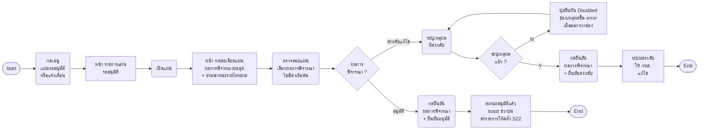

**Wireframe**
- **หน้า รายการแผนรออนุมัติ** `[เสนอ]` — ชื่อแผน · ปีงบประมาณ · ผู้สร้าง · ภาค · ประเภทยานพาหนะ · จำนวนยานพาหนะ · วันที่ส่ง · ปุ่มเปิด
- **หน้า รายละเอียดแผน (ฝั่งผู้อนุมัติ)** (ปรับ 5 พ.ย.) — **ผลการพิจารณาบนสุด** (Radio text card อนุมัติ · ส่งกลับแก้ไข ไม่มีใบที่เลือกไว้) · ช่องเหตุผลที่ส่งกลับ เมื่อเลือกส่งกลับ `[บอร์ด]` · ข้อมูลแผน (Display ดึงจาก S1) · ยานพาหนะในแผน แยกแท็บไตรมาส คอลัมน์แบบ S1 · อะไหล่ในแผน แยกแท็บไตรมาส ชนิด · ประเภท · จำนวน · หน่วย รวมทุกคัน (6 พ.ย.) · ปุ่ม ย้อนกลับ · ยืนยันผลการพิจารณา (Disabled จนกว่าจะเลือกผล)
- **หน้า รายละเอียดแผน หลังอนุมัติ** (5 พ.ย.) — ป้าย "อนุมัติแล้ว" · toast ขวาบน · ไม่มีส่วนผลการพิจารณา ไม่มีกล่องแจ้งอนุมัติ ไม่มีแถวปุ่ม

**Condition**

| ส่วน | เงื่อนไข | ที่มา |
|---|---|---|
| ผู้อนุมัติ | สายอนุมัติทั่วไป ไม่ใช่ ผพจ. · ใครและกี่ชั้น (ยังไม่รู้ — Q32) | เจ้าของงาน 30 ต.ค. |
| ยานพาหนะในแผน | Section label "ยานพาหนะในแผน (n)" + แท็บไตรมาส 1 ถึง 4 (จำนวนยานพาหนะบนแท็บ) + ตาราง ทะเบียน · ยี่ห้อ/รุ่น · หน่วยงานเจ้าของยานพาหนะ · น้ำมันไฮดรอลิก · เปลี่ยนล่าสุด · อะไหล่ (จำนวนรายการ หรือ ยังไม่เลือก) · ดูอย่างเดียว ไม่มีไอคอน | เจ้าของงาน 2 พ.ย. |
| อะไหล่ในแผน (6 พ.ย. 2569) | ต่อจากหัวข้อยานพาหนะในแผน · หัวข้อ "อะไหล่ในแผน" + แท็บ ไตรมาส 1 ถึง 4 (ตัวเลขบนแท็บ = จำนวนรายการ) · ตาราง ชนิด · ประเภท · จำนวน · หน่วย · ยอดรวมของยานพาหนะทุกคันในไตรมาสนั้น ไม่แยกรายคัน · ชนิด = ชื่อรายการ (เช่น ไส้กรองไฮโดรลิก · น้ำมันไฮโดรลิก ISO VG 46) · ประเภท = หมวด (น้ำมัน · ไส้กรอง · เพิ่มเอง) · เรียงตามประเภท · ยานพาหนะที่เลือกไม่เบิกอะไหล่ไม่รวม · ไตรมาสที่ไม่มีอะไหล่ แสดง "ยังไม่มีรายการอะไหล่" "ไตรมาสนี้ไม่มีอะไหล่ที่ต้องเบิก" · ดูอย่างเดียว ไม่มีไอคอน · ยอดชุดเดียวกับหัวข้ออะไหล่ในไตรมาสของ S1 | เจ้าของงาน 6 พ.ย. _"อยากเพิ่ม section อะใหล่ โดย group ชนิด ประเภท จำนวน ไม่แยกรายคัน แต่ละไตรมาส"_ |
| ผลการพิจารณา | **อยู่บนสุดของเนื้อหา** เหนือกล่องรายละเอียดแผน (แบบงานซ่อม) · Radio text card 2 ใบ สูงเท่ากัน · อนุมัติ (บรรทัดรอง "แผนผ่านการตรวจสอบ หน่วยงานเริ่มงานรายไตรมาสได้") · ส่งกลับแก้ไข (บรรทัดรอง "แจ้งเหตุผลให้ผู้สร้างแผนแก้ไขแล้วส่งใหม่") · **ไม่มีค่าเริ่มต้น ผู้อนุมัติต้องเลือกเอง** | เจ้าของงาน 2 พ.ย. + รีวิวทีมออกแบบ 5 พ.ย. |
| เหตุผลที่ส่งกลับ | Text area แสดงเมื่อเลือกส่งกลับแก้ไข · บังคับ · placeholder "ระบุเหตุผลที่ส่งกลับ" · ออกจากช่องโดยยังว่าง = error "กรุณาระบุเหตุผลที่ส่งกลับ" (Validation กรณีไม่ได้ระบุเหตุผล, Out of focus) | บอร์ด "ระบุเหตุผล" + เจ้าของงาน 2 พ.ย. + รีวิว 5 พ.ย. |
| ปุ่ม | ย้อนกลับ · ยืนยันผลการพิจารณา (Disabled จนกว่าจะเลือกผล และถ้าเลือกส่งกลับต้องระบุเหตุผลก่อน · 5 พ.ย.) → confirm ตามผลที่เลือก: อนุมัติ "ยืนยันอนุมัติแผนบำรุงรักษา" ปุ่ม อนุมัติ · ส่งกลับ "ยืนยันส่งกลับแก้ไข — แผนจะกลับไปให้ผู้สร้างแผนแก้ไขตามเหตุผลที่ระบุ แล้วส่งอนุมัติใหม่" ปุ่ม ส่งกลับ | เจ้าของงาน 2 พ.ย. + เสนอ |
| ส่งกลับ | แผนกลับสถานะ "ส่งกลับแก้ไข" · กบค. เห็นเหตุผล แล้วแก้ที่ S19 ส่งใหม่ | บอร์ด "กบค. จัดการแก้ไข" |
| อนุมัติ | มี confirm modal · สถานะ "รออนุมัติ" เปลี่ยนเป็น "อนุมัติแล้ว" · toast ขวาบน "อนุมัติแผนบำรุงรักษาสำเร็จ" อย่างเดียว ไม่มีกล่องแจ้ง "อนุมัติแผนแล้ว" ซ้ำ · ส่วนผลการพิจารณาหายไป · หลังจากนี้ กบค. ทำงานรายไตรมาสได้ (S4) | เสนอ + รีวิวทีมออกแบบ 5 พ.ย. |

### Scenario 4 · กบค. ติดตามความคืบหน้าและเบิกอะไหล่ของไตรมาส

**ช่วงงาน:** เบิก/จัดหาอะไหล่ · **เข้าจาก:** แผนอนุมัติแล้วและคลังรับทราบ (S22) เปิดไตรมาสที่กำลังทำ · **จบที่:** เบิกครบ แล้วไปหน้าแผนเดินทางของไตรมาส (S6 · เลือกดำเนินการเอง หรือจ้างดำเนินการ S9 ในฟอร์มแผนเดินทาง) · **ที่มา:** เจ้าของงาน 2 พ.ย. 2569 _"S4 จะไม่ได้เป็นการตรวจความพร้อมของรถ แต่จะเป็นการตรวจความคืบหน้าอะไหล่แทน โดยเห็นรายการว่ามีความต้องการเบิกอะไร และเห็นว่าใน smart inventory มีจำนวนเท่าไร"_ + เลือก รวม S4 S5 เป็นหน้าเดียว ยุบ S5 ออก · เห็นต้องเบิกเทียบคงเหลือ Smart Inventory + สถานะการเบิกรายรายการ · เฉพาะไตรมาสที่กำลังทำ · ตัดการตรวจยานพาหนะทิ้งทั้งหมด
· **5 พ.ย. 2569:** อะไหล่ในไตรมาสบนฟอร์มสร้างแผนตั้งต้นว่างแล้วรวมจากยานพาหนะทีละคัน (S21) ⇒ อะไหล่ที่ต้องเบิกของไตรมาสในหน้านี้ = ผลรวมอะไหล่ของยานพาหนะทุกคันในไตรมาส (น้ำมันไฮโดรลิกที่เปลี่ยน + ไส้กรองและอะไหล่) หน้าตาเหมือนเดิม
· แทน S4 เดิม (ตรวจจำนวนยานพาหนะ · ความพร้อมยานพาหนะ · นำยานพาหนะโอน/รอยุบออก — ตัดทิ้ง) และรวม S5 เดิม (เบิกผ่านระบบจองอะไหล่) ไว้หน้าเดียว · เนื้อหาเดิมเก็บใน `14-บำรุงรักษา-userflow-พักไว้-S3.md`
· ข้อที่ผู้เขียนถือตามที่เสนอ: ถ้าต้องเอายานพาหนะออก ให้แก้แผนที่ S19 · สถานะการเบิก รอเบิก → จองแล้ว / รอจัดซื้อ → เบิกแล้ว

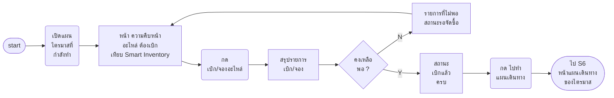

**Wireframe**
- **หน้า ความคืบหน้าอะไหล่ · ไตรมาส n** (เฉพาะไตรมาสที่กำลังทำ) — แถบบอกคลังรับทราบไตรมาสนี้แล้ว · ตาราง รายการอะไหล่ · รหัส · ต้องเบิก · หน่วย · คงเหลือ Smart Inventory · ไม่พอ · สถานะการเบิก (รอเบิก · จองแล้ว · รอจัดซื้อ · เบิกแล้ว) · ปุ่ม ย้อนกลับ · เบิก/จองอะไหล่ · มีผลเบิก/จองแล้ว (ตั้งแต่คงเหลือไม่พอ) = ตัวเลือก รูปแบบดำเนินการ (ดำเนินการเอง · ว่าจ้าง) + ปุ่ม ไปทำแผนเดินทาง (กดได้เมื่อเบิกครบ)

**Condition**

| ส่วน | เงื่อนไข | ที่มา |
|---|---|---|
| ขอบเขต | เฉพาะไตรมาสที่กำลังทำ · จำนวนต้องเบิกมาจากอะไหล่ที่ กบค. เลือกให้ยานพาหนะของไตรมาสนั้น (S1 S21) | เจ้าของงาน 2 พ.ย. |
| คงเหลือ Smart Inventory | Display ดึงจาก Smart Inventory · ไม่พอ = ต้องเบิก ลบ คงเหลือ · เชื่อมไม่ได้ = แถบ error "เชื่อมต่อ Smart Inventory ไม่ได้" คงเหลือแสดง "-" ปุ่มเบิกกดไม่ได้ | เจ้าของงาน 2 พ.ย. + เสนอ |
| สถานะการเบิก | รายรายการ รอเบิก (Gray) → จองแล้ว (Info) หรือ รอจัดซื้อ (Warning) เมื่อคงเหลือไม่พอ → เบิกแล้ว (Success) | เจ้าของงาน 2 พ.ย. + เสนอ |
| เบิก/จอง | ปุ่ม "เบิก/จองอะไหล่" → modal สรุปรายการ (เบิกจากคลัง · รอจัดซื้อ) → ยืนยัน · ไม่มีอะไหล่ในแผน = ปุ่มกดไม่ได้ เพิ่มอะไหล่ที่แก้ไขแผน | เสนอ |
| ~~รูปแบบดำเนินการ~~ | ถอดออก 3 พ.ย. 2569 (เจ้าของงาน "ถอดออกจาก S4 ตามที่เสนอ") ย้ายไปเลือกในฟอร์มแผนเดินทาง ไตรมาสเดียวมีทั้งแผนที่ กบค. ดำเนินการเองและแผนจ้างดำเนินการได้ | เจ้าของงาน 3 พ.ย. |
| ไปทำแผนเดินทาง | กดได้เมื่อเบิกครบทุกรายการ · กดแล้วไปหน้าแผนเดินทางของไตรมาส (S6 หน้าแรก) · ข้อความเมื่อเบิกครบ "เบิกอะไหล่ครบแล้ว" บรรทัดรอง "เบิกจาก Smart Inventory n รายการ · ไปทำแผนเดินทางของไตรมาสได้" | บอร์ด + เจ้าของงาน 3 พ.ย. |
| ~~ตรวจจำนวนยานพาหนะ ความพร้อม นำยานพาหนะออก~~ | ตัดทิ้ง 2 พ.ย. 2569 (เจ้าของงาน) | — |

### Scenario 6 · กบค. ทำแผนเดินทาง (ตรวจเอง)

**ช่วงงาน:** จ้างดำเนินการ (สายไม่ว่าจ้าง) · **เข้าจาก:** S4 เลือกไม่ว่าจ้าง · **จบที่:** ส่งแจ้งเตือน · **ที่มา:** `[บอร์ด]` "ทำแผนเดินทาง → ระบุรายละเอียดแผนการเดินทาง" + กล่อง "กบค. ระบุข้อมูล: พนักงาน กบค.ซ่อม จำนวน 2-3 คน · ค่าเบี้ยเลี้ยง · ค่าที่พัก · ค่าเดินทาง · เลือกยานพาหนะที่จะบำรุงรักษา · ระบุสถานที่บำรุงรักษา · กำหนดวันที่เดินทางไปเป็นช่วง · ยืนยันการสร้างแผนเดินทาง · ส่ง Notification หาวันที่เข้าตรวจ → เจ้าของยานพาหนะ · กรย."
· **ปรับ 2 พ.ย. 2569 (เจ้าของงาน):** _"ตอนที่สร้างแผนการเดินทาง อยากให้ระบุเป็นรายคัน โดย default เป็นสำนักงานที่รถคันนั้นอยู่ · เลือกรถเป็นการเลือกภายในไตรมาสนั้น วิธีเลือกรถเป็นแบบไม่มีชิป และมีตารางแสดงเหมือน S1 · แจ้งเตือนเป็นแบบ in-app email push noti · ข้อความ toast เป็นไปตามนั้นก่อน"_ ⇒ สถานที่บำรุงรักษาระบุรายคันในตารางยานพาหนะ ค่าเริ่มต้นสำนักงานที่ยานพาหนะคันนั้นอยู่ แก้ได้ทีละคัน · เลือกยานพาหนะเฉพาะไตรมาสที่กำลังทำ ช่องค้นหาไม่มีชิป ตารางยานพาหนะแบบ S1 · แจ้งเตือน in-app · e-mail · push notification

· **ปรับ 3 พ.ย. 2569 (เจ้าของงาน):** _"แผนการเดินทาง ตอนเลือก เป็นรายการรถทั้งหมดที่อยู่ในแผนไตรมาสนั้น โดยมีปุ่มให้เพิ่มรถเข้าแผนการเดินทาง เนื่องจาก 1 ไตรมาสอาจมีหลายแผนการเดินทาง แต่ละแผนการเดินทางจะมีรถต่างกันก็ได้ และพอเลือกเข้าแผนการเดินทางนั้นแล้ว การสร้างแผนการเดินทางครั้งต่อไปรถคันนั้นก็ไม่มีให้เลือก"_ + เลือกแบบ popup เพิ่มยานพาหนะ และยานพาหนะที่อยู่ในแผนเดินทางอื่นแล้ว ไม่แสดงแต่บอกจำนวน ⇒ ตัดช่องค้นหาเลือกยานพาหนะออก ใช้ปุ่ม "เพิ่มยานพาหนะ" เปิด popup รายการยานพาหนะของไตรมาสแบบติ๊ก
· **ปรับ 3 พ.ย. 2569 (เจ้าของงาน รอบ 2):** _"scen e1 อยากให้แสดงรถทั้งหมดในแผน และมีให้เพิ่มแผนการเดินทาง … ตัวอย่างมีรถ 10 คัน ในแผน"_ + เลือก ยานพาหนะของไตรมาสที่กำลังทำ · หน้าเดียวมีตารางยานพาหนะและตารางแผนเดินทาง · ยานพาหนะ 10 คันใช้เฉพาะ S6 ⇒ หน้าแรกของ S6 เป็นหน้า "แผนเดินทาง" ของไตรมาส แสดงยานพาหนะทุกคันของไตรมาสว่าอยู่แผนเดินทางใบไหนแล้ว และรายการแผนเดินทางพร้อมปุ่ม "สร้างแผนเดินทาง"
· **ปรับ 3 พ.ย. 2569 (เจ้าของงาน รอบ 3):** _"ตอนสร้างแผนการเดินทางอยากให้ตั้งชื่อแผนได้ด้วย เพิ่มช่องชื่อแผนการเดินทางด้วย"_ ⇒ ฟอร์มมีหัวข้อ "ข้อมูลแผนเดินทาง" ช่อง "ชื่อแผนเดินทาง" (แบบเดียวกับช่อง "ชื่อแผน" ของ S1) · หน้าแผนเดินทางแสดงชื่อที่ตั้งแทน "แผนเดินทาง k"
· **ปรับ 5 พ.ย. 2569 (รีวิวทีมออกแบบ):** _"เพิ่ม Flow การเข้าจากหน้า "บำรุงรักษาตามวาระ" มาจนถึงหน้า "แผนเดินทาง" เพราะตอนนี้ไม่รู้ว่าเข้ามาถึงหน้านี้ได้ยังไง"_ ⇒ เจ้าของงานเคาะ: เมนูบำรุงรักษาตามวาระ → รายการแผน → รายละเอียดแผนที่อนุมัติแล้ว → กดไตรมาส 1 → หน้า "ไตรมาส 1"
· **ปรับ 5 พ.ย. 2569 (รีวิวทีมออกแบบ):** _"E.1 ยานพาหนะในไตรมาสและแผนเดินทาง (ยังไม่มีแผนเดินทาง): หน้านี้คือหน้า "ไตรมาส 1" ใช่หรือไม่ หากใช้ ต้องแก้ breadcrumb ให้ถูกต้องสัมพันธ์กัน"_ + _"เมื่อเข้ามาถึงหน้า "ไตรมาส" จะสามารถสร้างแผนเดินทางได้"_ ⇒ ใช่ (เจ้าของงาน) · หัวหน้า "ไตรมาส 1" · breadcrumb บำรุงรักษาตามวาระ › {ชื่อแผน} › ไตรมาส 1 · หน้าที่อยู่ใต้ไตรมาส (สร้างแผนเดินทาง · ความคืบหน้าอะไหล่ S4 · รายละเอียดแผนเดินทาง S10) ต่อจาก "ไตรมาส 1" เหมือนกัน
· **ปรับ 5 พ.ย. 2569 (รีวิวทีมออกแบบ):** สร้างแผนเดินทาง _"ต้องกำหนดวันที่เดินทาง และระบุรถในไตรมาสนั้นได้"_ + _"รถ 1 คันในไตรมาส สามารถอยู่ได้เพียง 1 แผนการเดินทางเท่านั้น"_ + _"รถที่ถูกเลือกลงแผนอื่นไปแล้ว จะยังแสดงให้เห็นตอนที่กดเพิ่มรถเข้าแผนเดินทาง แต่ไม่สามารถเลือกลงแผนเดินทางนี้ได้"_ + _"รถที่เลือกลงแผนเดินทางแล้วจะลบออกได้ (soft delete)"_ ⇒ popup เพิ่มยานพาหนะแสดงยานพาหนะทุกคันของไตรมาส คันที่อยู่ในแผนเดินทางอื่นติ๊กไม่ได้ บรรทัดรองบอกชื่อแผนเดินทาง (เลิกที่ 3 พ.ย. ให้ซ่อน) · เอายานพาหนะออกจากแผนเดินทางแล้วยานพาหนะกลับไปเลือกได้
· **ปรับ 5 พ.ย. 2569 (รีวิวทีมออกแบบ):** _"E.7 ไม่ถูกต้อง : ระบบเราใช้ Validate แบบต้องกรอกข้อมูลที่ require ครบถึงจะ enable ปุ่ม ดังนั้น เคสที่ enable ตอนกรอกครบจะไม่มีอยู่จริง และเคสนี้จะต้องเปลี่ยน scenario เป็น "Validation กรณีไม่ได้ระบุข้อมูล, Out of focus""_ ⇒ ปุ่ม "ยืนยันการสร้างแผนเดินทาง" Disabled จนกว่าช่องบังคับครบ
· **ปรับ 5 พ.ย. 2569 (รีวิวทีมออกแบบ):** _"E.9 สร้างแผนเดินทางสำเร็จ จะถูกนำมาแสดงที่หน้า "ไตรมาส" ที่เข้ามาสร้างแผนเดินทาง"_ + _"สามารถสร้างแผนได้จนกว่าจะไม่เหลือรถอยู่แล้ว"_ ⇒ สร้างสำเร็จกลับหน้าไตรมาส 1 แผนเดินทางใหม่อยู่ในตาราง + toast · ยานพาหนะครบทุกคันแล้วปุ่ม "สร้างแผนเดินทาง" กดไม่ได้ (ตัด popup "ยานพาหนะทุกคันอยู่ในแผนเดินทางแล้ว")
· **ปรับ 6 พ.ย. 2569 (เจ้าของงาน):** _"เปลี่ยนคำ กบค ดำเนินการเอง เป็น ดำเนินการเอง"_ + _"ย้าย ช่วงวันเดินทางขึ้นมาก่อนเลือกรถ"_ + _"พนักงาน ขึ้นไปก่อนการเลือกรถ"_ + _"เปลี่ยนคำของพนักงาน กบค"_ + _"จำนวนคนเดินทาง เพิ่ม ได้ไม่จำกัด เพิ่มชื่อผู้ดูแลยานพาหนะ ตรงเบอร์โทร ดึงจากผู้ควบคุมรถ"_ + _"ตรงป๊อบอัพ เลยต้องมีให้แก้ชื่อโดย prefill ข้อมูลมาให้"_ ⇒ ตัวเลือก "ดำเนินการเอง" · ลำดับฟอร์ม ข้อมูลแผนเดินทาง → ช่วงวัน → พนักงานที่เดินทาง → ยานพาหนะ · พนักงานเพิ่มได้ไม่จำกัด (อย่างน้อย 2 คน) · คอลัมน์เบอร์ติดต่อเป็น "ผู้ดูแลยานพาหนะ" ชื่อ + เบอร์ จากผู้ควบคุมยานพาหนะ · popup แก้ไขมีช่องชื่อผู้ดูแลยานพาหนะ กรอกค่าไว้ให้ · มีผลกับ S9 (ฟอร์มเดียวกัน) และหน้าไตรมาส · หน้ารายละเอียดแผนเดินทาง (S10) ด้วย

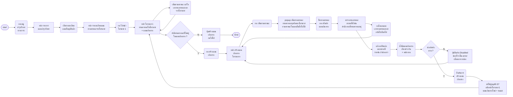

**Wireframe**
- **หน้า รายการแผน (ทางเข้า · 5 พ.ย.)** — หน้าเดียวกับ S1 · กดเมนู "…" ของแผนที่อนุมัติแล้วหรือดำเนินการ แล้ว "ดูรายละเอียด"
- **หน้า รายละเอียดแผน (ทางเข้า · 5 พ.ย.)** — หัวหน้า "เลขที่ MR …" ป้ายสถานะ · กล่องรายละเอียดแผน · หัวข้อ "ยานพาหนะในแผน (n)" + ปุ่ม "ไปหน้าไตรมาส 1" (ตามแท็บที่เปิด · เสนอ Q54) · แท็บไตรมาส 1 ถึง 4 · ตารางยานพาหนะของไตรมาส
- **หน้า ไตรมาส n** (เดิม "หน้า แผนเดินทาง (ของไตรมาส n)" · 5 พ.ย. หัวหน้า "ไตรมาส 1" breadcrumb บำรุงรักษาตามวาระ › {ชื่อแผน} › ไตรมาส 1) — กล่องรายละเอียดแผน (ไตรมาสบอกจำนวนยานพาหนะ เช่น "ไตรมาส 1 (10 คัน)") · ส่วน "ยานพาหนะในไตรมาส n (จำนวน)": ตารางยานพาหนะทุกคันของไตรมาส ทะเบียน · ยี่ห้อ/รุ่น · หน่วยงานเจ้าของยานพาหนะ · เบอร์ติดต่อ · ช่วงวันเดินทาง · แผนเดินทาง (ชื่อแผนเดินทางที่ยานพาหนะอยู่ หรือป้าย "ยังไม่มีแผนเดินทาง") · ส่วน "แผนเดินทาง (จำนวน)" + ปุ่ม "สร้างแผนเดินทาง": ตาราง ชื่อแผนเดินทาง (บรรทัดรองจำนวนสถานที่) · ช่วงวันเดินทาง · ยานพาหนะ (คัน) · ผู้ดำเนินการ · สถานะ · ไอคอนไปหน้ารายละเอียด · (4 พ.ย. 2569) ปุ่ม "เพิ่มยานพาหนะ" ที่หัวส่วนยานพาหนะในไตรมาส · ไอคอนแก้ไข + ลบ ท้ายแถว (คันที่อยู่ในแผนเดินทางแล้วมีแค่แก้ไข)
- **หน้า สร้างแผนเดินทาง · ไตรมาส n** (ลำดับใหม่ 6 พ.ย.) — หัวข้อ "ข้อมูลแผนเดินทาง" ช่อง "ชื่อแผนเดินทาง" + รูปแบบดำเนินการ (ดำเนินการเอง · จ้างดำเนินการ) · ช่วงวันเดินทาง · พนักงานที่เดินทาง (1 คน 1 แถว + ปุ่มลบ · ปุ่ม "เพิ่มพนักงาน" ไม่จำกัดจำนวน อย่างน้อย 2 คน) · หัวข้อ "ยานพาหนะในแผนเดินทาง" (จำนวนคัน) + ปุ่ม "เพิ่มยานพาหนะ" · ตาราง ทะเบียน · ยี่ห้อ/รุ่น · หน่วยงานเจ้าของยานพาหนะ · ผู้ดูแลยานพาหนะ (ชื่อ + เบอร์ จากผู้ควบคุมยานพาหนะ) · สถานที่บำรุงรักษา (บรรทัดรองบอกค่าเริ่มต้นหรือแก้แล้ว) · ไอคอนแก้ไข (popup แก้ผู้ดูแลยานพาหนะ เบอร์ และสถานที่) และลบยานพาหนะ · ปุ่ม ย้อนกลับ / ยืนยันการสร้างแผนเดินทาง (ไม่มีค่าใช้จ่ายแล้ว 3 พ.ย. 2569 ย้ายไปกรอกรายคันตอนปิดงาน S10)
- **popup เพิ่มยานพาหนะเข้าแผนเดินทาง** (ปรับ 5 พ.ย.) — หัว "เพิ่มยานพาหนะเข้าแผนเดินทาง" บรรทัดรอง "ยานพาหนะทุกคันของไตรมาส n · x คันอยู่ในแผนเดินทางอื่นแล้ว เลือกไม่ได้" · ช่องค้นหา · ตารางติ๊ก ทะเบียน · ยี่ห้อ/รุ่น · หน่วยงานเจ้าของยานพาหนะ (ช่องหัวตารางติ๊กทั้งหมดที่เลือกได้) · คันที่อยู่ในแผนเดินทางอื่น ช่องติ๊กกดไม่ได้ บรรทัดรอง "อยู่ในแผนเดินทาง {ชื่อแผนเดินทาง}" · ปุ่ม ยกเลิก / เพิ่มเข้าแผนเดินทาง (n)
- ~~popup เมื่อไม่มียานพาหนะให้เลือก~~ ตัดออก 5 พ.ย. 2569 — ยานพาหนะครบทุกคันแล้วปุ่ม "สร้างแผนเดินทาง" ในหน้าไตรมาสกดไม่ได้แทน

**Condition**

| ส่วน | เงื่อนไข | ที่มา |
|---|---|---|
| หน้าแผนเดินทาง ส่วนยานพาหนะ | แสดงยานพาหนะทุกคันของไตรมาสที่กำลังทำ ไม่ว่าจะอยู่ในแผนเดินทางแล้วหรือยัง · จำนวนคันต่อท้ายหัวข้อ "ยานพาหนะในไตรมาส n" · ยานพาหนะที่อยู่ในแผนเดินทางแล้ว คอลัมน์แผนเดินทางแสดงชื่อแผนเดินทางของใบนั้น และคอลัมน์ช่วงวันเดินทางแสดงช่วงวันของใบนั้น · ยานพาหนะที่ยังไม่อยู่ในใบใด แสดงป้าย "ยังไม่มีแผนเดินทาง" (สีเทา) และช่วงวันเป็นขีด · คอลัมน์เบอร์ติดต่อ ยานพาหนะที่อยู่ในแผนเดินทางแล้วแสดงเบอร์ของใบนั้น (แก้แล้วมีบรรทัดรอง "แก้จากเบอร์เจ้าของยานพาหนะ") ยานพาหนะที่ยังไม่อยู่ในใบใดแสดงเบอร์เจ้าของยานพาหนะ · ส่วนนี้ดูอย่างเดียว แก้เบอร์ทำในหน้าสร้างหรือแก้ไขแผนเดินทาง | เจ้าของงาน 3 พ.ย. (คอลัมน์เป็นข้อเสนอ · เบอร์ติดต่อเจ้าของงานขอ) |
| เพิ่ม ลด แก้ไข ยานพาหนะในไตรมาส (4 พ.ย. 2569) | ปุ่ม "เพิ่มยานพาหนะ" เปิด popup "เพิ่มยานพาหนะเข้าไตรมาส n" รายการยานพาหนะในขอบเขตของแผน (ภาค เขต ประเภทยานพาหนะเดียวกัน) ที่ยังไม่อยู่ในไตรมาสใด ติ๊กได้หลายคัน ปุ่ม "เพิ่มเข้าไตรมาส n (จำนวน)" ไม่ติ๊กกดไม่ได้ → แจ้งเตือน "เพิ่มยานพาหนะเข้าไตรมาส n สำเร็จ" คันที่เพิ่มขึ้นก่อน · ไอคอนแก้ไข = popup แก้ไขเบอร์ติดต่อและสถานที่ (แบบเดียวกับฟอร์มแผนเดินทาง) ค่าที่แก้เป็นค่าตั้งต้นตอนสร้างแผนเดินทาง · ไอคอนลบ = ยืนยัน "ยืนยันการเอายานพาหนะออกจากไตรมาส n" ปุ่ม ยกเลิก / เอาออก → แจ้งเตือน "เอายานพาหนะออกจากไตรมาส n สำเร็จ" อะไหล่ของคันนั้นออกจากรายการเบิกของไตรมาส · คันที่อยู่ในแผนเดินทางแล้วไม่มีไอคอนลบ (เอาออกจากแผนเดินทางก่อน) · ไม่ต้องส่งอนุมัติแผนใหม่ · ยานพาหนะเกิน 10 คันแสดงหน้าละ 10 พร้อม pagination | เจ้าของงาน 4 พ.ย. _"หน้า E.1 ต้องสามารถ เพิ่มลด จำนวน หรือแก้ไขได้ด้วย"_ + เลือก เพิ่มหรือเอายานพาหนะออก · แก้เบอร์และสถานที่ · ไม่ต้องอนุมัติใหม่ |
| หน้าแผนเดินทาง ส่วนแผนเดินทาง | หัวข้อ "แผนเดินทาง" ต่อท้ายจำนวนใบ (มีทั้งใบที่ กบค. ดำเนินการเอง และใบจ้างดำเนินการ) และปุ่ม "สร้างแผนเดินทาง" · ยังไม่มีใบ แสดง "ยังไม่มีแผนเดินทาง" และ "สร้างแผนเดินทางเพื่อนัดวันเข้าตรวจ แจ้งเจ้าของยานพาหนะและ กรย." พร้อมปุ่ม "สร้างแผนเดินทาง" · มีใบแล้ว แสดงตารางเรียงตามลำดับที่สร้าง คอลัมน์แรก "ชื่อแผนเดินทาง" แสดงชื่อที่ตั้งตอนสร้าง บรรทัดรองบอกจำนวนสถานที่ (และจำนวนคันที่ใช้สำนักงานเจ้าของยานพาหนะ) · ช่วงวัน · ยานพาหนะ (คัน) · ผู้ดำเนินการ ("กบค. (ดำเนินการเอง)" หรือชื่อผู้รับจ้าง) · สถานะ "รออนุมัติ" · "อนุมัติแล้ว" · "ส่งกลับแก้ไข" (ดูแถว สถานะแผนเดินทาง · แก้ 5 พ.ย. 2569 เดิมเขียน "ส่งแจ้งแล้ว" ค้างจากก่อนมีขั้นอนุมัติแผนเดินทาง S7) · ไอคอนไปหน้ารายละเอียดของใบ (ใบที่อนุมัติแล้วไปหน้ารายละเอียดแผนเดินทางของ S10 ที่มีสถานะงานรายคัน) | เจ้าของงาน 3 พ.ย. |
| รูปแบบดำเนินการ | อยู่แถวเดียวกับช่อง "ชื่อแผนเดินทาง" คนละครึ่ง (ชื่อแผนเดินทางซ้าย รูปแบบดำเนินการขวา) · ป้าย "รูปแบบดำเนินการ" · radio 2 ตัวเรียงแนวนอน "ดำเนินการเอง" (6 พ.ย. 2569 เดิม "กบค. ดำเนินการเอง") เลือกไว้เป็นค่าเริ่มต้น · "จ้างดำเนินการ" · ไม่มีคำอธิบายใต้ตัวเลือก · เลือกจ้างดำเนินการแล้วฟอร์มเปลี่ยนเป็นแบบ S9 · บนมือถือ ชื่อแผนเดินทางเต็มแถว แล้วรูปแบบดำเนินการอยู่บรรทัดถัดลงมา radio 2 ตัวยังเรียงข้างกัน | เจ้าของงาน 3 พ.ย. (เปลี่ยนจากการ์ดเป็น radio แถวเดียวกัน) |
| ชื่อแผนเดินทาง | ช่อง "ชื่อแผนเดินทาง" อยู่บนสุดของฟอร์ม ใต้หัวข้อ "ข้อมูลแผนเดินทาง" · บังคับกรอก · ข้อความในช่องว่า "ระบุชื่อแผนเดินทาง" · ไม่มีค่าตั้งต้น · ออกจากช่องโดยยังว่าง ขึ้น "กรุณาระบุชื่อแผนเดินทาง" ใต้ช่อง · ชื่อที่ตั้งแสดงในหน้าแผนเดินทางทั้งตารางยานพาหนะ และตารางแผนเดินทาง | เจ้าของงาน 3 พ.ย. (บังคับกรอกและข้อความเป็นข้อเสนอ) |
| ลำดับหัวข้อในฟอร์ม (6 พ.ย. 2569) | ข้อมูลแผนเดินทาง → ผู้รับจ้าง (เฉพาะจ้างดำเนินการ S9) → ช่วงวันเดินทาง (จ้าง = ช่วงวันทำงาน) → พนักงานที่เดินทาง (เฉพาะดำเนินการเอง) → ยานพาหนะในแผนเดินทาง → ปุ่ม · ช่วงวันและพนักงานอยู่ก่อนเลือกยานพาหนะ | เจ้าของงาน 6 พ.ย. _"ย้าย ช่วงวันเดินทางขึ้นมาก่อนเลือกรถ"_ + _"พนักงาน ขึ้นไปก่อนการเลือกรถ"_ |
| แผนเดินทางต่อไตรมาส | 1 ไตรมาสมีแผนเดินทางได้หลายใบ · แต่ละใบมียานพาหนะต่างกัน · ยานพาหนะ 1 คันอยู่ได้ในแผนเดินทางใบเดียวของไตรมาสนั้น | เจ้าของงาน 3 พ.ย. |
| เปิดหน้าสร้างแผนเดินทาง | ตาราง "ยานพาหนะในแผนเดินทาง" ยังว่าง แสดง "ยังไม่มียานพาหนะในแผนเดินทาง" และ "กดเพิ่มยานพาหนะเพื่อเลือกยานพาหนะของไตรมาส n ที่ยังไม่อยู่ในแผนเดินทางใด" · ปุ่ม "เพิ่มยานพาหนะ" อยู่ที่หัวข้อ "ยานพาหนะในแผนเดินทาง" กดได้ทุกเมื่อ ทั้งตอนยังไม่มียานพาหนะและตอนมียานพาหนะแล้ว | เจ้าของงาน 3 พ.ย. |
| popup เพิ่มยานพาหนะ แสดงเมื่อ | กดปุ่ม "เพิ่มยานพาหนะ" เท่านั้น · ไม่เปิดเองตอนเข้าหน้า | เจ้าของงาน 3 พ.ย. |
| ทางเข้าหน้าไตรมาส | เมนูบำรุงรักษาตามวาระ → รายการแผน → เมนู "…" ดูรายละเอียดของแผนที่อนุมัติแล้ว (หรือดำเนินการ) → หน้ารายละเอียดแผน กดปุ่ม "ไปหน้าไตรมาส 1" ที่หัวข้อยานพาหนะในแผน (ไตรมาสตามแท็บที่เปิด · ชื่อปุ่มเสนอ Q54) → หน้า "ไตรมาส 1" | รีวิวทีมออกแบบ 5 พ.ย. + เจ้าของงานเคาะ |
| หน้าไตรมาส หัวหน้าและ breadcrumb | หัวหน้า "ไตรมาส n" · breadcrumb บำรุงรักษาตามวาระ › {ชื่อแผน} › ไตรมาส n · หน้าสร้างแผนเดินทาง ต่อท้าย › สร้างแผนเดินทาง · หน้ารายละเอียดแผนเดินทาง (S10) › {ชื่อแผนเดินทาง} · ความคืบหน้าอะไหล่ (S4) › ความคืบหน้าอะไหล่ | รีวิวทีมออกแบบ 5 พ.ย. |
| ปุ่มสร้างแผนเดินทาง | สร้างได้หลายใบจนกว่ายานพาหนะของไตรมาสจะอยู่ในแผนเดินทางครบทุกคัน · ครบแล้วปุ่มกดไม่ได้ | รีวิวทีมออกแบบ 5 พ.ย. "สามารถสร้างแผนได้จนกว่าจะไม่เหลือยานพาหนะอยู่แล้ว" |
| ยานพาหนะที่แสดงใน popup | ยานพาหนะทุกคันของไตรมาสที่กำลังทำ ยกเว้นยานพาหนะที่อยู่ในตารางของแผนเดินทางใบนี้แล้ว · **ยานพาหนะที่อยู่ในแผนเดินทางใบอื่นของไตรมาสเดียวกันยังแสดง แต่ช่องติ๊ก Disabled เลือกไม่ได้ บรรทัดรอง "อยู่ในแผนเดินทาง {ชื่อแผนเดินทาง}"** · คอลัมน์ ทะเบียน · ยี่ห้อ/รุ่น · หน่วยงานเจ้าของยานพาหนะ | รีวิวทีมออกแบบ 5 พ.ย. (เดิม 3 พ.ย. ไม่แสดง) |
| บรรทัดรองของ popup | "ยานพาหนะทุกคันของไตรมาส n" · ถ้ามียานพาหนะที่อยู่ในแผนเดินทางใบอื่นแล้ว ต่อท้าย " · x คันอยู่ในแผนเดินทางอื่นแล้ว เลือกไม่ได้" | รีวิวทีมออกแบบ 5 พ.ย. |
| ค้นหาใน popup | ค้นจากทะเบียน · ยี่ห้อ/รุ่น · หน่วยงานเจ้าของยานพาหนะ · จับคำที่มีอยู่ในข้อความ · ค้นไม่พบใช้ Empty state ค้นไม่พบ (ยังไม่มีจอ) | เสนอ |
| ติ๊กเลือก | ติ๊กได้หลายคัน · ช่องติ๊กหัวตารางเลือกหรือเอาออกทุกคันที่แสดงอยู่ · หัวตารางเป็นติ๊กครึ่งเมื่อเลือกบางคัน | หน้า Select vehicles ของ UI Release#2 |
| ปุ่มใน popup | "ยกเลิก" และปุ่มปิดมุมขวา ปิด popup โดยตารางในฟอร์มไม่เปลี่ยน · "เพิ่มเข้าแผนเดินทาง (n)" n = จำนวนคันที่ติ๊ก · กดไม่ได้เมื่อยังไม่ติ๊ก (ไม่แสดงวงเล็บ) · กดแล้วปิด popup ยานพาหนะที่ติ๊กต่อท้ายตาราง "ยานพาหนะในแผนเดินทาง" | เสนอ |
| ~~ไม่มียานพาหนะให้เลือก (popup)~~ | ตัดออก 5 พ.ย. 2569 — ยานพาหนะครบแล้วปุ่ม "สร้างแผนเดินทาง" กดไม่ได้ | รีวิวทีมออกแบบ |
| ตารางยานพาหนะในแผนเดินทาง | ทะเบียน · ยี่ห้อ/รุ่น · หน่วยงานเจ้าของยานพาหนะ · ผู้ดูแลยานพาหนะ · สถานที่บำรุงรักษา · ไอคอนแก้ไข และลบ · จำนวนคันที่หัวข้อ | เจ้าของงาน 2 พ.ย. · ผู้ดูแลยานพาหนะ 6 พ.ย. (เดิมเบอร์ติดต่อ 3 พ.ย.) |
| ผู้ดูแลยานพาหนะ (6 พ.ย. 2569) | รายคัน · ช่องเดียว 2 บรรทัด ชื่อบรรทัดบน เบอร์โทรบรรทัดรอง · ค่าเริ่มต้นดึงจากผู้ควบคุมยานพาหนะของยานพาหนะคันนั้นในข้อมูลยานพาหนะ (ทั้งชื่อและเบอร์) · แก้ได้ทีละคันจากไอคอนแก้ไข (popup เดียวกับสถานที่) · ใช้ชื่อคอลัมน์เดียวกันในหน้าไตรมาส (ยานพาหนะในไตรมาส n) และหน้ารายละเอียดแผนเดินทาง (S10) · ไม่มีผู้ควบคุมยานพาหนะในข้อมูลยานพาหนะ แสดง "-" (เสนอ) | เจ้าของงาน 6 พ.ย. _"เพิ่มชื่อผู้ดูแลยานพาหนะ ตรงเบอร์โทร ดึงจากผู้ควบคุมรถ"_ · คำ "ผู้ดูแลยานพาหนะ" ตามแท็บข้อมูลยานพาหนะของ UI Release#2 |
| popup แก้ไขยานพาหนะในแผนเดินทาง | แสดงเมื่อกดไอคอนแก้ไขของแถวนั้น · หัว "แก้ไขผู้ดูแลยานพาหนะและสถานที่ · {ทะเบียน}" · 3 ช่อง "ผู้ดูแลยานพาหนะ" · "เบอร์ติดต่อ" · "สถานที่บำรุงรักษา" กรอกค่าปัจจุบันของแถวไว้ให้ (ครั้งแรกเป็นชื่อและเบอร์ของผู้ควบคุมยานพาหนะ) แก้ชื่อได้ · ปุ่ม ยกเลิก (ปิดโดยค่าไม่เปลี่ยน) · บันทึก (ปิดแล้วค่าในแถวเปลี่ยนตาม) | เจ้าของงาน 3 พ.ย. + 6 พ.ย. _"ตรงป๊อบอัพ เลยต้องมีให้แก้ชื่อโดย prefill ข้อมูลมาให้"_ |
| ลบยานพาหนะออกจากตาราง (soft delete) | กดไอคอนลบ ยานพาหนะออกจากแผนเดินทางนี้ทันที (ไม่ได้ลบยานพาหนะออกจากไตรมาส) แล้วกลับไปแสดงใน popup เพิ่มยานพาหนะให้ติ๊กได้อีก | เสนอ + รีวิวทีมออกแบบ 5 พ.ย. "ยานพาหนะที่เลือกลงแผนเดินทางแล้วจะลบออกได้ (soft delete)" |
| ยานพาหนะในแผนเดินทางใบก่อน | เมื่อยืนยันการสร้างแผนเดินทางสำเร็จ ยานพาหนะทุกคันในใบนั้นแสดงใน popup ของแผนเดินทางใบถัดไปในไตรมาสเดียวกันแบบเลือกไม่ได้ · ยานพาหนะ 1 คันอยู่ได้แผนเดินทางเดียว · ยานพาหนะของไตรมาสอื่นไม่เกี่ยว | เจ้าของงาน 3 พ.ย. + รีวิว 5 พ.ย. |
| สถานที่บำรุงรักษา | รายคัน · ค่าเริ่มต้น "สำนักงาน {หน่วยงานเจ้าของยานพาหนะ}" · บรรทัดรอง "ค่าเริ่มต้น สำนักงานที่ยานพาหนะอยู่" · แก้ได้ทีละคันจากไอคอนแก้ไข (popup แก้ไขยานพาหนะในแผนเดินทาง ข้างบน) · แก้แล้วบรรทัดรอง "แก้จากสำนักงานเจ้าของยานพาหนะ" | เจ้าของงาน 2 พ.ย. |
| วันที่เดินทาง | date range · ไม่สามารถเลือกน้อยกว่าวันนี้ | บอร์ด "เป็นช่วง" + เสนอ |
| พนักงานที่เดินทาง (6 พ.ย. 2569) | หัวข้อ "พนักงานที่เดินทาง" (เดิม "พนักงาน กบค. ซ่อม (2-3 คน)") · 1 คน 1 แถว: ช่องค้นหา "พนักงานคนที่ n" ข้อความในช่อง "ค้นหาชื่อ-นามสกุล, รหัสพนักงาน" + ปุ่มลบท้ายแถว · ปุ่ม "เพิ่มพนักงาน" ใต้แถวสุดท้าย เพิ่มได้ไม่จำกัด · ฟอร์มว่างแสดง 2 แถว · ต้องมีอย่างน้อย 2 คน (คนที่ 1 และ 2 ขึ้น error "กรุณาเลือกพนักงาน" เมื่อออกจากช่องโดยยังว่าง) · กรอกแล้วหัวข้อมีป้าย "n คน" · แบบเดียวกับแถวพนักงานในค่าใช้จ่ายตอนปิดงาน (S10) | เจ้าของงาน 6 พ.ย. _"จำนวนคนเดินทาง เพิ่ม ได้ไม่จำกัด"_ + _"เปลี่ยนคำของพนักงาน กบค"_ · อย่างน้อย 2 คนคงตามบอร์ด |
| ~~ค่าเบี้ยเลี้ยง / ที่พัก / เดินทาง~~ | ไม่กรอกในแผนเดินทางแล้ว ย้ายไปกรอกรายคันตอนปิดงาน (S10) พร้อมเลือกงบ · เดิม Text number (บาท) ไปรวมที่ S18 | เจ้าของงาน 3 พ.ย. 2569 _"ค่าที่พัก ค่าเดินทาง … จะมีให้กรอกอีกทีตอนปิดงาน โดยรายละเอียดเรื่องค่าใช้จ่ายของรถแต่ละคันจะกรอกแยกกัน"_ |
| ปุ่มยืนยัน (5 พ.ย. 2569) | "ยืนยันการสร้างแผนเดินทาง" Disabled จนกว่าช่องบังคับครบ: ชื่อแผนเดินทาง · ยานพาหนะอย่างน้อย 1 คัน · วันที่เดินทาง ตั้งแต่ · ถึงวันที่ · พนักงานคนที่ 1 และ 2 · เลิกกล่องแจ้ง "กรุณาเพิ่มยานพาหนะเข้าแผนเดินทางอย่างน้อย 1 คัน" | รีวิวทีมออกแบบ 5 พ.ย. |
| Validation กรณีไม่ได้ระบุข้อมูล, Out of focus | ช่องบังคับที่เข้าแล้วออกโดยยังว่างขึ้น error ใต้ช่อง ("กรุณาระบุชื่อแผนเดินทาง" · "กรุณาเลือกวันที่เริ่ม" · "กรุณาเลือกวันที่สิ้นสุด" · "กรุณาเลือกพนักงาน") · ปุ่มยัง Disabled | รีวิวทีมออกแบบ 5 พ.ย. |
| ยืนยัน | สำเร็จ ⇒ กลับหน้าไตรมาสที่เข้ามาสร้าง แผนเดินทางใหม่ขึ้นในตารางแผนเดินทาง สถานะ "รออนุมัติ" ส่งให้ผู้อนุมัติ (S7) · toast ขวาบน "สร้างแผนเดินทางสำเร็จ · ส่งให้ผู้อนุมัติแล้ว" · ยังไม่แจ้งเจ้าของยานพาหนะและ กรย. จนกว่าจะอนุมัติ (S8) · ยานพาหนะในใบนี้นับว่าอยู่ในแผนเดินทางแล้วตั้งแต่ส่งอนุมัติ | เจ้าของงาน 3 พ.ย. (ย้ายแจ้งเตือนไปหลังอนุมัติ) |
| สถานะแผนเดินทาง | รออนุมัติ (สีเหลือง) · อนุมัติแล้ว (สีเขียว) · ส่งกลับแก้ไข (สีแดง) · แสดงที่คอลัมน์สถานะของตารางแผนเดินทาง | เสนอ ตามชื่อสถานะของแผน S2 |
| ถูกส่งกลับแก้ไข | ใบที่ถูกส่งกลับ สถานะ "ส่งกลับแก้ไข" · เปิดใบนั้นแล้วเข้าหน้าแก้ไขแผนเดินทาง (ฟอร์มเดียวกับสร้าง ค่าเดิมกรอกไว้) · บนสุดมีกล่องแจ้ง "ผู้อนุมัติส่งกลับให้แก้ไข" พร้อมเหตุผลที่ผู้อนุมัติระบุ · ปุ่มท้ายหน้า "ส่งอนุมัติใหม่" · ส่งแล้วสถานะกลับเป็น "รออนุมัติ" · toast "ส่งแผนเดินทางให้ผู้อนุมัติใหม่แล้ว" · ยานพาหนะของใบที่ถูกส่งกลับยังไม่กลับไปให้ใบอื่นเลือก | เสนอ ตามแบบ S19 ของแผน |

**ยังไม่เคาะ** — เพิ่มยานพาหนะเข้าไตรมาสแล้ว คลัง (S22) ต้องรับทราบรายการอะไหล่ใหม่ไหม และอะไหล่ของคันที่เพิ่มเลือกที่ไหน (S21) · ยานพาหนะที่เอาออกไปไหนต่อ (ไตรมาสอื่นหรือออกจากแผน) · ชื่อแผนเดินทางบังคับกรอกไหม · ซ้ำกับใบอื่นในไตรมาสเดียวกันได้ไหม · ยาวได้สูงสุดกี่ตัวอักษร · แผนเดินทางมีเลขที่ของระบบด้วยไหม · หน้ารายละเอียดของแผนเดินทางแต่ละใบยังไม่มีจอ · ฟอร์มที่ยังไม่กดยืนยันกันยานพาหนะไว้ไหม (ตอนนี้นับเฉพาะใบที่ยืนยันแล้ว) · ยกเลิกหรือแก้ไขแผนเดินทางที่ยืนยันแล้ว ยานพาหนะกลับมาเลือกได้ไหม · ลบยานพาหนะออกจากตารางต้องถามยืนยันไหม · เมื่อยานพาหนะทุกคันของไตรมาสอยู่ในแผนเดินทางแล้ว ปุ่ม "สร้างแผนเดินทาง" ในหน้ารายการควรกดไม่ได้ไหม (Q44) · เบอร์ติดต่อเจ้าของยานพาหนะดึงจากข้อมูลไหน ตรวจรูปแบบเบอร์ไหม และ S7 S8 ต้องแสดงเบอร์ด้วยไหม (Q47)

### Scenario 7 · ผู้อนุมัติ ตรวจสอบและอนุมัติแผนเดินทาง

**ช่วงงาน:** จ้างดำเนินการ · **เข้าจาก:** แจ้งเตือน หรือเมนูแผนเดินทางรออนุมัติ · **จบที่:** แผนเดินทางอนุมัติแล้ว (ต่อ S8) หรือส่งกลับให้ กบค. แก้ที่ S6 · **ที่มา:** เจ้าของงาน 3 พ.ย. 2569 _"s7 เป็นเรื่องอนุมัติแผนการเดินทาง"_ + เลือกหน้าอนุมัติแบบเดียวกับ S2 · ผู้อนุมัติ _"จะเป็นคนตามเส้น api getupper lower เลยไม่แน่ใจว่าเป็นหัวหน้ากบคมั้ย"_
· S7 เดิม (ผู้รับจ้างทำแผนเดินทาง) ย้ายไป [14-…-พักไว้-S3.md](14-บำรุงรักษา-userflow-พักไว้-S3.md) · เส้นว่าจ้างแยกเป็น scenario ใหม่ หัวข้อ 2.1
· **ปรับ 5 พ.ย. 2569 ตาม S2 (รีวิวทีมออกแบบของ S2 ใช้หน้าเดียวกัน):** _"Default จะยังไม่เลือกผลการพิจารณาให้ ต้องเลือกเอง · ย้ายตำแหน่งจากด้านล่างสุดไปไว้ด้านบนสุดให้เหมือนงานซ่อม"_ + _"แสดง Toast ด้านบนขวา · ไม่ต้องแสดง Alert อนุมัติแผนแล้ว ซ้ำ ให้แสดงแค่ Toast"_ ⇒ ผลการพิจารณาบนสุด ไม่มีค่าเริ่มต้น · อนุมัติแล้วแสดงแค่ toast · ยังไม่ได้รีวิวจอของ S7 เอง

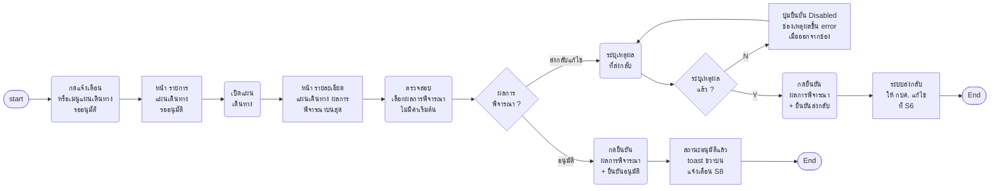

**Wireframe**
- **หน้า รายการแผนเดินทางรออนุมัติ** `[เสนอ]` — ชื่อแผนเดินทาง (บรรทัดรอง เลขที่ MR · ไตรมาส) · ช่วงวันเดินทาง · ยานพาหนะ (คัน) · ผู้สร้าง (กบค.) · วันที่ส่ง · สถานะ · ปุ่มเปิด
- **หน้า รายละเอียดแผนเดินทาง (ฝั่งผู้อนุมัติ)** (ปรับ 5 พ.ย. ตาม S2) — **ผลการพิจารณาบนสุด** (Radio text card อนุมัติ · ส่งกลับแก้ไข ไม่มีใบที่เลือกไว้) · ช่องเหตุผลที่ส่งกลับเมื่อเลือกส่งกลับ · กล่องข้อมูลแผนเดินทาง (Display จาก S6) · ยานพาหนะในแผนเดินทาง (ตาราง ทะเบียน · ยี่ห้อ/รุ่น · หน่วยงานเจ้าของยานพาหนะ · สถานที่บำรุงรักษา ดูอย่างเดียว) · ปุ่ม ย้อนกลับ · ยืนยันผลการพิจารณา (Disabled จนกว่าจะเลือก)

**Condition**

| ส่วน | เงื่อนไข | ที่มา |
|---|---|---|
| ผู้อนุมัติ | ผู้บังคับบัญชาตามสายงานของ กบค. ผู้สร้างแผนเดินทาง ได้จาก API getUpperLower · ตำแหน่งและจำนวนชั้นยังไม่รู้ (Q45) | เจ้าของงาน 3 พ.ย. |
| เข้าหน้า | แจ้งเตือน "มีแผนเดินทางรออนุมัติ" (ร่าง) หรือเมนูแผนเดินทางรออนุมัติ · รายการแสดงเฉพาะใบที่ส่งมาให้ผู้อนุมัติคนนี้ | เสนอ |
| รายการ | คอลัมน์ ชื่อแผนเดินทาง (บรรทัดรอง เลขที่ MR และไตรมาส) · ช่วงวันเดินทาง · ยานพาหนะ (คัน) · ผู้สร้าง (กบค.) · วันที่ส่ง · สถานะ · ไอคอนเปิด · ค้นหาด้วยชื่อแผนเดินทาง หรือผู้สร้าง | เสนอ |
| รายละเอียด | กล่อง "รายละเอียดแผนเดินทาง": ชื่อแผนเดินทาง · แผน · ไตรมาส · ช่วงวันเดินทาง · พนักงาน กบค. ซ่อม · ผู้สร้าง · วันที่ส่ง (ไม่มีค่าใช้จ่าย ย้ายไปปิดงานรายคัน 3 พ.ย. 2569) · ส่วน "ยานพาหนะในแผนเดินทาง (n)" ตาราง ทะเบียน · ยี่ห้อ/รุ่น · หน่วยงานเจ้าของยานพาหนะ · สถานที่บำรุงรักษา (บรรทัดรองค่าเริ่มต้นหรือแก้แล้ว) ดูอย่างเดียว | เสนอ ตามช่องที่กรอกใน S6 |
| ผลการพิจารณา | อยู่บนสุดของเนื้อหา · Radio text card 2 ใบ สูงเท่ากัน · ไม่มีค่าเริ่มต้น (5 พ.ย. ตาม S2) · อนุมัติ (บรรทัดรอง "แผนเดินทางผ่านการตรวจสอบ แจ้งเจ้าของยานพาหนะและ กรย.") · ส่งกลับแก้ไข (บรรทัดรอง "แจ้งเหตุผลให้ กบค. แก้ไขแผนเดินทางแล้วส่งใหม่") | เจ้าของงาน 3 พ.ย. (แบบ S2) |
| เหตุผลที่ส่งกลับ | Text area แสดงเมื่อเลือกส่งกลับแก้ไข · บังคับ · placeholder "ระบุเหตุผลที่ส่งกลับ" · ออกจากช่องโดยยังว่าง = error "กรุณาระบุเหตุผลที่ส่งกลับ" | แบบ S2 |
| ปุ่ม | ย้อนกลับ · ยืนยันผลการพิจารณา (Disabled จนกว่าจะเลือกผล และระบุเหตุผลเมื่อส่งกลับ) ⇒ confirm ตามผลที่เลือก: อนุมัติ "ยืนยันอนุมัติแผนเดินทาง" ปุ่ม อนุมัติ · ส่งกลับ "ยืนยันส่งกลับแก้ไข" ข้อความ "แผนเดินทางจะกลับไปให้ กบค. แก้ไขตามเหตุผลที่ระบุ แล้วส่งอนุมัติใหม่" ปุ่ม ส่งกลับ | แบบ S2 |
| อนุมัติ | สถานะ "อนุมัติแล้ว" · toast ขวาบน "อนุมัติแผนเดินทางสำเร็จ" · ระบบแจ้งเตือน กรย. และหน่วยงานเจ้าของยานพาหนะ (S8) · ส่วนผลการพิจารณาหายไป · ~~กล่อง "อนุมัติแผนเดินทางแล้ว"~~ เอาออก 5 พ.ย. 2569 ตาม S2 (แสดงแค่ toast) | เจ้าของงาน 3 พ.ย. + ตาม S2 5 พ.ย. |
| ส่งกลับ | สถานะ "ส่งกลับแก้ไข" · toast "ส่งแผนเดินทางกลับให้ กบค. แก้ไขแล้ว" · กบค. แก้ที่ S6 แล้วส่งใหม่ · ใบนั้นหายจากรายการรออนุมัติจนกว่าจะส่งใหม่ | แบบ S2 |

**ยังไม่เคาะ** — ผู้อนุมัติจาก API getUpperLower เป็นตำแหน่งไหน และอนุมัติกี่ชั้น (Q45) · ผู้อนุมัติได้แจ้งเตือนทางไหน · ส่งกลับได้กี่ครั้ง

### Scenario 8 · กรย. และหน่วยงานเจ้าของยานพาหนะ ได้รับแจ้งเตือนแผนเดินทาง

**ช่วงงาน:** จ้างดำเนินการ (ก่อนออกเดินทาง) · **เข้าจาก:** แผนเดินทางอนุมัติแล้ว (S7) · **จบที่:** รับรู้วันและสถานที่ที่ กบค. จะเข้าบำรุงรักษา · **ที่มา:** เจ้าของงาน 3 พ.ย. 2569 _"S8 เป็นเรื่อง noti ไปที่ กรย และหน่วยงานเจ้าของรถ"_ + เลือก "ดูอย่างเดียว" · _"noti ออกแบบเป็น noti inapp ไปก่อน"_ ⇒ ออกแบบเฉพาะแจ้งเตือนในแอป (กระดิ่ง)
· S8 เดิม (กบค. ตรวจสอบแผนเดินทางของผู้รับจ้าง) ย้ายไป [14-…-พักไว้-S3.md](14-บำรุงรักษา-userflow-พักไว้-S3.md)

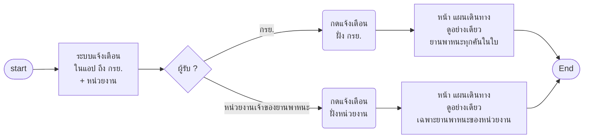

**Wireframe**
- **แผงแจ้งเตือน (กระดิ่ง)** — แบบเดียวกับแผงแจ้งเตือนของ Overhaul · รายการใหม่อยู่บนสุด จุดสีบอกประเภท ข้อความ เวลา
- **หน้า แผนเดินทาง (ดูอย่างเดียว)** — กล่องข้อมูลแผนเดินทาง (ชื่อ · แผน · ไตรมาส · ช่วงวันเดินทาง · พนักงาน กบค. ซ่อม · ผู้สร้าง · อนุมัติเมื่อ) · ตารางยานพาหนะ ทะเบียน · ยี่ห้อ/รุ่น · หน่วยงานเจ้าของยานพาหนะ · สถานที่บำรุงรักษา · ไม่มีปุ่มแก้ไขหรือตอบกลับ

**Condition**

| ส่วน | เงื่อนไข | ที่มา |
|---|---|---|
| เมื่อไหร่ส่ง | ทันทีที่ผู้อนุมัติอนุมัติแผนเดินทาง (S7) · ไม่ส่งตอนสร้างหรือตอนส่งกลับ | เจ้าของงาน 3 พ.ย. |
| ผู้รับ | กรย. ของเขตที่มียานพาหนะอยู่ในแผนเดินทาง · หน่วยงานเจ้าของยานพาหนะทุกหน่วยงานที่มียานพาหนะอยู่ในใบนั้น (หน่วยงานละ 1 แจ้งเตือน) · แผนเดินทางจ้างดำเนินการ (S9) แจ้งผู้รับจ้างด้วย (ยังไม่มีจอฝั่งผู้รับจ้าง) | เจ้าของงาน 3 พ.ย. + เสนอ (แยกต่อหน่วยงาน) |
| ช่องทาง | ออกแบบเฉพาะแจ้งเตือนในแอป (กระดิ่งที่แถบบน) ไปก่อน · e-mail และ push notification ที่เคาะไว้ 2 พ.ย. ยังไม่ออกแบบ | เจ้าของงาน 3 พ.ย. |
| ข้อความถึง กรย. | "แผนเดินทาง {ชื่อแผนเดินทาง} อนุมัติแล้ว กบค. จะเข้าบำรุงรักษายานพาหนะ {n} คัน ระหว่างวันที่ {วันเริ่ม} ถึง {วันสิ้นสุด}" (ร่าง) | เสนอ |
| ข้อความถึงหน่วยงานเจ้าของยานพาหนะ | "กบค. จะเข้าบำรุงรักษายานพาหนะของหน่วยงาน {n} คัน ({ทะเบียน}) ระหว่างวันที่ {วันเริ่ม} ถึง {วันสิ้นสุด} ที่ {สถานที่บำรุงรักษา}" (ร่าง) · ถ้ายานพาหนะของหน่วยงานอยู่คนละสถานที่ ดูรายคันในหน้าแผนเดินทาง | เสนอ |
| กดแจ้งเตือน | เปิดหน้าแผนเดินทางของใบนั้นแบบดูอย่างเดียว · กระดิ่งจุดแดงหายเมื่ออ่านแล้ว | เสนอ |
| หน้าแผนเดินทาง ฝั่ง กรย. | เห็นยานพาหนะทุกคันในใบ | เสนอ |
| หน้าแผนเดินทาง ฝั่งหน่วยงานเจ้าของยานพาหนะ | เห็นเฉพาะยานพาหนะของหน่วยงานตัวเอง · จำนวนคันต่อท้ายหัวข้อนับเฉพาะยานพาหนะของหน่วยงาน | เสนอ |
| ทำต่อ | ดูอย่างเดียว ไม่ต้องตอบรับวันเข้าตรวจ ไม่มีปุ่ม | เจ้าของงาน 3 พ.ย. (Q12 ปิด) |

**ยังไม่เคาะ** — กรย. ของเขตไหนได้แจ้งเตือน (เขตของยานพาหนะ หรือเขตของ กบค.) · e-mail และ push notification จะทำเมื่อไหร่ และใช้ข้อความเดียวกับในแอปไหม · แผนเดินทางถูกแก้หลังอนุมัติแล้วต้องแจ้งซ้ำไหม

### Scenario 9 · กบค. สร้างแผนเดินทางจ้างดำเนินการ (vendor)

**ช่วงงาน:** จ้างดำเนินการ · **เข้าจาก:** หน้าแผนเดินทางของไตรมาส (S6) กด "สร้างแผนเดินทาง" · **จบที่:** แผนเดินทางสถานะรออนุมัติ ส่งให้ผู้อนุมัติ (S7) · **ที่มา:** เจ้าของงาน 3 พ.ย. 2569 _"s9 อยากแทนด้วยการสร้างแผนการเดินทางของ vendor"_ + _"ตอนที่ทำ e2 อยากให้มีการเลือกว่า กบค ดำเนินการเอง หรือ จ้างดำเนินการ และพอเลือกจ้างดำเนินการ ก็มีให้เลือก vendor list"_ + เลือกช่อง เลขที่สัญญา/ใบสั่งจ้าง · สถานที่รายคัน · ช่วงวันทำงาน + ผ่าน S7 และ S8
· S9 เดิม (กรย. เตรียมอะไหล่ไว้ที่จุดรวมงาน) ตัดออก ย้ายไป [14-…-พักไว้-S3.md](14-บำรุงรักษา-userflow-พักไว้-S3.md)

```mermaid
flowchart LR
    S([start]) --> D1["หน้า แผนเดินทาง<br/>ยานพาหนะในไตรมาส<br/>+ แผนเดินทาง"]
    D1 --> A1("กด สร้างแผน<br/>เดินทาง")
    A1 --> D2["หน้า สร้างแผน<br/>เดินทาง เลือก<br/>จ้างดำเนินการ"]
    D2 --> A3("เลือกผู้รับจ้าง<br/>จาก vendor list<br/>+ เลขที่สัญญา")
    A3 --> A2("กด เพิ่มยานพาหนะ")
    A2 --> D5["popup เพิ่มยานพาหนะ<br/>ยานพาหนะทุกคันของไตรมาส<br/>ยานพาหนะในแผนอื่นติ๊กไม่ได้"]
    D5 --> A4("ติ๊กยานพาหนะ<br/>กด เพิ่มเข้า<br/>แผนเดินทาง")
    A4 --> A5("แก้เบอร์ติดต่อ<br/>สถานที่รายคัน +<br/>เลือกช่วงวันทำงาน")
    A5 --> Q1{"ช่องบังคับ<br/>ครบ ?"}
    Q1 -->|N| D2
    Q1 -->|Y| A6("ยืนยันการ<br/>สร้างแผน<br/>เดินทาง")
    A6 --> D3["ระบบส่งแผนเดินทาง<br/>ให้ผู้อนุมัติ S7<br/>สถานะรออนุมัติ"]
    D3 --> E([End])
    %% Q: A3 | Q46 ❓ vendor list มาจากไหน (ทะเบียนผู้รับจ้างของ กฟภ. หรือ กบค. เพิ่มเอง) · กรองตามประเภทยานพาหนะไหม · เลขที่สัญญาบังคับไหม
```

**Wireframe**
- **หน้า สร้างแผนเดินทาง · ไตรมาส n (จ้างดำเนินการ)** — ฟอร์มเดียวกับ S6: ข้อมูลแผนเดินทาง (ชื่อแผนเดินทาง คู่กับ radio รูปแบบดำเนินการ เลือก "จ้างดำเนินการ") · ผู้รับจ้าง (ช่องค้นหาผู้รับจ้าง + เลขที่สัญญา/ใบสั่งจ้าง) · ยานพาหนะในแผนเดินทาง (ปุ่ม "เพิ่มยานพาหนะ" + ตารางยานพาหนะ เบอร์ติดต่อและสถานที่รายคัน) · ช่วงวันทำงาน · ไม่มีส่วนพนักงาน กบค. ซ่อม และค่าใช้จ่าย · ปุ่ม ย้อนกลับ / ยืนยันการสร้างแผนเดินทาง

**Condition**

| ส่วน | เงื่อนไข | ที่มา |
|---|---|---|
| เข้าฟอร์ม | กด "สร้างแผนเดินทาง" ในหน้าแผนเดินทางของไตรมาส แล้วเลือก radio "จ้างดำเนินการ" ที่ช่องรูปแบบดำเนินการ ข้างช่องชื่อแผนเดินทาง (ค่าเริ่มต้นเป็น "กบค. ดำเนินการเอง") | เจ้าของงาน 3 พ.ย. |
| เปลี่ยนรูปแบบ | เลือก "จ้างดำเนินการ" แล้วหัวข้อ "ผู้รับจ้าง" ขึ้นใต้หัวข้อข้อมูลแผนเดินทาง · หัวข้อ "ช่วงวันเดินทาง" เปลี่ยนเป็น "ช่วงวันทำงาน" · หัวข้อ "พนักงาน กบค. ซ่อม (2-3 คน)" ซ่อน · เปลี่ยนกลับเป็นดำเนินการเองแล้วส่วนเหล่านั้นกลับมา | เจ้าของงาน 3 พ.ย. + เสนอ |
| ผู้รับจ้าง | ช่องค้นหา "ผู้รับจ้าง" ข้อความในช่อง "ค้นหาชื่อผู้รับจ้าง" · กดหรือพิมพ์แล้วรายชื่อผู้รับจ้าง (vendor list) ขึ้นใต้ช่อง แต่ละแถวมีชื่อผู้รับจ้างและบรรทัดรองประเภทยานพาหนะที่รับงาน · เลือกได้รายเดียว · บังคับ ไม่เลือก ขึ้น "กรุณาเลือกผู้รับจ้าง" | เจ้าของงาน 3 พ.ย. + เสนอ (บรรทัดรอง) |
| เลขที่สัญญา/ใบสั่งจ้าง | Text input ข้างช่องผู้รับจ้าง · ไม่บังคับ ป้าย "(ถ้ามี)" · ข้อความในช่อง "ระบุเลขที่สัญญาหรือใบสั่งจ้าง" | เจ้าของงาน 3 พ.ย. (บังคับหรือไม่ยังไม่เคาะ) |
| ยานพาหนะในแผนเดินทาง | ปุ่ม "เพิ่มยานพาหนะ" และ popup เพิ่มยานพาหนะเหมือน S6 ทุกข้อ · ยานพาหนะที่อยู่ในแผนเดินทางใบอื่นของไตรมาสแล้ว (ทั้งใบที่ กบค. ดำเนินการเองและใบจ้าง) แสดงแต่เลือกไม่ได้ บรรทัดรอง "อยู่ในแผนเดินทาง {ชื่อ}" (5 พ.ย. 2569 ตาม S6) | เจ้าของงาน 3 พ.ย. + รีวิว S6 5 พ.ย. |
| เบอร์ติดต่อและสถานที่บำรุงรักษา | รายคันเหมือน S6 · เบอร์ค่าเริ่มต้นเป็นเบอร์เจ้าของยานพาหนะ สถานที่ค่าเริ่มต้นสำนักงานที่ยานพาหนะอยู่ · แก้ได้ทีละคันจาก popup แก้ไขยานพาหนะในแผนเดินทางเหมือน S6 | เจ้าของงาน 3 พ.ย. |
| ช่วงวันทำงาน | วันที่เริ่มงาน และถึงวันที่ · date range · ไม่สามารถเลือกน้อยกว่าวันนี้ · ไม่กรอก ขึ้น "กรุณาเลือกวันที่เริ่ม" และ "กรุณาเลือกวันที่สิ้นสุด" | เจ้าของงาน 3 พ.ย. |
| ยืนยัน | ปุ่ม "ยืนยันการสร้างแผนเดินทาง" Disabled จนกว่าช่องบังคับครบ (ชื่อแผนเดินทาง · ผู้รับจ้าง · ยานพาหนะ · ช่วงวันทำงาน) · ช่องที่ออกโดยยังว่างขึ้นข้อความใต้ช่อง (Validation กรณีไม่ได้ระบุข้อมูล, Out of focus · 5 พ.ย. 2569 ตาม S6) · สำเร็จ แผนเดินทางสถานะ "รออนุมัติ" ส่งให้ผู้อนุมัติ (S7) · toast "สร้างแผนเดินทางสำเร็จ · ส่งให้ผู้อนุมัติแล้ว" · ในหน้าแผนเดินทาง คอลัมน์ผู้ดำเนินการแสดงชื่อผู้รับจ้าง | เจ้าของงาน 3 พ.ย. |
| อนุมัติและแจ้งเตือน | ผ่าน S7 เหมือนแผนที่ กบค. ดำเนินการเอง (หน้ารายละเอียดแสดง รูปแบบดำเนินการ ผู้รับจ้าง เลขที่สัญญา ช่วงวันทำงาน แทนพนักงาน) · อนุมัติแล้วแจ้งเตือนตาม S8 · การแจ้งผู้รับจ้างทำนอกระบบไปก่อน เพราะผู้รับจ้างไม่มีหน้าในระบบแล้ว (4 พ.ย. 2569 ตัด S23) | เจ้าของงาน 3 พ.ย. + 4 พ.ย. |

**ยังไม่เคาะ** — vendor list มาจากไหน และกรองตามประเภทยานพาหนะไหม (Q46) · เลขที่สัญญาบังคับไหม · ผู้รับจ้างได้แจ้งเตือนทางไหน และมีสิทธิ์เข้าระบบแบบใดหรือไม่ (Q13) · หลังอนุมัติ กบค. ปิดงานรายคันของใบนี้เองที่ S10 (S11 ตัดออก 4 พ.ย. 2569)

### Scenario 10 · กบค. บันทึกงานบำรุงรักษารายคัน

**ช่วงงาน:** ดำเนินการบำรุงรักษา · **เข้าจาก:** หน้ารายละเอียดแผนเดินทางที่อนุมัติแล้ว (ไอคอนไปต่อในตารางแผนเดินทางของหน้าแผนเดินทาง S6 หรือแจ้งเตือน) · **จบที่:** ทำครบทุกคันในแผนเดินทาง · **ที่มา:** `[บอร์ด]` "ก่อนออกเดินทาง → เดินทางไปจุดรวมงาน → รับอะไหล่ที่จุดรวมงาน → เดินทางไปหน้างานที่จะบำรุงรักษา → บำรุงรักษาได้? → ใช่ → ถ่ายรูปยานพาหนะก่อนบำรุงรักษา → ดำเนินการตรวจและบำรุงรักษา + เก็บตัวอย่างน้ำมันไฮโดรลิกไปทดสอบ → บันทึกงานบำรุงรักษาและอะไหล่ (ยืนยันจำนวนอะไหล่ที่ใช้จริง) … บำรุงรักษาคันอื่น ๆ ต่อจนครบตามแผน" + กล่อง Display "แสดง Field ให้ระบุสาเหตุที่ไม่สามารถบำรุงรักษาได้" · "แสดง Field ให้ Upload ภาพที่ต้องถ่ายก่อนเริ่มงาน" · "แสดง Field ให้ Upload ภาพที่ต้องถ่ายตอนจบงาน"
· **ปรับ 5 พ.ย. 2569 ตามรีวิวทีมออกแบบ (เจ้าของงาน _"s10 ลองปรับให้เป็นแบบที่เขียนให้"_):** รีวิว _"หน้ารายละเอียดแผนเดินทาง อยากให้มีนับ progress แบบ 0/10 ของรายการรถที่ตรวจแล้ว · หน้างานรายคัน - เริ่มงาน เมื่อกดเริ่มงาน จะพาเข้า Step การ Maintain · Step1 : ตรวจสภาพก่อนบำรุงรักษา ลงนามการตรวจสภาพ (optional?) · Step2 : ไม่ต้องมีแล้ว · Step3 : เอาไปแทน Step2 สรุปงานก่อนปิดงาน ระบุจำนวนอะไหล่ที่ใช้จริงในงานนี้ เลือกศูนย์ต้นทุน ต้องเป็นรูปแบบเดียวกันกับงานซ่อมและ overhaul น้ำมันไฮโดรลิก เลือกตัวเลือก สามารถระบุวันที่เปลี่ยนน้ำมันครั้งล่าสุดได้ · หน้ารายละเอียดแผนเดินทาง ปิดงานทำเร็จ แสดง Toast ด้านบนขวา สถานะ ยังไม่เริ่ม > เสร็จสิ้น + รอผลตรวจน้ำมัน(ถ้าเลือกมาจะมี ไม่เลือกมาจะไม่มี) · หน้างานรายคัน Step3 : บำรุงรักษาไม่ได้ เมื่อกดแล้วจะต้องระบุสาเหตุ แสดงรายการอะไหล่ที่ต้องใช้สำหรับงานนี้เพื่อยืนยันการส่งคืน เมื่อยืนยันแล้ว จะกลับไปที่หน้ารายละเอียดแผนเดินทาง"_ · เจ้าของงานยืนยันเพิ่ม 5 พ.ย. 2569: _"toast ต้องแสดงด้านมุมบนขวามือเสมอเลย"_ · _"เรื่องลงนาม require"_ · _"เข้ามา step 1 ถือว่า อยู่ระหว่างบำรุงรักษา เลย"_ · _"ถ้าบำรุงรักษาไม่ได้ ไม่เอามานับ เช่น ถ้าทั้งหมด 10 แล้วมีคันที่ไม่ได้บำรุงรักษา จะเหลือ 9"_ ⇒ กดเริ่มงานแล้วเข้าขั้นตอน 2 ขั้น (Step 1 ตรวจสภาพก่อนบำรุงรักษา · Step 2 สรุปงานก่อนปิดงาน) · หน้า "อยู่ระหว่างบำรุงรักษา" ที่คั่นระหว่างรับยานพาหนะกับปิดงานเอาออก แต่สถานะ "อยู่ระหว่างบำรุงรักษา" ยังมี ตั้งแต่กดเริ่มงานจนปิดงาน · หน้ารายละเอียดแผนเดินทางมีตัวนับ "ตรวจแล้ว x/y" · รหัสจอบล็อก I เลื่อนทั้งบล็อก (I.6 เป็นต้นไป)
· **ปรับ 5 พ.ย. 2569 (เจ้าของงาน · ภาพส่วน "ตรวจสภาพรถปิดงาน" ของหน้าปิดงาน):** _"s10 เอาตรวจสภาพปิดงาน ออกไปเลย"_ ⇒ เอาตารางตรวจสภาพยานพาหนะปิดงาน (24 รายการ ปกติ · ต้องแก้ไข · หมายเหตุ + เพิ่มรายการ) ออกจากหน้าปิดงานทั้งแผนดำเนินการเองและแผนจ้าง · คงไว้ ลงนามการส่งคืนยานพาหนะ · Safety Inspection · รายการรับยานพาหนะตอนเริ่มงาน · ไม่มีจอหรือข้อความ error ที่ผูกกับตารางนี้ รหัสจอบล็อก I ไม่เปลี่ยน
· **ปรับ 3 พ.ย. 2569 (เจ้าของงาน):** _"หน้าที่เป็นบำรุงรักษารายคัน จะเข้าจากหน้าไหนได้บ้าง จริงมันควรเข้าได้จากหน้าแผนการเดินทาง แล้วเลือกบำรุงรถทีละคัน"_ → เลือก (1) ทางเข้า = หน้ารายละเอียดแผนเดินทาง (2) หน้ารายคันแบบทำทีละขั้น ⇒ ตามหน้า RP & MA Job ของ UI Release#2 (หน้างานรายคันมีสถานะ ปุ่มเปลี่ยนสถานะที่หัวหน้า และ popup ทีละขั้น) · ฟอร์มยาวบันทึกครั้งเดียวแบบเดิมเลิกใช้
· **รวมแผนจ้างดำเนินการเข้า S10 (4 พ.ย. 2569 เจ้าของงาน):** _"อยากตัด scen ผู้รับจ้าง หรือ vendor ตรวจรับทีละคัน ออก คือ S23 และ S11 ที่อยากเอาออก"_ แล้วเลือกให้ กบค. ปิดงานรายคันของแผนจ้างดำเนินการเอง ใช้หน้างานรายคันและหน้าปิดงานเดียวกับ S10 กรอกแทนผู้รับจ้าง ⇒ S10 ครอบทั้งแผนที่ กบค. ดำเนินการเองและแผนจ้างดำเนินการ · ไม่มีขั้นส่งตรวจงานและตรวจรับรายคัน · หลัง S10 เดินต่อ S12 ถึง S17 ตามเดิม · เดิมมุมผู้รับจ้างแยกเป็น S23 (4 พ.ย. 2569 รอบ 3) และ กบค. ตรวจรับที่ S11 ทั้งสองตัดออกแล้ว

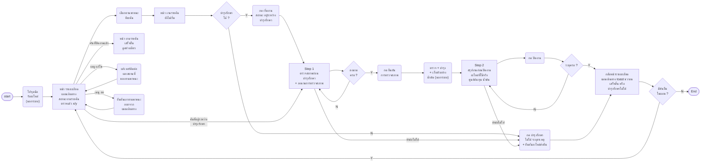

**Wireframe**
- **หน้า รายละเอียดแผนเดินทาง** — หัวหน้า = ชื่อแผนเดินทาง ป้าย "อนุมัติแล้ว" · กล่อง "รายละเอียดแผนเดินทาง" (ข้อมูลแผนเดินทางเดียวกับหน้าอนุมัติ S7 + ความคืบหน้า · แผนจ้างดำเนินการแสดง รูปแบบดำเนินการ ผู้รับจ้าง เลขที่สัญญา/ใบสั่งจ้าง และช่วงวันทำงาน แทนพนักงาน) · หัวข้อ "ยานพาหนะในแผนเดินทาง" มีป้ายนับ "ตรวจแล้ว x/y" ต่อท้ายหัวข้อ (5 พ.ย. 2569) · ตาราง ทะเบียน (บรรทัดรองหน่วยงานเจ้าของยานพาหนะ) · ยี่ห้อ/รุ่น · เบอร์ติดต่อ · สถานที่บำรุงรักษา · สถานะงาน · ปุ่ม "…" ท้ายแถว (ดูรายละเอียด · แก้ไข · ลบ) · toast ขวาบนเมื่อกลับมาจากปิดงานหรือบำรุงรักษาไม่ได้
- **หน้า งานรายคัน (ยังไม่เริ่ม)** — หัวหน้า = ทะเบียน ป้าย "ยังไม่เริ่ม" · ปุ่ม "บำรุงรักษาไม่ได้" และปุ่มหลัก "เริ่มงาน" · กล่อง "ข้อมูลยานพาหนะ" 6 ช่อง · กล่อง "การนัดหมาย" (แผนเดินทาง · ช่วงวันเดินทาง · สถานที่บำรุงรักษา · เบอร์ติดต่อ · แผนจ้างดำเนินการแสดง ผู้รับจ้าง และช่วงวันทำงาน แทนช่วงวันเดินทาง) · ตาราง "รายการงานและอะไหล่ตามแผน" พร้อมปุ่ม "เพิ่มอะไหล่" และไอคอนแก้ไข ลบ ท้ายแถว
- **หน้า ขั้นตอนบำรุงรักษา** (5 พ.ย. 2569 แทนหน้ารับยานพาหนะ หน้าอยู่ระหว่างบำรุงรักษา และหน้าปิดงานเดิม) — หัวหน้า = ทะเบียน ป้าย "อยู่ระหว่างบำรุงรักษา" · ปุ่ม "บำรุงรักษาไม่ได้" ที่หัวหน้าทุกขั้น · ใต้หัวหน้าเป็นแถบขั้นตอน 2 ขั้น "01 ตรวจสภาพก่อนบำรุงรักษา" และ "02 สรุปงานก่อนปิดงาน" (มือถือเป็นวงขั้นตอน 1/2 · 2/2 พร้อมชื่อขั้นปัจจุบันและขั้นถัดไป) · กล่องข้อมูลยานพาหนะ และกล่องการนัดหมาย (มีเวลาเริ่มงานและผู้เริ่มงาน)
  - **Step 1 ตรวจสภาพก่อนบำรุงรักษา** — **รายการเอกสารรับยานพาหนะ** 13 รายการ (แผ่นป้ายทะเบียนหน้า - หลัง … สภาพตัวถังและสี) เป็นตารางแบบงานซ่อม: รายการ · มี · ไม่มี · ชำรุด · ผิดรุ่น (ติ๊กได้เมื่อเลือก มี) · หมายเหตุ (ถ้ามี) + ปุ่มเพิ่มรายการ · มือถือเป็นการ์ดรายการละใบ · **ลงนามการตรวจสภาพ** ผู้ส่งมอบยานพาหนะ (หน่วยงานเจ้าของยานพาหนะ) และผู้รับมอบยานพาหนะ (กบค.) แต่ละฝ่ายเลือกชื่อแล้วกด "เซ็นลงนาม" (popup "ลงนามการตรวจสภาพ" ปุ่ม ปิด · บันทึก · เซ็นแล้วแสดง "ลงนามแล้ว" และปุ่ม "แก้ไขลงนาม") · **ภาพก่อนเริ่มงาน** · ปุ่ม ย้อนกลับ / "ยืนยันการตรวจสภาพ" · ใช้ component ของงานซ่อม ReceiptChecklist + HandoverSignature + Modal Signature
  - **Step 2 สรุปงานก่อนปิดงาน** — เนื้อหาเดียวกับหน้าปิดงานเดิม ไล่ยาวหน้าเดียว ไม่มีส่วนภาพ เรียงลง: **ข้อมูลเอกสาร** (เลขที่งาน · หน่วยงานผู้ใช้บริการ · ชื่องาน · วันที่รับงาน · วันที่เสร็จงาน) · **บันทึกข้อตกลงลูกค้า** (ติดต่อลูกค้าชื่อ · ตำแหน่ง · เมื่อวันที่ · เบอร์โทรศัพท์ · ความต้องการลูกค้า) · **รายการสภาพวัสดุอะไหล่** (ชื่ออะไหล่ · ราคาต่อหน่วย · จำนวนที่ใช้ เป็นช่องกรอกตัวเลข · ราคารวมที่ใช้ · จำนวนที่คืน · ราคารวมที่คืน · จำนวนอะไหล่เก่า · หมายเหตุ + ปุ่มเพิ่มรายการ) · **ค่าใช้จ่ายของยานพาหนะคันนี้** (รายคน ค่าเบี้ยเลี้ยงต่อวัน · ค่าที่พักต่อวัน · จำนวนวัน · รวม + ค่าเดินทางรวมทุกคนช่องเดียว + สรุปรวม + **งบที่ตัด** คู่กับ **ศูนย์ต้นทุน** แบบงานซ่อม) · **ผลการบำรุงรักษา** (เลขไมล์ยานพาหนะ · ชั่วโมงเครื่องจักร) · **น้ำมันไฮโดรลิก** (เก็บตัวอย่าง · เปลี่ยนน้ำมัน · เก็บตัวอย่างและเปลี่ยน + ช่อง "วันที่เปลี่ยนน้ำมันครั้งล่าสุด (ถ้ามี)" กรอกได้ มีปฏิทินเลือกวัน + ผลการทดสอบ (ถ้ามี) เมื่อเลือกแบบที่มีเก็บตัวอย่าง) · **Safety Inspection** (เฉพาะรถเครนและรถกระเช้า · อัปโหลด "เอกสาร Safety Inspection" ไม่บังคับ "PDF, PNG, or JPG (สูงสุด 10 ไฟล์)") · **ลงนามการส่งคืนยานพาหนะ** 2 ฝ่าย ผู้ส่งมอบยานพาหนะ (กบค.) และผู้รับมอบยานพาหนะ (หน่วยงานเจ้าของยานพาหนะ) · **บันทึกตรวจสอบเอกสารปิดงาน** (รายการเดียว "บันทึกใบสั่งการ" เลือก มี · ไม่มี · ไม่ต้องใช้ + ปุ่มอัพโหลดเอกสาร + ปุ่มเพิ่มรายการ) · ปุ่ม ย้อนกลับ / ปิดงาน · ~~ตรวจสภาพยานพาหนะปิดงาน~~ ตัดออก 5 พ.ย. 2569
- **popup บำรุงรักษาไม่ได้** — หัว "บำรุงรักษาไม่ได้ · {ทะเบียน}" บรรทัดรอง "ระบุสาเหตุ และตรวจรายการอะไหล่ของงานนี้เพื่อยืนยันการส่งคืน" · ช่อง "สาเหตุที่บำรุงรักษาไม่ได้" · ตาราง "อะไหล่ส่งคืน" (ชื่ออะไหล่ · จำนวนตามแผน · จำนวนที่ใช้ · จำนวนที่คืน) · ปุ่ม ยกเลิก / ยืนยัน · เปิดได้จากหน้างานรายคันที่ยังไม่เริ่ม และจาก Step 1 หรือ Step 2 · มือถือเป็น bottom sheet ตารางเป็นการ์ดรายการละใบ
- **หน้า งานรายคัน (เสร็จสิ้น)** — ข้อมูลยานพาหนะและงาน (เริ่มงาน · ปิดงาน · ผู้บันทึก · เลขไมล์และชั่วโมงหลังทำ) · ภาพก่อนเริ่มงาน · รายการงานและอะไหล่ที่ใช้จริง · ค่าใช้จ่ายของยานพาหนะคันนี้ (งบที่ตัด · ศูนย์ต้นทุน) · ผลตรวจน้ำมัน (S12)

**Condition**

| ส่วน | เงื่อนไข | ที่มา |
|---|---|---|
| เข้าหน้ารายละเอียดแผนเดินทาง | กดไอคอนไปต่อของแผนเดินทางที่สถานะ "อนุมัติแล้ว" ในหน้าแผนเดินทางของไตรมาส (S6) หรือกดแจ้งเตือนของแผนเดินทางนั้น · ใบที่ยังรออนุมัติหรือถูกส่งกลับ เปิดแล้วไปหน้าแก้ไขหรือหน้าดูตามเดิม ไม่มีส่วนสถานะงาน | เจ้าของงาน 3 พ.ย. + เสนอ (ใบที่ยังไม่อนุมัติ) |
| ความคืบหน้า (เคาะแล้ว 5 พ.ย. 2569) | หัวข้อ "ยานพาหนะในแผนเดินทาง" มีป้ายนับ "ตรวจแล้ว x/y" · x = จำนวนคันที่ "เสร็จสิ้น" · y = จำนวนยานพาหนะทั้งหมดในแผนเดินทาง ลบด้วยคันที่ "บำรุงรักษาไม่ได้" (เช่น 10 คัน บำรุงรักษาไม่ได้ 1 คัน แสดง x/9) · ยังไม่เริ่มสักคันแสดง "ตรวจแล้ว 0/4" · คันที่อยู่ระหว่างบำรุงรักษายังไม่นับใน x · กล่องรายละเอียดแผนเดินทางช่อง "ความคืบหน้า" แสดง "เสร็จสิ้น x จาก y คัน" ต่อด้วย " · อยู่ระหว่างบำรุงรักษา n" และ " · บำรุงรักษาไม่ได้ n (ไม่นับรวม)" เมื่อมี · แผนจ้างดำเนินการนับแบบเดียวกัน | รีวิวทีมออกแบบ 5 พ.ย. 2569 _"อยากให้มีนับ progress แบบ 0/10 ของรายการรถที่ตรวจแล้ว"_ + เจ้าของงาน 5 พ.ย. 2569 _"ถ้าบำรุงรักษาไม่ได้ ไม่เอามานับ เช่น ถ้าทั้งหมด 10 แล้วมีคันที่ไม่ได้บำรุงรักษา จะเหลือ 9"_ |
| ตารางยานพาหนะในแผนเดินทาง | ยานพาหนะทุกคันในใบ เรียงตามลำดับในแผนเดินทาง · ทะเบียนมีบรรทัดรองหน่วยงานเจ้าของยานพาหนะ · เบอร์ติดต่อและสถานที่ตามที่บันทึกในแผนเดินทาง · กดแถวเปิดหน้างานรายคันของคันนั้น | เจ้าของงาน 3 พ.ย. |
| ปุ่ม "…" ท้ายแถวยานพาหนะ | กดแล้วเปิดเมนูใต้ปุ่ม (มือถือเป็น bottom sheet) รายการตามสถานะงาน: ยังไม่เริ่ม = ดูรายละเอียด · แก้ไข · ลบ · อยู่ระหว่างบำรุงรักษา = ดูรายละเอียด · แก้ไข · เสร็จสิ้น = ดูรายละเอียด (ผลการทดสอบน้ำมันบันทึกในหน้ารายละเอียด S12 · เลิกเมนูแยก 4 พ.ย.) · บำรุงรักษาไม่ได้ = ดูรายละเอียด · แผนจ้างดำเนินการใช้เมนูชุดเดียวกัน ผู้กดคือ กบค. · **ดูรายละเอียด** เปิดหน้างานรายคัน (เหมือนกดแถว) · **แก้ไข** เปิด popup "แก้ไขเบอร์ติดต่อและสถานที่ · {ทะเบียน}" ช่อง เบอร์ติดต่อ และ สถานที่บำรุงรักษา กรอกค่าปัจจุบันไว้ ปุ่ม ยกเลิก · บันทึก (popup เดียวกับฟอร์มแผนเดินทาง S6) · **ลบ** ขึ้นหน้าต่างยืนยันสีแดง "ยืนยันการเอายานพาหนะออกจากแผนเดินทาง" ข้อความ "{ทะเบียน} จะถูกเอาออกจากแผนเดินทางนี้ และเลือกเข้าแผนเดินทางใบอื่นของไตรมาสได้อีก" ปุ่ม ยกเลิก · เอาออก | เจ้าของงาน 3 พ.ย. _"แก้ไข คือแก้ไขข้อมูล สถานที่ติดต่อ กับเบอร์โทร ลบ ก็คือรถคันนั้นออกจากแผนการเดินทาง ส่วนดูรายละเอียด ก็ไปหน้ารายละเอียดที่จะมีให้เริ่มการบำรุงรักษา และปิดงาน"_ (ยืนยันทางแยกในผัง) + เสนอ (รายการตามสถานะ · ข้อความยืนยัน (ร่าง)) |
| สถานะงานรายคัน | ยังไม่เริ่ม (สีเทา) · อยู่ระหว่างบำรุงรักษา (สีเหลือง) · เสร็จสิ้น (สีเขียว) · บำรุงรักษาไม่ได้ (สีแดง) · ทุกคันเริ่มที่ "ยังไม่เริ่ม" เมื่อแผนเดินทางอนุมัติ · **กด "เริ่มงาน" แล้วเป็น "อยู่ระหว่างบำรุงรักษา" ทันที** ตั้งแต่เข้า Step 1 จนปิดงาน (เคาะแล้ว 5 พ.ย. 2569) ออกจากหน้ากลางทางแล้วสถานะยังเป็น "อยู่ระหว่างบำรุงรักษา" ในหน้ารายละเอียดแผนเดินทาง · ปิดงานสำเร็จเป็น "เสร็จสิ้น" · ผลรวมจากหน้ารายละเอียดแผนเดินทางจึงเห็น ยังไม่เริ่ม เปลี่ยนเป็น เสร็จสิ้น ตามรีวิว โดยมีอยู่ระหว่างบำรุงรักษาระหว่างทาง · แผนจ้างดำเนินการใช้ 4 สถานะนี้เหมือนกัน | เจ้าของงาน 5 พ.ย. 2569 _"เข้ามา step 1 ถือว่า อยู่ระหว่างบำรุงรักษา เลย"_ + รีวิว 5 พ.ย. _"สถานะ ยังไม่เริ่ม > เสร็จสิ้น"_ + เจ้าของงาน 4 พ.ย. (ตัดสถานะของงานผู้รับจ้าง) |
| ปุ่มที่หน้างานรายคัน | ยังไม่เริ่ม: "บำรุงรักษาไม่ได้" และ "เริ่มงาน" · อยู่ระหว่างบำรุงรักษา: เปิดแล้วไปหน้าขั้นตอนที่ค้างอยู่ (Step 1 หรือ Step 2) ปุ่ม "บำรุงรักษาไม่ได้" ที่หัวหน้า และปุ่มของขั้นท้ายหน้า · เสร็จสิ้นหรือบำรุงรักษาไม่ได้: ไม่มีปุ่ม ดูอย่างเดียว · หน้างานรายคันแบบอยู่ระหว่างบำรุงรักษาที่มีปุ่ม "ปิดงาน" เลิกใช้ (5 พ.ย. 2569) · แผนจ้างดำเนินการมีปุ่มชุดเดียวกัน กบค. เป็นผู้กด | รีวิว 5 พ.ย. 2569 _"Step2 : ไม่ต้องมีแล้ว"_ + เจ้าของงาน 4 พ.ย. |
| เริ่มงาน และ Step 1 ตรวจสภาพก่อนบำรุงรักษา | กด "เริ่มงาน" สถานะเป็น "อยู่ระหว่างบำรุงรักษา" ระบบบันทึกเวลาเริ่มงานและผู้เริ่มงาน toast ขวาบน "เริ่มงานบำรุงรักษาแล้ว" แล้วเปิดหน้าขั้นตอนที่ Step 1 · แถบขั้นตอน 2 ขั้น "ตรวจสภาพก่อนบำรุงรักษา" (ปัจจุบัน) และ "สรุปงานก่อนปิดงาน" · ตรวจรายการรับยานพาหนะทีละรายการ (มี · ไม่มี · ชำรุด · ผิดรุ่น) · **ลงนามการตรวจสภาพบังคับ** 2 ฝ่าย ป้าย "ผู้ส่งมอบยานพาหนะ (หน่วยงานเจ้าของยานพาหนะ)" และ "ผู้รับมอบยานพาหนะ (กบค.)" ข้อความในช่องเมื่อว่าง "เลือก" ตามด้วยชื่อป้าย · popup ลงนามแสดงชื่อผู้ที่กำลังเซ็น · ปุ่ม "ยืนยันการตรวจสภาพ" กดไม่ได้จนกว่าลงนามครบ 2 ฝ่าย (แบบเดียวกับปุ่มยืนยันรับยานพาหนะเดิม) · แนบภาพก่อนเริ่มงาน "รูปยานพาหนะ + ทะเบียน" และ "อะไหล่ใหม่" · กด "ยืนยันการตรวจสภาพ" แล้วขั้นที่ 1 เป็นเสร็จ ไปหน้า Step 2 ไม่มี toast · ขั้นที่ยืนยันแล้วดูย้อนได้จากแถบขั้นตอน แก้ไม่ได้ · ย้อนกลับในขั้นปัจจุบันกลับหน้ารายละเอียดแผนเดินทาง สถานะยังเป็นอยู่ระหว่างบำรุงรักษา | รีวิว 5 พ.ย. 2569 _"เมื่อกดเริ่มงาน จะพาเข้า Step การ Maintain · Step1 : ตรวจสภาพก่อนบำรุงรักษา ลงนามการตรวจสภาพ"_ + เจ้าของงาน 5 พ.ย. 2569 _"เรื่องลงนาม require"_ · _"เข้ามา step 1 ถือว่า อยู่ระหว่างบำรุงรักษา เลย"_ + กติกา stepper เจ้าของงาน 21 ต.ค. (ปุ่มขั้นปัจจุบัน · ขั้นที่ยืนยันแล้วดูจากแถบ) + บอร์ด (ภาพก่อนเริ่ม) |
| Step 2 สรุปงานก่อนปิดงาน และปิดงาน | หลังยืนยันการตรวจสภาพ เปิด Step 2 ในหน้าเดียวกัน แถบขั้นตอนขั้น 1 เสร็จ ขั้น 2 ปัจจุบัน · เนื้อหาไล่ยาวหน้าเดียวเท่าหน้าปิดงานเดิม · ข้อมูลเอกสารและบันทึกข้อตกลงลูกค้าแสดงอย่างเดียว ระบบเติมจากแผนเดินทาง (เลขที่งาน = เลขที่ MR ของแผนที่แผนเดินทางนี้อยู่ เช่น MR Z7000001) (เบอร์โทรศัพท์ = เบอร์ติดต่อของคันนั้น) · รายการสภาพวัสดุอะไหล่ตั้งต้นจากอะไหล่ตามแผนของคัน **จำนวนที่ใช้เป็นช่องกรอกตัวเลข ตั้งต้นเท่าแผน กรอกจำนวนที่ใช้จริงในงานนี้** (5 พ.ย. 2569 · แบบ ReturnPart ของงานซ่อม · มือถือยังแสดงเป็นข้อความในการ์ด) จำนวนที่คืน จำนวนอะไหล่เก่า และหมายเหตุ กรอกได้ ราคารวมคำนวณเอง · แผนจ้างดำเนินการ กบค. กรอกจำนวนที่ใช้และที่คืนตามที่ผู้รับจ้างทำจริง · บันทึกตรวจสอบเอกสารปิดงาน ตั้งต้นรายการเดียว "บันทึกใบสั่งการ" (เจ้าของงาน 3 พ.ย. 2569 ตัด 15 รายการของงานซ่อมออก) เพิ่มรายการได้ด้วยปุ่ม "เพิ่มรายการ" · แต่ละรายการเลือก มี ไม่มี หรือไม่ต้องใช้ ปุ่มอัพโหลดเอกสารกดได้เมื่อเลือก มี · ~~ตรวจสภาพยานพาหนะปิดงาน~~ ตัดออก 5 พ.ย. 2569 (เจ้าของงาน _"s10 เอาตรวจสภาพปิดงาน ออกไปเลย"_ · ทั้งแผนดำเนินการเองและแผนจ้าง · desktop และมือถือ) · **ลงนามการส่งคืนยานพาหนะ** 2 ฝ่ายคงไว้ ป้าย "ผู้ส่งมอบยานพาหนะ (กบค.)" และ "ผู้รับมอบยานพาหนะ (หน่วยงานเจ้าของยานพาหนะ)" หัวข้อคงเป็น "ลงนามการส่งคืนยานพาหนะ" ทั้งก่อนและหลังเซ็น · **ปุ่ม "ปิดงาน" กดไม่ได้จนกว่ากรอกช่องบังคับครบและลงนามการส่งคืนยานพาหนะครบ 2 ฝ่าย** ช่องบังคับที่ว่างขึ้นข้อความใต้ช่องเมื่อออกจากช่อง (Out of focus) แบบเดียวกับฟอร์ม S1 S6 (5 พ.ย. 2569) · รายการรับยานพาหนะตอนเริ่มงานคงเดิม · **ค่าใช้จ่ายของยานพาหนะคันนี้ (บาท)** อยู่ต่อจากรายการสภาพวัสดุอะไหล่ · กรอกรายคน 1 แถวต่อพนักงาน 1 คน ตั้งต้นเป็นพนักงาน กบค. ซ่อมในแผนเดินทาง **เพิ่ม ลด พนักงานได้** (ปุ่ม "เพิ่มพนักงาน" ใต้แถว · ไอคอนลบท้ายแถว): พนักงาน (ช่องค้นหา "ค้นหาชื่อ-นามสกุล, รหัสพนักงาน") · ค่าเบี้ยเลี้ยง (บาท/วัน) · ค่าที่พัก (บาท/วัน) ป้าย "(ถ้ามี)" · จำนวนวัน (เลือก 1 ถึงจำนวนวันของช่วงวันเดินทาง ข้อความในช่องเมื่อว่าง "เลือกจำนวนวัน") · รวม (บาท) = (ค่าเบี้ยเลี้ยงต่อวัน + ค่าที่พักต่อวัน) x จำนวนวัน ระบบคำนวณ อ่านอย่างเดียว · ใต้แถวรายคนมีช่อง **"ค่าเดินทาง (รวมทุกคน)"** ช่องเดียว ป้าย "(ถ้ามี)" เป็นยอดรวมของทุกคนที่ไปกับแผนเดินทาง · ใต้นั้นสรุป รวมค่าเบี้ยเลี้ยง · รวมค่าที่พัก · ค่าเดินทาง · รวมค่าใช้จ่ายของยานพาหนะคันนี้ (ยังไม่กรอกแสดง 0 บาท) · ไม่มีกล่องแจ้ง (เจ้าของงานให้ลบ 3 พ.ย. 2569) · ต่อด้วย **งบที่ตัด + ศูนย์ต้นทุน** แบบเดียวกับงานซ่อม (ดูแถว งบที่ตัดและศูนย์ต้นทุน · 5 พ.ย. 2569 แทนช่องเดียว "งบประมาณ (ศูนย์ต้นทุน)" ของ 3 พ.ย.) · งบนี้ใช้กับค่าใช้จ่ายของยานพาหนะคันนี้เท่านั้น ค่าอะไหล่เป็นของ กบค. · เลขไมล์ยานพาหนะและชั่วโมงเครื่องจักร บังคับ ไม่กรอกขึ้น "กรุณาระบุเลขไมล์ยานพาหนะ" และ "กรุณาระบุชั่วโมงเครื่องจักร" · ภาพชั่วโมงเครื่องจักรไม่บังคับ · กด "ปิดงาน" สำเร็จ สถานะเป็น "เสร็จสิ้น" (แผนจ้างดำเนินการก็เป็น "เสร็จสิ้น" ทันที ไม่มีส่งตรวจงาน) ระบบบันทึกเวลาปิดงาน กลับหน้ารายละเอียดแผนเดินทาง toast ขวาบน "บันทึกงานบำรุงรักษาสำเร็จ" · ตัวนับ x เพิ่ม 1 · สถานะเป็น "เสร็จสิ้น" ต่อด้วยป้าย "รอผลตรวจน้ำมัน" เฉพาะคันที่เลือกน้ำมันแบบมีเก็บตัวอย่าง เลือกเปลี่ยนน้ำมันอย่างเดียวไม่มีป้ายนี้ | รีวิว 5 พ.ย. 2569 _"Step3 : เอาไปแทน Step2 สรุปงานก่อนปิดงาน ระบุจำนวนอะไหล่ที่ใช้จริงในงานนี้"_ · _"ปิดงานทำเร็จ แสดง Toast ด้านบนขวา สถานะ ยังไม่เริ่ม > เสร็จสิ้น + รอผลตรวจน้ำมัน(ถ้าเลือกมาจะมี ไม่เลือกมาจะไม่มี)"_ + บอร์ด + เจ้าของงาน 3 พ.ย. (รูปแบบหน้า · ค่าใช้จ่ายรายคันกรอกรายคน + รวม · งบประมาณ (ศูนย์ต้นทุน) ตั้งต้นศูนย์ต้นทุนเจ้าของยานพาหนะ) + เสนอ (ค่าตั้งต้น · ปุ่มอัพโหลดกดได้เมื่อ มี · ข้อความกล่องแจ้ง) |
| งบที่ตัดและศูนย์ต้นทุน (5 พ.ย. 2569) | แบบเดียวกับงานซ่อม: ช่องเลือก "งบที่ตัด" ครึ่งซ้าย ตัวเลือก งบทำการ หน่วยงานต้นสังกัด · งบทำการ หน่วยงานอื่น · งบโครงการ (ตาม WBS) · งบซ่อมบำรุงตามใบสั่ง (PM Order) · อื่น ๆ · ครึ่งขวาเปลี่ยนตามที่เลือก: หน่วยงานต้นสังกัด = "ศูนย์ต้นทุน" ระบบเติมศูนย์ต้นทุนของหน่วยงานเจ้าของยานพาหนะ อ่านอย่างเดียว · หน่วยงานอื่น = ช่องเลือก "ศูนย์ต้นทุน" ข้อความในช่องเมื่อว่าง "ระบุศูนย์ต้นทุน" · WBS = เลข WBS เลขโครงข่าย เลขกิจกรรม · PM Order = เลขใบสั่ง เลขโครงข่าย เลขกิจกรรม · อื่น ๆ = รายละเอียดงบที่ตัด · ตั้งต้น "งบทำการ หน่วยงานต้นสังกัด" + ศูนย์ต้นทุนของหน่วยงานเจ้าของยานพาหนะ · ใช้กับค่าใช้จ่ายของยานพาหนะคันนี้เท่านั้น · งาน Overhaul ใช้ชื่อ "ประเภทงบประมาณ" และวางช่องตามประเภทแถวถัดไป ต่างจากงานซ่อม จึงยึดงานซ่อม | รีวิว 5 พ.ย. 2569 _"เลือกศูนย์ต้นทุน ต้องเป็นรูปแบบเดียวกันกับงานซ่อมและ overhaul"_ + เจ้าของงาน 3 พ.ย. (ตั้งต้นศูนย์ต้นทุนของหน่วยงานเจ้าของยานพาหนะ) |
| บำรุงรักษาไม่ได้ | กดได้จากหน้างานรายคันที่ยังไม่เริ่ม และจากปุ่มที่หัวหน้าของ Step 1 และ Step 2 · popup "บำรุงรักษาไม่ได้ · {ทะเบียน}" บรรทัดรอง "ระบุสาเหตุ และตรวจรายการอะไหล่ของงานนี้เพื่อยืนยันการส่งคืน" ช่อง "สาเหตุที่บำรุงรักษาไม่ได้" Text area บังคับ placeholder "ระบุสาเหตุที่บำรุงรักษาไม่ได้" ไม่กรอกขึ้น "กรุณาระบุสาเหตุที่บำรุงรักษาไม่ได้" · ไม่มีช่องอื่นนอกจากสาเหตุและอะไหล่ส่งคืน (ไม่มีแนบภาพ) · กด "ยืนยัน": สถานะเป็น "บำรุงรักษาไม่ได้" ทันที ไม่ต้องส่งตรวจ toast ขวาบน "บันทึกบำรุงรักษาไม่ได้แล้ว" · คันนี้ไม่นับในตัวนับ y ลดลง 1 · แผนจ้างดำเนินการเหมือนกัน กบค. บันทึกแทนผู้รับจ้าง (4 พ.ย. 2569) · กลับหน้ารายละเอียดแผนเดินทาง | รีวิว 5 พ.ย. 2569 _"เมื่อกดแล้วจะต้องระบุสาเหตุ แสดงรายการอะไหล่ที่ต้องใช้สำหรับงานนี้เพื่อยืนยันการส่งคืน เมื่อยืนยันแล้ว จะกลับไปที่หน้ารายละเอียดแผนเดินทาง"_ + บอร์ด + เจ้าของงาน 3 พ.ย. (กรอกแค่สาเหตุ · กบค. จบได้เลย) + เสนอ (ข้อความ error · toast) |
| อะไหล่ส่งคืน | อยู่ใน popup บำรุงรักษาไม่ได้ ใต้ช่องสาเหตุ · แถวตั้งต้นจากตาราง "รายการงานและอะไหล่ตามแผน" ของคันนั้น (รวมน้ำมันไฮโดรลิกถ้ามีในรายการ) · คอลัมน์ ชื่ออะไหล่ · จำนวนตามแผน · จำนวนที่ใช้ · จำนวนที่คืน · **ยังไม่เริ่ม และ Step 1** จำนวนที่ใช้เป็น 0 แก้ไม่ได้ คืนทั้งหมดตามแผน · **Step 2** จำนวนที่ใช้ตามที่กรอกในรายการสภาพวัสดุอะไหล่ กรอกได้ 0 ถึงจำนวนตามแผน · จำนวนที่คืน = จำนวนตามแผน − จำนวนที่ใช้ ระบบคำนวณ อ่านอย่างเดียว · ไม่มีอะไหล่ในรายการ แสดง "ไม่มีอะไหล่ที่ต้องส่งคืน" · คืนคลังตามขั้นคืนอะไหล่ทั้งสองแบบ (ยังไม่รู้ — Q9 Q41) · แผนจ้างดำเนินการ กบค. รับอะไหล่ที่ผู้รับจ้างไม่ได้ใช้คืนนอกระบบ แล้วกรอกตามจริง | เจ้าของงาน 3 พ.ย. _"มีให้กดส่งคืน ตอนที่กบค รับเรื่องจะเห็นว่ามีอะไหล่อะไรคืนบ้าง"_ + เสนอ (คอลัมน์ · ค่าตั้งต้นตามสถานะ) |
| อะไหล่ตามแผนในหน้างานรายคัน | ตาราง "รายการงานและอะไหล่ตามแผน" ตั้งต้นจากอะไหล่ที่เลือกให้คันนี้ในแผน (S1 S21) · กบค. เพิ่ม แก้ไข ลบ ได้ที่หน้างานรายคันเมื่อสถานะ ยังไม่เริ่ม (แผนจ้างดำเนินการด้วย) · **อยู่ระหว่างบำรุงรักษา ไม่มีหน้างานรายคันแบบแก้ตารางนี้แล้ว (5 พ.ย. 2569)** แก้ได้ที่ Step 2 สรุปงานก่อนปิดงาน ตาราง "รายการสภาพวัสดุอะไหล่" กรอกจำนวนที่ใช้จริง และปุ่ม "เพิ่มรายการ" สำหรับอะไหล่นอกแผน · ปุ่ม "เพิ่มอะไหล่" ที่หัวข้อ และไอคอนแก้ไข ไปหน้าอะไหล่ของยานพาหนะ (หน้าเดียวกับ S21) · ไอคอนลบ ขึ้นหน้าต่างยืนยันสีแดง "ยืนยันการเอาอะไหล่ออก" ข้อความ "{อะไหล่} จะถูกเอาออกจากยานพาหนะคันนี้" (ร่าง) ปุ่ม ยกเลิก · เอาออก · ที่แก้ที่นี่เป็นค่าตั้งต้นของตารางรายการสภาพวัสดุอะไหล่ตอนปิดงาน · เสร็จสิ้นแล้วดูอย่างเดียว | เจ้าของงาน 3 พ.ย. _"อะไหล่ตามแผนสามารถแก้ไข ลบ เพิ่มได้"_ + เสนอ (หน้าที่ไป · ข้อความยืนยัน) |
| น้ำมันไฮโดรลิก | การ์ดเลือก 3 แบบ "เก็บตัวอย่าง" · "เปลี่ยนน้ำมัน" · "เก็บตัวอย่างและเปลี่ยน" เลือกได้ 1 แบบ ค่าตั้งต้นตามที่วางไว้ในแผนของยานพาหนะคันนั้น (S21) แก้ได้ (ตัวอย่าง 82-6789 = เก็บตัวอย่างและเปลี่ยน) · อยู่ใน Step 2 สรุปงานก่อนปิดงาน · ช่อง **"วันที่เปลี่ยนน้ำมันครั้งล่าสุด (ถ้ามี)"** กรอกได้ (5 พ.ย. 2569 เดิมอ่านอย่างเดียว) ข้อความในช่องเมื่อว่าง "วว/ดด/ปปปป" กดแล้วเปิดปฏิทินเลือกวันเดียวใต้ช่อง ค่าตั้งต้นเป็นวันที่เปลี่ยนน้ำมันล่าสุดในข้อมูลการบำรุงรักษาของยานพาหนะ (S24) ค่าเดียวกันทุกจอ ไม่บังคับ · ปฏิทินภาษาไทย หัวเดือนเช่น "มีนาคม 2568" ปุ่ม ปิด / ตกลง · เลือก "เก็บตัวอย่าง" อย่างเดียว แถวเปลี่ยนน้ำมันไฮโดรลิกและน้ำมันไม่อยู่ในรายการอะไหล่ · มีการเก็บตัวอย่าง Step 2 มีช่องผลการทดสอบ (ถ้ามี) และคันนี้เข้ารอผลตรวจน้ำมันที่ S12 (ป้าย "รอผลตรวจน้ำมัน" ที่สถานะงาน) · เลือก "เปลี่ยนน้ำมัน" อย่างเดียว ไม่เข้า S12 · ทำไม่ได้แทนติ๊ก "เก็บตัวอย่างน้ำมันไฮโดรลิกไปทดสอบแล้ว" เดิม | รีวิว 5 พ.ย. 2569 _"น้ำมันไฮโดรลิก เลือกตัวเลือก สามารถระบุวันที่เปลี่ยนน้ำมันครั้งล่าสุดได้"_ + เจ้าของงาน 3 พ.ย. _"อยากให้สามารถเลือกได้ว่าเก็บตัวอย่างน้ำมันไฮดรอลิก หรือเปลี่ยน เนื่องจากการเปลี่ยนน้ำมันเปลี่ยนทุก 3 ปี … หรือสามารถเลือกได้ว่าเก็บตัวอย่างและเปลี่ยน"_ + เสนอ (ผลต่อรายการอะไหล่และ S12) |
| Safety Inspection (JO 7.3.3) | แสดงเฉพาะยานพาหนะประเภทรถเครนและรถกระเช้า · Step 2 สรุปงานก่อนปิดงาน: section "Safety Inspection" ต่อจากน้ำมันไฮโดรลิก มีกล่องอัปโหลด "เอกสาร Safety Inspection" (ถ้ามี) ไม่บังคับ รับ PDF PNG JPG สูงสุด 10 ไฟล์ มีแถบความคืบหน้าตอนอัปโหลด · ปิดงานได้แม้ยังไม่แนบ · หลังปิดงานเพิ่มภายหลังได้ที่หน้างานรายคันที่เสร็จสิ้น section "Safety Inspection" แล้วกด "บันทึกเอกสาร Safety Inspection" ขึ้นแจ้งเตือน "บันทึกเอกสาร Safety Inspection สำเร็จ" และแสดงบันทึกเอกสารเมื่อ · ลอกแบบบล็อก M (S12 ตรวจสภาพ Safety) ของงาน Overhaul | เจ้าของงาน 4 พ.ย. 2569 _"อยากให้เพิ่มในส่วนของปิดงานคล้ายกับการเก็บผลของน้ำมันไฮดรอลิก ลอกแบบมาจากงาน overhaul ได้เลย"_ |
| ดูงานที่ปิดแล้ว | กดคันที่ "เสร็จสิ้น" ในหน้ารายละเอียดแผนเดินทาง เปิดหน้างานรายคันแบบดูอย่างเดียว | เสนอ |
| แผนจ้างดำเนินการ: กบค. ปิดงานรายคันแทนผู้รับจ้าง | เข้าหน้ารายละเอียดแผนเดินทางของใบจ้างดำเนินการ (S9 ที่อนุมัติแล้ว) ทางเดียวกับใบที่ กบค. ดำเนินการเอง · กล่องรายละเอียดแสดงรูปแบบดำเนินการ "จ้างดำเนินการ" ผู้รับจ้าง เลขที่สัญญา/ใบสั่งจ้าง และช่วงวันทำงาน · ตาราง ปุ่ม "…" และเมนูตามสถานะชุดเดียวกัน · หน้างานรายคัน กล่องการนัดหมายแสดงผู้รับจ้างและช่วงวันทำงาน ปุ่ม "บำรุงรักษาไม่ได้" "เริ่มงาน" และอะไหล่ตามแผนแก้ได้เหมือนกัน · ขั้นตอน Step 1 Step 2 (5 พ.ย. 2569) ตัวนับ และ popup บำรุงรักษาไม่ได้ ใช้หน้าเดียวกัน กบค. กรอกตามที่ผู้รับจ้างทำจริง · ผู้เริ่มงานและผู้บันทึกเป็นชื่อ กบค. ที่กด · ปิดงานแล้วเป็น "เสร็จสิ้น" ทันที ไม่มีส่งตรวจงาน ไม่มีตรวจรับรายคัน · เก็บผลน้ำมัน (S12) และส่งหน่วยงานยอมรับผล (S13) ต่อเหมือนแผนที่ กบค. ดำเนินการเอง | เจ้าของงาน 4 พ.ย. 2569 _"อยากตัด scen ผู้รับจ้าง หรือ vendor ตรวจรับทีละคัน ออก คือ S23 และ S11 ที่อยากเอาออก"_ แล้วเลือกให้ กบค. ปิดงานรายคันเองด้วยหน้าเดียวกับ S10 |
| toast | ขวาบนเสมอทุกอุปกรณ์ ไม่อยู่ตรงกลาง: "เริ่มงานบำรุงรักษาแล้ว" (กดเริ่มงาน) · "บันทึกงานบำรุงรักษาสำเร็จ" (ปิดงาน) · "บันทึกบำรุงรักษาไม่ได้แล้ว" · "บันทึกเอกสาร Safety Inspection สำเร็จ" | เจ้าของงาน 5 พ.ย. 2569 _"toast ต้องแสดงด้านมุมบนขวามือเสมอเลย"_ |

**ยังไม่เคาะ (รีวิว 5 พ.ย. 2569)** — ระหว่าง Step 1 (ก่อนยืนยันการตรวจสภาพ) แก้อะไหล่ตามแผนได้ไหม หรือรอแก้ที่ Step 2 อย่างเดียว · ลบรายการอะไหล่ใน Step 2 ได้ไหม (ตอนนี้ตั้งจำนวนที่ใช้เป็น 0 แทน) · เลือกเปลี่ยนน้ำมันในงานนี้แล้ว ระบบเปลี่ยนวันที่เปลี่ยนน้ำมันครั้งล่าสุดเป็นวันที่ปิดงานให้เอง หรือให้ผู้ใช้กรอกเอง · วันที่ที่กรอกต้องไม่เกินวันนี้ไหม และบันทึกกลับไปที่ข้อมูลยานพาหนะ (หน้าอะไหล่ของยานพาหนะ S21) ไหม · มือถือ ช่องจำนวนที่ใช้จริงในการ์ดรายการอะไหล่จะกรอกได้อย่างไร (การ์ดตารางของไลบรารีไม่มีช่องกรอก) · ตั้งชื่อป้ายตัวนับเป็น "ตรวจแล้ว" ตามคำรีวิว หรือ "บำรุงรักษาแล้ว" · ป้ายชื่อ "งบที่ตัด" แทน "งบประมาณ (ศูนย์ต้นทุน)" ที่เคาะ 3 พ.ย. ตามรูปแบบงานซ่อม ยืนยันไหม

**ยังไม่เคาะ** — Safety Inspection: ระบบบังคับตรวจตามรอบปีหรือตามกฎหมายอย่างไร (เตือนเมื่อครบรอบ · บังคับแนบก่อนปิดงานไหม) · ต้องมีป้าย "รอเอกสาร Safety" ที่สถานะงานแบบผลน้ำมันไหม · เก็บในข้อมูลยานพาหนะรายคันไหม · เมนู "…" ของยานพาหนะ: แก้ไขหรือลบยานพาหนะหลังแผนเดินทางอนุมัติแล้ว ต้องส่งอนุมัติใหม่ไหม · ต้องแจ้งเจ้าของยานพาหนะและ กรย. อีกครั้งไหม · คันที่อยู่ระหว่างบำรุงรักษาแก้ไขได้ไหม · ลบแล้วยานพาหนะกลับไปให้แผนเดินทางใบอื่นเลือกได้ทันทีไหม · รายการรับยานพาหนะ 13 รายการและรายการตรวจสภาพ 24 รายการ (ของงานซ่อม รถกระเช้า) ใช้กับยานพาหนะทุกประเภทในแผนไหม · ผู้ส่งมอบยานพาหนะฝั่งเจ้าของยานพาหนะต้องเซ็นในระบบเอง หรือ กบค. เซ็นแทนบนเครื่องเดียว · ชั่วโมงเครื่องจักยานพาหนะ่ายภาพหรือกรอก (Q18) · แผนที่ กบค. ดำเนินการเอง อะไหล่ส่งคืนของคันที่บำรุงรักษาไม่ได้ ใครรับคืนและคืนคลังทางไหน · ปิดงานแล้วแก้ไขได้ไหม · บำรุงรักษาไม่ได้แล้วยานพาหนะคันนั้นไปไหนต่อ (ย้ายไปแผนเดินทางใบอื่นหรือไตรมาสถัดไป) · ยกเลิกการเริ่มงานได้ไหม · ระบบบันทึกเวลาเริ่มและปิดงานเองตามข้อเสนอ ใช้แทนคำถาม Q17 ได้ไหม · หน้าปิดงาน: ภาพตอนจบงาน 4 ช่องตามบอร์ดเอาออกตามคำสั่ง "ยังไม่ต้องมีเพิ่มรูป" จะกลับมาเมื่อไหร่ · เอกสาร "บันทึกใบสั่งการ" บังคับเลือกไหม · รายการที่เพิ่มเองตั้งชื่ออย่างไร · ผลการบำรุงรักษา (เลขไมล์ ชั่วโมงเครื่องจักร เก็บตัวอย่างน้ำมัน) ไม่อยู่ในเฟรม คงไว้เพราะ S12 ใช้ ยืนยันไหม · ปุ่มท้ายเฟรมคือ "ส่งอนุมัติ" แต่ S10 ใช้ "ปิดงาน" ปิดงานต้องมีผู้อนุมัติไหม · ช่องในตารางอะไหล่บนจอเป็นข้อความ เพราะตารางของไลบรารีไม่มีช่องกรอก · หน้าอะไหล่ของยานพาหนะ (S21) ตอนวางแผนยังเลือกน้ำมันได้ 2 แบบ ต้องเพิ่ม "เก็บตัวอย่างและเปลี่ยน" ให้ตรงกันไหม · หน้าต้นทุน S18 รวมค่าใช้จ่ายรายคันตามงบที่ตัดของแต่ละคันอย่างไร (ตอนนี้ยังแสดงรายใบเดินทาง) · เปลี่ยนศูนย์ต้นทุนเป็นของหน่วยงานอื่นได้ไหม ต้องมีเหตุผลไหม · รายการศูนย์ต้นทุนให้เลือกได้จากหน่วยงานไหนบ้าง · คนที่ไม่ได้อยู่ในแผนเดินทาง (เช่น คนขับเพิ่ม) เพิ่มแถวได้ไหม · ค่าที่พักคูณจำนวนวันเดียวกับเบี้ยเลี้ยง หรือคูณจำนวนคืน (มักน้อยกว่าวัน 1) · ค่าเดินทางรวมทุกคนของแผนเดินทาง แต่กรอกในหน้าปิดงานรายคัน: กรอกที่คันไหน แบ่งต่อคันอย่างไร หรือย้ายไปกรอกระดับแผนเดินทาง · อัตราเบี้ยเลี้ยงและค่าที่พักต่อวันมีค่าตั้งต้นตามระเบียบไหม

**ยังไม่เคาะ แผนจ้างดำเนินการที่ กบค. ปิดงานแทนผู้รับจ้าง (4 พ.ย. 2569)**
- ผู้รับจ้างส่งผลงานให้ กบค. ทางไหน (ภาพ ใบรายงานผล ใบส่งมอบงาน) และต้องแนบเอกสารของผู้รับจ้างในหน้าปิดงานไหม ถ้าแนบ แนบที่ส่วนไหน (Q52)
- ผู้รับจ้างมีสิทธิ์เข้าระบบแบบใดหรือไม่ เช่น ดูแผนเดินทางของใบตัวเองอย่างเดียว หรือรับแจ้งเตือน หรือไม่มีเลย (Q13)
- ผู้รับจ้างได้รับแจ้งแผนเดินทางที่อนุมัติแล้วทางไหน
- ลงนามรับมอบยานพาหนะตอนเริ่มงานและลงนามส่งคืนยานพาหนะตอนปิดงาน ฝ่ายผู้รับมอบหรือผู้ส่งมอบเป็นผู้รับจ้างหรือ กบค. และใครเซ็นในระบบ
- ต้องบันทึกชื่อช่างหรือผู้แทนของผู้รับจ้างในงานรายคันไหม หรือเก็บแค่ชื่อ กบค. ที่บันทึก
- ส่วนค่าใช้จ่ายของยานพาหนะคันนี้ (เบี้ยเลี้ยง ที่พัก เดินทาง ของพนักงาน กบค.) ในหน้าปิดงานของแผนจ้างดำเนินการ ยังแสดงไหม หรือต้องเปลี่ยนเป็นค่าจ้างผู้รับจ้าง
- กบค. ต้องตรวจงานของผู้รับจ้างก่อนกดปิดงานแบบไหน และต้องมีหลักฐานการตรวจแนบไว้ไหม
- อะไหล่ที่ผู้รับจ้างไม่ได้ใช้ กบค. รับคืนเมื่อไหร่ และคืนเข้าคลังทางไหน (Q9 Q41)

### Scenario 12 · กบค. บันทึกผลตรวจน้ำมันไฮโดรลิก

**ช่วงงาน:** ตรวจรับ · **เข้าจาก:** หน้าปิดงาน (S10 Step 2 สรุปงานก่อนปิดงาน ตั้งแต่ 5 พ.ย. 2569 · ทั้งแผนดำเนินการเองและแผนจ้าง) ที่เลือกน้ำมันแบบมีการเก็บตัวอย่าง หรือภายหลังจากปุ่ม "…" ดูรายละเอียดของยานพาหนะที่ขึ้นป้าย "รอผลตรวจน้ำมัน" · **จบที่:** ผลเก็บไว้ในข้อมูลยานพาหนะคันนั้น (ยังไม่แจ้งเจ้าของยานพาหนะ ตามเจ้าของงาน 3 พ.ย. 2569) · **ที่มา:** `[บอร์ด]` "ตรวจสภาพการนำไฟฟ้าน้ำมันไฮโดรลิก → บันทึกข้อมูลผลตรวจน้ำมันไฮโดรลิก" + เลนเจ้าของยานพาหนะ "เจ้าของยานพาหนะได้รับแจ้งเตือนผลตรวจน้ำมันไฮโดรลิก"
· **ปรับ 4 พ.ย. 2569 (เจ้าของงาน รีวิว S12):** _"ไม่ได้อยากเป็น popup อยากได้เป๋นส่วนหนึ่งของ flowเลย เช่น ถ้าเลือก เก็บตัวอย่างน้ำมันไฮดรอลิก ก็จะ มีให้เลืิอกเก็บผล แต่เป็น optional แต่ว่า ตอนที่จะเข้ามาเก็บผล หลังจากปิดงานไปแล้ว อยากให้ทางเข้า ทางแรกเป็นข้อมูลรถรายคัน แต่ว่าจะทำยังไงให้รู้ว่ารถคันนั้นต้องส่งผลการทดสอบ ยังนึกไม่ออก ช่วยคิด แล้วตอนนี้อยากให้ทางเข้าคือทางเดียวคือดูรายละเอียดแล้วเพิ่มในส่วนของรายละเอียด"_ + เลือกบอกยานพาหนะที่รอผลด้วย **ป้ายที่สถานะงาน** (ป้ายที่ข้อมูลยานพาหนะรายคันทำทีหลัง) ⇒ เลิก popup และเมนู "ผลการทดสอบน้ำมันไฮโดรลิก" · ใส่ผลได้ในหน้าปิดงาน (ไม่บังคับ) · หลังปิดงานบันทึกที่ section ในหน้ารายละเอียดงานรายคันที่เดียว · หน้ารายละเอียดเอาภาพตอนจบงานออกให้ตรงกับหน้าปิดงาน
· **ปรับ 3 พ.ย. 2569 (เจ้าของงาน รอบ 2):** _"ไฟล์แนบเป็น optional แก้ผลหลังปิดงานได้ เพราะการเอาน้ำมันมาตรวจอาจใช้เวลานาน แต่อยากให้สามารถไปเพิ่มผลการตรวจน้ำมันได้ ไม่ผ่านก็ใส่ผลไว้ในข้อมูลรถคันนั้น ยังไม่มีการแจ้งเจ้าของรถ"_ ⇒ ไฟล์ไม่บังคับ · แก้ผลได้ภายหลังจากเมนูเดิม · ผลเก็บไว้ในข้อมูลยานพาหนะ · ไม่แจ้งเจ้าของยานพาหนะ
· **ปรับ 3 พ.ย. 2569 (เจ้าของงาน):** _"ถ้าเลือกเก็บตัวอย่างแล้ว อยากให้สามารถกลับมาใส่ผลของการเทสน้ำมันที่เก็บตัวอย่าง โดยเป็นการเลือกเมนู ผลการทดสอบน้ำมันไฮดรอลิก แล้วก็มีให้เลือก radio ผ่าน ไม่ผ่าน และมีให้อัปโหลดไฟล์"_ ⇒ เข้าจากเมนู "…" ของยานพาหนะ ไม่ใช่ปุ่มในหน้างานรายคัน · บันทึกใน popup แทนหน้าฟอร์มเต็ม · ผลเป็น ผ่าน หรือ ไม่ผ่าน ไม่กรอกค่าการนำไฟฟ้าและวันที่ตรวจแล้ว · แนบไฟล์ผล

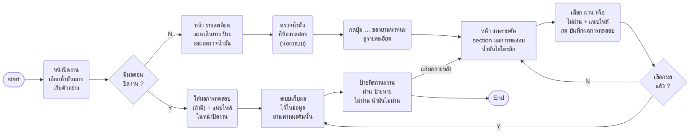

**Wireframe**
- **หน้า ปิดงานบำรุงรักษา (ส่วนน้ำมันไฮโดรลิก)** — การ์ดเลือก เก็บตัวอย่าง · เปลี่ยนน้ำมัน · เก็บตัวอย่างและเปลี่ยน + เปลี่ยนน้ำมันครั้งล่าสุด · เลือกแบบที่มีการเก็บตัวอย่างแล้วมี radio "ผลการทดสอบ (ถ้ามี)" ผ่าน · ไม่ผ่าน และอัปโหลด "ไฟล์ผลการทดสอบ (ถ้ามี)" ต่อท้ายในการ์ดเดียวกัน
- **หน้า รายละเอียดแผนเดินทาง** — คอลัมน์สถานะงานของคันที่เสร็จสิ้นแสดงสองป้าย "เสร็จสิ้น" + "รอผลตรวจน้ำมัน" (สีเหลือง) หรือ "น้ำมันไม่ผ่าน" (สีแดง) · มือถือป้ายที่สองเป็นแถว "ผลตรวจน้ำมัน" ในการ์ด · เมนู "…" ของคันที่เสร็จสิ้นมีแค่ "ดูรายละเอียด"
- **หน้า งานรายคัน (เสร็จสิ้น)** — ไม่มีภาพตอนจบงาน · ท้ายหน้า section "ผลการทดสอบน้ำมันไฮโดรลิก" (เฉพาะคันที่เก็บตัวอย่าง): radio ผลการทดสอบ ผ่าน · ไม่ผ่าน · อัปโหลดไฟล์ผลการทดสอบ (ถ้ามี) · เก็บตัวอย่างเมื่อ {วันที่} โดย {ผู้เก็บ} · บันทึกผลเมื่อ {วันเวลา} โดย {ผู้บันทึก} (เมื่อบันทึกแล้ว) · ปุ่ม "บันทึกผลการทดสอบ"

**Condition**

| ส่วน | เงื่อนไข | ที่มา |
|---|---|---|
| ผลการทดสอบในหน้าปิดงาน | แสดงเมื่อเลือกน้ำมันไฮโดรลิกแบบ "เก็บตัวอย่าง" หรือ "เก็บตัวอย่างและเปลี่ยน" · เลือก "เปลี่ยนน้ำมัน" อย่างเดียวไม่แสดง · radio "ผลการทดสอบ (ถ้ามี)" ผ่าน หรือ ไม่ผ่าน ไม่บังคับ ค่าเริ่มต้นยังไม่เลือก · ไฟล์ผลการทดสอบ ไม่บังคับ · ไม่เลือกผลก็ปิดงานได้ | เจ้าของงาน 4 พ.ย. _"มีให้เลือกเก็บผล แต่เป็น optional"_ |
| ป้ายที่สถานะงาน | หน้ารายละเอียดแผนเดินทาง คันที่เสร็จสิ้นและเก็บตัวอย่าง: ยังไม่มีผล = "เสร็จสิ้น" + "รอผลตรวจน้ำมัน" (Warning) · ผลไม่ผ่าน = "เสร็จสิ้น" + "น้ำมันไม่ผ่าน" (Error) · ผลผ่าน หรือไม่ได้เก็บตัวอย่าง = "เสร็จสิ้น" ป้ายเดียว · ใช้ Table cell Style=Multiple badges · มือถือป้ายที่สองเป็นแถว "ผลตรวจน้ำมัน" ในการ์ด | เจ้าของงานเลือกป้ายที่สถานะงาน 4 พ.ย. + เสนอ (ข้อความและสีป้าย) |
| ทางเข้าหลังปิดงาน | ทางเดียว: ปุ่ม "…" ของยานพาหนะ แล้ว "ดูรายละเอียด" (หรือกดแถว) เปิดหน้ารายละเอียดงานรายคัน · ไม่มีเมนู "ผลการทดสอบน้ำมันไฮโดรลิก" และไม่มี popup แล้ว | เจ้าของงาน 4 พ.ย. _"ทางเข้าคือทางเดียวคือดูรายละเอียดแล้วเพิ่มในส่วนของรายละเอียด"_ |
| section ผลการทดสอบในหน้ารายละเอียด | แสดงเฉพาะคันที่เก็บตัวอย่าง · ค่าที่บันทึกไว้ (ทั้งจากหน้าปิดงานและที่นี่) ขึ้นในช่อง · กด "บันทึกผลการทดสอบ" ต้องเลือกผล ยังไม่เลือกขึ้น "กรุณาเลือกผลการทดสอบ" · ไฟล์ไม่บังคับ PDF JPG PNG สูงสุด 10 ไฟล์ อัปโหลดแล้วมีแถบความคืบหน้า · บันทึกสำเร็จ toast "บันทึกผลการทดสอบน้ำมันไฮโดรลิกสำเร็จ" แสดง บันทึกผลเมื่อ และผู้บันทึก · แก้ผลหรือเพิ่มไฟล์แล้วบันทึกใหม่ได้ภายหลัง | เจ้าของงาน 3–4 พ.ย. + เสนอ (บันทึกผลเมื่อ) |
| ผลเก็บที่ไหน | เก็บไว้ในข้อมูลยานพาหนะคันนั้น ทั้งผ่านและไม่ผ่าน · **ยังไม่แจ้งเจ้าของยานพาหนะ** | เจ้าของงาน 3 พ.ย. |

**ยังไม่เคาะ** — ป้ายรอผลที่ข้อมูลยานพาหนะรายคัน (หน้าข้อมูลยานพาหนะของระบบเดิม Vehicle Management) ทำเมื่อไหร่ ใครดูแลหน้านั้น (Q51) · ผลไม่ผ่านมีผลต่อแผนรอบถัดไปไหม (Q21) · จะเริ่มแจ้งเจ้าของยานพาหนะเมื่อไหร่ และทางไหน · แก้ผลได้ไม่จำกัดเวลาไหม · ต้องมีช่องคำแนะนำเมื่อผลไม่ผ่านไหม

### Scenario 13 · หน่วยงาน/เจ้าของยานพาหนะ ยอมรับผลการตรวจบำรุงยานพาหนะรายคัน

**ช่วงงาน:** ตรวจรับ · **เข้าจาก:** แจ้งเตือนหลังบันทึกงานแต่ละคัน (S10) · **จบที่:** ยอมรับผลรายคัน · **ที่มา:** `[บอร์ด]` เลนหน่วยงาน รอบแรก "ได้รับการแจ้งเตือนทาง e-mail และ VMS+ → กดยอมรับผลการตรวจบำรุงยานพาหนะ → บำรุงรักษาครบทุกคันตามแผนหรือไม่?" + เลนเจ้าของยานพาหนะ "แสดงรายการการตรวจบำรุงยานพาหนะที่รอตรวจสอบ · รายการตรวจบำรุงยานพาหนะ: ใบตรวจสภาพอะไหล่ · ใบตรวจสภาพงานบำรุงรักษา · ปุ่มยอมรับผลการตรวจบำรุงยานพาหนะ"
· บอร์ดวางการยอมรับไว้ **2 รอบ** (รายคัน → ครบทุกคัน) scenario นี้คือรอบแรก · รอบสองดู S14

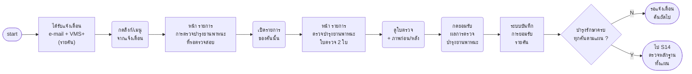

**Wireframe**
- **หน้า รายการการตรวจบำรุงยานพาหนะที่รอตรวจสอบ** `[บอร์ด]` — ทะเบียน · วันที่บำรุง · ผู้ทำ (กบค./ผู้รับจ้าง) · สถานะ (รอยอมรับ · ยอมรับแล้ว) `[เสนอ]`
- **หน้า รายการตรวจบำรุงยานพาหนะ (รายคัน)** — ใบตรวจสภาพอะไหล่ `[บอร์ด]` · ใบตรวจสภาพงานบำรุงรักษา `[บอร์ด]` · ภาพก่อน/หลัง + อะไหล่ที่ใช้จริง (จาก S10) `[เสนอ]` · กรณีบำรุงรักษาไม่ได้: สาเหตุ (จาก S10) `[บอร์ด]` · ปุ่ม "ยอมรับผลการตรวจบำรุงยานพาหนะ" `[บอร์ด]`

**Condition**

| ส่วน | เงื่อนไข | ที่มา |
|---|---|---|
| แจ้งเตือน | e-mail และ VMS+ · ส่งเมื่อ S10 บันทึกงานคันนั้น | บอร์ด |
| ปุ่มยอมรับ | กดได้ทันที · ไม่มีปุ่มไม่ยอมรับ (Q23) | บอร์ด |
| กรณีบำรุงรักษาไม่ได้ | ใช้ฟอร์มเดียวกันหรือแยก (ยังไม่รู้ — Q19) | บอร์ด |
| ยอมรับแล้ว | สถานะคัน "หน่วยงานยอมรับแล้ว" · กบค. เห็นใน S15 | เสนอ |

### Scenario 14 · หน่วยงาน/เจ้าของยานพาหนะ ตรวจสอบหลักฐานและประเมินความพึงพอใจ (ครบทุกคัน)

**ช่วงงาน:** ตรวจรับ · **เข้าจาก:** แจ้งเตือนเมื่อบำรุงรักษาครบทุกคันตามแผน · **จบที่:** ยอมรับผลทั้งแผน · **ที่มา:** `[บอร์ด]` เลนหน่วยงาน รอบสอง "บำรุงรักษาครบทุกคันตามแผนหรือไม่? → ได้รับการแจ้งเตือนทาง e-mail และ VMS+ → ตรวจสอบเอกสารหลักฐานการตรวจบำรุงยานพาหนะ → ประเมินความพึงพอใจ → กดยอมรับผลการตรวจบำรุงยานพาหนะ" + เลนเจ้าของยานพาหนะ "ประเมินความพึงพอใจ (ต้องทำทุกครั้ง?)"

```mermaid
flowchart LR
    S([start]) --> D0["ได้รับแจ้งเตือน<br/>e-mail + VMS+<br/>(ครบทุกคัน)"]
    D0 --> A0("กดลิงก์/เมนู<br/>จากแจ้งเตือน")
    A0 --> D1["หน้า รายการ<br/>การตรวจบำรุงยานพาหนะ<br/>ที่รอตรวจสอบ"]
    D1 --> A1("เปิดรายการ<br/>ของแผน")
    A1 --> D2["หน้า เอกสาร<br/>หลักฐานการตรวจ<br/>บำรุงยานพาหนะทั้งแผน"]
    D2 --> A2("ตรวจสอบ<br/>เอกสาร<br/>หลักฐาน")
    A2 --> A3("ประเมิน<br/>ความพึงพอใจ")
    A3 --> A4("กดยอมรับ<br/>ผลการตรวจ<br/>บำรุงยานพาหนะ")
    A4 --> D3["ระบบบันทึก<br/>การยอมรับ<br/>+ แจ้ง กบค."]
    D3 --> E([End])
    %% Q: A3 | Q22 ❓ (บอร์ด) ประเมินความพึงพอใจ (ต้องทำทุกครั้ง?) · แบบประเมินมีข้อ/สเกลอะไร
    %% Q: A4 | Q28 ❓ การยอมรับ 2 รอบ (รายคัน S13 + ทั้งแผน S14) จำเป็นทั้งคู่ไหม หรือรอบเดียวพอ
```

**Wireframe**
- **หน้า รายการการตรวจบำรุงยานพาหนะที่รอตรวจสอบ** `[บอร์ด]` — หน้าเดียวกับ S13 เพิ่มแถวระดับแผน "ครบทุกคันแล้ว รอตรวจสอบหลักฐาน" `[เสนอ]`
- **หน้า เอกสารหลักฐานการตรวจบำรุงยานพาหนะทั้งแผน** `[บอร์ด]` — สรุปรายคัน: ใบตรวจสภาพอะไหล่ · ใบตรวจสภาพงานบำรุงรักษา · การยอมรับรายคัน (S13) `[เสนอ]` · แบบประเมินความพึงพอใจ `[บอร์ด]` · ปุ่ม "ยอมรับผลการตรวจบำรุงยานพาหนะ" `[บอร์ด]`

**Condition**

| ส่วน | เงื่อนไข | ที่มา |
|---|---|---|
| แจ้งเตือน | e-mail และ VMS+ · ส่งเมื่อทุกคันในแผนบันทึกงานแล้ว | บอร์ด |
| ประเมินความพึงพอใจ | บังคับทุกครั้งหรือไม่ (ยังไม่รู้ — Q22) · ข้อ/สเกล (ยังไม่รู้) | บอร์ด |
| ปุ่มยอมรับ | กดได้เมื่อประเมินแล้ว (ถ้าบังคับ) | เสนอ |
| ยอมรับแล้ว | แจ้ง กบค. → ส่งประวัติได้ (S15) | เสนอ |

### Scenario 15 · กบค. บันทึกและส่งประวัติงานบำรุงรักษา

**ช่วงงาน:** จัดทำรายงาน · **เข้าจาก:** แผน · **จบที่:** รอหัวหน้า กบค. ตรวจ · **ที่มา:** `[บอร์ด]` "บำรุงรักษาเสร็จทั้งหมดหรือไม่? → ใช่ → บันทึกประวัติงานบำรุงรักษา → ส่งประวัติงานบำรุงรักษา" + Display "แสดงข้อมูลประวัติงานบำรุงรักษาทั้งหมด"


**Wireframe**
- **หน้า ประวัติงานบำรุงรักษาทั้งหมด** `[บอร์ด]` — รายคัน: วันที่ · งานที่ทำ · อะไหล่ที่ใช้ · ภาพ · ผลน้ำมัน · ผู้ทำ · การยอมรับของเจ้าของยานพาหนะ (S13 · S14) `[เสนอ]` · ปุ่ม "ส่งประวัติให้หัวหน้าตรวจสอบ" `[บอร์ด]`

**Condition** — ส่งได้เมื่อครบทุกคัน `[บอร์ด]` (คันที่ทำไม่ได้ — Q24) · ส่งแล้วแก้ไม่ได้จนกว่าถูกตีกลับ `[เสนอ]`

### Scenario 16 · หัวหน้า กบค. ตรวจสอบประวัติงานบำรุงรักษา

**ช่วงงาน:** จัดทำรายงาน · **เข้าจาก:** เมนู/แจ้งเตือน · **จบที่:** ผ่าน หรือ ตีกลับ · **ที่มา:** `[บอร์ด]` "หัวหน้า กบค. ตรวจสอบประวัติงานบำรุงรักษา → ผ่านหรือไม่? → ใช่ → บันทึกประวัติ" · ไม่ผ่าน → "กบค. จัดการแก้ไข" `[ภาพ ก.ค.]`


**Wireframe** — หน้า รายการประวัติรอตรวจสอบ `[เสนอ]`: แผน · กบค. ผู้ส่ง · จำนวนยานพาหนะ · วันที่ส่ง · หน้า ประวัติของแผน = หน้าเดียวกับ S15 (Display) + ปุ่ม "ตีกลับ (ระบุเหตุผล)" `[เสนอ]` · "อนุมัติ" `[บอร์ด "ผ่าน"]`

**Condition** — เหตุผลตีกลับ Freetext บังคับ `[เสนอ]` · ตีกลับ → แผนกลับสถานะให้ กบค. แก้แล้วส่งใหม่ (S15) `[ภาพ ก.ค.]`

### Scenario 17 · กบค. ออกรายงานผลและปิดงาน

**ช่วงงาน:** จัดทำรายงาน · **เข้าจาก:** ประวัติผ่านแล้ว (S16) · **จบที่:** ปิดงาน · **ที่มา:** `[บอร์ด]` "รายงานผลการบำรุงรักษา → ปิดงาน" + Display "แสดงรายงานผลงานบำรุงรักษา (Download ได้)"

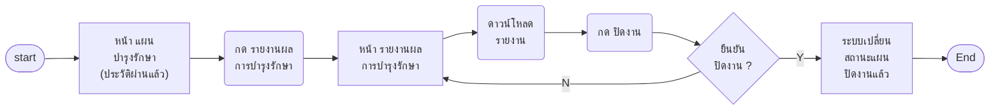

**Wireframe** — หน้า รายงานผลการบำรุงรักษา `[บอร์ด]`: สรุปรายคัน/รายแผน (หัวข้อ ยังไม่รู้ — Q25) · ปุ่ม "ดาวน์โหลด" `[บอร์ด]` · ปุ่ม "ปิดงาน" `[บอร์ด]`

**Condition** — ปิดงาน มี confirm modal `[เสนอ]` · ปิดแล้วแก้ไม่ได้ `[เสนอ]` · toast คำว่า (ยังไม่รู้)

### Scenario 18 · กบค. คำนวณต้นทุนการบำรุงรักษา

> 🔴 **4 พ.ย. 2569 เจ้าของงาน:** _"หน้าต้นทุนยังไม่ได้คิดเลย แต่มันคือหน้าสรุปของแผนแต่ละแผน ว่าใช้งบประมาณไปเท่าไร ยังไม่ได้คิด"_ ⇒ scenario นี้**ยังไม่ออกแบบ** จอที่มีเป็นร่างเดิม ไม่ใช้เป็นแบบ · ทิศทาง: หน้าสรุปงบประมาณที่ใช้ของแต่ละแผน · ต้นแบบเว็บยังไม่ทำ

**ช่วงงาน:** คำนวณต้นทุน · **เข้าจาก:** แผนที่ปิดงานแล้ว · **จบที่:** Summary ต้นทุน · **ที่มา:** `[บอร์ด]` "คำนวณต้นทุนการบำรุงรักษา → ได้รับ Summary ต้นทุน" + Display "คำนวณต้นทุน: ค่าแรง · ค่าที่พัก · ค่าเดินทาง · สามารถ Download excel ได้ · แสดงผลลัพธ์ Summary ของต้นทุน"


**Wireframe** — หน้า ต้นทุนการบำรุงรักษา `[บอร์ด]`: ตารางรายคัน/รายใบเดินทาง: ค่าแรง · ค่าที่พัก · ค่าเดินทาง · รวม `[บอร์ด]` · ยอดตั้งต้นดึงจากแผนเดินทาง S6 `[เสนอ]` · Summary ของต้นทุน `[บอร์ด]` · ปุ่ม "ดาวน์โหลด Excel" `[บอร์ด]`

**Condition** — ค่าใช้จ่าย Text number แก้ได้ก่อนยืนยัน `[เสนอ]` · Excel มีคอลัมน์อะไร (ยังไม่รู้)

### Scenario 19 · กบค. แก้ไขแผนบำรุงรักษา แล้วส่งอนุมัติใหม่

**ช่วงงาน:** เตรียมดำเนินการ · **เข้าจาก:** เมนู "…" ในรายการแผน หรือหน้ารายละเอียดแผน · **จบที่:** แผนกลับเป็นรออนุมัติ แล้วไป S2 · **ที่มา:** เจ้าของงาน 30 ต.ค. 2569 _"ตอนสร้างแผนเสร็จแล้ว อยากให้สามารถแก้ไขได้"_ + _"แก้ไขแล้วมีอนุมัติ อยากให้ใส่ไปก่อน"_ · จอยึดบล็อก C ของ Overhaul

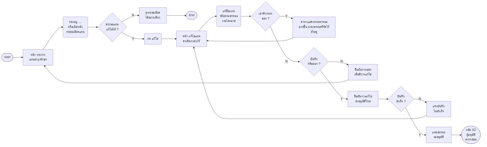

**Wireframe**
- **หน้า รายละเอียดแผน (ฝั่ง กบค.)** — หัวหน้า "เลขที่ MR …" + ป้ายสถานะ · ปุ่ม ลบแผน (เฉพาะก่อนอนุมัติ) · แก้ไข · แผนที่ถูกส่งกลับมีกล่องแจ้งเหตุผลบนสุด · เนื้อหาชุดเดียวกับหน้าฝั่งผู้อนุมัติ (ข้อมูลแผน · ยานพาหนะในแผนแยกแท็บไตรมาส)
- **หน้า แก้ไขแผน** — ฟอร์มเดียวกับ S1 ค่าเดิมกรอกไว้ (ภาค เขต ประเภทยานพาหนะ อยู่ในแผงตัวกรอง ค่าเดิมเป็นชิปใต้แถวค้นหา) · หัวหน้า "แก้ไขแผน <เลขที่ MR>" · ปีงบประมาณ Readonly · ปุ่ม ยกเลิก · บันทึกและส่งอนุมัติ

**Condition**

| ส่วน | เงื่อนไข | ที่มา |
|---|---|---|
| แก้ไขได้เมื่อ | สถานะ รออนุมัติ · ส่งกลับแก้ไข · อนุมัติแล้ว (ก่อนเริ่มงาน) · ดำเนินการขึ้นไป แก้ไม่ได้ เมนู "…" เหลือดูรายละเอียดอย่างเดียว | เสนอ · เจ้าของงานไม่ทักท้วง 30 ต.ค. |
| ปีงบประมาณ | Readonly แก้ไม่ได้ เพราะเลขที่ MR ผูกกับปี · ต้องการเปลี่ยนปีให้ลบแล้วสร้างใหม่ | เสนอ |
| เลขที่ MR | คงเลขเดิมหลังแก้ไข | เสนอ |
| ภาค เขต ประเภทยานพาหนะ | อยู่ในแผงตัวกรองเหมือน S1 (5 พ.ย. 2569) · เปิดฟอร์มแก้ไขแล้วตัวกรองที่ใช้ตอนสร้างแผนแสดงเป็นชิปใต้แถวค้นหา · แท็บและแถบเหนือตารางแสดงเสมอ | ตาม S1 (เจ้าของงาน 5 พ.ย.) |
| เอาตัวกรองออก | เปลี่ยนแค่แถวที่แสดง ยานพาหนะที่จัดไว้แล้วไม่ถูกเอาออก ไม่มี confirm · ~~confirm "ยานพาหนะของ {ค่า} ที่จัดไว้ {n} คัน จะถูกเอาออกจากทุกไตรมาส"~~ ตัดออก 5 พ.ย. 2569 | ตาม S1 (รีวิวทีมออกแบบ 5 พ.ย.) |
| ช่องอื่น | เงื่อนไขและข้อความ error เหมือน S1 · ปุ่ม "บันทึกและส่งอนุมัติ" Disabled จนกว่าช่องบังคับครบ (5 พ.ย. 2569) | ตาม S1 |
| แผนที่ถูกส่งกลับ | ฟอร์มแสดงเหตุผลจากผู้อนุมัติบนสุด | บอร์ด "กบค. จัดการแก้ไข" |
| แผนที่อนุมัติแล้ว | ฟอร์มแสดงคำเตือน "เมื่อบันทึก แผนจะกลับเป็นสถานะรออนุมัติ และต้องให้ผู้อนุมัติตรวจสอบอีกครั้ง" | เจ้าของงาน 30 ต.ค. |
| ยกเลิก | มีการแก้ไข มี confirm "ข้อมูลที่แก้ไขไว้จะไม่ถูกบันทึก" · ไม่มีการแก้ไข ออกทันที | ตามบล็อก C ของ Overhaul |
| บันทึกและส่งอนุมัติ | มี confirm "ยืนยันการแก้ไข" · ทุกสถานะกลับเป็น "รออนุมัติ" แล้วไป S2 · toast "บันทึกการแก้ไขแผนและส่งอนุมัติสำเร็จ" · ไม่สำเร็จ toast general error | เจ้าของงาน 30 ต.ค. |

### Scenario 20 · กบค. ลบแผนบำรุงรักษาที่ยังไม่อนุมัติ

**ช่วงงาน:** เตรียมดำเนินการ · **เข้าจาก:** เมนู "…" ในรายการแผน หรือหน้ารายละเอียดแผน · **จบที่:** แผนหายจากรายการ · **ที่มา:** เจ้าของงาน 30 ต.ค. 2569 _"ลบแผนได้"_ + _"ยกเลิกแผนไม่ต้องมีก็ได้ มีแก้ไข กับลบ"_ · จอยึดบล็อก D ของ Overhaul

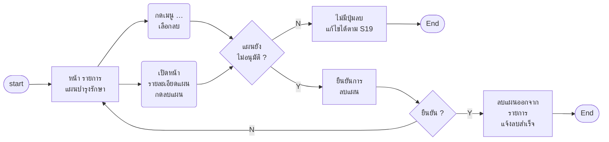

**Wireframe** — ใช้หน้ารายการแผนและหน้ารายละเอียดแผน (S19) · ป๊อปอัปยืนยันการลบ · ไม่ต้องระบุเหตุผล

**Condition**

| ส่วน | เงื่อนไข | ที่มา |
|---|---|---|
| ลบได้เมื่อ | สถานะ รออนุมัติ · ส่งกลับแก้ไข · อนุมัติแล้วขึ้นไปไม่มีปุ่มลบ (ซ่อน ไม่ disable) | เสนอ · เจ้าของงานไม่ทักท้วง 30 ต.ค. |
| ยืนยันการลบ | modal "ยืนยันการลบแผน" "เมื่อลบแล้วจะไม่สามารถกู้คืนข้อมูลได้ ต้องการลบใช่หรือไม่" ปุ่ม ยกเลิก · ยืนยัน ทั้งหน้า List และ Detail | ตามบล็อก D ของ Overhaul |
| ลบสำเร็จ | กลับหน้ารายการ · toast "ลบแผนบำรุงรักษาสำเร็จ" | ตามบล็อก D ของ Overhaul |
| เลขที่ MR ของแผนที่ลบ | ไม่นำกลับมาใช้ซ้ำ ลำดับนับต่อไป | เสนอ |

**ยังไม่เคาะ** — **Q53** แผนสถานะ "รออนุมัติ" หน้ารายละเอียดดูอย่างเดียวตามที่เจ้าของงานเคาะใน S1 (5 พ.ย. 2569) แต่จอ S19 และ S20 ยังให้แก้ไขและลบแผนรออนุมัติได้จากเมนู "…" ในรายการแผนและจากหน้ารายละเอียด ต้องเอาแก้ไขและลบออกจากสถานะรออนุมัติไหม (จอยังคงแบบเดิมจนกว่าจะเคาะ) · Q35 แผนที่อนุมัติแล้วแต่ยังไม่เริ่มงานจะเอาออกอย่างไร

### Scenario 21 · กบค. จัดการอะไหล่ของยานพาหนะแต่ละคันในแผน

**ช่วงงาน:** เตรียมดำเนินการ · **เข้าจาก:** ไอคอนแก้ไขที่แถวยานพาหนะในแท็บไตรมาส n ของฟอร์มสร้างแผน (S1) หรือแก้ไขแผน (S19) (5 พ.ย. 2569 · เดิมเข้าจากปุ่มเพิ่มอะไหล่ของหัวข้ออะไหล่ในไตรมาส ซึ่งเลิกแล้ว) · **จบที่:** กลับแท็บไตรมาสเดิม · **ที่มา:** เจ้าของงาน 2 พ.ย. 2569 _"เพิ่มปุ่มเพิ่มอะไหล่ใน scen A"_ + _"แปลว่าจะมี scen ในการเลือกอะไหล่ของรถแต่ละคันด้วย"_ · ข้อกำหนด JO 7.3.2 กำหนดอะไหล่หรือวัสดุที่ต้องใช้ของยานพาหนะแต่ละคันตามรอบ
· **ปรับ 2 พ.ย. 2569 (เจ้าของงาน):** _"อะไหล่ในการบำรุงจะเป็นไส้กรอง และน้ำมันไฮดรอลิก โดยน้ำมันไฮดรอลิค จะไม่ได้เปลี่ยนทุกปี จะเปลี่ยนตามอายุการใช้งาน 1 เงื่อนไข และเงื่อนไข อายุ 3 ปี แปลว่า ถ้าปีนี้เปลี่ยนปีถัดไปจะเป็นการ เลือกเก็บตัวอย่าง แต่เพื่อให้การทำงานของระบบง่าย อยากให้ มีการเลือกว่า เป็นการเปลี่ยนหรือการเก็บตัวอย่างน้ำมันไฮดรอลิก และมีบอกว่า เปลี่ยนไปครั้งล่าสุดเมื่อไร"_ ⇒ ให้ กบค. เลือกรายคัน ระบบไม่ตัดสินแทน
· **ปรับ 2 พ.ย. 2569 (เจ้าของงาน):** _"พาทอะไหล่ อยากให้มีปุ่มเพิ่มอะไหล่ ไม่มี suggest มาให้เลย ให้เลือกเอง"_ + _"หัวข้ออะไหล่ เป็นอะไหล่ในไตรมาสนั้นๆ"_ ⇒ หน้านี้ตั้งต้นว่าง ไม่มีป้าย "แนะนำ" · เลือกยานพาหนะได้เฉพาะคันในไตรมาสที่เปิดจากฟอร์ม
· **ปรับ 5 พ.ย. 2569 (เจ้าของงาน):** _"หน้านี้จะเห็นรถในไตรมาส แต่จะยังไม่เห็นอะใหล่ อยากให้จัดการสิ่งที่ต้องทำของรถแต่ละคัน เช่น รถตันนี้ ต้องเปลี่ยนน่ำมันไฮดรอลิก รถตันนี้ต้องเก็บตัวอย่างน้ำมันไฮดรอลิก น้ำมันเบอร์อะไร รหัสอะไร ใช้กี่ลิตร  ต้องเปลี่ยนใส้กรอง ระบุ ชื่อ ยี่ห้อกรอง รุ่นกรอง รหัสกรอง เป็นต้น"_ + แก้ต่อ _"ข้อ 2 ไม่ได้ให้เอาออกจากการสร้างแผน แต่ให้เอารายการอะใหล่ออก เป็น empty ก่อน แล้วค่อยให้เลือกจัดการอะใหล่ ทีละคัน แล้วค่อยเอามาลงในรายการอะใหล่ตอนจะส่งอนุมัติ โดยหน้าจัดอะใหล่อยากกให้เป็นอีกหน้า โดยมี section เลือกว่า น้ำมันไฮดอลิกเปลี่ยน หรือ เก็บตัวอย่าง และอะใหล่อื่นๆ เช่นใส้กรอง เป็นต้น"_ ⇒ หน้านี้เป็นหน้าแยก **"จัดการอะไหล่ของยานพาหนะ {ทะเบียน}"** มี section **น้ำมันไฮโดรลิก** และ **อะไหล่อื่นๆ** · เข้าจากไอคอนแก้ไขที่แถวยานพาหนะในแท็บไตรมาส · บันทึกแล้วรวมลงหัวข้ออะไหล่ในไตรมาสของฟอร์ม (ตั้งต้นว่าง) · น้ำมันไฮโดรลิก เลือก เก็บตัวอย่าง · เปลี่ยนน้ำมัน · เก็บตัวอย่างและเปลี่ยน (ชุดคำเดียวกับหน้างานรายคัน S10) + เบอร์น้ำมัน · รหัสน้ำมัน · จำนวน (ลิตร) เมื่อเปลี่ยน · อะไหล่อื่นๆ (เช่นไส้กรอง) ระบุ ชื่อ · ยี่ห้อ · รุ่น · รหัส · จำนวน · หน่วย
· **ข้อจำกัด 5 พ.ย. 2569:** การ์ดอะไหล่ของงานซ่อม (`RequestedPartsPanel` · `Spare Part Card Item`) ไม่มีช่องยี่ห้อและรุ่น และการ์ด "รายการเพิ่มเติม" มีช่องกรอกแค่ รายละเอียด · รหัสอะไหล่ · ราคา ⇒ รายการของยานพาหนะคันนี้แสดงเป็นตารางของไลบรารี และระบุอะไหล่เพิ่มเติมกรอกใน popup ฟอร์ม 6 ช่อง (แบบสำรองเดิมของหน้านี้) ส่วนคลังอะไหล่ที่กดเลือกยังเป็นของงานซ่อม · รอเจ้าของงานเคาะว่าจะใช้แบบนี้ หรือให้ทีมออกแบบเพิ่มช่องในการ์ดของงานซ่อม
· ข้อที่ผู้เขียนถือตามที่เสนอ: ค่าเริ่มต้นเป็นเก็บตัวอย่าง · ขั้นนี้เป็นการวางแผน ยังไม่เบิกหรือจอง จึงไม่มีซื้อเพิ่มและเลือกผู้จัดซื้อ · อะไหล่ระดับไตรมาส (หัวข้ออะไหล่ในไตรมาสของฟอร์ม · S4 · S22) = ผลรวมอะไหล่ของยานพาหนะทุกคันในไตรมาสนั้น

```mermaid
flowchart LR
    S([start]) --> D1["แท็บไตรมาส n<br/>ตารางยานพาหนะ<br/>สิ่งที่ต้องทำรายคัน"]
    D1 --> A1("กดไอคอนแก้ไข<br/>ที่แถวยานพาหนะ")
    A1 --> D2["หน้า จัดการอะไหล่<br/>ของยานพาหนะ<br/>{ทะเบียน}"]
    D2 --> A2("เลือกยานพาหนะคันอื่น<br/>ในไตรมาส<br/>ถ้าต้องการ")
    A2 --> A6("เลือกเก็บตัวอย่าง<br/>เปลี่ยน หรือทั้งสอง<br/>น้ำมันไฮดรอลิก")
    A6 --> A9("ถ้าเปลี่ยน ระบุ<br/>เบอร์น้ำมัน รหัส<br/>จำนวนลิตร")
    A9 --> A3("อะไหล่อื่นๆ<br/>เลือกไส้กรอง<br/>จากคลัง")
    A3 --> A7("กดระบุอะไหล่<br/>เพิ่มเติม ถ้าไม่มี<br/>ในคลัง")
    A7 --> A8("กรอกชื่อ ยี่ห้อ<br/>รุ่น รหัส<br/>จำนวน หน่วย")
    A8 --> A4("แก้จำนวน<br/>หรือเอาออก")
    A4 --> Q1{"ครบ ?"}
    Q1 -->|N| A3
    Q1 -->|Y| A5("กดบันทึก<br/>อะไหล่<br/>ของยานพาหนะ")
    A5 --> D4["กลับแท็บไตรมาส n<br/>สรุปของยานพาหนะ + รวมลง<br/>อะไหล่ในไตรมาส"]
    D4 --> E([End])
    %% Q: A6 | Q39 ❓ เงื่อนไขอายุการใช้งานของน้ำมันคืออะไร นอกจากอายุ 3 ปี · คันที่เลือกเปลี่ยนน้ำมัน ยังต้องเก็บตัวอย่างและบันทึกผลตรวจ (S10 S12) ไหม
    %% Q: A9 | Q57 ❓ เก็บตัวอย่างอย่างเดียวต้องระบุเบอร์น้ำมันและรหัสไหม (ตอนนี้แสดงเฉพาะตอนเปลี่ยน) · รายการเบอร์น้ำมันมาจากไหน
    %% Q: A8 | Q58 ❓ อะไหล่ของยานพาหนะใช้การ์ดของงานซ่อม (ต้องเพิ่มช่องยี่ห้อ รุ่น ในไฟล์ออกแบบ) หรือใช้ตารางและ popup ฟอร์มแบบนี้
```

**Wireframe** — **หน้า จัดการอะไหล่ของยานพาหนะ {ทะเบียน}** (หน้าแยก): ช่องเลือกยานพาหนะ (เฉพาะยานพาหนะของไตรมาสที่เปิดจากฟอร์ม) · หัวข้อ "น้ำมันไฮโดรลิก" ตัวเลือก เก็บตัวอย่าง · เปลี่ยนน้ำมัน · เก็บตัวอย่างและเปลี่ยน + ช่อง เบอร์น้ำมัน (dropdown) · รหัสน้ำมัน · จำนวน (ลิตร) เมื่อเลือกเปลี่ยนน้ำมันหรือเก็บตัวอย่างและเปลี่ยน · เปลี่ยนน้ำมันครั้งล่าสุด (แสดงอย่างเดียว) · แผง "คลังอะไหล่" (ไส้กรองและอะไหล่จาก Smart Inventory และคลังสำรอง · ค้นชื่อหรือรหัส · ปุ่มเลือก) · หัวข้อ "อะไหล่อื่นๆ" (จำนวนรายการ) + ปุ่ม "ระบุอะไหล่เพิ่มเติม" · ตาราง ชื่อ · ยี่ห้อ · รุ่น · รหัส · จำนวน · หน่วย · ไอคอนแก้ไข ลบ · popup "ระบุอะไหล่เพิ่มเติม" ช่อง ชื่ออะไหล่ · ยี่ห้อ · รุ่น · รหัสอะไหล่ (ถ้ามี) · จำนวน · หน่วย ปุ่ม ยกเลิก · เพิ่ม · ปุ่ม ย้อนกลับ · บันทึกอะไหล่ของยานพาหนะ

**Condition**

| ส่วน | เงื่อนไข | ที่มา |
|---|---|---|
| เข้าหน้า | ไอคอนแก้ไขท้ายแถวยานพาหนะในแท็บไตรมาส n ของฟอร์มสร้างแผน (S1) หรือแก้ไขแผน (S19) · หน้าแยก หัวหน้า "จัดการอะไหล่ของยานพาหนะ {ทะเบียน}" · breadcrumb บำรุงรักษาตามวาระ › สร้างแผน › จัดการอะไหล่ของยานพาหนะ | เจ้าของงาน 5 พ.ย. |
| เลือกยานพาหนะ | dropdown เฉพาะยานพาหนะของไตรมาสที่เปิดจากฟอร์ม เปลี่ยนคันได้โดยไม่ต้องกลับตาราง | เจ้าของงาน 2 พ.ย. + เสนอ |
| การเบิกอะไหล่ (6 พ.ย. 2569) | หัวข้อ "การเบิกอะไหล่" ใต้ช่องเลือกยานพาหนะ · การ์ดเลือก 2 ใบ "เบิกอะไหล่" (บรรทัดรอง "เลือกอะไหล่ที่ต้องเบิกให้ยานพาหนะคันนี้") · "ไม่เบิกอะไหล่" (บรรทัดรอง "ยานพาหนะคันนี้ไม่ใช้อะไหล่จากการเบิก") · ไม่มีค่าเริ่มต้น ต้องเลือกเอง · เลือกเบิก แสดงคลังอะไหล่และหัวข้ออะไหล่อื่นๆ · เลือกไม่เบิก ซ่อนคลังอะไหล่และอะไหล่อื่นๆ หัวข้อน้ำมันไฮโดรลิกยังแสดง · ปุ่ม "บันทึกอะไหล่ของยานพาหนะ" กดได้เมื่อเลือกไม่เบิก หรือเลือกเบิกแล้วมีอะไหล่อย่างน้อย 1 รายการ · บันทึกไม่เบิกแล้ว แถวยานพาหนะในแท็บไตรมาสคอลัมน์อะไหล่อื่นๆ แสดง "ไม่เบิกอะไหล่" และยานพาหนะคันนั้นไม่รวมในหัวข้ออะไหล่ในไตรมาส | เจ้าของงาน 6 พ.ย. _"อยากเพิ่มการเบิก โดยอยากให้มีการเลือกว่า ว่าเบิกอะใหล่ หรือไม่เบิก ด้วย"_ · การ์ดแบบผลการพิจารณา S2 |
| น้ำมันไฮโดรลิก | เลือกรายคัน เก็บตัวอย่าง · เปลี่ยนน้ำมัน · เก็บตัวอย่างและเปลี่ยน (ชุดคำเดียวกับหน้างานรายคัน S10) · ค่าเริ่มต้นเก็บตัวอย่าง · ระบบไม่ตัดสินจากเงื่อนไขอายุ · แสดงวันที่เปลี่ยนครั้งล่าสุด ไม่มีประวัติขึ้น "ไม่มีข้อมูล" | เจ้าของงาน 2 พ.ย. + 5 พ.ย. |
| เบอร์น้ำมัน · รหัสน้ำมัน · จำนวน (ลิตร) | แสดงเมื่อเลือกเปลี่ยนน้ำมัน หรือเก็บตัวอย่างและเปลี่ยน · เบอร์น้ำมัน dropdown "เลือกเบอร์น้ำมัน" (เช่น ISO VG 32 · ISO VG 46 · ISO VG 68) · รหัสน้ำมัน Text input "ระบุรหัสน้ำมัน" · จำนวน (ลิตร) Text input · เก็บตัวอย่างอย่างเดียวต้องกรอกไหม (ยังไม่รู้ — Q57) | เจ้าของงาน 5 พ.ย. "น้ำมันเบอร์อะไร รหัสอะไร ใช้กี่ลิตร" |
| รายการตั้งต้น | ว่าง ระบบไม่คำนวณและไม่แนะนำ กบค. เลือกเอง ไม่มีป้าย "แนะนำ" | เจ้าของงาน 2 พ.ย. |
| เลือกจากคลัง | แผงคลังอะไหล่ของงานซ่อม (Smart Inventory · คลังสำรอง) เฉพาะไส้กรองและอะไหล่ (น้ำมันไฮโดรลิกอยู่ในหัวข้อของตัวเอง) · เลือกแล้วชื่อ ยี่ห้อ รุ่น รหัส หน่วย มาจากข้อมูลคลัง จำนวนแก้ได้ | เจ้าของงาน 2 พ.ย. + 5 พ.ย. |
| อะไหล่อื่นๆ | ตาราง ชื่อ · ยี่ห้อ · รุ่น · รหัส · จำนวน · หน่วย · ไอคอนแก้ไขและลบ · ยังไม่มี = "ยังไม่มีรายการอะไหล่" "เลือกไส้กรองหรืออะไหล่อื่นจากคลัง หรือกดระบุอะไหล่เพิ่มเติม" | เจ้าของงาน 5 พ.ย. "ระบุ ชื่อ ยี่ห้อกรอง รุ่นกรอง รหัสกรอง" |
| ระบุอะไหล่เพิ่มเติม | popup "ระบุอะไหล่เพิ่มเติม" ชื่ออะไหล่ · ยี่ห้อ · รุ่น · รหัสอะไหล่ (ถ้ามี) · จำนวน · หน่วย · ปุ่ม ยกเลิก · เพิ่ม · ช่องไหนบังคับ (ยังไม่รู้) · ~~ราคาต่อหน่วย~~ ไม่อยู่ในช่องที่เจ้าของงานระบุ 5 พ.ย. | เจ้าของงาน 5 พ.ย. + ข้อจำกัดการ์ดงานซ่อม (Q58) |
| ปุ่มย้อนกลับ | มีการแก้ไข มี confirm "ยืนยันการออก — อะไหล่ที่แก้ไขไว้จะไม่ถูกบันทึก" · ไม่มีการแก้ไข ออกทันที | เสนอ |
| บันทึก | ปุ่ม "บันทึกอะไหล่ของยานพาหนะ" · สำเร็จ → กลับแท็บไตรมาสเดิม แถวของยานพาหนะคันนั้นแสดงสรุป น้ำมันไฮโดรลิก และ "n รายการ" ของอะไหล่อื่นๆ · อะไหล่ของคันนั้นรวมลงหัวข้ออะไหล่ในไตรมาส n · toast "บันทึกอะไหล่ของยานพาหนะ {ทะเบียน} แล้ว" · ไม่สำเร็จ toast general error | เสนอ |
| อะไหล่ระดับไตรมาส (S4 S22) | ผลรวมอะไหล่ของยานพาหนะทุกคันในไตรมาส (น้ำมันไฮโดรลิกที่เปลี่ยน + อะไหล่อื่นๆ) = หัวข้ออะไหล่ในไตรมาสของฟอร์ม · หน้า S4 ความคืบหน้าอะไหล่ และหน้า S22 คลังรับทราบ ยังแสดงรายการรวมรายไตรมาสเหมือนเดิม | เจ้าของงาน 5 พ.ย. |
| เปลี่ยนยานพาหนะในแผน | ยานพาหนะที่ย้ายไตรมาส อะไหล่ของคันนั้นไปด้วย · ยานพาหนะที่เอาออกจากแผน อะไหล่ของคันนั้น (ยังไม่รู้ — Q38) | เสนอ |

**ยังไม่เคาะ** — เก็บตัวอย่างอย่างเดียวต้องระบุเบอร์น้ำมันและรหัสไหม (ตอนนี้ช่องแสดงเฉพาะตอนเปลี่ยน) และรายการเบอร์น้ำมันมาจากไหน (Q57) · ใช้ตารางและ popup ฟอร์มแบบนี้ หรือให้ทีมออกแบบเพิ่มช่องยี่ห้อ รุ่น ในการ์ดอะไหล่ของงานซ่อม (Q58) · ช่องไหนบังคับใน popup ระบุอะไหล่เพิ่มเติม · มือถือ: แถวยานพาหนะในแท็บไตรมาสเป็นรายการติ๊ก (List with checkbox) ไม่มีไอคอนแก้ไข ยังไม่มีทางเข้าหน้านี้บนมือถือ

### Scenario 22 · กบค. คลัง รับทราบรายการอะไหล่รายไตรมาส

**ช่วงงาน:** เบิก/จัดหาอะไหล่ · **เข้าจาก:** แผนอนุมัติแล้ว (S2) ระบบส่งให้ทันที · **จบที่:** คลังรับทราบ แล้ว กบค. ติดตามและเบิกอะไหล่รายไตรมาสต่อ (S4) · **ที่มา:** เจ้าของงาน 2 พ.ย. 2569 _"scen ต่อมา เป็น scen ที่ต่อจากอนุมัติ คือ ส่งไปหา กบค. คลัง ว่าแต่ละไตรมาสมีเบิกอะไหล่อะไรบ้าง แยกเป็นไตรมาสให้ด้วย"_ + เลือก แทรกหลัง S2 ก่อน S4 · ดูและกดรับทราบ · ส่งทันทีที่อนุมัติทั้งปี
· **5 พ.ย. 2569:** รายการอะไหล่รายไตรมาสที่คลังรับทราบ = ผลรวมอะไหล่ของยานพาหนะทุกคันในไตรมาส (S21) ชุดเดียวกับหัวข้ออะไหล่ในไตรมาสบนฟอร์ม หน้าตาเหมือนเดิม
· **ปรับ 2 พ.ย. 2569 (เจ้าของงาน):** _"พอมี s22 ก็ต้องมี status ให้หน้าของ จนท กบค. ที่ทำเรื่องบำรุงรักษา รู้ว่า ไตรมาสไหน ได้รับการรับทราบแล้วด้วย"_ + เลือก รับทราบทีละไตรมาส · แสดงที่หน้ารายละเอียดแผนและหน้ารายการแผน ⇒ คลังกดรับทราบทีละไตรมาส (ไตรมาสที่ไม่มียานพาหนะไม่ต้องรับทราบ) · กบค. เห็นสถานะในหน้ารายการแผน (คอลัมน์ คลังรับทราบ x/n ไตรมาส) และหน้ารายละเอียดแผน (แถบบอกในแท็บไตรมาส)
· ข้อที่ผู้เขียนถือตามที่เสนอ: ยอดของแต่ละไตรมาสรวมจากอะไหล่ที่ กบค. เลือกให้ยานพาหนะของไตรมาสนั้น (S1 S21) · มีคงเหลือในคลังและจำนวนที่ไม่พอให้คลังเห็นล่วงหน้า · คลังไม่มีปุ่มส่งกลับหรือแก้รายการ

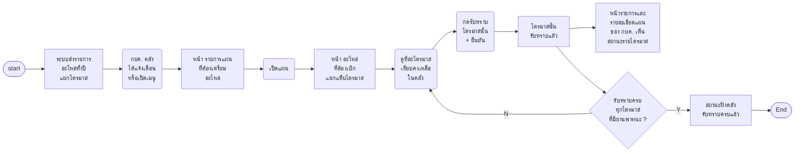

**Wireframe**
- **หน้า รายการแผนที่ต้องเตรียมอะไหล่** — เลขที่ MR · ชื่อแผน · ปีงบประมาณ · จำนวนยานพาหนะ · วันที่อนุมัติ · สถานะ (รอรับทราบ · รับทราบ x/n ไตรมาส · รับทราบครบแล้ว) · ค้นหา (เลขที่ MR · ชื่อแผน)
- **หน้า อะไหล่ที่ต้องเบิกรายไตรมาส** — รายละเอียดแผน · แท็บไตรมาส 1 ถึง 4 (ป้ายบอกจำนวนรายการ) · ตาราง รายการอะไหล่ · รหัส · จำนวนที่ต้องเบิก · หน่วย · คงเหลือในคลัง · ไม่พอ · ไตรมาสที่ไม่มียานพาหนะ = Empty state "ไม่มีอะไหล่ที่ต้องเบิก" · ปุ่ม ย้อนกลับ · รับทราบไตรมาส n · ไตรมาสที่รับทราบแล้วมีแถบ "รับทราบไตรมาส n แล้ว" ไม่มีปุ่ม
- **ฝั่ง กบค.** — หน้ารายการแผน คอลัมน์ "คลังรับทราบ" (ก่อนอนุมัติ "-" · หลังอนุมัติ "x/n ไตรมาส") · หน้ารายละเอียดแผน แถบในแท็บไตรมาส "คลังรับทราบรายการอะไหล่ไตรมาส n แล้ว" หรือ "รอคลังรับทราบ…"

**Condition**

| ส่วน | เงื่อนไข | ที่มา |
|---|---|---|
| ส่งให้คลัง | ระบบส่งเองทันทีที่แผนอนุมัติ (S2) ทั้ง 4 ไตรมาส | เจ้าของงาน 2 พ.ย. |
| แยกไตรมาส | แท็บไตรมาส 1 ถึง 4 · ยอดรวมจากอะไหล่ที่ กบค. เลือกให้ยานพาหนะของไตรมาสนั้น รวมรายการที่ระบุเอง | เจ้าของงาน 2 พ.ย. |
| ไม่พอ | Display จำนวนที่เกินคงเหลือในคลัง ไม่พอ = "-" | เสนอ |
| รับทราบ | ทีละไตรมาส · ปุ่ม "รับทราบไตรมาส n" → confirm "ยืนยันรับทราบรายการอะไหล่ไตรมาส n" → แถบ "รับทราบไตรมาส n แล้ว" · toast "รับทราบรายการอะไหล่ไตรมาส n แล้ว" · ไตรมาสที่ไม่มียานพาหนะไม่ต้องรับทราบ · สถานะแผนฝั่งคลัง รอรับทราบ → รับทราบ x/n ไตรมาส → รับทราบครบแล้ว · ไม่มีส่งกลับ | เจ้าของงาน 2 พ.ย. |
| สถานะฝั่ง กบค. | หน้ารายการแผน คอลัมน์ คลังรับทราบ · หน้ารายละเอียดแผน (อนุมัติแล้ว) แถบในแท็บไตรมาส | เจ้าของงาน 2 พ.ย. |
| บทบาท | กบค. คลัง ใครและได้แจ้งเตือนทางไหน (ยังไม่รู้ — Q42) | — |

### Scenario 24 · กบค. ติดตามข้อมูลการบำรุงรักษารายคันและกำหนดครั้งถัดไป

**ช่วงงาน:** หลังปิดงาน (ข้อมูลยานพาหนะ) · **เข้าจาก:** เมนูยานพาหนะ (Vehicle Management) แท็บ "การบำรุงรักษา" · **จบที่:** เห็นยานพาหนะที่ใกล้ถึงหรือถึงกำหนดบำรุงรักษาครั้งถัดไป เพื่อนำเข้าแผนรอบถัดไป · **ที่มา:** เจ้าของงาน 4 พ.ย. 2569 _"จากข้อมูลที่กรอก ในตอนปิดงาน อยากให้ข้อมูลเหล่านั่นถูกเก็บ ในตารางๆ นึง แยกเป็นข้อมูลการบำรุงรักษา โดยอนาคตจะต้องแทร็กได้ ว่า ใกล้ถึงกำหนดการบำรุงรักษาครั้งต่อไปมั้ย โดยหน้านั้น จะเป็นหน้าลิสที่มีรถทุกคัน และ search and filter ได้"_
· **เคาะ 4 พ.ย. 2569:** วางเป็นแท็บ "การบำรุงรักษา" ของ Vehicle Management (UI Release#2 มีแท็บนี้อยู่แล้วข้าง ยานพาหนะ) · ประวัติรายคันอยู่แท็บ "ตารางบำรุงรักษา" ของหน้ารายละเอียดยานพาหนะ · กำหนดครั้งถัดไปคิดจาก 4 อย่าง (รอบเวลา · ชั่วโมงเครื่องจักร/ระยะทาง · รอบเปลี่ยนน้ำมันไฮโดรลิก · Safety Inspection รายปี) · ใกล้ครบกำหนด = เหลือไม่เกิน 6 เดือน
· เลขชั่วคราว S24 (เจ้าของงาน "เดี๋ยวสุดท้ายจะจัดเรียงใหม่ทั้งหมด")

```mermaid
flowchart LR
    S([start]) --> D0["ระบบบันทึก<br/>ข้อมูลการบำรุงรักษา<br/>เมื่อปิดงานรายคัน<br/>คำนวณครั้งถัดไป"]
    D0 --> A0("กดเมนู<br/>ยานพาหนะ")
    A0 --> D1["หน้า ยานพาหนะ<br/>แท็บ การบำรุงรักษา<br/>ยานพาหนะทุกคัน"]
    D1 --> A1("ค้นหา<br/>ทะเบียน ยี่ห้อ รุ่น")
    A1 --> Q1{"พบข้อมูล ?"}
    Q1 -->|N| D2["ไม่พบข้อมูล<br/>ล้างตัวกรอง"]
    D2 --> D1
    Q1 -->|Y| A2("กดตัวกรอง")
    A2 --> D3["แผงตัวกรอง<br/>ประเภท สังกัด<br/>สถานะกำหนดการ<br/>รายการที่ครบ"]
    D3 --> A3("กดตกลง")
    A3 --> D4["รายการที่กรองแล้ว<br/>ชิปตัวกรอง"]
    D4 --> A4("กด … ของยานพาหนะ<br/>ดูรายละเอียด")
    A4 --> D5["หน้า รายละเอียดยานพาหนะ<br/>แท็บ ตารางบำรุงรักษา<br/>กำหนดครั้งถัดไป<br/>+ ประวัติ"]
    D5 --> A5("กด … ของบันทึก<br/>ดูรายละเอียด")
    A5 --> D6["หน้า งานรายคัน<br/>ที่เสร็จสิ้น (S10)"]
    D6 --> E([End])
    %% Q: D0 | รอบเวลา ชั่วโมงเครื่องจักร และระยะทางของแต่ละประเภทยานพาหนะเท่าไร ใครตั้ง (แบบ การบำรุงรักษาตามรอบ ของ Vehicle Management?)
    %% Q: D1 | ข้อมูลยานพาหนะอยู่ระบบ Vehicle Management เดิม ต้องเชื่อมอย่างไร (Q51) · แจ้งเตือนเมื่อใกล้ครบกำหนดไหม ทางไหน
```

**Wireframe**
- **หน้า ยานพาหนะ แท็บ การบำรุงรักษา** (ตาม Vehicle list ของ UI Release#2) — Page header "ข้อมูลยานพาหนะ" · Tabs ปฏิทินการจอง · ยานพาหนะ · การบำรุงรักษา (จำนวนคันที่ใกล้หรือถึงกำหนด) · Table header ค้นหา "เลขทะเบียน, ยี่ห้อ, รุ่น" + ปุ่ม ตัวกรอง + ชิปตัวกรอง · ตาราง 8 คอลัมน์: เลขทะเบียน (ยี่ห้อ/รุ่น) · ประเภทยานพาหนะ (สังกัด) · บำรุงรักษาล่าสุด (แผน MR) · เลขไมล์ (ชั่วโมงเครื่องจักร) · น้ำมันไฮโดรลิก (เปลี่ยนล่าสุด · ผลตรวจล่าสุด) · Safety Inspection ล่าสุด · กำหนดครั้งถัดไป (วันที่ · รายการ · บรรทัดรองสถานะ) · ปุ่ม "…" ดูรายละเอียด · pagination
- **แผงตัวกรอง** (ตาม Filter ของ UI Release#2) — หัว "ตัวกรอง" "กรองข้อมูลให้แสดงเฉพาะข้อมูลที่ต้องการ" · ประเภทยานพาหนะ · สังกัดยานพาหนะ · สถานะกำหนดการ · รายการที่ครบกำหนด (ทุกช่องมีป้าย (ถ้ามี) ค่าตั้งต้น ทั้งหมด) · ปุ่ม ล้างตัวกรอง · ยกเลิก · ตกลง · มือถือเป็น bottom sheet
- **ไม่พบข้อมูล** — Empty state "ไม่พบข้อมูล" "เปลี่ยนคำค้นหรือเงื่อนไขแล้วลองใหม่อีกครั้ง" ปุ่ม "ล้างตัวกรอง"
- **หน้า รายละเอียดยานพาหนะ แท็บ ตารางบำรุงรักษา** (Vehicle detail ของ UI Release#2: แท็บ ข้อมูลยานพาหนะ · ข้อมูลการเดินทาง · การเติมเชื้อเพลิง · ตารางบำรุงรักษา · ประวัติการซ่อมบำรุง) — ข้อมูลยานพาหนะ · ตาราง "กำหนดครั้งถัดไป" 4 แถว (รายการ · ครั้งล่าสุด · รอบ · ครบกำหนด + สถานะ) · ตาราง "ประวัติการบำรุงรักษา" (วันที่ปิดงาน · แผน · งานที่ทำ · เลขไมล์ · ชั่วโมงเครื่องจักร · น้ำมันไฮโดรลิก · ผู้บันทึก · …) ใหม่สุดก่อน

**Condition**

| ส่วน | เงื่อนไข | ที่มา |
|---|---|---|
| ข้อมูลการบำรุงรักษา | ระบบบันทึกเองทุกครั้งที่ปิดงานรายคันสำเร็จ (S10 ทั้งแผนดำเนินการเองและแผนจ้าง) · 1 ครั้งที่ปิดงาน = 1 บันทึก: วันที่ปิดงาน · แผน MR · แผนเดินทาง · งานที่ทำและอะไหล่ที่ใช้จริง · เลขไมล์ · ชั่วโมงเครื่องจักร · น้ำมันไฮโดรลิก (เก็บตัวอย่าง/เปลี่ยน) · ผลตรวจน้ำมัน (S12 ใส่ทีหลังก็อัปเดตบันทึกเดิม) · เอกสาร Safety Inspection · ผู้บันทึก · คันที่บำรุงรักษาไม่ได้ขึ้นในประวัติแต่ไม่นับเป็นครั้งล่าสุด | เจ้าของงาน 4 พ.ย. |
| ยานพาหนะในรายการ | ยานพาหนะทุกคันในงานบำรุงรักษาตามวาระ (ยานพาหนะติดตั้งเครื่องมือกล) รวมคันที่ยังไม่เคยมีบันทึก (ช่องล่าสุด "-") · เรียงกำหนดครั้งถัดไปที่ใกล้สุดก่อน | เสนอ |
| กำหนดครั้งถัดไป | คิด 4 รายการ แล้วแสดงรายการที่ถึงก่อน: (1) รอบเวลา นับจากบำรุงรักษาครั้งล่าสุด (2) ชั่วโมงเครื่องจักรหรือระยะทาง ตามรอบของประเภทยานพาหนะ (3) เปลี่ยนน้ำมันไฮโดรลิก ทุก 3 ปีนับจากเปลี่ยนครั้งล่าสุด (4) Safety Inspection ทุก 1 ปี เฉพาะรถเครนและรถกระเช้า | เจ้าของงาน 4 พ.ย. (เลือกทั้ง 4) · น้ำมัน 3 ปี จาก 3 พ.ย. |
| สถานะกำหนดการ | บรรทัดรองใต้ช่องกำหนดครั้งถัดไป ข้อความตาม Vehicle list ของ UI Release#2: "ใกล้ครบกำหนดบำรุงรักษา" สีเตือน เมื่อเหลือไม่เกิน 6 เดือน · "ครบกำหนดบำรุงรักษา" สีแดง เมื่อถึงหรือเลยวันครบ · ยังไม่ใกล้ = ไม่มีบรรทัดรอง · ชั่วโมงเครื่องจักร/ระยะทาง ประมาณวันครบจากการใช้งานเฉลี่ยระหว่างสองครั้งล่าสุด (ยังไม่เคาะ) | เจ้าของงาน 4 พ.ย. "6 เดือน" |
| แท็บ | ป้ายจำนวนบนแท็บ "การบำรุงรักษา" = จำนวนคันที่ใกล้ครบหรือครบกำหนด | เสนอ |
| ค้นหา | Text input "เลขทะเบียน, ยี่ห้อ, รุ่น" ค้นทันทีที่พิมพ์ | UI Release#2 Vehicle list |
| ตัวกรอง | dropdown 4 ช่อง ไม่บังคับ ค่าตั้งต้น "ทั้งหมด": ประเภทยานพาหนะ · สังกัดยานพาหนะ · สถานะกำหนดการ (ใกล้ครบกำหนดบำรุงรักษา · ครบกำหนดบำรุงรักษา) · รายการที่ครบกำหนด (รอบเวลา · ชั่วโมงเครื่องจักร/ระยะทาง · น้ำมันไฮโดรลิก · Safety Inspection) · ตกลง = ชิปตัวกรองใต้ช่องค้นหา กดกากบาทลบทีละชิป · ล้างตัวกรอง = ล้างทุกช่อง | UI Release#2 Filter |
| ไม่พบ | ค้นหรือกรองแล้วไม่มียานพาหนะ = Empty state ไม่พบข้อมูล + ปุ่ม ล้างตัวกรอง | UI Release#2 Vehicle list |
| รายละเอียดยานพาหนะ | ปุ่ม "…" ของยานพาหนะ → ดูรายละเอียด เปิดแท็บ "ตารางบำรุงรักษา" · ตารางกำหนดครั้งถัดไปแสดงครบ 4 รายการ (ยานพาหนะที่ไม่ใช่เครนหรือกระเช้าไม่มีแถว Safety Inspection) · ประวัติกด "…" ดูรายละเอียด เปิดหน้างานรายคันที่เสร็จสิ้น (S10) | UI Release#2 Vehicle detail |
| มือถือ | ตาราง = การ์ด (บรรทัดรองเป็น Supporting text) · ไอคอนดูรายละเอียดบนการ์ด (R50) · แผงตัวกรองเป็น bottom sheet | กติกามือถือ |

**Permission** — กบค. ดูได้ทุกคัน · หน่วยงานเจ้าของยานพาหนะ ดูเฉพาะยานพาหนะในสังกัด (เสนอ) · ผู้ดูแลระบบตั้งรอบการบำรุงรักษาของแต่ละประเภทยานพาหนะ (ยังไม่เคาะ)

**ยังไม่เคาะ** — รอบเวลา ชั่วโมงเครื่องจักร และระยะทางของแต่ละประเภทยานพาหนะ และใครตั้ง · ชั่วโมงเครื่องจักร/ระยะทาง คิด "ใกล้ครบ 6 เดือน" จากการใช้งานเฉลี่ยได้ไหม · แจ้งเตือนเมื่อใกล้ครบกำหนดไหม ใครได้รับ ทางไหน · ข้อมูลยานพาหนะอยู่ระบบ Vehicle Management เดิม ต้องเชื่อมอย่างไร (Q51) · ปุ่มรายงานของ Vehicle list ส่งออกข้อมูลการบำรุงรักษาด้วยไหม · ป้าย "ครบกำหนด" ต้องขึ้นที่แท็บ ยานพาหนะ (ช่องเลขไมล์และอายุการใช้งาน) ด้วยไหม

### Scenario 25 · กบค. ย้ายยานพาหนะที่บำรุงรักษาไม่ได้ไปไตรมาสอื่น

**ช่วงงาน:** ดำเนินการบำรุงรักษา (หลังแจ้งบำรุงรักษาไม่ได้ที่ S10) · **เข้าจาก:** หน้า "ไตรมาส n" (S6) แถวยานพาหนะที่สถานะงานเป็นบำรุงรักษาไม่ได้ · **จบที่:** ยานพาหนะอยู่ในไตรมาสใหม่ ยังไม่มีแผนเดินทาง พร้อมเบิกอะไหล่ (S4) และทำแผนเดินทางใหม่ (S6) · **ที่มา:** เจ้าของงาน 5 พ.ย. 2569 _"จะเรื่องรถที่บำรุงไม่ได้ ต้องมีหน้าที่สามารถเอาไปใส่ในไตรมาสอื่นๆได้ด้วย ช่วยออกแบบ scen นี้ให้หน่อย คือ scen ที่รถออกนอกจากไตรมาสเดิม เลือกเข้าไตรมาสใหม่"_ + เรื่องอะไหล่ _"อะใหล่ ย้ายไปไตรมาสที่รถคันนั้นย้ายไปด้วย"_
· **เคาะ 5 พ.ย. 2569:** ทางเข้าคือหน้าไตรมาส (หน้าเดียวกับที่เพิ่ม เอาออก แก้ไขยานพาหนะของไตรมาส) เมนู "…" ของแถวยานพาหนะ "ย้ายไปไตรมาสอื่น" · ย้ายได้เฉพาะไตรมาสที่อยู่หลังไตรมาสปัจจุบันของแผนเดียวกัน · ย้ายแล้วยานพาหนะออกจากตารางยานพาหนะของไตรมาสเดิม ไปขึ้นในไตรมาสใหม่เป็น "ยังไม่มีแผนเดินทาง" · อะไหล่ตามแผนของยานพาหนะย้ายไปอยู่ในรายการอะไหล่ของไตรมาสใหม่ อะไหล่ที่ส่งคืนไปแล้วตอนแจ้งบำรุงรักษาไม่ได้ไม่เกี่ยว · การอนุมัติใช้กติกาเดียวกับเพิ่มยานพาหนะเข้าไตรมาส คือไม่ต้องส่งอนุมัติใหม่
· เลขชั่วคราว S25 · บล็อก X ในปลั๊กอินบำรุงรักษา

```mermaid
flowchart LR
    S([start]) --> D0["หน้า ไตรมาส 1<br/>ยานพาหนะที่บำรุงรักษาไม่ได้<br/>ป้าย บำรุงรักษาไม่ได้"]
    D0 --> A1("กด … ของยานพาหนะ")
    A1 --> Q1{"ไตรมาสสุดท้าย<br/>ของแผน ?"}
    Q1 -->|Y| D1["เมนู ย้ายไปไตรมาสอื่น<br/>กดไม่ได้"]
    D1 --> E1([End])
    Q1 -->|N| A2("กด<br/>ย้ายไปไตรมาสอื่น")
    A2 --> D2["popup ย้ายไปไตรมาสอื่น<br/>ข้อมูลยานพาหนะ สาเหตุ<br/>เลือกไตรมาส<br/>อะไหล่ที่ย้ายไปด้วย"]
    D2 --> A3("เลือกไตรมาสถัดไป<br/>กด ย้ายยานพาหนะ")
    A3 --> D3["ยืนยันการย้ายยานพาหนะ"]
    D3 --> Q2{"ยืนยัน ?"}
    Q2 -->|N| D2
    Q2 -->|Y| D4["หน้า ไตรมาส 1<br/>ไม่มียานพาหนะคันนี้แล้ว<br/>toast ย้ายยานพาหนะสำเร็จ"]
    D4 --> A4("เปิดหน้า<br/>ไตรมาสที่ย้ายไป")
    A4 --> D5["หน้า ไตรมาส 2<br/>ยานพาหนะที่ย้ายมา<br/>ยังไม่มีแผนเดินทาง"]
    D5 --> A5("ถึงรอบไตรมาส 2<br/>เปิดความคืบหน้าอะไหล่")
    A5 --> D6["ความคืบหน้าอะไหล่<br/>ไตรมาส 2 รวมอะไหล่<br/>ของยานพาหนะที่ย้ายมา (S4)"]
    D6 --> E2(["ไป S6<br/>ทำแผนเดินทาง<br/>ของไตรมาส 2"])
    %% Q: D1 | ยานพาหนะที่บำรุงรักษาไม่ได้ในไตรมาส 4 ย้ายเข้าแผนปีถัดไปได้ไหม
    %% Q: D3 | ต้องส่งอนุมัติใหม่ หรือให้ กบค. คลังรับทราบรายการอะไหล่ใหม่ (S22) ไหม · ต้องแจ้งหน่วยงานเจ้าของยานพาหนะและ กรย. ไหม
    %% Q: D4 | แผนเดินทางเดิมยังแสดงยานพาหนะคันนี้ (บำรุงรักษาไม่ได้) ไหม · สาเหตุและอะไหล่ที่คืนแล้วเก็บไว้ที่ไหนหลังยานพาหนะออกจากไตรมาส (ประวัติ S24?)
```

**Wireframe**
- **หน้า ไตรมาส n** (หน้าเดียวกับ S6) — ตารางยานพาหนะในไตรมาส: แถวยานพาหนะที่บำรุงรักษาไม่ได้ ช่องแผนเดินทางเป็นป้าย "บำรุงรักษาไม่ได้" (สีแดง) · ช่วงวันเดินทางยังเป็นของแผนเดินทางเดิม · ท้ายแถวเป็นปุ่ม "…" แทนไอคอนแก้ไข · เมนู 1 รายการ "ย้ายไปไตรมาสอื่น" · มือถือเป็นปุ่ม "ย้ายไปไตรมาสอื่น" บนการ์ดของยานพาหนะคันนั้น
- **popup ย้ายไปไตรมาสอื่น · {ทะเบียน}** — บรรทัดรอง "ยานพาหนะและอะไหล่ตามแผนของยานพาหนะคันนี้จะย้ายไปไตรมาสที่เลือก" · ข้อมูล ทะเบียน · หน่วยงานเจ้าของยานพาหนะ · แผนเดินทาง · สาเหตุที่บำรุงรักษาไม่ได้ · หัวข้อ "เลือกไตรมาสที่จะย้ายไป" การ์ดตัวเลือกไตรมาส 1 ถึง 4 (บรรทัดรอง ไตรมาสก่อนหน้า · ไตรมาสปัจจุบัน · ยานพาหนะในไตรมาส n คัน) · หัวข้อ "อะไหล่ตามแผนที่ย้ายไปด้วย" ตาราง อะไหล่ตามแผน · จำนวนตามแผน · หน่วย · ปุ่ม ยกเลิก · ย้ายยานพาหนะ · มือถือเป็น bottom sheet
- **ยืนยันการย้ายยานพาหนะไปไตรมาส n** — "{ทะเบียน} จะออกจากไตรมาส 1 ไปอยู่ไตรมาส n ของแผนนี้ พร้อมอะไหล่ตามแผนของยานพาหนะคันนี้" · ปุ่ม ยกเลิก · ยืนยัน
- **หน้า ไตรมาส n (ไตรมาสใหม่)** — ยานพาหนะที่ย้ายมาอยู่บนสุด บรรทัดรองใต้ทะเบียน "ย้ายมาจากไตรมาส 1" · ช่องแผนเดินทาง "ยังไม่มีแผนเดินทาง" · ไอคอนแก้ไข ลบ เหมือนยานพาหนะที่เพิ่มเข้าไตรมาส · หัวข้อแผนเดินทางพร้อมปุ่ม "สร้างแผนเดินทาง"
- **ความคืบหน้าอะไหล่ · ไตรมาส n** (S4 เมื่อถึงรอบ) — จำนวนที่ต้องเบิกรวมอะไหล่ของยานพาหนะที่ย้ายมาแล้ว บรรทัดรองใต้ชื่ออะไหล่ "รวม {จำนวน} {หน่วย} ของ {ทะเบียน} ที่ย้ายมา"

**Condition**

| ส่วน | เงื่อนไข | ที่มา |
|---|---|---|
| ยานพาหนะที่ย้ายได้ | เฉพาะยานพาหนะที่สถานะงานรายคันเป็น "บำรุงรักษาไม่ได้" (แจ้งจาก popup บำรุงรักษาไม่ได้ของ S10 แล้ว) · ยานพาหนะสถานะอื่นไม่มีเมนูนี้ | เจ้าของงาน 5 พ.ย. |
| เมนู | ปุ่ม "…" ท้ายแถว เมนูเดียว "ย้ายไปไตรมาสอื่น" · ยานพาหนะในไตรมาส 4 (ไตรมาสสุดท้ายของแผน) แสดงรายการแต่กดไม่ได้ (Disabled) · มือถือ ปุ่มบนการ์ดกดไม่ได้เช่นกัน | เจ้าของงาน 5 พ.ย. · ไลบรารีมี State=Disabled |
| ไตรมาสที่เลือกได้ | ไตรมาสที่อยู่หลังไตรมาสปัจจุบันของแผนเดียวกันเท่านั้น · ไตรมาสก่อนหน้าและไตรมาสปัจจุบันแสดงแต่เลือกไม่ได้ · ไม่มีค่าเริ่มต้น | เจ้าของงาน 5 พ.ย. |
| ปุ่ม ย้ายยานพาหนะ | กดไม่ได้จนกว่าจะเลือกไตรมาส · กดแล้วขึ้นยืนยัน | ตามกติกา validation ปุ่ม Disabled |
| ยืนยัน | ยกเลิก = กลับ popup ค่าที่เลือกยังอยู่ · ยืนยัน = ย้ายยานพาหนะ | เสนอ |
| หลังย้าย | ยานพาหนะออกจากตารางยานพาหนะของไตรมาสเดิม · ขึ้นบนสุดในตารางยานพาหนะของไตรมาสใหม่ บรรทัดรอง "ย้ายมาจากไตรมาส 1" สถานะ "ยังไม่มีแผนเดินทาง" · เลือกเข้าแผนเดินทางใหม่ของไตรมาสนั้นได้ (S6) | เจ้าของงาน 5 พ.ย. |
| อะไหล่ | อะไหล่ตามแผนของยานพาหนะคันนั้นออกจากรายการอะไหล่ของไตรมาสเดิม ไปรวมในอะไหล่ที่ต้องเบิกของไตรมาสใหม่ (S4) · อะไหล่ที่ส่งคืนไปแล้วตอนแจ้งบำรุงรักษาไม่ได้ไม่เปลี่ยน | เจ้าของงาน 5 พ.ย. |
| อนุมัติ | ไม่ต้องส่งแผนอนุมัติใหม่ ตามกติกาเพิ่มยานพาหนะเข้าไตรมาส | ตามกติกาเดิม (ยังไม่เคาะ) |
| toast | "ย้ายยานพาหนะ {ทะเบียน} ไปไตรมาส n สำเร็จ" ขวาบน | เสนอ |
| มือถือ | popup เป็น bottom sheet · ตารางเป็นการ์ด | กติกามือถือ |

**Permission** — กบค. (ผู้ทำแผนและบันทึกงาน) ย้ายได้ · ผู้อนุมัติ กบค. คลัง กรย. หน่วยงานเจ้าของยานพาหนะ ไม่มีเมนูนี้ (เสนอ)

**ยังไม่เคาะ** — ยานพาหนะที่บำรุงรักษาไม่ได้ในไตรมาส 4 ย้ายเข้าแผนปีถัดไปได้ไหม (ตอนนี้เมนูกดไม่ได้) · ต้องส่งอนุมัติใหม่ หรือให้ กบค. คลังรับทราบรายการอะไหล่ของไตรมาสใหม่อีกครั้ง (S22) ไหม · แผนเดินทางเดิมยังนับและแสดงยานพาหนะคันนี้ (สถานะบำรุงรักษาไม่ได้) ไหม · สาเหตุที่บำรุงรักษาไม่ได้และอะไหล่ที่คืนแล้วเก็บไว้ที่ไหนหลังยานพาหนะออกจากไตรมาส (ประวัติการบำรุงรักษา S24?) · ต้องแจ้งหน่วยงานเจ้าของยานพาหนะและ กรย. ไหม ทางไหน · ป้ายบำรุงรักษาไม่ได้แทนชื่อแผนเดินทางในหน้าไตรมาส หรือแยกคอลัมน์สถานะงาน · รายการเมนูที่กดไม่ได้ต้องบอกเหตุผลไหม · ย้ายแล้วย้ายซ้ำหรือย้ายกลับได้ไหม

## 2.1 เส้นว่าจ้าง (ผู้รับจ้าง)

> เจ้าของงาน 3 พ.ย. 2569: _"เส้นว่าจ้าง จะเป็นอีก scen นึงที่ กบค จะเป็นผู้สร้างแผนให้ว่าในรถมีกี่คัน vendor list ใครเป็นผู้รับจ้าง และมีรถในแผนกี่คัน จะมีผลต่อว่าสามารถเห็นรถเท่าที่ กบค เลือกให้เท่านั้น และ กบค ก็สามารถเห็นกระบวนการทำงานของแต่ละคันว่าทำไปถึงใหน ตอนเสร็จ จนท กบค ต้องเข้ามา approver การทำของรถแต่ละคันด้วย"_

- สร้างแผน: **S9** (ทำแล้ว 3 พ.ย. 2569) ฟอร์มเดียวกับ S6 เลือก "จ้างดำเนินการ" แล้วเลือกผู้รับจ้างจาก vendor list ผ่าน S7 และ S8
- บันทึกงานรายคันและปิดงาน: **S10** (4 พ.ย. 2569) กบค. ปิดงานรายคันแทนผู้รับจ้างด้วยหน้างานรายคันและหน้าปิดงานเดียวกับแผนที่ดำเนินการเอง · ปิดงานแล้วเป็นเสร็จสิ้นทันที แล้วเดินต่อ S12 ถึง S17
- ~~ผู้รับจ้างบันทึกงานรายคันและส่งตรวจงาน S23 · กบค. ตรวจรับรายคัน อนุมัติหรือส่งกลับแก้ไข S11~~ ตัดออกทั้งสอง scenario 4 พ.ย. 2569 เจ้าของงาน _"อยากตัด scen ผู้รับจ้าง หรือ vendor ตรวจรับทีละคัน ออก คือ S23 และ S11 ที่อยากเอาออก"_
- ยังไม่เคาะ: ผู้รับจ้างส่งผลงานและเอกสารให้ กบค. ทางไหน (Q52) · ผู้รับจ้างมีสิทธิ์ในระบบแบบใดหรือไม่ (Q13) · ดูรายการเต็มท้ายหัวข้อ S10

## 3. คำถาม — ❓ ทั้งชุด (Q บนบอร์ดเขียนกำกับว่า "บอร์ด")

| # | คำถาม | scenario | ถามใคร |
|---|---|---|---|
| Q1 | ~~ผพจ. ย่อจากอะไร · หัวหน้า ผพจ. แยกบทบาทไหม~~ ไม่ต้องตอบแล้ว 30 ต.ค. (อนุมัติไม่ผ่าน ผพจ. · S3 พักไว้) | — | — |
| Q2 | ~~รายการอะไหล่ที่ระบบคำนวณ ให้ กบค. แก้ได้ไหม~~ ✅ ตอบแล้ว 2 พ.ย. 2569: แก้ได้รายคันที่ S21 | S21 | — |
| Q3 | ~~"ตรวจ/เตรียมอะไหล่เพื่อใช้ในไตรมาส" ทำในระบบหรือนอกระบบ~~ ตัดขั้นนี้ออกจาก S2 แล้ว 30 ต.ค. | — | — |
| Q4 | ~~รูปแบบเลขงาน~~ ไม่ต้องตอบแล้ว S3 ตัดออก 2 พ.ย. 2569 (เลขที่ MR ออกตอนสร้างแผน) | — | — |
| Q5 | ~~ไม่อนุมัติรายการอะไหล่แล้ว "ทำเรื่องคืนอะไหล่" คือคืนอะไร~~ ไม่ต้องตอบแล้ว S3 ตัดออก 2 พ.ย. 2569 | — | — |
| Q6 | S3 ตัดออก 2 พ.ย. 2569 · ยังเหลือ: อะไหล่ที่คงเหลือไม่พอตอนเบิก (S4) จัดซื้อนอกระบบ หรือต้องบันทึกในระบบ | S4 | เจ้าของงาน |
| Q7 | ~~ความพร้อมยานพาหนะใครตอบ~~ ไม่ต้องตอบแล้ว ตัดการตรวจยานพาหนะที่ S4 2 พ.ย. 2569 | — | — |
| Q8 | ~~นำยานพาหนะออกจากไตรมาสหลังอนุมัติ~~ ไม่ต้องตอบแล้ว ตัดการนำยานพาหนะออกที่ S4 2 พ.ย. 2569 (เอายานพาหนะออกให้แก้แผนที่ S19) | — | — |
| Q9 | "ระบบจองอะไหล่" คือระบบไหน เชื่อมกับ VMS+ ยังไง | S4 | กฟภ. |
| Q10 | ~~ตัดสินใจว่าจ้างต่อแผนทั้งใบ หรือต่อคัน/พื้นที่~~ ✅ ตอบแล้ว 3 พ.ย. 2569: เลือกต่อแผนเดินทาง (ฟอร์มแผนเดินทางมีรูปแบบดำเนินการ) ไตรมาสเดียวมีทั้งสองแบบได้ | S6 · S9 | — |
| Q11 | ~~สถานที่บำรุงรักษาคือจุดรวมงานไหม~~ ✅ ตอบแล้ว 2 พ.ย. 2569: ระบุรายคัน ค่าเริ่มต้นสำนักงานที่ยานพาหนะอยู่ · เรื่องวางอะไหล่ไม่ต้องตอบแล้ว (S9 ตัดออก 3 พ.ย.) | S6 | — |
| Q12 | ~~Notification ส่งช่องทางไหน · เจ้าของยานพาหนะต้องตอบรับวันไหม~~ ✅ ตอบแล้ว: in-app · e-mail · push notification (2 พ.ย.) · ดูอย่างเดียว ไม่ต้องตอบรับ (3 พ.ย.) | S8 | — |
| Q13 | ผู้รับจ้างเข้า VMS+ ทางไหน มีบัญชีภายนอกไหม · (4 พ.ย. 2569) ตัด S23 แล้ว ตอนนี้ผู้รับจ้างไม่มีหน้าในระบบ ยังต้องมีสิทธิ์ดูหรือรับแจ้งเตือนไหม | S9 · S10 | กฟภ. |
| Q14 | "ทำเรื่องซื้ออะไหล่" ของผู้รับจ้าง ทำนอกระบบหรือบันทึกในระบบ | เส้นว่าจ้าง (2.1) | เจ้าของงาน |
| Q15 | (บอร์ด) ผู้รับจ้างต้องเสนอแผนใหม่? มี limit ไหม? ต้องบอกใครบ้าง? ใครต้องทำอะไรต่อบ้าง? (ของ S8 เดิม · ใช้กับเส้นว่าจ้างถ้ายังมีแผนเดินทางของผู้รับจ้าง) | เส้นว่าจ้าง (2.1) | กฟภ. |
| Q16 | ~~กรย. พบอะไหล่ไม่พร้อม แจ้งใคร ผ่านระบบไหม~~ ไม่ต้องตอบแล้ว: เตรียมอะไหล่ประสานกันเองนอกระบบ (S9 ตัดออก 3 พ.ย.) | — | — |
| Q17 | (บอร์ด) ระบบต้อง stamp ระยะเวลาจากภาพก่อนเริ่มถึงจบงานไหม | S10 | กฟภ. |
| Q18 | (บอร์ด) ชั่วโมงเครื่องจักร (ภาพถ่ายหรือกรอกข้อมูล?) · อะไหล่เก่า? · อะไหล่ใหม่ (ถ้าเหลือ?) | S10 | กฟภ. |
| Q19 | ~~(บอร์ด) กรณีที่ไม่สามารถบำรุงรักษาได้ จำเป็นต้องใช้ form รูปแบบเดียวกันไหม? หากแยกกันจะต้องมี field อะไรบ้าง?~~ ✅ ตอบแล้ว 3 พ.ย. 2569: แยกเป็น popup กรอกแค่สาเหตุ + รายการอะไหล่ส่งคืน | S10 · S13 | — |
| Q20 | ~~ตรวจสอบงานผู้รับจ้างไม่ผ่าน ส่งกลับยังไง~~ ✅ ตอบแล้ว 3 พ.ย. 2569: ผลการพิจารณาแบบ S2 เลือกส่งกลับแก้ไข กรอกเหตุผล ผู้รับจ้างเห็นเหตุผลที่หน้างานรายคัน แก้แล้วส่งตรวจงานใหม่ · S11 ตัดออก 4 พ.ย. 2569 ไม่มีขั้นส่งกลับแล้ว | — |
| Q21 | ผลตรวจน้ำมันเป็นตัวเลขหรือผ่าน/ไม่ผ่าน · แนบใบผลแล็บไหม | S12 | กฟภ. |
| Q22 | (บอร์ด) ประเมินความพึงพอใจ (ต้องทำทุกครั้ง?) · แบบประเมินมีข้อ/สเกลอะไร | S14 | กฟภ. |
| Q23 | เจ้าของยานพาหนะไม่ยอมรับผล ทำยังไง · "หน่วยงาน" กับ "เจ้าของยานพาหนะ" คนเดียวกันไหม | S13 | เจ้าของงาน |
| Q24 | คันที่บำรุงรักษาไม่ได้ นับว่าเสร็จไหม ส่งประวัติได้ไหม | S15 | เจ้าของงาน |
| Q25 | รายงานผลมีหัวข้ออะไร รูปแบบไฟล์ | S17 | กฟภ. |
| Q26 | "ค่าแรง" กับ "ค่าเบี้ยเลี้ยง" รายการเดียวกันไหม · ต้นทุนรวมอะไหล่/ค่าจ้างไหม | S18 | เจ้าของงาน |
| Q28 | การยอมรับผล 2 รอบ (รายคัน S13 + ครบทุกคัน S14) จำเป็นทั้งคู่ไหม หรือรอบเดียวพอ | S13 · S14 | เจ้าของงาน |
| Q29 | ~~เลือกได้ทีละภาคหรือหลายภาค · ประเภทยานพาหนะเลือกได้หลายประเภทไหม~~ ✅ ตอบแล้ว 2 พ.ย. 2569: เลือกได้หลายค่าทั้งภาค เขต ประเภทยานพาหนะ · ยังเหลือ: ประเภทยานพาหนะอ้างรายการจากทะเบียนยานพาหนะ VMS+ ชุดไหน | S1 | เจ้าของงาน |
| Q30 | ยานพาหนะสถานะรอยุบ/โอน ซ่อนตั้งแต่ตอนเลือก หรือแสดงแต่เลือกไม่ได้ | S1 | เจ้าของงาน |
| Q27 | ชื่อ scenario หัวบอร์ด "กบค.ทำงานรายการซ่อม หลังจากได้รับใบงานการแจ้งซ่อม" เป็นของบอร์ดนี้จริงไหม | — | เจ้าของงาน |
| Q31 | รายการปีงบประมาณในช่องเลือก แสดงย้อนหลังและล่วงหน้ากี่ปี (เจ้าของงานบอก "ไม่จำกัดปี") | S1 | เจ้าของงาน |
| Q32 | ผู้อนุมัติแผนคือใคร (ผู้บังคับบัญชาตามสาย หรือหัวหน้า กบค.) · อนุมัติกี่ชั้น · กบค. เลือกผู้อนุมัติเองไหม | S1 · S2 | เจ้าของงาน |
| Q34 | แผนที่อนุมัติแล้ว แก้เรื่องเล็กน้อย เช่น ชื่อแผน ต้องส่งอนุมัติใหม่ทุกครั้งหรือไม่ (ตอนนี้ใส่ไว้ก่อนว่าต้องส่งทุกครั้ง) | S19 | เจ้าของงาน |
| Q35 | แผนที่อนุมัติแล้วแต่ยังไม่เริ่มงาน จะเอาออกอย่างไร (ไม่มียกเลิกแผน · ตอนนี้ลบไม่ได้) | S20 | เจ้าของงาน |
| Q36 | ~~แผนเดียวมียานพาหนะได้หลายเขตไหม~~ ✅ ตอบแล้ว 2 พ.ย. 2569: ได้ เลือกเขตได้หลายเขต | S1 | — |
| Q37 | ~~ระบบคำนวณอะไหล่ของแต่ละคันจากข้อมูลอะไร~~ ✅ ตอบแล้ว 2 พ.ย. 2569: ระบบไม่คำนวณ กบค. เลือกเอง | S21 | — |
| Q38 | เอายานพาหนะออกจากแผนแล้ว อะไหล่ที่เพิ่มเองของคันนั้นหายไปด้วยใช่ไหม | S21 | เจ้าของงาน |
| Q39 | เงื่อนไขอายุการใช้งานของน้ำมันคืออะไร นอกจากอายุ 3 ปี · คันที่เลือกเปลี่ยนน้ำมัน ยังต้องเก็บตัวอย่างและบันทึกผลตรวจ (S10 S12) ไหม | S21 · S10 · S12 | เจ้าของงาน |
| Q40 | ~~ต้องเลือกอะไหล่ครบทุกคันก่อนส่งอนุมัติไหม~~ ✅ ตอบแล้ว 2 พ.ย. 2569: ไม่บังคับ | S1 | — |
| Q41 | อะไหล่ที่เหลือจากไตรมาสหนึ่ง คืนคลังหรือยกไปใช้ไตรมาสถัดไป (ตอนนี้ใส่ไว้ก่อนว่าคืนคลังตามเดิม) | S4 · S10 | เจ้าของงาน |
| Q42 | กบค. คลัง คือบทบาทแยกในระบบ หรือ กบค. ที่ได้สิทธิ์คลัง · ได้แจ้งเตือนทางไหน | S22 | เจ้าของงาน |
| Q43 | แก้แผนหลังอนุมัติ (S19 ส่งอนุมัติใหม่) ต้องส่งรายการให้คลังรับทราบใหม่ไหม · อะไหล่ไม่พอ คลังต้องแจ้งกลับ กบค. ไหม | S22 | เจ้าของงาน |
| Q44 | แผนเดินทาง: ฟอร์มที่ยังไม่ยืนยันกันยานพาหนะไว้ไหม · ยกเลิกหรือแก้ไขแผนเดินทางที่ยืนยันแล้ว ยานพาหนะกลับมาเลือกได้ไหม · ลบยานพาหนะออกจากตารางต้องถามยืนยันไหม · ~~ยานพาหนะครบทุกคันแล้วปุ่มสร้างแผนเดินทางกดไม่ได้ไหม~~ ตอบแล้ว 5 พ.ย. 2569 รีวิว "สามารถสร้างแผนได้จนกว่าจะไม่เหลือยานพาหนะอยู่แล้ว" (ปุ่มกดไม่ได้เมื่อยานพาหนะครบ) | S6 | เจ้าของงาน |
| Q45 | ผู้อนุมัติแผนเดินทางที่ได้จาก API getUpperLower คือตำแหน่งไหน (หัวหน้า กบค. หรือไม่) · อนุมัติชั้นเดียวหรือหลายชั้น · ได้แจ้งเตือนทางไหน | S7 | เจ้าของงาน |
| Q46 | vendor list ของแผนเดินทางจ้างดำเนินการมาจากไหน (ทะเบียนผู้รับจ้างของ กฟภ. หรือ กบค. เพิ่มเอง) · กรองตามประเภทยานพาหนะไหม · เลขที่สัญญา/ใบสั่งจ้างบังคับไหม | S9 | เจ้าของงาน |
| Q48 | ~~งานรายคัน S23 (เดิม S10): มุมผู้รับจ้างเห็นหน้ารายละเอียดแผนเดินทางแบบกรองเฉพาะยานพาหนะในใบไหม · ต้องมีเมนูรวมงานรายคันแบบ Job list (ค้นทะเบียน กรองสถานะ) ไหม · บำรุงรักษาไม่ได้แล้วยานพาหนะไปไหนต่อ~~ ✅ 4 พ.ย. 2569 เจ้าของงาน _"แผนการเดินทางของผู้รับจ้าง ไม่ต้องมีเนื่องจากเป็นความรับผิดชอบของผู้รับจ้าง"_ ⇒ ไม่มีหน้ารายการแผนเดินทางของผู้รับจ้าง · S23 ตัดออกทั้ง scenario 4 พ.ย. 2569 | — | เจ้าของงาน |
| Q49 | ~~ผู้รับจ้างส่งตรวจงานทีละคันอย่างเดียว หรือเลือกหลายคันส่งพร้อมกันได้ด้วย~~ ไม่ต้องตอบแล้ว S23 S11 ตัดออก 4 พ.ย. 2569 ไม่มีขั้นส่งตรวจงาน | — | — |
| Q50 | ~~จนท. กบค. ที่ตรวจรับงานผู้รับจ้างคือใคร ผู้สร้างแผนเดินทาง หรือ กบค. คนใดก็ได้ในหน่วย · ได้แจ้งเตือนทางไหน~~ ไม่ต้องตอบแล้ว S11 ตัดออก 4 พ.ย. 2569 · ยังเหลือ: กบค. คนไหนปิดงานแผนจ้างได้ ผู้สร้างแผนเดินทางหรือคนใดก็ได้ในหน่วย | S10 | เจ้าของงาน |
| Q51 | ป้าย "รอผลตรวจน้ำมัน" ที่หน้าข้อมูลยานพาหนะรายคัน (Vehicle Management ของระบบเดิม) ทำเมื่อไหร่ ใครดูแลหน้านั้น · ~~หลังปิดงานแผนจ้างดำเนินการ ใครเป็นคนใส่ผล~~ กบค. ใส่เองทั้งสองแบบ (4 พ.ย. 2569 ตัด S23) | S12 | เจ้าของงาน |
| Q52 | (4 พ.ย. 2569) แผนจ้างดำเนินการ กบค. ปิดงานรายคันแทนผู้รับจ้าง: ผู้รับจ้างส่งผลงาน ภาพ และเอกสาร (ใบรายงานผล ใบส่งมอบงาน) ให้ กบค. ทางไหน · ต้องแนบเอกสารของผู้รับจ้างในหน้าปิดงานไหม | S10 | เจ้าของงาน |
| Q53 | (5 พ.ย. 2569) แผนรออนุมัติ หน้ารายละเอียดดูอย่างเดียว (เจ้าของงานเคาะใน S1) แต่ S19 และ S20 ยังให้แก้ไขและลบแผนรออนุมัติได้จากเมนู "…" และหน้ารายละเอียด ต้องเอาแก้ไขและลบออกจากสถานะรออนุมัติไหม | S1 · S19 · S20 | เจ้าของงาน |
| Q54 | (5 พ.ย. 2569) หน้ารายละเอียดแผนที่อนุมัติแล้ว ปุ่มเข้าหน้าไตรมาสชื่ออะไร และวางที่ไหน (ตอนนี้เสนอปุ่ม "ไปหน้าไตรมาส 1" ที่หัวข้อยานพาหนะในแผน ตามแท็บที่เปิด) · หน้าไตรมาสต้องมีป้ายสถานะของแผนหรือของไตรมาส | S6 | เจ้าของงาน |
| Q55 | (5 พ.ย. 2569) ปุ่ม "ยืนยันผลการพิจารณา" ของ S2 และ S7 ยังอยู่ท้ายหน้า (รีวิวสั่งย้ายเฉพาะส่วนผลการพิจารณาขึ้นบนสุด) งานซ่อมวางปุ่มอนุมัติที่หัวหน้า ต้องย้ายตามไหม | S2 · S7 | เจ้าของงาน |
| Q56 | (5 พ.ย. 2569) ยานพาหนะที่จัดลงไตรมาสแล้ว กบค. เอาออกจากแผน หรือกลับเป็น "ยังไม่จัด" ได้อย่างไร — เจ้าของงานให้ตัดตัวเลือก "เอาออกจากไตรมาส (ยังไม่จัด)" ใน popup จัดลงไตรมาสแล้ว | S1 · S19 | เจ้าของงาน |
| Q57 | (5 พ.ย. 2569) จัดการอะไหล่ของยานพาหนะ: เก็บตัวอย่างน้ำมันอย่างเดียวต้องระบุเบอร์น้ำมันและรหัสไหม (ตอนนี้ช่องแสดงเฉพาะตอนเปลี่ยน) · รายการเบอร์น้ำมันมาจากไหน | S21 | เจ้าของงาน |
| Q58 | (5 พ.ย. 2569) อะไหล่อื่นๆ ของยานพาหนะต้องมี ยี่ห้อ รุ่น แต่การ์ดอะไหล่ของงานซ่อมไม่มีช่องนี้ ⇒ ใช้ตารางและ popup ฟอร์มแบบที่ทำ หรือให้ทีมออกแบบเพิ่มช่องในการ์ดของงานซ่อม | S21 | เจ้าของงาน + ทีมออกแบบ |
| Q47 | เบอร์ติดต่อในแผนเดินทาง: เบอร์เจ้าของยานพาหนะดึงจากข้อมูลไหน (ผู้รับผิดชอบหลักของยานพาหนะแบบหน้า MA Appointment หรือเบอร์หน่วยงาน · มือถือหรือเบอร์ภายใน) · ตรวจรูปแบบเบอร์ไหม · หน้าอนุมัติ S7 และหน้าดูอย่างเดียว S8 ต้องแสดงเบอร์ด้วยไหม | S6 S9 | เจ้าของงาน |
| Q33 | ~~เลขที่ MR: Z คืออะไร · 69 คือปีไหน · ลำดับรีเซ็ตไหม~~ ✅ ตอบแล้ว 30 ต.ค. 2569: Z = เขตของการไฟฟ้า (Z = สำนักงานใหญ่) · 69 = ปีที่เลือกตอนสร้างแผน · ลำดับนับต่อกันภายในปีที่เลือก | S1 | — |

## 4. จุดที่บอร์ดขัดกับที่เคาะไว้ในต้นแบบ/ผัง 00–06 (ยังไม่แก้ฝั่งไหน — รอเคาะว่าอันไหนชนะ)

| เรื่อง | บอร์ด (ไฟล์นี้ยึดตาม) | ต้นแบบ / ผัง Diagram 00–06 | วันที่เคาะของเดิม |
|---|---|---|---|
| ใครอนุมัติแผน + ออกเลขงาน | ✅ **เคาะแล้ว 30 ต.ค. 2569** — อนุมัติแผนยังมี แต่ส่งเข้าสายอนุมัติทั่วไป ไม่ผ่าน ผพจ. (S2) · เลขงานไม่มีในระบบ แยกออกไปก่อน (S3 พักไว้) | กบค. ออกเลขเอง · ฝ่ายพัสดุแค่รับทราบ | 8 ส.ค. 2569 |
| สถานะยานพาหนะตอนเข้าแผน | ต้องไม่ใช่รอยุบ/โอน (S4) | เลือกได้ทุกสถานะ เป็นแค่คำเตือน | 17 ส.ค. 2569 |
| ยืนยันยานพาหนะกับหน่วยงาน | มีแค่ sticky "เห็นยานพาหนะพร้อม/ไม่พร้อม" ไม่มีเลนตอบ (S4) | ถาม-ตอบ 2 รอบ (ยืนยันยานพาหนะ · เลือกวันนัด) | 9 ส.ค. 2569 |
| ตรวจรับ | หลังบำรุง = หน่วยงาน/เจ้าของยานพาหนะยอมรับผล 2 รอบ + ประเมินความพึงพอใจ (S13 · S14) | เปลี่ยนเป็น "ตรวจสภาพก่อนซ่อม" ย้ายไปก่อนลงมือ · ผัง 03 บอกผู้รับทราบคือ "หน่วยงานพัสดุ" | 20 ส.ค. 2569 |
| สายว่าจ้าง | ผู้รับจ้างทำแผนเดินทาง กบค. อนุมัติ (S7 · S8) | ยังไม่ทำในต้นแบบ | — |
| ต้นทุน | ค่าแรง · ที่พัก · เดินทาง หลังปิดงาน (S18) | เบี้ยเลี้ยง · ที่พัก · เดินทาง กรอกตอนรายงาน แล้วเฟสต้นทุนแสดงรวม + ส่งอนุมัติปิดแผนไตรมาส | 17 ส.ค. 2569 |
| โครงแผน | ✅ **เคาะแล้ว 30 ต.ค. 2569** — 1 แผน = 1 ปีงบประมาณ (เลือกปีได้ทุกปี) จัดยานพาหนะลงไตรมาส 1 ถึง 4 ในฟอร์มสร้างแผน · 1 คันอยู่ไตรมาสเดียว · ขั้นหลังจากนั้นทำรายไตรมาส | 1 แผน = ทั้งปีงบ ยานพาหนะแยกรายไตรมาส · แผนล่วงหน้า 2 ปี · รอบทบทวน · หน้าไตรมาส 6 แท็บ — **โครงปี + ไตรมาสตรงกับของเดิมแล้ว เหลือต่างเรื่องแผนล่วงหน้า 2 ปีและรอบทบทวน** | 17–28 ส.ค. 2569 |
| ยื่นของบ / ทบทวนแผน | ✅ **เคาะแล้ว 22 ต.ค. 2569 — ไม่ทำ** เริ่มที่สร้างแผน (S1) · ไม่มีรอบทบทวน · (30 ต.ค.) ปีงบประมาณกลับมาเป็นช่องเลือกปีของแผน ไม่ผูกกับการของบ | แผนล่วงหน้า 2 ปี (ทำปี N ได้แผน N+2) + รอบทบทวน "สรุปแผนก่อนออกปฏิบัติงาน" ปลายปีงบ (ผัง 00 · 01 · 02 + ต้นแบบ maintainance-yearly) — **ยังไม่ได้แก้ผัง 00–02 และต้นแบบเดิม** | 17 ส.ค. 2569 |
