# บำรุงรักษาตามวาระ — userflow 21 scenario (4 พ.ย. แยกมุมผู้รับจ้างจาก S10 เป็น S23 เลขชั่วคราว · ร่าง 19 ต.ค. 2569 · 30 ต.ค. แผนปี + จัดรถรายไตรมาส · อนุมัติทั่วไป · S3 ตัดออก (2 พ.ย.) · เพิ่ม S19 แก้ไขแผน S20 ลบแผน · 2 พ.ย. เลือกภาค เขต ประเภทรถ แล้วค้นรถแบบ Overhaul · เพิ่ม S21 อะไหล่ของรถแต่ละคัน · 3 พ.ย. S7 อนุมัติแผนเดินทาง · S8 แจ้งเตือน กรย. และเจ้าของรถ · S9 เดิมตัดออก แทนด้วย S9 แผนเดินทางจ้างดำเนินการ · เส้นว่าจ้างแยกเป็น scenario ใหม่ · S10 มุมผู้รับจ้าง ส่งตรวจงาน และอะไหล่ส่งคืนเมื่อบำรุงรักษาไม่ได้ · S11 กบค. ตรวจรับงานรายคันของผู้รับจ้าง)

> **ที่มา:** บอร์ด *User Journey — Smart Mechanical Service Management (บำรุงรักษา To-be)* ที่เจ้าของงานส่งเป็น**ข้อความก๊อปจากบอร์ด** 19 ต.ค. 2569
> (ข้อความดิบเก็บนอกรีโป `~/PEA/Maintain-D/userflow/บำรุงรักษา-ข้อความจากบอร์ด-2569-10-19.txt`) · เจ้าของงานสั่ง _"ลองเขียน userflow ขึ้นตาม flow ที่ส่งให้ ให้พร้อม export figjam"_
>
> บอร์ดต้นทางเป็น**ผังระดับกระบวนการ** 6 เลน (กบค. · ผพจ. · กรย. · ผู้รับจ้าง · หน่วยงาน · เจ้าของรถ) × 8 ช่วงงาน
> ไฟล์นี้แตกเป็น **userflow ระดับหน้าจอ** แบบเดียวกับชุด Overhaul: **1 scenario = 1 บทบาทเดินบนหน้าจอเพื่อทำงานหนึ่งอย่างให้จบ**
>
> **ป้ายที่มา:** `[บอร์ด]` = บอร์ดเขียนไว้ · `[ภาพ ก.ค.]` = บอร์ดเดียวกันฉบับภาพที่ถอดไว้ใน `maintainance-yearly/maintannance-yearly.md` · `[เสนอ]` = ผู้เขียนเติมเพื่อให้เส้นจบ/หน้าจอเปิดได้ · `❓` = ยังไม่รู้ ต้องถาม (รวมไว้หัวข้อ 3) · `(ยังไม่รู้)` ในตาราง Condition = ไม่เดา
>
> ⚠️ **ยึดบอร์ดเป็นหลัก** ตามคำสั่ง 19 ต.ค. — จุดที่ขัดกับที่เคาะไว้ในต้นแบบ/ผัง 00–06 (ผพจ. อนุมัติแผน · ตรวจรับหลังบำรุง · สถานะรถ · ชื่อค่าใช้จ่าย) ลิสต์ไว้หัวข้อ 4 **ยังไม่แก้ผัง 00–06 และต้นแบบ** จนกว่าเจ้าของงานจะเคาะ
>
> **สัญลักษณ์ 4 แบบ (ตามหัวบอร์ด):** start/End = `([ ])` · **Display** หน้าจอ/สิ่งที่ระบบแสดง = `[ ]` · **Action** สิ่งที่ผู้ใช้ทำ = `( )` · **Decision/Condition** = `{ }` ลงท้าย `?` ตามด้วย `Y`/`N`
> · บรรทัด `%% Q: <node> | <ข้อความ>` ในผัง = sticky คำถามที่จะไปโผล่ข้าง node นั้นบน FigJam (mermaid มองเป็นคอมเมนต์)
>
> **ขึ้นบอร์ด FigJam:** `node figma-export/8-flow-userflow.js` → `node figma-export/3-figjam-board.js --maintainance --only --out=board-maintainance.json` → ปลั๊กอิน figjam ใส่ `board-maintainance.json` · section ละ scenario · รูปทรงตาม Template บอร์ด Planning 1-2 (วงกลมขาว = start/End · วงกลมฟ้า = Action · สี่เหลี่ยมเขียว = Display · ข้าวหลามตัดม่วง = Decision)

## 0. ภาพรวม — scenario × ช่วงงาน × บทบาท

| # | scenario | ช่วงงาน (คอลัมน์บอร์ด) | บทบาท | กล่องบนบอร์ดที่ใช้ |
|---|---|---|---|---|
| S1 | กบค. สร้างแผนบำรุงรักษาประจำปี และจัดรถลงไตรมาส | เตรียมดำเนินการ | กบค. | สร้างแผนบำรุงรักษา · (30 ต.ค.) เลือกปีงบประมาณได้ทุกปี · จัดรถลงไตรมาส 1 ถึง 4 · ส่งอนุมัติ |
| S2 | ผู้อนุมัติ ตรวจสอบและอนุมัติแผนบำรุงรักษา | เตรียมดำเนินการ | ผู้อนุมัติ (สายอนุมัติทั่วไป · 30 ต.ค. ไม่ผ่าน ผพจ.) | ตรวจสอบแผน · อนุมัติ? · ระบุเหตุผล · แผนของ กบค. ไม่ถูกต้อง → กบค. จัดการแก้ไข |
| ~~S3~~ | ~~ผพจ. ออกเลขงานและจัดซื้ออะไหล่~~ ⏸ พักไว้ 30 ต.ค. 2569 · ✂ **ตัดออก 2 พ.ย. 2569** (เจ้าของงาน _"s3 ตัดออก"_) ย้ายไป [14-…-พักไว้-S3.md](14-บำรุงรักษา-userflow-พักไว้-S3.md) | — | — | — |
| S4 | กบค. ติดตามความคืบหน้าและเบิกอะไหล่ของไตรมาส | เบิก จัดหาอะไหล่ | กบค. | เจ้าของงาน 2 พ.ย. 2569 · แทนตรวจจำนวนรถ · รวม S5 เดิม · ต้องเบิกเทียบคงเหลือ Smart Inventory · สถานะการเบิกรายรายการ |
| ~~S5~~ | ~~กบค. ตรวจสอบและเบิกอะไหล่ผ่านระบบจองอะไหล่~~ ✂ **รวมเข้า S4 2 พ.ย. 2569** (เจ้าของงาน _"รวบ s4 s5 เป็นหน้าเดียวกัน ยุบ S5 ออกไปก่อนเลย"_) เนื้อหาเดิมอยู่ [14-…-พักไว้-S3.md](14-บำรุงรักษา-userflow-พักไว้-S3.md) | — | — | — |
| S6 | กบค. ทำแผนเดินทาง (ตรวจเอง) | จ้างดำเนินการ | กบค. | ทำแผนเดินทาง · กบค. ระบุข้อมูล (ชื่อแผนเดินทาง · พนักงาน 2-3 คน · เบี้ยเลี้ยง · ที่พัก · เดินทาง · เพิ่มรถ · สถานที่รายคัน · ช่วงวัน) · ส่งอนุมัติ (S7) · ถูกส่งกลับแล้วแก้ไขส่งใหม่ |
| S7 | ผู้อนุมัติ ตรวจสอบและอนุมัติแผนเดินทาง | จ้างดำเนินการ | ผู้อนุมัติตามสายงาน | เจ้าของงาน 3 พ.ย. 2569 · แทน S7 ผู้รับจ้างทำแผนเดินทางเดิม · ผลการพิจารณาแบบ S2 (อนุมัติ / ส่งกลับแก้ไข + เหตุผล) |
| S8 | กรย. และหน่วยงานเจ้าของรถ ได้รับแจ้งเตือนแผนเดินทาง | จ้างดำเนินการ | กรย. · หน่วยงานเจ้าของรถ | เจ้าของงาน 3 พ.ย. 2569 · แทน S8 กบค. ตรวจแผนผู้รับจ้างเดิม · แจ้งเตือนหลังอนุมัติ · เปิดดูแผนเดินทางแบบอ่านอย่างเดียว |
| S9 | กบค. สร้างแผนเดินทางจ้างดำเนินการ (vendor) | จ้างดำเนินการ | กบค. | เจ้าของงาน 3 พ.ย. 2569 · แทน S9 เดิม (กรย. เตรียมอะไหล่ ตัดออก ย้ายไป [14-…-พักไว้-S3.md](14-บำรุงรักษา-userflow-พักไว้-S3.md)) · ฟอร์มเดียวกับ S6 เลือก "จ้างดำเนินการ" แล้วเลือกผู้รับจ้างจาก vendor list · ผ่าน S7 และ S8 |
| S10 | กบค. บันทึกงานบำรุงรักษารายคัน | ดำเนินการบำรุงรักษา | กบค. | หน้ารายละเอียดแผนเดินทาง (สถานะงานรายคัน) · เลือกรถทีละคัน · เริ่มงาน (ภาพก่อน) · ปิดงาน (งานและอะไหล่จำนวนจริง · ภาพหลัง · เลขไมล์ · เก็บตัวอย่างน้ำมัน) · บำรุงรักษาไม่ได้ (สาเหตุ + อะไหล่ส่งคืน) · ทำคันอื่นต่อ · แผนที่ กบค. ดำเนินการเอง จบที่ S10 ไม่ต้องส่งตรวจ · (4 พ.ย.) มุมผู้รับจ้างแยกไป S23 |
| S11 | กบค. ตรวจรับงานรายคันของผู้รับจ้างและรับคืนอะไหล่ | ตรวจรับ | กบค. | ตรวจสอบข้อมูลที่ได้รับจากผู้รับจ้าง · ผ่าน? · รับคืนอะไหล่/น้ำมันที่ไม่ได้ใช้ · (3 พ.ย.) ผลการพิจารณาแบบ S2 อนุมัติ / ส่งกลับแก้ไข + เหตุผล · ตรวจทั้งคันที่ปิดงานและคันที่แจ้งบำรุงรักษาไม่ได้ |
| S12 | กบค. บันทึกผลตรวจน้ำมันไฮโดรลิก | ตรวจรับ | กบค. | เมนู … ของรถที่เก็บตัวอย่าง · ผลการทดสอบ ผ่าน/ไม่ผ่าน + แนบไฟล์ (ถ้ามี) · เก็บผลในข้อมูลรถ แก้ได้ภายหลัง · ยังไม่แจ้งเจ้าของรถ |
| S13 | หน่วยงาน/เจ้าของรถ ยอมรับผลการตรวจบำรุงรถรายคัน | ตรวจรับ | หน่วยงาน / เจ้าของรถ | ได้รับการแจ้งเตือนทาง e-mail และ VMS+ · กดยอมรับผลการตรวจบำรุงรถ · แสดงรายการการตรวจบำรุงรถที่รอตรวจสอบ · ใบตรวจสภาพอะไหล่ · ใบตรวจสภาพงานบำรุงรักษา · ปุ่มยอมรับผล |
| S14 | หน่วยงาน/เจ้าของรถ ตรวจสอบหลักฐานและประเมินความพึงพอใจ (ครบทุกคัน) | ตรวจรับ | หน่วยงาน / เจ้าของรถ | บำรุงรักษาครบทุกคันตามแผนหรือไม่? · ได้รับการแจ้งเตือน · ตรวจสอบเอกสารหลักฐานการตรวจบำรุงรถ · ประเมินความพึงพอใจ (ต้องทำทุกครั้ง?) · กดยอมรับผลการตรวจบำรุงรถ |
| S15 | กบค. บันทึกและส่งประวัติงานบำรุงรักษา | จัดทำรายงานการบำรุงรักษา | กบค. | บำรุงรักษาเสร็จทั้งหมดหรือไม่? · บันทึกประวัติ · ส่งประวัติ · แสดงข้อมูลประวัติงานบำรุงรักษาทั้งหมด |
| S16 | หัวหน้า กบค. ตรวจสอบประวัติงานบำรุงรักษา | จัดทำรายงานการบำรุงรักษา | หัวหน้า กบค. | หัวหน้า กบค. ตรวจสอบประวัติ · ผ่านหรือไม่? · บันทึกประวัติ · (ไม่ผ่าน) กบค. จัดการแก้ไข |
| S17 | กบค. ออกรายงานผลและปิดงาน | จัดทำรายงานการบำรุงรักษา | กบค. | รายงานผลการบำรุงรักษา (Download ได้) · ปิดงาน |
| S18 | กบค. คำนวณต้นทุนการบำรุงรักษา | คำนวณต้นทุน | กบค. | คำนวณต้นทุน (ค่าแรง · ที่พัก · เดินทาง) · Download Excel · Summary ต้นทุน |
| S19 | กบค. แก้ไขแผนบำรุงรักษา แล้วส่งอนุมัติใหม่ | เตรียมดำเนินการ | กบค. | เจ้าของงานเพิ่ม 30 ต.ค. 2569 · แก้ได้ก่อนเริ่มงาน แล้วกลับไปอนุมัติที่ S2 |
| S20 | กบค. ลบแผนบำรุงรักษาที่ยังไม่อนุมัติ | เตรียมดำเนินการ | กบค. | เจ้าของงานเพิ่ม 30 ต.ค. 2569 · ไม่มียกเลิกแผน |
| S21 | กบค. กำหนดอะไหล่ของรถแต่ละคันในแผน | เตรียมดำเนินการ | กบค. | เจ้าของงานเพิ่ม 2 พ.ย. 2569 · ทำระหว่าง S1 หรือ S19 |
| S22 | กบค. คลัง รับทราบรายการอะไหล่รายไตรมาส | เบิก จัดหาอะไหล่ | กบค. คลัง | เจ้าของงานเพิ่ม 2 พ.ย. 2569 · ต่อจาก S2 อนุมัติ ก่อน S4 |
| S23 | ผู้รับจ้าง บันทึกงานรายคันและส่งตรวจงาน | ดำเนินการบำรุงรักษา | ผู้รับจ้าง | เจ้าของงานแยกจาก S10 4 พ.ย. 2569 (เลขชั่วคราว รอจัดเรียงใหม่) · แผนเดินทางจ้างดำเนินการ · เห็นเฉพาะรถในใบ ไม่มีแก้ไข ลบ รถในแผนและอะไหล่ตามแผน · เริ่มงาน ปิดงาน บำรุงรักษาไม่ได้ ใช้หน้าเดียวกับ S10 · แก้ไข ลบ อะไหล่ที่ใช้จริง อะไหล่ส่งคืน และภาพ · กด "ส่งตรวจงาน" รายคัน ไป S11 |

ลำดับหลัก (30 ต.ค. 2569 · S21 ทำระหว่าง S1 และ S19): S1 → S2 (ส่งกลับหรือแก้ไข S19 แล้วกลับ S2 · ลบก่อนอนุมัติ S20) → S22 ส่งรายการอะไหล่รายไตรมาสให้ กบค. คลังรับทราบ (2 พ.ย.) → แล้วทำรายไตรมาส: S4 ความคืบหน้าและเบิกอะไหล่ → แผนเดินทาง (S6 กบค. ดำเนินการเอง | S9 จ้างดำเนินการ เลือกในฟอร์มเดียวกัน) → S7 ผู้อนุมัติอนุมัติแผนเดินทาง (ส่งกลับ แก้ที่ฟอร์มแผนเดินทางแล้วส่งใหม่) → S8 แจ้งเตือน กรย. และหน่วยงานเจ้าของรถ → S10 (ดำเนินการเอง) | S23 ผู้รับจ้างบันทึกงานและส่งตรวจงาน → S11 กบค. ตรวจรับ (จ้างดำเนินการ) → S12 → S13 → S14 → S15 → S16 → S17 → S18 · S3 ตัดออก · S5 รวมเข้า S4 · S9 เดิมตัดออก แทนด้วยแผนจ้างดำเนินการ (3 พ.ย.) · ติดตามและ approve งานผู้รับจ้างรายคันอยู่ที่ S11 (หัวข้อ 2.1)

## 1. Permission (ตามเลนบอร์ด · `[เสนอ]` ทั้งตาราง — บอร์ดนี้ไม่มีกล่อง Permission)

| บทบาท | ดู | แก้ไข/กด |
|---|---|---|
| กบค. | ทุกหน้าในเรื่องนี้ | S1 · S4 · S6 · S9 · S10 · S11 · S12 · S15 · S17 · S18 · S19 · S20 · S21 |
| ผู้อนุมัติ (สายอนุมัติทั่วไป) | แผนและแผนเดินทางที่ส่งมาให้อนุมัติ | S2 · S7 · (ผพจ. / หัวหน้า ผพจ. ไม่อยู่ในเส้นแล้ว 30 ต.ค. — S3 พักไว้) |
| กบค. คลัง | รายการอะไหล่รายไตรมาสของแผนที่อนุมัติแล้ว | S22 (กดรับทราบ) |
| กรย. | แผนเดินทางที่อนุมัติแล้วซึ่งมีรถในเขตตน (ดูอย่างเดียว) | — (S8 ดูอย่างเดียว) |
| ผู้รับจ้าง | เฉพาะรถที่ กบค. เลือกให้ในแผนเดินทางจ้างดำเนินการ (S9) | S23 (บันทึกงานรายคัน · ส่งตรวจงาน · แก้ไขเมื่อถูกส่งกลับ) · ไม่มีแก้ไข ลบ รถในแผนเดินทาง และอะไหล่ตามแผน (4 พ.ย. 2569) |
| หน่วยงาน / เจ้าของรถ | เฉพาะรถของตน (แผนเดินทางที่อนุมัติแล้ว ดูอย่างเดียวที่ S8) | S13 · S14 |
| หัวหน้า กบค. | ประวัติงานที่ส่งมา | S16 |

## 2. Scenario

### Scenario 1 · กบค. สร้างแผนบำรุงรักษาประจำปี และจัดรถลงไตรมาส

**ช่วงงาน:** เตรียมดำเนินการ · **เข้าจาก:** เมนู · **จบที่:** แผนรออนุมัติ · **ที่มา:** `[บอร์ด]` กล่อง "สร้างแผนบำรุงรักษา" · ช่องในฟอร์มจาก `[ภาพ ก.ค.]` ช่วงที่ 1
· **ปรับ 22 ต.ค. 2569 (เจ้าของงาน):** _"เรื่องการยื่นของบ ไม่ทำ จะเริ่มตั้งแต่สร้างแผนเลย ใส่ชื่อแผน เลือกรถ โดยเลือกรถจะแยกเป็นเลือกตามภาค ตามประเภทรถ แทน"_ ⇒ ไม่มีขั้นยื่นของบ แผนล่วงหน้า และรอบทบทวน · เลือกรถตามภาคและประเภทรถ
· **ปรับ 30 ต.ค. 2569 (เจ้าของงาน):** _"สิ่งที่อยากได้คือการสร้างแผนของปีนั้นๆ เลย เช่น ตอนนี้ปี 69 สร้างแผนของปี 70 และก็เข้าสู่การเลือกรถที่จะไปแต่ละไตรมาส"_ + _"เลือกสร้างแผนปีได้ ไม่จำกัดปี"_ + _"การอนุมัติแผนยังมีเหมือนเดิม แต่ว่าไม่ต้องผ่าน ผพจ ส่งอนุมัติทั่วไปได้เลย"_ + เลขงาน "ไม่ต้องมีในระบบแล้ว แยกออกไปก่อน"
⇒ **1 แผน = 1 ปีงบประมาณ** (เลือกปีได้ทุกปี) แล้วจัดรถลงไตรมาส 1 ถึง 4 ในฟอร์มเดียวกัน · บันทึกแล้วส่งอนุมัติทั่วไป (S2) ไม่ผ่าน ผพจ. · ไม่มีเลขงาน (S3 พักไว้ ดู `14-บำรุงรักษา-userflow-พักไว้-S3.md`)
· **ปรับ 2 พ.ย. 2569 (เจ้าของงาน):** _"อยากให้การเลือกรถ เหมือน Overhaul แต่ว่าจังหวะเลือกรถ อยากให้สามารถเลือก เขตได้ด้วย"_ + _"ภาคเหนือ มี 3 เขต เขาก็จะเลือก ภาค แล้วจึงเลือก เขต ภายใต้ภาค แล้วถึงเห็นรถ"_ ⇒ ลำดับเป็น ภาค แล้ว เขต แล้ว ประเภทรถ · เลือกรถด้วยช่องค้นหา + ชิปแบบ Overhaul (R24) แทนตารางติ๊ก · ยังเลือกรายไตรมาสด้วยแท็บเหมือนเดิม
· **ปรับ 2 พ.ย. 2569 (เจ้าของงาน):** _"พาทอะไหล่ อยากให้มีปุ่มเพิ่มอะไหล่ ไม่มี suggest มาให้เลย ให้เลือกเอง"_ + _"หัวข้ออะไหล่ เป็นอะไหล่ในไตรมาสนั้นๆ"_ ⇒ ระบบไม่คำนวณหรือแนะนำอะไหล่ ตั้งต้นว่าง กบค. เลือกเอง · หัวข้ออะไหล่แสดงตามแท็บไตรมาสที่เปิด แทนยอดทั้งปี · ปุ่ม "เพิ่มอะไหล่" อยู่ที่หัวข้อนี้
· **ปรับ 2 พ.ย. 2569 (เจ้าของงาน):** _"ภาค เขต ประเภทรถ อยากให้มัลติซีเล็คได้"_ ⇒ ภาค เขต และประเภทรถเลือกได้หลายค่า ค่าที่เลือกเป็นชิปในช่อง · แผนเดียวมีหลายภาค หลายเขต และหลายประเภทได้
· **ปรับ 2 พ.ย. 2569 (เจ้าของงาน):** _"ไม่อยากได้แสดงเป็นชิปแล้ว เพราะว่าเลือกแล้วข้อมูลแสดงข้างล่างอยู่แล้ว"_ (ชิปรถใต้ช่องเลือกรถ) ⇒ ไม่มีชิปรถใต้ช่องเลือกรถ รถที่เลือกแสดงในตาราง อะไหล่ของรถแต่ละคัน · เอารถออกด้วยการกดคันที่ติ๊กไว้ในรายการเลือกรถอีกครั้ง ตารางรายคันมีแค่ไอคอนแก้ไข (ตามภาพที่เจ้าของงานส่ง _"ตอนเลือกรถให้เป็นแบบนี้"_)
· **ปรับ 2 พ.ย. 2569 (เจ้าของงาน):** _"ตรงเลือกรถ ต้องบอกว่าเป็นรถที่เลือกในไตรมาส ด้านหลังของรถ"_ + _"อะไหล่ต้องมีไอคอนแก้ไข และลบด้วย"_ ⇒ รายการรถทุกคันที่จัดแล้วมี "ไตรมาส n" ต่อท้ายทะเบียน · ตารางอะไหล่ในไตรมาสมีไอคอนแก้ไข (ไปหน้า S21) และลบ (ถามยืนยัน แล้วเอาออกจากรถทุกคันในไตรมาส)
· **ปรับ 2 พ.ย. 2569 (เจ้าของงาน):** _"ตั้งใจเป็น section ของรถที่เลือกมาไตรมาสนั้น ทำให้เป็นแบบนั้นหน่อย"_ ⇒ ตารางรายคันเปลี่ยนเป็น section **รถในไตรมาส n** แสดงรถที่เลือกของแท็บที่เปิด · ไตรมาสที่ยังไม่มีรถแสดง Empty state
· **ปรับ 2 พ.ย. 2569 (เจ้าของงาน):** _"ไอคอนอยากให้มีไอคอนลบรถออกจากไตรมาสได้ด้วย"_ ⇒ section รถในไตรมาส มีไอคอนแก้ไขและไอคอนลบท้ายแถว ลบ = เอารถออกจากไตรมาสนั้น
· ✅ **ยึดเป็นแบบหลัก 2 พ.ย. 2569 (เจ้าของงาน):** _"เซฟ scen 1 ไว้ว่ายึดตามนี้"_ ⇒ S1 ฉบับนี้ (บล็อก A 14 state) คือแบบที่ใช้ export และออกแบบครั้งถัดไป แก้เมื่อเจ้าของงานสั่งเท่านั้น · ภาค เขต ประเภทรถ เลือกได้หลายค่า · เลือกรถด้วยช่องค้นหา รายการบอก "ไตรมาส n" ไม่มีชิปใต้ช่อง · section รถในไตรมาส (แก้ไข · ลบ) · section อะไหล่ในไตรมาส ตั้งต้นว่าง กบค. เลือกเอง ปุ่มเพิ่มอะไหล่ (แก้ไข · ลบ)
· ข้อที่ผู้เขียนถือตามที่เสนอไว้ และเจ้าของงานไม่ได้ทักท้วง 30 ต.ค.: ปีเดียวกันมีหลายแผนได้ · 1 คันอยู่ได้ไตรมาสเดียวต่อแผน (ตามที่สั่งไว้ 17 ส.ค. ในต้นแบบเดิม) · รถทุกคันในแผนต้องมีไตรมาส แต่ไตรมาสว่างได้ · ขั้น S4 เป็นต้นไปทำรายไตรมาส

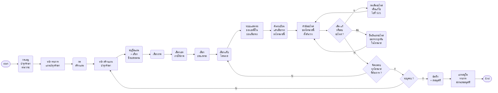

**Wireframe**
- **หน้า รายการแผนบำรุงรักษา** `[เสนอ]` — ตาราง: **เลขที่ MR** (เช่น MR Z7000001) · ชื่อแผน (บรรทัดรอง ปีงบประมาณ · 2 พ.ย. ย้ายจากคอลัมน์แยก) · ภาค · จำนวนรถ · รถรายไตรมาส (2 บรรทัด เช่น "ไตรมาส 1: 3 · ไตรมาส 2: 2" และ "ไตรมาส 3: 1 · ไตรมาส 4: 0" ไม่ใช้ตัวย่อ Q) · คลังรับทราบ (2 พ.ย. · ก่อนอนุมัติ "-" · หลังอนุมัติ "x/n ไตรมาส" จาก S22) · สถานะ (รออนุมัติ · ส่งกลับแก้ไข · อนุมัติแล้ว · ดำเนินการ · ปิดงานแล้ว) · ปุ่ม "…" แสดงตามสถานะแผน (ดูรายละเอียด · แก้ไข S19 · ลบ S20) · ปุ่ม "สร้างแผน" · ค้นหา (เลขที่ MR · ชื่อแผน) · ตัวกรอง (ปีงบประมาณ · ภาค · ประเภทรถ · สถานะ) · ประเภทรถอยู่ในชื่อแผนแทนคอลัมน์แยก (Table 8 คอลัมน์)
  ~~เลขงาน~~ ไม่มีแล้ว (30 ต.ค. — แยกออกไปก่อน)
- **หน้า สร้างแผนบำรุงรักษา**
  - section **ข้อมูลแผน**: ชื่อแผน · ปีงบประมาณ (เลือกได้ทุกปี)
  - section **เลือกรถเข้าแผนและจัดลงไตรมาส**: ภาค · เขต · ประเภทรถ เรียงในแถวเดียว เลือกได้หลายค่า ค่าที่เลือกเป็นชิปในช่อง · แท็บไตรมาส 1 ถึง 4 (ป้ายบนแท็บบอกจำนวนรถในไตรมาสนั้น) · ช่อง "เลือกรถ" แบบค้นหา ไม่มีชิปใต้ช่อง
    - เลือกรถจากรายการ = เอารถคันนั้นเข้าไตรมาสของแท็บที่เปิดอยู่ แล้วรถขึ้นใน section รถในไตรมาส ด้านล่าง ไม่มีชิปใต้ช่อง · เอาออกด้วยการกดคันที่ติ๊กไว้ในรายการอีกครั้ง
    - รายการแสดงเฉพาะรถของเขตที่เลือก ทุกคันที่จัดแล้วมี "ไตรมาส n" ต่อท้ายทะเบียน ถ้าเลือกคันที่อยู่ไตรมาสอื่นในแท็บนี้ รถจะย้ายมาไตรมาสนี้ และยอดของไตรมาสเดิมลดลง
    - เลือกได้หลายเขต รายการรถแสดงรถของทุกเขตที่เลือก
  - section **รถในไตรมาส n** ตามแท็บที่เปิด: ตาราง ทะเบียน · ยี่ห้อ/รุ่น · หน่วยงานเจ้าของรถ · น้ำมันไฮดรอลิก (เก็บตัวอย่าง · เปลี่ยนน้ำมัน) · เปลี่ยนล่าสุด · อะไหล่ (จำนวนรายการ หรือ ยังไม่เลือก) · ไอคอนแก้ไข (ไปหน้า S21) และไอคอนลบ (เอารถออกจากไตรมาส) ท้ายแถว · ยังไม่มีรถ = Empty state "ยังไม่มีรถในไตรมาสนี้"
  - section **อะไหล่ในไตรมาส n** ตามแท็บที่เปิด: ปุ่ม "เพิ่มอะไหล่" ไปหน้า S21 · ตาราง รายการ · รหัส · หมวด · จำนวนตามแผน · หน่วย รวมจากรถของไตรมาสนั้น
  - ปุ่ม ย้อนกลับ · บันทึกและส่งอนุมัติ
  - ~~ไตรมาส (ช่องเดียวของทั้งแผน)~~ เปลี่ยนเป็นแท็บจัดรถรายไตรมาส (30 ต.ค.) · ~~เกณฑ์เลือกรถ ทรัค/เนต~~ ตัดออก (22 ต.ค.) · ~~ตารางติ๊กรถ + คอลัมน์ไตรมาสในแผน~~ เปลี่ยนกลับเป็นช่องค้นหา + ชิป (2 พ.ย.)

**Condition**

| ส่วน | เงื่อนไข | ที่มา |
|---|---|---|
| ชื่อแผน | Freetext · บังคับ · ความยาว (ยังไม่รู้) · error "กรุณาระบุชื่อแผน" | เสนอ |
| ปีงบประมาณ | dropdown select · บังคับ · ไม่ตั้งค่าไว้ให้ · เลือกได้ทุกปี ไม่จำกัดว่าต้องเป็นปีหน้า · error "กรุณาเลือกปีงบประมาณ" · ปีเดียวกันมีหลายแผนได้ · รายการปีที่แสดง (ยังไม่รู้ — Q31) | เจ้าของงาน 30 ต.ค. + เสนอ |
| ภาค | dropdown เลือกได้หลายค่า (Input dropdown with badges) · บังคับ · เลือกก่อนจึงเลือกเขตได้ · ค่าที่เลือกเป็นชิปในช่อง · เอาภาคออกแล้วเขตของภาคนั้นออกด้วย และถ้ามีรถของภาคนั้นจัดไว้ มี confirm ก่อนเอารถออก · error "กรุณาเลือกภาค" | เจ้าของงาน 22 ต.ค. + 2 พ.ย. |
| เขต | dropdown เลือกได้หลายค่า · บังคับ · ก่อนเลือกภาคเป็น Disabled · รายการเฉพาะเขตภายใต้ภาคที่เลือก ค่าย่อเช่น กฟฉ.1 · placeholder "เลือกเขต" · error "กรุณาเลือกเขต" · รายการรถแสดงรถของทุกเขตที่เลือก · เอาเขตออกแล้วรถของเขตนั้นที่จัดไว้ออกจากแผนหลัง confirm "รถของ {เขต} ที่จัดไว้ {n} คัน จะถูกเอาออกจากทุกไตรมาส" | เจ้าของงาน 2 พ.ย. |
| ประเภทรถ | dropdown เลือกได้หลายค่า · บังคับ · ก่อนเลือกเขตเป็น Disabled · ตัวเลือกมาจากประเภทในทะเบียนรถ (ยังไม่รู้ว่าชุดไหน — Q29) · เอาประเภทออกแล้วถามยืนยันแบบเดียวกับเขต · error "กรุณาเลือกประเภทรถ" | เจ้าของงาน 22 ต.ค. + 2 พ.ย. |
| แท็บไตรมาส | 4 แท็บ ไตรมาส 1 ถึง 4 ของปีงบประมาณที่เลือก (ไตรมาส 1 = ต.ค. ถึง ธ.ค. ของปีก่อนหน้า) · ป้ายจำนวนรถบนแท็บ · เปิดแท็บไตรมาส 1 เป็นค่าเริ่มต้น | เจ้าของงาน 30 ต.ค. + ต้นแบบ ส.ค. |
| เลือกรถ | ช่องค้นหา "ค้นหาทะเบียน, จังหวัด" แบบเดียวกับ Overhaul · เลือกภาค เขต และประเภทรถครบแล้วจึงแสดงแท็บไตรมาสและช่องนี้ ก่อนหน้านั้นแสดง Empty state "เลือกภาค เขต และประเภทรถเพื่อแสดงรายการรถในเขต" · รายการแถวละทะเบียนกับจังหวัด คันที่เลือกแล้วอยู่ในสถานะ Selected · ไม่มีรถเข้าเงื่อนไข = "ไม่มีรถที่ตรงกับเขตและประเภทรถที่เลือก" · ค่าเริ่มต้นยังไม่เลือก | เจ้าของงาน 2 พ.ย. + เสนอ |
| รถที่เลือกแล้ว | แสดงใน section รถในไตรมาส n เฉพาะรถของไตรมาสที่แท็บเปิดอยู่ ไม่มีชิปใต้ช่องเลือกรถ · เอาออกด้วยไอคอนลบที่แถวรถ หรือกดคันที่ติ๊กไว้ในรายการเลือกรถอีกครั้ง · อะไหล่ที่เลือกไว้ของคันนั้น (ยังไม่รู้ — Q38) · ป้ายหัวข้อบอกจำนวนรถทั้งแผน | เจ้าของงาน 2 พ.ย. |
| 1 คัน 1 ไตรมาส | รถคันหนึ่งอยู่ได้ไตรมาสเดียวในแผนนี้ · เลือกในแท็บอื่นแล้วรถย้ายไตรมาส · รายการในช่องเลือกรถบอกไตรมาสของทุกคันที่จัดแล้ว ด้วย "ไตรมาส n" ต่อท้ายทะเบียน | เจ้าของงาน 17 ส.ค. (ต้นแบบเดิม) + 2 พ.ย. |
| จัดครบ | ต้องมีรถในแผนอย่างน้อย 1 คัน error "กรุณาเลือกรถเข้าแผนอย่างน้อย 1 คัน" · ไตรมาสที่ไม่มีรถได้ · คันที่ไม่ได้เลือกในแท็บใดเลยไม่อยู่ในแผน | เสนอ |
| รถในไตรมาส | แสดงเมื่อเลือกภาค เขต และประเภทรถครบ · หัวข้อเปลี่ยนตามแท็บ · แสดงเฉพาะรถของไตรมาสนั้น · ยังไม่มีรถ = Empty state "ยังไม่มีรถในไตรมาสนี้ — ค้นทะเบียนในช่องเลือกรถเพื่อเพิ่มรถเข้าไตรมาสนี้" · ระบบไม่คำนวณหรือแนะนำอะไหล่ · ยังไม่เลือกอะไหล่แสดง "ยังไม่เลือก" · กดไอคอนแก้ไขที่แถวรถ ไปหน้า S21 ของคันนั้น | เจ้าของงาน 2 พ.ย. |
| อะไหล่ในไตรมาส | หัวข้อเปลี่ยนตามแท็บไตรมาส · รวมอะไหล่ที่ กบค. เลือกของรถในไตรมาสนั้น รวมรายการที่ระบุเอง · ปุ่ม "เพิ่มอะไหล่" แสดงตลอด กดได้เมื่อไตรมาสนั้นมีรถ · ไม่มีรถ = Empty state "เลือกรถเข้าไตรมาสนี้ก่อน แล้วจึงเพิ่มอะไหล่ได้" · มีรถแต่ยังไม่เลือก = Empty state "กดเพิ่มอะไหล่เพื่อเลือกอะไหล่ของรถในไตรมาสนี้" · ไม่บังคับเลือกก่อนส่งอนุมัติ · ท้ายแถวมีไอคอนแก้ไข (ไปหน้า S21 ของรถที่ใช้อะไหล่นั้น) และไอคอนลบ (confirm "ยืนยันการเอาอะไหล่ออก — {อะไหล่} จะถูกเอาออกจากรถทุกคันในไตรมาส {n}" ปุ่ม ยกเลิก · เอาออก) | เจ้าของงาน 2 พ.ย. |
| ปุ่มย้อนกลับ | มีการแก้ไข มี confirm modal "ยืนยันการออก — ข้อมูลที่กรอกไว้จะไม่ถูกบันทึก" · ไม่มีการแก้ไข ไม่มี CF modal | เสนอ (ตามแบบ Overhaul) |
| เลขที่ MR (Maintenance Request) | ระบบออกให้ตอนบันทึกแผน ผู้ใช้ไม่ได้กรอก · รูปแบบ **"MR Z69000XX"** (เจ้าของงาน 30 ต.ค. 2569) · **Z** = เขตของการไฟฟ้าที่สร้างแผน (Z = สำนักงานใหญ่ ซึ่งเป็นที่ตั้ง กบค.) · **69** = ปีงบประมาณที่เลือกตอนสร้างแผน · **ลำดับ 5 หลัก** นับต่อกันภายในปีที่เลือก เช่น เลือกปี 70 สร้างไปแล้ว 2 แผน แผนที่ 3 ของปี 70 = MR Z7000003 · สร้างแผนปี 71 ครั้งแรก = MR Z7100001 | เจ้าของงาน 30 ต.ค. |
| บันทึกและส่งอนุมัติ | สำเร็จ → สถานะ "รออนุมัติ" · กลับหน้ารายการ · toast "ส่งแผนบำรุงรักษาเพื่ออนุมัติสำเร็จ" · ไม่สำเร็จ toast general error · ผู้อนุมัติ (ยังไม่รู้ — Q32) | เจ้าของงาน 30 ต.ค. + เสนอ |
| ~~ไตรมาส ช่องเดียว~~ | เปลี่ยนเป็นแท็บจัดรถรายไตรมาส 30 ต.ค. 2569 | เจ้าของงาน |
| ~~เกณฑ์เลือกรถ ทรัค/เนต~~ | ตัดออก 22 ต.ค. 2569 — แทนด้วยภาค + ประเภทรถ | เจ้าของงาน |

### Scenario 2 · ผู้อนุมัติ ตรวจสอบและอนุมัติแผนบำรุงรักษา

**ช่วงงาน:** เตรียมดำเนินการ · **เข้าจาก:** เมนู/แจ้งเตือน · **จบที่:** แผนอนุมัติแล้ว หรือ ส่งกลับ กบค. · **ที่มา:** `[บอร์ด]` เลน ผพจ. "ตรวจสอบแผนบำรุงรักษา → อนุมัติ? → ระบุเหตุผล → กบค. จัดการแก้ไข"
· **ปรับ 30 ต.ค. 2569 (เจ้าของงาน):** _"การอนุมัติแผนยังมีเหมือนเดิม แต่ว่าไม่ต้องผ่าน ผพจ ส่งอนุมัติทั่วไปได้เลย"_ ⇒ ผู้อนุมัติเป็นสายอนุมัติทั่วไป ไม่ใช่ ผพจ. · ตัดขั้น "ตรวจ/เตรียมอะไหล่เพื่อใช้ในไตรมาส" ของ ผพจ. ออก · อนุมัติแล้วไม่มีขั้นออกเลขงานต่อ (S3 พักไว้) ไปที่ S4 รายไตรมาสได้เลย
· **ปรับ 2 พ.ย. 2569 (เจ้าของงาน):** _"s2 จะมี scen อนุมัติ และหรือส่งกลับแก้ไข อยากให้ลอง export โดย อนุมัติ กับ ส่งกลับแก้ไข อยากให้แสดงเป็น radio button select อนุมัติไว้เป็น Default"_ ⇒ ผลการพิจารณาเป็น Radio text card 2 ใบ อนุมัติ (เลือกไว้เป็นค่าเริ่มต้น) · ส่งกลับแก้ไข (ช่องเหตุผลขึ้น บังคับ) · ปุ่มเดียว "ยืนยันผลการพิจารณา" แทนปุ่มอนุมัติ/ส่งกลับ 2 ปุ่ม · ยึดแบบการ์ดตอบรับ/ปฏิเสธนัดหมายของ Overhaul (R29)
· **ปรับ 2 พ.ย. 2569 (เจ้าของงาน):** _"อยากให้ขนาดกล่องเท่ากัน อยากให้ข้อมูลที่แสดงเป็นข้อมูลรถ"_ (เลือกแบบ รถรายไตรมาสแบบ S1 แทนตารางอะไหล่) ⇒ การ์ดผลการพิจารณาสูงเท่ากัน · หน้ารายละเอียดแผนแสดงรถในแผนแยกแท็บไตรมาส คอลัมน์แบบ section รถในไตรมาสของ S1 ไม่มีตารางอะไหล่ทั้งปี

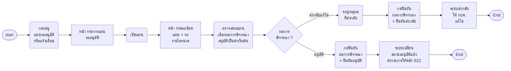

**Wireframe**
- **หน้า รายการแผนรออนุมัติ** `[เสนอ]` — ชื่อแผน · ปีงบประมาณ · ผู้สร้าง · ภาค · ประเภทรถ · จำนวนรถ · วันที่ส่ง · ปุ่มเปิด
- **หน้า รายละเอียดแผน (ฝั่งผู้อนุมัติ)** — ข้อมูลแผน (Display ดึงจาก S1) · รถในแผน แยกแท็บไตรมาส คอลัมน์แบบ S1 (ไม่มีตารางอะไหล่) · ผลการพิจารณา (Radio text card อนุมัติ · ส่งกลับแก้ไข) · ช่องเหตุผลที่ส่งกลับ เมื่อเลือกส่งกลับ `[บอร์ด]` · ปุ่ม ย้อนกลับ · ยืนยันผลการพิจารณา

**Condition**

| ส่วน | เงื่อนไข | ที่มา |
|---|---|---|
| ผู้อนุมัติ | สายอนุมัติทั่วไป ไม่ใช่ ผพจ. · ใครและกี่ชั้น (ยังไม่รู้ — Q32) | เจ้าของงาน 30 ต.ค. |
| รถในแผน | Section label "รถในแผน (n)" + แท็บไตรมาส 1 ถึง 4 (จำนวนรถบนแท็บ) + ตาราง ทะเบียน · ยี่ห้อ/รุ่น · หน่วยงานเจ้าของรถ · น้ำมันไฮดรอลิก · เปลี่ยนล่าสุด · อะไหล่ (จำนวนรายการ หรือ ยังไม่เลือก) · ดูอย่างเดียว ไม่มีไอคอน | เจ้าของงาน 2 พ.ย. |
| ผลการพิจารณา | Radio text card 2 ใบ สูงเท่ากัน · อนุมัติ (บรรทัดรอง "แผนผ่านการตรวจสอบ กบค. เริ่มงานรายไตรมาสได้") เลือกไว้เป็นค่าเริ่มต้น · ส่งกลับแก้ไข (บรรทัดรอง "แจ้งเหตุผลให้ กบค. แก้ไขแผนแล้วส่งใหม่") | เจ้าของงาน 2 พ.ย. |
| เหตุผลที่ส่งกลับ | Text area แสดงเมื่อเลือกส่งกลับแก้ไข · บังคับ · placeholder "ระบุเหตุผลที่ส่งกลับ" · ไม่กรอก = error "กรุณาระบุเหตุผลที่ส่งกลับ" | บอร์ด "ระบุเหตุผล" + เจ้าของงาน 2 พ.ย. |
| ปุ่ม | ย้อนกลับ · ยืนยันผลการพิจารณา → confirm ตามผลที่เลือก: อนุมัติ "ยืนยันอนุมัติแผนบำรุงรักษา" ปุ่ม อนุมัติ · ส่งกลับ "ยืนยันส่งกลับแก้ไข — แผนจะกลับไปให้ กบค. แก้ไขตามเหตุผลที่ระบุ แล้วส่งอนุมัติใหม่" ปุ่ม ส่งกลับ | เจ้าของงาน 2 พ.ย. + เสนอ |
| ส่งกลับ | แผนกลับสถานะ "ส่งกลับแก้ไข" · กบค. เห็นเหตุผล แล้วแก้ที่ S19 ส่งใหม่ | บอร์ด "กบค. จัดการแก้ไข" |
| อนุมัติ | มี confirm modal · สถานะเป็น "อนุมัติแล้ว" · toast "อนุมัติแผนบำรุงรักษาสำเร็จ" · หลังจากนี้ กบค. ทำงานรายไตรมาสได้ (S4) | เสนอ |

### Scenario 4 · กบค. ติดตามความคืบหน้าและเบิกอะไหล่ของไตรมาส

**ช่วงงาน:** เบิก/จัดหาอะไหล่ · **เข้าจาก:** แผนอนุมัติแล้วและคลังรับทราบ (S22) เปิดไตรมาสที่กำลังทำ · **จบที่:** เบิกครบ แล้วไปหน้าแผนเดินทางของไตรมาส (S6 · เลือกดำเนินการเอง หรือจ้างดำเนินการ S9 ในฟอร์มแผนเดินทาง) · **ที่มา:** เจ้าของงาน 2 พ.ย. 2569 _"S4 จะไม่ได้เป็นการตรวจความพร้อมของรถ แต่จะเป็นการตรวจความคืบหน้าอะไหล่แทน โดยเห็นรายการว่ามีความต้องการเบิกอะไร และเห็นว่าใน smart inventory มีจำนวนเท่าไร"_ + เลือก รวม S4 S5 เป็นหน้าเดียว ยุบ S5 ออก · เห็นต้องเบิกเทียบคงเหลือ Smart Inventory + สถานะการเบิกรายรายการ · เฉพาะไตรมาสที่กำลังทำ · ตัดการตรวจรถทิ้งทั้งหมด
· แทน S4 เดิม (ตรวจจำนวนรถ · ความพร้อมรถ · นำรถโอน/รอยุบออก — ตัดทิ้ง) และรวม S5 เดิม (เบิกผ่านระบบจองอะไหล่) ไว้หน้าเดียว · เนื้อหาเดิมเก็บใน `14-บำรุงรักษา-userflow-พักไว้-S3.md`
· ข้อที่ผู้เขียนถือตามที่เสนอ: ถ้าต้องเอารถออก ให้แก้แผนที่ S19 · สถานะการเบิก รอเบิก → จองแล้ว / รอจัดซื้อ → เบิกแล้ว


**Wireframe**
- **หน้า ความคืบหน้าอะไหล่ · ไตรมาส n** (เฉพาะไตรมาสที่กำลังทำ) — แถบบอกคลังรับทราบไตรมาสนี้แล้ว · ตาราง รายการอะไหล่ · รหัส · ต้องเบิก · หน่วย · คงเหลือ Smart Inventory · ไม่พอ · สถานะการเบิก (รอเบิก · จองแล้ว · รอจัดซื้อ · เบิกแล้ว) · ปุ่ม ย้อนกลับ · เบิก/จองอะไหล่ · มีผลเบิก/จองแล้ว (ตั้งแต่คงเหลือไม่พอ) = ตัวเลือก รูปแบบดำเนินการ (ดำเนินการเอง · ว่าจ้าง) + ปุ่ม ไปทำแผนเดินทาง (กดได้เมื่อเบิกครบ)

**Condition**

| ส่วน | เงื่อนไข | ที่มา |
|---|---|---|
| ขอบเขต | เฉพาะไตรมาสที่กำลังทำ · จำนวนต้องเบิกมาจากอะไหล่ที่ กบค. เลือกให้รถของไตรมาสนั้น (S1 S21) | เจ้าของงาน 2 พ.ย. |
| คงเหลือ Smart Inventory | Display ดึงจาก Smart Inventory · ไม่พอ = ต้องเบิก ลบ คงเหลือ · เชื่อมไม่ได้ = แถบ error "เชื่อมต่อ Smart Inventory ไม่ได้" คงเหลือแสดง "-" ปุ่มเบิกกดไม่ได้ | เจ้าของงาน 2 พ.ย. + เสนอ |
| สถานะการเบิก | รายรายการ รอเบิก (Gray) → จองแล้ว (Info) หรือ รอจัดซื้อ (Warning) เมื่อคงเหลือไม่พอ → เบิกแล้ว (Success) | เจ้าของงาน 2 พ.ย. + เสนอ |
| เบิก/จอง | ปุ่ม "เบิก/จองอะไหล่" → modal สรุปรายการ (เบิกจากคลัง · รอจัดซื้อ) → ยืนยัน · ไม่มีอะไหล่ในแผน = ปุ่มกดไม่ได้ เพิ่มอะไหล่ที่แก้ไขแผน | เสนอ |
| ~~รูปแบบดำเนินการ~~ | ถอดออก 3 พ.ย. 2569 (เจ้าของงาน "ถอดออกจาก S4 ตามที่เสนอ") ย้ายไปเลือกในฟอร์มแผนเดินทาง ไตรมาสเดียวมีทั้งแผนที่ กบค. ดำเนินการเองและแผนจ้างดำเนินการได้ | เจ้าของงาน 3 พ.ย. |
| ไปทำแผนเดินทาง | กดได้เมื่อเบิกครบทุกรายการ · กดแล้วไปหน้าแผนเดินทางของไตรมาส (S6 หน้าแรก) · ข้อความเมื่อเบิกครบ "เบิกอะไหล่ครบแล้ว" บรรทัดรอง "เบิกจาก Smart Inventory n รายการ · ไปทำแผนเดินทางของไตรมาสได้" | บอร์ด + เจ้าของงาน 3 พ.ย. |
| ~~ตรวจจำนวนรถ ความพร้อม นำรถออก~~ | ตัดทิ้ง 2 พ.ย. 2569 (เจ้าของงาน) | — |

### Scenario 6 · กบค. ทำแผนเดินทาง (ตรวจเอง)

**ช่วงงาน:** จ้างดำเนินการ (สายไม่ว่าจ้าง) · **เข้าจาก:** S4 เลือกไม่ว่าจ้าง · **จบที่:** ส่งแจ้งเตือน · **ที่มา:** `[บอร์ด]` "ทำแผนเดินทาง → ระบุรายละเอียดแผนการเดินทาง" + กล่อง "กบค. ระบุข้อมูล: พนักงาน กบค.ซ่อม จำนวน 2-3 คน · ค่าเบี้ยเลี้ยง · ค่าที่พัก · ค่าเดินทาง · เลือกรถที่จะบำรุงรักษา · ระบุสถานที่บำรุงรักษา · กำหนดวันที่เดินทางไปเป็นช่วง · ยืนยันการสร้างแผนเดินทาง · ส่ง Notification หาวันที่เข้าตรวจ → เจ้าของรถ · กรย."
· **ปรับ 2 พ.ย. 2569 (เจ้าของงาน):** _"ตอนที่สร้างแผนการเดินทาง อยากให้ระบุเป็นรายคัน โดย default เป็นสำนักงานที่รถคันนั้นอยู่ · เลือกรถเป็นการเลือกภายในไตรมาสนั้น วิธีเลือกรถเป็นแบบไม่มีชิป และมีตารางแสดงเหมือน S1 · แจ้งเตือนเป็นแบบ in-app email push noti · ข้อความ toast เป็นไปตามนั้นก่อน"_ ⇒ สถานที่บำรุงรักษาระบุรายคันในตารางรถ ค่าเริ่มต้นสำนักงานที่รถคันนั้นอยู่ แก้ได้ทีละคัน · เลือกรถเฉพาะไตรมาสที่กำลังทำ ช่องค้นหาไม่มีชิป ตารางรถแบบ S1 · แจ้งเตือน in-app · e-mail · push notification

· **ปรับ 3 พ.ย. 2569 (เจ้าของงาน):** _"แผนการเดินทาง ตอนเลือก เป็นรายการรถทั้งหมดที่อยู่ในแผนไตรมาสนั้น โดยมีปุ่มให้เพิ่มรถเข้าแผนการเดินทาง เนื่องจาก 1 ไตรมาสอาจมีหลายแผนการเดินทาง แต่ละแผนการเดินทางจะมีรถต่างกันก็ได้ และพอเลือกเข้าแผนการเดินทางนั้นแล้ว การสร้างแผนการเดินทางครั้งต่อไปรถคันนั้นก็ไม่มีให้เลือก"_ + เลือกแบบ popup เพิ่มรถ และรถที่อยู่ในแผนเดินทางอื่นแล้ว ไม่แสดงแต่บอกจำนวน ⇒ ตัดช่องค้นหาเลือกรถออก ใช้ปุ่ม "เพิ่มรถ" เปิด popup รายการรถของไตรมาสแบบติ๊ก
· **ปรับ 3 พ.ย. 2569 (เจ้าของงาน รอบ 2):** _"scen e1 อยากให้แสดงรถทั้งหมดในแผน และมีให้เพิ่มแผนการเดินทาง … ตัวอย่างมีรถ 10 คัน ในแผน"_ + เลือก รถของไตรมาสที่กำลังทำ · หน้าเดียวมีตารางรถและตารางแผนเดินทาง · รถ 10 คันใช้เฉพาะ S6 ⇒ หน้าแรกของ S6 เป็นหน้า "แผนเดินทาง" ของไตรมาส แสดงรถทุกคันของไตรมาสว่าอยู่แผนเดินทางใบไหนแล้ว และรายการแผนเดินทางพร้อมปุ่ม "สร้างแผนเดินทาง"
· **ปรับ 3 พ.ย. 2569 (เจ้าของงาน รอบ 3):** _"ตอนสร้างแผนการเดินทางอยากให้ตั้งชื่อแผนได้ด้วย เพิ่มช่องชื่อแผนการเดินทางด้วย"_ ⇒ ฟอร์มมีหัวข้อ "ข้อมูลแผนเดินทาง" ช่อง "ชื่อแผนเดินทาง" (แบบเดียวกับช่อง "ชื่อแผน" ของ S1) · หน้าแผนเดินทางแสดงชื่อที่ตั้งแทน "แผนเดินทาง k"

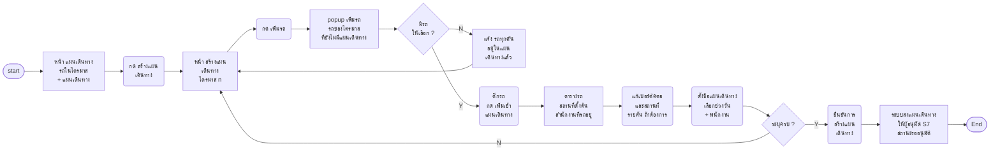

**Wireframe**
- **หน้า แผนเดินทาง (ของไตรมาส n)** — กล่องรายละเอียดแผน (ไตรมาสบอกจำนวนรถ เช่น "ไตรมาส 1 (10 คัน)") · ส่วน "รถในไตรมาส n (จำนวน)": ตารางรถทุกคันของไตรมาส ทะเบียน · ยี่ห้อ/รุ่น · หน่วยงานเจ้าของรถ · เบอร์ติดต่อ · ช่วงวันเดินทาง · แผนเดินทาง (ชื่อแผนเดินทางที่รถอยู่ หรือป้าย "ยังไม่มีแผนเดินทาง") · ส่วน "แผนเดินทาง (จำนวน)" + ปุ่ม "สร้างแผนเดินทาง": ตาราง ชื่อแผนเดินทาง (บรรทัดรองจำนวนสถานที่) · ช่วงวันเดินทาง · รถ (คัน) · ผู้ดำเนินการ · สถานะ · ไอคอนไปหน้ารายละเอียด
- **หน้า สร้างแผนเดินทาง · ไตรมาส n** — หัวข้อ "ข้อมูลแผนเดินทาง" ช่อง "ชื่อแผนเดินทาง" · หัวข้อ "รถในแผนเดินทาง" (จำนวนคัน) + ปุ่ม "เพิ่มรถ" · ตาราง ทะเบียน · ยี่ห้อ/รุ่น · หน่วยงานเจ้าของรถ · เบอร์ติดต่อ · สถานที่บำรุงรักษา (บรรทัดรองบอกค่าเริ่มต้นหรือแก้แล้ว) · ไอคอนแก้ไข (popup แก้เบอร์ติดต่อและสถานที่) และลบรถ · ช่วงวันเดินทาง · พนักงาน กบค. ซ่อม 2-3 คน · ปุ่ม ย้อนกลับ / ยืนยันการสร้างแผนเดินทาง (ไม่มีค่าใช้จ่ายแล้ว 3 พ.ย. 2569 ย้ายไปกรอกรายคันตอนปิดงาน S10)
- **popup เพิ่มรถเข้าแผนเดินทาง** — หัว "เพิ่มรถเข้าแผนเดินทาง" บรรทัดรอง "รถของไตรมาส n ที่ยังไม่อยู่ในแผนเดินทางใด · อีก x คันอยู่ในแผนเดินทางอื่นแล้ว" · ช่องค้นหา · ตารางติ๊ก ทะเบียน · ยี่ห้อ/รุ่น · หน่วยงานเจ้าของรถ (ช่องหัวตารางติ๊กทั้งหมด) · ปุ่ม ยกเลิก / เพิ่มเข้าแผนเดินทาง (n)
- **popup เมื่อไม่มีรถให้เลือก** `[เสนอ]` — "รถทุกคันของไตรมาส n อยู่ในแผนเดินทางแล้ว" · "ไม่มีรถที่เพิ่มเข้าแผนเดินทางนี้ได้" · ปุ่มเพิ่มกดไม่ได้

**Condition**

| ส่วน | เงื่อนไข | ที่มา |
|---|---|---|
| หน้าแผนเดินทาง ส่วนรถ | แสดงรถทุกคันของไตรมาสที่กำลังทำ ไม่ว่าจะอยู่ในแผนเดินทางแล้วหรือยัง · จำนวนคันต่อท้ายหัวข้อ "รถในไตรมาส n" · รถที่อยู่ในแผนเดินทางแล้ว คอลัมน์แผนเดินทางแสดงชื่อแผนเดินทางของใบนั้น และคอลัมน์ช่วงวันเดินทางแสดงช่วงวันของใบนั้น · รถที่ยังไม่อยู่ในใบใด แสดงป้าย "ยังไม่มีแผนเดินทาง" (สีเทา) และช่วงวันเป็นขีด · คอลัมน์เบอร์ติดต่อ รถที่อยู่ในแผนเดินทางแล้วแสดงเบอร์ของใบนั้น (แก้แล้วมีบรรทัดรอง "แก้จากเบอร์เจ้าของรถ") รถที่ยังไม่อยู่ในใบใดแสดงเบอร์เจ้าของรถ · ส่วนนี้ดูอย่างเดียว แก้เบอร์ทำในหน้าสร้างหรือแก้ไขแผนเดินทาง | เจ้าของงาน 3 พ.ย. (คอลัมน์เป็นข้อเสนอ · เบอร์ติดต่อเจ้าของงานขอ) |
| หน้าแผนเดินทาง ส่วนแผนเดินทาง | หัวข้อ "แผนเดินทาง" ต่อท้ายจำนวนใบ (มีทั้งใบที่ กบค. ดำเนินการเอง และใบจ้างดำเนินการ) และปุ่ม "สร้างแผนเดินทาง" · ยังไม่มีใบ แสดง "ยังไม่มีแผนเดินทาง" และ "สร้างแผนเดินทางเพื่อนัดวันเข้าตรวจ แจ้งเจ้าของรถและ กรย." พร้อมปุ่ม "สร้างแผนเดินทาง" · มีใบแล้ว แสดงตารางเรียงตามลำดับที่สร้าง คอลัมน์แรก "ชื่อแผนเดินทาง" แสดงชื่อที่ตั้งตอนสร้าง บรรทัดรองบอกจำนวนสถานที่ (และจำนวนคันที่ใช้สำนักงานเจ้าของรถ) · ช่วงวัน · รถ (คัน) · ผู้ดำเนินการ ("กบค. (ดำเนินการเอง)" หรือชื่อผู้รับจ้าง) · สถานะ "ส่งแจ้งแล้ว" · ไอคอนไปหน้ารายละเอียดของใบ (ใบที่อนุมัติแล้วไปหน้ารายละเอียดแผนเดินทางของ S10 ที่มีสถานะงานรายคัน) | เจ้าของงาน 3 พ.ย. |
| รูปแบบดำเนินการ | อยู่แถวเดียวกับช่อง "ชื่อแผนเดินทาง" คนละครึ่ง (ชื่อแผนเดินทางซ้าย รูปแบบดำเนินการขวา) · ป้าย "รูปแบบดำเนินการ" · radio 2 ตัวเรียงแนวนอน "กบค. ดำเนินการเอง" เลือกไว้เป็นค่าเริ่มต้น · "จ้างดำเนินการ" · ไม่มีคำอธิบายใต้ตัวเลือก · เลือกจ้างดำเนินการแล้วฟอร์มเปลี่ยนเป็นแบบ S9 · บนมือถือ ชื่อแผนเดินทางเต็มแถว แล้วรูปแบบดำเนินการอยู่บรรทัดถัดลงมา radio 2 ตัวยังเรียงข้างกัน | เจ้าของงาน 3 พ.ย. (เปลี่ยนจากการ์ดเป็น radio แถวเดียวกัน) |
| ชื่อแผนเดินทาง | ช่อง "ชื่อแผนเดินทาง" อยู่บนสุดของฟอร์ม ใต้หัวข้อ "ข้อมูลแผนเดินทาง" · บังคับกรอก · ข้อความในช่องว่า "ระบุชื่อแผนเดินทาง" · ไม่มีค่าตั้งต้น · กดยืนยันโดยยังว่าง ขึ้น "กรุณาระบุชื่อแผนเดินทาง" ใต้ช่อง · ชื่อที่ตั้งแสดงในหน้าแผนเดินทางทั้งตารางรถ และตารางแผนเดินทาง | เจ้าของงาน 3 พ.ย. (บังคับกรอกและข้อความเป็นข้อเสนอ) |
| แผนเดินทางต่อไตรมาส | 1 ไตรมาสมีแผนเดินทางได้หลายใบ · แต่ละใบมีรถต่างกัน · รถ 1 คันอยู่ได้ในแผนเดินทางใบเดียวของไตรมาสนั้น | เจ้าของงาน 3 พ.ย. |
| เปิดหน้าสร้างแผนเดินทาง | ตาราง "รถในแผนเดินทาง" ยังว่าง แสดง "ยังไม่มีรถในแผนเดินทาง" และ "กดเพิ่มรถเพื่อเลือกรถของไตรมาส n ที่ยังไม่อยู่ในแผนเดินทางใด" · ปุ่ม "เพิ่มรถ" อยู่ที่หัวข้อ "รถในแผนเดินทาง" กดได้ทุกเมื่อ ทั้งตอนยังไม่มีรถและตอนมีรถแล้ว | เจ้าของงาน 3 พ.ย. |
| popup เพิ่มรถ แสดงเมื่อ | กดปุ่ม "เพิ่มรถ" เท่านั้น · ไม่เปิดเองตอนเข้าหน้า | เจ้าของงาน 3 พ.ย. |
| รถที่แสดงใน popup | รถทุกคันของไตรมาสที่กำลังทำ ยกเว้น (1) รถที่อยู่ในแผนเดินทางใบอื่นของไตรมาสเดียวกันที่ยืนยันแล้ว (2) รถที่อยู่ในตารางของแผนเดินทางใบนี้แล้ว · รถที่ยกเว้นไม่แสดงในรายการเลย (ไม่ใช่แสดงเป็นสีเทา) · คอลัมน์ ทะเบียน · ยี่ห้อ/รุ่น · หน่วยงานเจ้าของรถ | เจ้าของงาน 3 พ.ย. |
| บรรทัดรองของ popup | "รถของไตรมาส n ที่ยังไม่อยู่ในแผนเดินทางใด" · ถ้ามีรถที่อยู่ในแผนเดินทางใบอื่นแล้ว ต่อท้าย " · อีก x คันอยู่ในแผนเดินทางอื่นแล้ว" (x = จำนวนคันนั้น) · ไม่มีก็ไม่ต่อท้าย | เจ้าของงานเลือก 3 พ.ย. (ไม่แสดงแต่บอกจำนวน) |
| ค้นหาใน popup | ค้นจากทะเบียน · ยี่ห้อ/รุ่น · หน่วยงานเจ้าของรถ · จับคำที่มีอยู่ในข้อความ · ค้นไม่พบใช้ Empty state ค้นไม่พบ (ยังไม่มีจอ) | เสนอ |
| ติ๊กเลือก | ติ๊กได้หลายคัน · ช่องติ๊กหัวตารางเลือกหรือเอาออกทุกคันที่แสดงอยู่ · หัวตารางเป็นติ๊กครึ่งเมื่อเลือกบางคัน | หน้า Select vehicles ของ UI Release#2 |
| ปุ่มใน popup | "ยกเลิก" และปุ่มปิดมุมขวา ปิด popup โดยตารางในฟอร์มไม่เปลี่ยน · "เพิ่มเข้าแผนเดินทาง (n)" n = จำนวนคันที่ติ๊ก · กดไม่ได้เมื่อยังไม่ติ๊ก (ไม่แสดงวงเล็บ) · กดแล้วปิด popup รถที่ติ๊กต่อท้ายตาราง "รถในแผนเดินทาง" | เสนอ |
| ไม่มีรถให้เลือก | รถทุกคันของไตรมาสอยู่ในแผนเดินทางแล้ว ⇒ popup แสดง "รถทุกคันของไตรมาส n อยู่ในแผนเดินทางแล้ว" และ "ไม่มีรถที่เพิ่มเข้าแผนเดินทางนี้ได้" · ปุ่ม "เพิ่มเข้าแผนเดินทาง" กดไม่ได้ | เสนอ |
| ตารางรถในแผนเดินทาง | ทะเบียน · ยี่ห้อ/รุ่น · หน่วยงานเจ้าของรถ · เบอร์ติดต่อ · สถานที่บำรุงรักษา · ไอคอนแก้ไข และลบ · จำนวนคันที่หัวข้อ | เจ้าของงาน 2 พ.ย. · เบอร์ติดต่อ 3 พ.ย. |
| เบอร์ติดต่อ | รายคัน · ค่าเริ่มต้นเป็นเบอร์ของเจ้าของรถจากข้อมูลรถ ไม่มีบรรทัดรอง · แก้ได้ทีละคันจากไอคอนแก้ไข (popup เดียวกับสถานที่) · แก้แล้วบรรทัดรอง "แก้จากเบอร์เจ้าของรถ" · ไม่มีเบอร์ในข้อมูลรถ แสดง "-" (เสนอ) | เจ้าของงาน 3 พ.ย. + เสนอ (บรรทัดรอง) |
| popup แก้ไขรถในแผนเดินทาง | แสดงเมื่อกดไอคอนแก้ไขของแถวนั้น · หัว "แก้ไขเบอร์ติดต่อและสถานที่ · {ทะเบียน}" · ช่อง "เบอร์ติดต่อ" และ "สถานที่บำรุงรักษา" กรอกค่าปัจจุบันของแถวไว้ · ปุ่ม ยกเลิก (ปิดโดยค่าไม่เปลี่ยน) · บันทึก (ปิดแล้วค่าในแถวเปลี่ยนตาม) | เจ้าของงาน 3 พ.ย. + เสนอ (ชื่อหัว popup) |
| ลบรถออกจากตาราง | กดไอคอนลบ รถออกจากตารางทันที แล้วกลับไปแสดงใน popup เพิ่มรถให้เลือกได้อีก | เสนอ |
| รถไม่มีให้เลือกในแผนเดินทางถัดไป | เมื่อยืนยันการสร้างแผนเดินทางสำเร็จ รถทุกคันในใบนั้นไม่แสดงใน popup เพิ่มรถของแผนเดินทางใบถัดไปในไตรมาสเดียวกัน · รถของไตรมาสอื่นไม่เกี่ยว | เจ้าของงาน 3 พ.ย. |
| สถานที่บำรุงรักษา | รายคัน · ค่าเริ่มต้น "สำนักงาน {หน่วยงานเจ้าของรถ}" · บรรทัดรอง "ค่าเริ่มต้น สำนักงานที่รถอยู่" · แก้ได้ทีละคันจากไอคอนแก้ไข (popup แก้ไขรถในแผนเดินทาง ข้างบน) · แก้แล้วบรรทัดรอง "แก้จากสำนักงานเจ้าของรถ" | เจ้าของงาน 2 พ.ย. |
| วันที่เดินทาง | date range · ไม่สามารถเลือกน้อยกว่าวันนี้ | บอร์ด "เป็นช่วง" + เสนอ |
| พนักงาน | search select · อย่างน้อย 2 ไม่เกิน 3 คน | บอร์ด "จำนวน 2-3 คน" |
| ~~ค่าเบี้ยเลี้ยง / ที่พัก / เดินทาง~~ | ไม่กรอกในแผนเดินทางแล้ว ย้ายไปกรอกรายคันตอนปิดงาน (S10) พร้อมเลือกงบ · เดิม Text number (บาท) ไปรวมที่ S18 | เจ้าของงาน 3 พ.ย. 2569 _"ค่าที่พัก ค่าเดินทาง … จะมีให้กรอกอีกทีตอนปิดงาน โดยรายละเอียดเรื่องค่าใช้จ่ายของรถแต่ละคันจะกรอกแยกกัน"_ |
| ยืนยันโดยยังไม่มีรถ | แจ้ง "กรุณาเพิ่มรถเข้าแผนเดินทางอย่างน้อย 1 คัน" ที่หัวข้อรถในแผนเดินทาง พร้อมข้อความของช่องอื่นที่ยังไม่ครบ | เสนอ |
| ยืนยัน | สำเร็จ ⇒ แผนเดินทางสถานะ "รออนุมัติ" ส่งให้ผู้อนุมัติ (S7) · toast "สร้างแผนเดินทางสำเร็จ · ส่งให้ผู้อนุมัติแล้ว" · ยังไม่แจ้งเจ้าของรถและ กรย. จนกว่าจะอนุมัติ (S8) · รถในใบนี้นับว่าอยู่ในแผนเดินทางแล้วตั้งแต่ส่งอนุมัติ | เจ้าของงาน 3 พ.ย. (ย้ายแจ้งเตือนไปหลังอนุมัติ) |
| สถานะแผนเดินทาง | รออนุมัติ (สีเหลือง) · อนุมัติแล้ว (สีเขียว) · ส่งกลับแก้ไข (สีแดง) · แสดงที่คอลัมน์สถานะของตารางแผนเดินทาง | เสนอ ตามชื่อสถานะของแผน S2 |
| ถูกส่งกลับแก้ไข | ใบที่ถูกส่งกลับ สถานะ "ส่งกลับแก้ไข" · เปิดใบนั้นแล้วเข้าหน้าแก้ไขแผนเดินทาง (ฟอร์มเดียวกับสร้าง ค่าเดิมกรอกไว้) · บนสุดมีกล่องแจ้ง "ผู้อนุมัติส่งกลับให้แก้ไข" พร้อมเหตุผลที่ผู้อนุมัติระบุ · ปุ่มท้ายหน้า "ส่งอนุมัติใหม่" · ส่งแล้วสถานะกลับเป็น "รออนุมัติ" · toast "ส่งแผนเดินทางให้ผู้อนุมัติใหม่แล้ว" · รถของใบที่ถูกส่งกลับยังไม่กลับไปให้ใบอื่นเลือก | เสนอ ตามแบบ S19 ของแผน |

**ยังไม่เคาะ** — ชื่อแผนเดินทางบังคับกรอกไหม · ซ้ำกับใบอื่นในไตรมาสเดียวกันได้ไหม · ยาวได้สูงสุดกี่ตัวอักษร · แผนเดินทางมีเลขที่ของระบบด้วยไหม · หน้ารายละเอียดของแผนเดินทางแต่ละใบยังไม่มีจอ · ฟอร์มที่ยังไม่กดยืนยันกันรถไว้ไหม (ตอนนี้นับเฉพาะใบที่ยืนยันแล้ว) · ยกเลิกหรือแก้ไขแผนเดินทางที่ยืนยันแล้ว รถกลับมาเลือกได้ไหม · ลบรถออกจากตารางต้องถามยืนยันไหม · เมื่อรถทุกคันของไตรมาสอยู่ในแผนเดินทางแล้ว ปุ่ม "สร้างแผนเดินทาง" ในหน้ารายการควรกดไม่ได้ไหม (Q44) · เบอร์ติดต่อเจ้าของรถดึงจากข้อมูลไหน ตรวจรูปแบบเบอร์ไหม และ S7 S8 ต้องแสดงเบอร์ด้วยไหม (Q47)

### Scenario 7 · ผู้อนุมัติ ตรวจสอบและอนุมัติแผนเดินทาง

**ช่วงงาน:** จ้างดำเนินการ · **เข้าจาก:** แจ้งเตือน หรือเมนูแผนเดินทางรออนุมัติ · **จบที่:** แผนเดินทางอนุมัติแล้ว (ต่อ S8) หรือส่งกลับให้ กบค. แก้ที่ S6 · **ที่มา:** เจ้าของงาน 3 พ.ย. 2569 _"s7 เป็นเรื่องอนุมัติแผนการเดินทาง"_ + เลือกหน้าอนุมัติแบบเดียวกับ S2 · ผู้อนุมัติ _"จะเป็นคนตามเส้น api getupper lower เลยไม่แน่ใจว่าเป็นหัวหน้ากบคมั้ย"_
· S7 เดิม (ผู้รับจ้างทำแผนเดินทาง) ย้ายไป [14-…-พักไว้-S3.md](14-บำรุงรักษา-userflow-พักไว้-S3.md) · เส้นว่าจ้างแยกเป็น scenario ใหม่ หัวข้อ 2.1

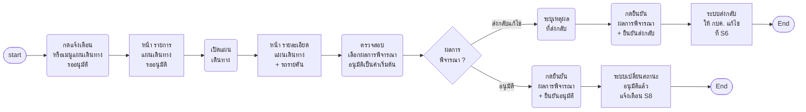

**Wireframe**
- **หน้า รายการแผนเดินทางรออนุมัติ** `[เสนอ]` — ชื่อแผนเดินทาง (บรรทัดรอง เลขที่ MR · ไตรมาส) · ช่วงวันเดินทาง · รถ (คัน) · ผู้สร้าง (กบค.) · วันที่ส่ง · สถานะ · ปุ่มเปิด
- **หน้า รายละเอียดแผนเดินทาง (ฝั่งผู้อนุมัติ)** — กล่องข้อมูลแผนเดินทาง (Display จาก S6) · รถในแผนเดินทาง (ตาราง ทะเบียน · ยี่ห้อ/รุ่น · หน่วยงานเจ้าของรถ · สถานที่บำรุงรักษา ดูอย่างเดียว) · ผลการพิจารณา (Radio text card อนุมัติ · ส่งกลับแก้ไข) · ช่องเหตุผลที่ส่งกลับเมื่อเลือกส่งกลับ · ปุ่ม ย้อนกลับ · ยืนยันผลการพิจารณา

**Condition**

| ส่วน | เงื่อนไข | ที่มา |
|---|---|---|
| ผู้อนุมัติ | ผู้บังคับบัญชาตามสายงานของ กบค. ผู้สร้างแผนเดินทาง ได้จาก API getUpperLower · ตำแหน่งและจำนวนชั้นยังไม่รู้ (Q45) | เจ้าของงาน 3 พ.ย. |
| เข้าหน้า | แจ้งเตือน "มีแผนเดินทางรออนุมัติ" (ร่าง) หรือเมนูแผนเดินทางรออนุมัติ · รายการแสดงเฉพาะใบที่ส่งมาให้ผู้อนุมัติคนนี้ | เสนอ |
| รายการ | คอลัมน์ ชื่อแผนเดินทาง (บรรทัดรอง เลขที่ MR และไตรมาส) · ช่วงวันเดินทาง · รถ (คัน) · ผู้สร้าง (กบค.) · วันที่ส่ง · สถานะ · ไอคอนเปิด · ค้นหาด้วยชื่อแผนเดินทาง หรือผู้สร้าง | เสนอ |
| รายละเอียด | กล่อง "รายละเอียดแผนเดินทาง": ชื่อแผนเดินทาง · แผน · ไตรมาส · ช่วงวันเดินทาง · พนักงาน กบค. ซ่อม · ผู้สร้าง · วันที่ส่ง (ไม่มีค่าใช้จ่าย ย้ายไปปิดงานรายคัน 3 พ.ย. 2569) · ส่วน "รถในแผนเดินทาง (n)" ตาราง ทะเบียน · ยี่ห้อ/รุ่น · หน่วยงานเจ้าของรถ · สถานที่บำรุงรักษา (บรรทัดรองค่าเริ่มต้นหรือแก้แล้ว) ดูอย่างเดียว | เสนอ ตามช่องที่กรอกใน S6 |
| ผลการพิจารณา | Radio text card 2 ใบ สูงเท่ากัน · อนุมัติ (บรรทัดรอง "แผนเดินทางผ่านการตรวจสอบ แจ้งเจ้าของรถและ กรย.") เลือกไว้เป็นค่าเริ่มต้น · ส่งกลับแก้ไข (บรรทัดรอง "แจ้งเหตุผลให้ กบค. แก้ไขแผนเดินทางแล้วส่งใหม่") | เจ้าของงาน 3 พ.ย. (แบบ S2) |
| เหตุผลที่ส่งกลับ | Text area แสดงเมื่อเลือกส่งกลับแก้ไข · บังคับ · placeholder "ระบุเหตุผลที่ส่งกลับ" · ไม่กรอก = error "กรุณาระบุเหตุผลที่ส่งกลับ" | แบบ S2 |
| ปุ่ม | ย้อนกลับ · ยืนยันผลการพิจารณา ⇒ confirm ตามผลที่เลือก: อนุมัติ "ยืนยันอนุมัติแผนเดินทาง" ปุ่ม อนุมัติ · ส่งกลับ "ยืนยันส่งกลับแก้ไข" ข้อความ "แผนเดินทางจะกลับไปให้ กบค. แก้ไขตามเหตุผลที่ระบุ แล้วส่งอนุมัติใหม่" ปุ่ม ส่งกลับ | แบบ S2 |
| อนุมัติ | สถานะ "อนุมัติแล้ว" · toast "อนุมัติแผนเดินทางสำเร็จ" · ระบบแจ้งเตือน กรย. และหน่วยงานเจ้าของรถ (S8) · หน้ารายละเอียดแสดงกล่อง "อนุมัติแผนเดินทางแล้ว" พร้อมวันที่ และบอกว่าแจ้งเจ้าของรถและ กรย. แล้ว | เจ้าของงาน 3 พ.ย. |
| ส่งกลับ | สถานะ "ส่งกลับแก้ไข" · toast "ส่งแผนเดินทางกลับให้ กบค. แก้ไขแล้ว" · กบค. แก้ที่ S6 แล้วส่งใหม่ · ใบนั้นหายจากรายการรออนุมัติจนกว่าจะส่งใหม่ | แบบ S2 |

**ยังไม่เคาะ** — ผู้อนุมัติจาก API getUpperLower เป็นตำแหน่งไหน และอนุมัติกี่ชั้น (Q45) · ผู้อนุมัติได้แจ้งเตือนทางไหน · ส่งกลับได้กี่ครั้ง

### Scenario 8 · กรย. และหน่วยงานเจ้าของรถ ได้รับแจ้งเตือนแผนเดินทาง

**ช่วงงาน:** จ้างดำเนินการ (ก่อนออกเดินทาง) · **เข้าจาก:** แผนเดินทางอนุมัติแล้ว (S7) · **จบที่:** รับรู้วันและสถานที่ที่ กบค. จะเข้าบำรุงรักษา · **ที่มา:** เจ้าของงาน 3 พ.ย. 2569 _"S8 เป็นเรื่อง noti ไปที่ กรย และหน่วยงานเจ้าของรถ"_ + เลือก "ดูอย่างเดียว" · _"noti ออกแบบเป็น noti inapp ไปก่อน"_ ⇒ ออกแบบเฉพาะแจ้งเตือนในแอป (กระดิ่ง)
· S8 เดิม (กบค. ตรวจสอบแผนเดินทางของผู้รับจ้าง) ย้ายไป [14-…-พักไว้-S3.md](14-บำรุงรักษา-userflow-พักไว้-S3.md)

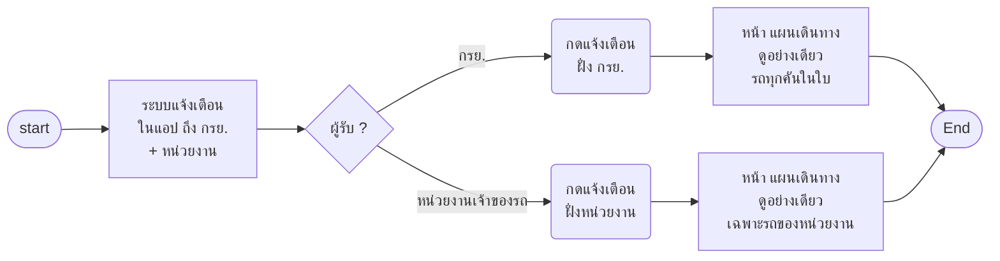

**Wireframe**
- **แผงแจ้งเตือน (กระดิ่ง)** — แบบเดียวกับแผงแจ้งเตือนของ Overhaul · รายการใหม่อยู่บนสุด จุดสีบอกประเภท ข้อความ เวลา
- **หน้า แผนเดินทาง (ดูอย่างเดียว)** — กล่องข้อมูลแผนเดินทาง (ชื่อ · แผน · ไตรมาส · ช่วงวันเดินทาง · พนักงาน กบค. ซ่อม · ผู้สร้าง · อนุมัติเมื่อ) · ตารางรถ ทะเบียน · ยี่ห้อ/รุ่น · หน่วยงานเจ้าของรถ · สถานที่บำรุงรักษา · ไม่มีปุ่มแก้ไขหรือตอบกลับ

**Condition**

| ส่วน | เงื่อนไข | ที่มา |
|---|---|---|
| เมื่อไหร่ส่ง | ทันทีที่ผู้อนุมัติอนุมัติแผนเดินทาง (S7) · ไม่ส่งตอนสร้างหรือตอนส่งกลับ | เจ้าของงาน 3 พ.ย. |
| ผู้รับ | กรย. ของเขตที่มีรถอยู่ในแผนเดินทาง · หน่วยงานเจ้าของรถทุกหน่วยงานที่มีรถอยู่ในใบนั้น (หน่วยงานละ 1 แจ้งเตือน) · แผนเดินทางจ้างดำเนินการ (S9) แจ้งผู้รับจ้างด้วย (ยังไม่มีจอฝั่งผู้รับจ้าง) | เจ้าของงาน 3 พ.ย. + เสนอ (แยกต่อหน่วยงาน) |
| ช่องทาง | ออกแบบเฉพาะแจ้งเตือนในแอป (กระดิ่งที่แถบบน) ไปก่อน · e-mail และ push notification ที่เคาะไว้ 2 พ.ย. ยังไม่ออกแบบ | เจ้าของงาน 3 พ.ย. |
| ข้อความถึง กรย. | "แผนเดินทาง {ชื่อแผนเดินทาง} อนุมัติแล้ว กบค. จะเข้าบำรุงรักษารถ {n} คัน ระหว่างวันที่ {วันเริ่ม} ถึง {วันสิ้นสุด}" (ร่าง) | เสนอ |
| ข้อความถึงหน่วยงานเจ้าของรถ | "กบค. จะเข้าบำรุงรักษารถของหน่วยงาน {n} คัน ({ทะเบียน}) ระหว่างวันที่ {วันเริ่ม} ถึง {วันสิ้นสุด} ที่ {สถานที่บำรุงรักษา}" (ร่าง) · ถ้ารถของหน่วยงานอยู่คนละสถานที่ ดูรายคันในหน้าแผนเดินทาง | เสนอ |
| กดแจ้งเตือน | เปิดหน้าแผนเดินทางของใบนั้นแบบดูอย่างเดียว · กระดิ่งจุดแดงหายเมื่ออ่านแล้ว | เสนอ |
| หน้าแผนเดินทาง ฝั่ง กรย. | เห็นรถทุกคันในใบ | เสนอ |
| หน้าแผนเดินทาง ฝั่งหน่วยงานเจ้าของรถ | เห็นเฉพาะรถของหน่วยงานตัวเอง · จำนวนคันต่อท้ายหัวข้อนับเฉพาะรถของหน่วยงาน | เสนอ |
| ทำต่อ | ดูอย่างเดียว ไม่ต้องตอบรับวันเข้าตรวจ ไม่มีปุ่ม | เจ้าของงาน 3 พ.ย. (Q12 ปิด) |

**ยังไม่เคาะ** — กรย. ของเขตไหนได้แจ้งเตือน (เขตของรถ หรือเขตของ กบค.) · e-mail และ push notification จะทำเมื่อไหร่ และใช้ข้อความเดียวกับในแอปไหม · แผนเดินทางถูกแก้หลังอนุมัติแล้วต้องแจ้งซ้ำไหม

### Scenario 9 · กบค. สร้างแผนเดินทางจ้างดำเนินการ (vendor)

**ช่วงงาน:** จ้างดำเนินการ · **เข้าจาก:** หน้าแผนเดินทางของไตรมาส (S6) กด "สร้างแผนเดินทาง" · **จบที่:** แผนเดินทางสถานะรออนุมัติ ส่งให้ผู้อนุมัติ (S7) · **ที่มา:** เจ้าของงาน 3 พ.ย. 2569 _"s9 อยากแทนด้วยการสร้างแผนการเดินทางของ vendor"_ + _"ตอนที่ทำ e2 อยากให้มีการเลือกว่า กบค ดำเนินการเอง หรือ จ้างดำเนินการ และพอเลือกจ้างดำเนินการ ก็มีให้เลือก vendor list"_ + เลือกช่อง เลขที่สัญญา/ใบสั่งจ้าง · สถานที่รายคัน · ช่วงวันทำงาน + ผ่าน S7 และ S8
· S9 เดิม (กรย. เตรียมอะไหล่ไว้ที่จุดรวมงาน) ตัดออก ย้ายไป [14-…-พักไว้-S3.md](14-บำรุงรักษา-userflow-พักไว้-S3.md)

```mermaid
flowchart LR
    S([start]) --> D1["หน้า แผนเดินทาง<br/>รถในไตรมาส<br/>+ แผนเดินทาง"]
    D1 --> A1("กด สร้างแผน<br/>เดินทาง")
    A1 --> D2["หน้า สร้างแผน<br/>เดินทาง เลือก<br/>จ้างดำเนินการ"]
    D2 --> A3("เลือกผู้รับจ้าง<br/>จาก vendor list<br/>+ เลขที่สัญญา")
    A3 --> A2("กด เพิ่มรถ")
    A2 --> D5["popup เพิ่มรถ<br/>รถของไตรมาส<br/>ที่ยังไม่มีแผนเดินทาง"]
    D5 --> A4("ติ๊กรถ<br/>กด เพิ่มเข้า<br/>แผนเดินทาง")
    A4 --> A5("แก้เบอร์ติดต่อ<br/>สถานที่รายคัน +<br/>เลือกช่วงวันทำงาน")
    A5 --> Q1{"ระบุครบ ?"}
    Q1 -->|N| D2
    Q1 -->|Y| A6("ยืนยันการ<br/>สร้างแผน<br/>เดินทาง")
    A6 --> D3["ระบบส่งแผนเดินทาง<br/>ให้ผู้อนุมัติ S7<br/>สถานะรออนุมัติ"]
    D3 --> E([End])
    %% Q: A3 | Q46 ❓ vendor list มาจากไหน (ทะเบียนผู้รับจ้างของ กฟภ. หรือ กบค. เพิ่มเอง) · กรองตามประเภทรถไหม · เลขที่สัญญาบังคับไหม
```

**Wireframe**
- **หน้า สร้างแผนเดินทาง · ไตรมาส n (จ้างดำเนินการ)** — ฟอร์มเดียวกับ S6: ข้อมูลแผนเดินทาง (ชื่อแผนเดินทาง คู่กับ radio รูปแบบดำเนินการ เลือก "จ้างดำเนินการ") · ผู้รับจ้าง (ช่องค้นหาผู้รับจ้าง + เลขที่สัญญา/ใบสั่งจ้าง) · รถในแผนเดินทาง (ปุ่ม "เพิ่มรถ" + ตารางรถ เบอร์ติดต่อและสถานที่รายคัน) · ช่วงวันทำงาน · ไม่มีส่วนพนักงาน กบค. ซ่อม และค่าใช้จ่าย · ปุ่ม ย้อนกลับ / ยืนยันการสร้างแผนเดินทาง

**Condition**

| ส่วน | เงื่อนไข | ที่มา |
|---|---|---|
| เข้าฟอร์ม | กด "สร้างแผนเดินทาง" ในหน้าแผนเดินทางของไตรมาส แล้วเลือก radio "จ้างดำเนินการ" ที่ช่องรูปแบบดำเนินการ ข้างช่องชื่อแผนเดินทาง (ค่าเริ่มต้นเป็น "กบค. ดำเนินการเอง") | เจ้าของงาน 3 พ.ย. |
| เปลี่ยนรูปแบบ | เลือก "จ้างดำเนินการ" แล้วหัวข้อ "ผู้รับจ้าง" ขึ้นใต้หัวข้อข้อมูลแผนเดินทาง · หัวข้อ "ช่วงวันเดินทาง" เปลี่ยนเป็น "ช่วงวันทำงาน" · หัวข้อ "พนักงาน กบค. ซ่อม (2-3 คน)" ซ่อน · เปลี่ยนกลับเป็นดำเนินการเองแล้วส่วนเหล่านั้นกลับมา | เจ้าของงาน 3 พ.ย. + เสนอ |
| ผู้รับจ้าง | ช่องค้นหา "ผู้รับจ้าง" ข้อความในช่อง "ค้นหาชื่อผู้รับจ้าง" · กดหรือพิมพ์แล้วรายชื่อผู้รับจ้าง (vendor list) ขึ้นใต้ช่อง แต่ละแถวมีชื่อผู้รับจ้างและบรรทัดรองประเภทรถที่รับงาน · เลือกได้รายเดียว · บังคับ ไม่เลือก ขึ้น "กรุณาเลือกผู้รับจ้าง" | เจ้าของงาน 3 พ.ย. + เสนอ (บรรทัดรอง) |
| เลขที่สัญญา/ใบสั่งจ้าง | Text input ข้างช่องผู้รับจ้าง · ไม่บังคับ ป้าย "(ถ้ามี)" · ข้อความในช่อง "ระบุเลขที่สัญญาหรือใบสั่งจ้าง" | เจ้าของงาน 3 พ.ย. (บังคับหรือไม่ยังไม่เคาะ) |
| รถในแผนเดินทาง | ปุ่ม "เพิ่มรถ" และ popup เพิ่มรถเหมือน S6 ทุกข้อ · รถที่อยู่ในแผนเดินทางใบอื่นของไตรมาสแล้ว (ทั้งใบที่ กบค. ดำเนินการเองและใบจ้าง) ไม่มีให้เลือก · ผู้รับจ้างเห็นเฉพาะรถในใบนี้ | เจ้าของงาน 3 พ.ย. |
| เบอร์ติดต่อและสถานที่บำรุงรักษา | รายคันเหมือน S6 · เบอร์ค่าเริ่มต้นเป็นเบอร์เจ้าของรถ สถานที่ค่าเริ่มต้นสำนักงานที่รถอยู่ · แก้ได้ทีละคันจาก popup แก้ไขรถในแผนเดินทางเหมือน S6 | เจ้าของงาน 3 พ.ย. |
| ช่วงวันทำงาน | วันที่เริ่มงาน และถึงวันที่ · date range · ไม่สามารถเลือกน้อยกว่าวันนี้ · ไม่กรอก ขึ้น "กรุณาเลือกวันที่เริ่ม" และ "กรุณาเลือกวันที่สิ้นสุด" | เจ้าของงาน 3 พ.ย. |
| ยืนยัน | ปุ่ม "ยืนยันการสร้างแผนเดินทาง" · ไม่ครบไม่บันทึก แสดงข้อความใต้ช่องที่ขาด · สำเร็จ แผนเดินทางสถานะ "รออนุมัติ" ส่งให้ผู้อนุมัติ (S7) · toast "สร้างแผนเดินทางสำเร็จ · ส่งให้ผู้อนุมัติแล้ว" · ในหน้าแผนเดินทาง คอลัมน์ผู้ดำเนินการแสดงชื่อผู้รับจ้าง | เจ้าของงาน 3 พ.ย. |
| อนุมัติและแจ้งเตือน | ผ่าน S7 เหมือนแผนที่ กบค. ดำเนินการเอง (หน้ารายละเอียดแสดง รูปแบบดำเนินการ ผู้รับจ้าง เลขที่สัญญา ช่วงวันทำงาน แทนพนักงาน) · อนุมัติแล้วแจ้งเตือนตาม S8 และแจ้งผู้รับจ้างด้วย | เจ้าของงาน 3 พ.ย. |

**ยังไม่เคาะ** — vendor list มาจากไหน และกรองตามประเภทรถไหม (Q46) · เลขที่สัญญาบังคับไหม · ผู้รับจ้างได้แจ้งเตือนทางไหน และเข้าระบบทางไหน (Q13) · ติดตามความคืบหน้ารายคันและ approve งานรายคันทำที่ S11

### Scenario 10 · กบค. บันทึกงานบำรุงรักษารายคัน

**ช่วงงาน:** ดำเนินการบำรุงรักษา · **เข้าจาก:** หน้ารายละเอียดแผนเดินทางที่อนุมัติแล้ว (ไอคอนไปต่อในตารางแผนเดินทางของหน้าแผนเดินทาง S6 หรือแจ้งเตือน) · **จบที่:** ทำครบทุกคันในแผนเดินทาง · **ที่มา:** `[บอร์ด]` "ก่อนออกเดินทาง → เดินทางไปจุดรวมงาน → รับอะไหล่ที่จุดรวมงาน → เดินทางไปหน้างานที่จะบำรุงรักษา → บำรุงรักษาได้? → ใช่ → ถ่ายรูปรถก่อนบำรุงรักษา → ดำเนินการตรวจและบำรุงรักษา + เก็บตัวอย่างน้ำมันไฮโดรลิกไปทดสอบ → บันทึกงานบำรุงรักษาและอะไหล่ (ยืนยันจำนวนอะไหล่ที่ใช้จริง) … บำรุงรักษาคันอื่น ๆ ต่อจนครบตามแผน" + กล่อง Display "แสดง Field ให้ระบุสาเหตุที่ไม่สามารถบำรุงรักษาได้" · "แสดง Field ให้ Upload ภาพที่ต้องถ่ายก่อนเริ่มงาน" · "แสดง Field ให้ Upload ภาพที่ต้องถ่ายตอนจบงาน"
· **ปรับ 3 พ.ย. 2569 (เจ้าของงาน):** _"หน้าที่เป็นบำรุงรักษารายคัน จะเข้าจากหน้าไหนได้บ้าง จริงมันควรเข้าได้จากหน้าแผนการเดินทาง แล้วเลือกบำรุงรถทีละคัน"_ → เลือก (1) ทางเข้า = หน้ารายละเอียดแผนเดินทาง (2) หน้ารายคันแบบทำทีละขั้น ⇒ ตามหน้า RP & MA Job ของ UI Release#2 (หน้างานรายคันมีสถานะ ปุ่มเปลี่ยนสถานะที่หัวหน้า และ popup ทีละขั้น) · ฟอร์มยาวบันทึกครั้งเดียวแบบเดิมเลิกใช้
· **แยกมุมผู้รับจ้างออกเป็น S23 (4 พ.ย. 2569 เจ้าของงาน):** _"แยกเป็นอีก scen นึงได้ป่ะ"_ → เลือกแยกโดยไม่เลื่อนเลข (เจ้าของงาน _"เดี๋ยวสุดท้ายจะจัดเรียงใหม่ทั้งหมด"_) ⇒ S10 เหลือแผนที่ กบค. ดำเนินการเอง · แผนจ้างดำเนินการ (ผู้รับจ้างบันทึกงานรายคันและส่งตรวจงาน) อยู่ที่ S23 · หน้ารับรถ หน้าปิดงาน และ popup บำรุงรักษาไม่ได้ใช้ร่วมกัน เงื่อนไขอยู่ที่นี่

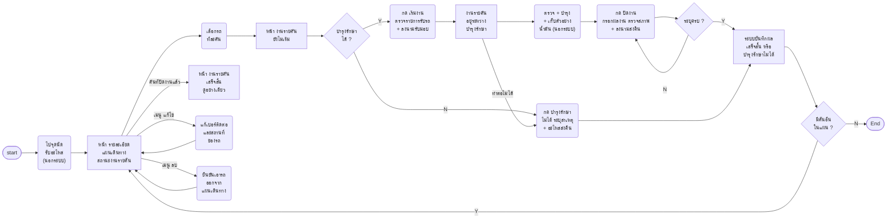

**Wireframe**
- **หน้า รายละเอียดแผนเดินทาง** — หัวหน้า = ชื่อแผนเดินทาง ป้าย "อนุมัติแล้ว" · กล่อง "รายละเอียดแผนเดินทาง" (ข้อมูลแผนเดินทางเดียวกับหน้าอนุมัติ S7 + ความคืบหน้า) · ส่วน "รถในแผนเดินทาง (n)" ตาราง ทะเบียน (บรรทัดรองหน่วยงานเจ้าของรถ) · ยี่ห้อ/รุ่น · เบอร์ติดต่อ · สถานที่บำรุงรักษา · สถานะงาน · ปุ่ม "…" ท้ายแถว (ดูรายละเอียด · แก้ไข · ลบ)
- **หน้า งานรายคัน** — หัวหน้า = ทะเบียน ป้ายสถานะงาน · ปุ่ม "บำรุงรักษาไม่ได้" และปุ่มหลัก "เริ่มงาน" (ยังไม่เริ่ม) หรือ "ปิดงาน" (อยู่ระหว่างบำรุงรักษา) · กล่อง "ข้อมูลยานพาหนะ" 6 ช่อง · กล่อง "การนัดหมาย" (แผนเดินทาง · ช่วงวันเดินทาง · สถานที่บำรุงรักษา · เบอร์ติดต่อ · เริ่มงานและผู้เริ่มงานเมื่อเริ่มแล้ว) · ภาพก่อนเริ่มงาน และเลือกน้ำมันไฮโดรลิก (เมื่อเริ่มแล้ว) · ตาราง "รายการงานและอะไหล่ตามแผน" พร้อมปุ่ม "เพิ่มอะไหล่" และไอคอนแก้ไข ลบ ท้ายแถว
- **หน้า รับรถเข้าบำรุงรักษา** (3 พ.ย. 2569 เจ้าของงาน _"ตอนกดเริ่มงาน อยากได้หน้าที่เป็นรายการรับรถ และมีให้ลงนาม"_ แทน popup เดิม) — ข้อมูลรถ · **รายการเอกสารรับรถ** 13 รายการ (แผ่นป้ายทะเบียนหน้า - หลัง … สภาพตัวถังและสี) เป็นตารางแบบงานซ่อม: รายการ · มี · ไม่มี (เลือกอย่างใดอย่างหนึ่ง) · ชำรุด · ผิดรุ่น (ติ๊กได้เมื่อเลือก มี) · หมายเหตุ (ถ้ามี) + ปุ่มเพิ่มรายการท้ายตาราง · มือถือเป็นการ์ดรายการละใบ เลือก มี/ไม่มี แล้วมี "สภาพ (ถ้ามี)" ชำรุด/ผิดรุ่น · **ลงนามการรับมอบรถ** ผู้ส่งมอบรถ (หน่วยงานเจ้าของรถ) และผู้รับมอบรถ (กบค.) แต่ละฝ่ายเลือกชื่อแล้วกด "เซ็นลงนาม" (กดได้เมื่อเลือกชื่อแล้ว · popup ลงนาม ปุ่ม ปิด · บันทึก · เซ็นแล้วแสดง "ลงนามแล้ว" และปุ่ม "แก้ไขลงนาม") · **ภาพก่อนเริ่มงาน** · ปุ่ม ย้อนกลับ / "ยืนยันรับรถและเริ่มงาน" กดได้เมื่อลงนามครบ 2 ฝ่าย · ใช้ component ของงานซ่อม ReceiptChecklist + HandoverSignature + Modal Signature แบบ Overhaul ตรวจรับรถ
- **หน้า ปิดงานบำรุงรักษา** (3 พ.ย. 2569 เจ้าของงาน _"หน้าปิดงานอยากได้สไตล์แบบนี้ ยังไม่ต้องมีเพิ่มรูป และไม่ต้องมี stepper เป็นหน้าปิดงานหน้าเดียว ไล่ยาวๆ"_ ตามเฟรมรายงานปิดงานของงานซ่อม) — หน้าเดียวไม่มีขั้นตอน ไม่มีส่วนภาพ เรียงลง: **ข้อมูลเอกสาร** (เลขที่งาน · หน่วยงานผู้ใช้บริการ · ชื่องาน · วันที่รับงาน · วันที่เสร็จงาน) · **บันทึกข้อตกลงลูกค้า** (ติดต่อลูกค้าชื่อ · ตำแหน่ง · เมื่อวันที่ · เบอร์โทรศัพท์ · ความต้องการลูกค้า) · **รายการสภาพวัสดุอะไหล่** (ชื่ออะไหล่ · ราคาต่อหน่วย · จำนวนที่ใช้ · ราคารวมที่ใช้ · จำนวนที่คืน · ราคารวมที่คืน · จำนวนอะไหล่เก่า · หมายเหตุ + ปุ่มเพิ่มรายการ) · **ค่าใช้จ่ายของรถคันนี้** (รายคน ค่าเบี้ยเลี้ยงต่อวัน · ค่าที่พักต่อวัน · จำนวนวัน · รวม + ค่าเดินทางรวมทุกคนช่องเดียว + สรุปรวม + งบประมาณ (ศูนย์ต้นทุน)) · **ผลการบำรุงรักษา** (เลขไมล์รถ · ชั่วโมงเครื่องจักร) · **ตรวจสภาพรถปิดงาน** (ตารางแบบงานซ่อม: รายการตรวจสภาพรถกระเช้า 24 รายการ · ปกติ · ต้องแก้ไข · หมายเหตุ (ถ้ามี) + เพิ่มรายการ · มือถือเป็นการ์ดรายการละใบ) + **ลงนามการส่งคืนรถ** ผู้ส่งมอบรถ (กบค.) และผู้รับมอบรถ (หน่วยงานเจ้าของรถ) · **น้ำมันไฮโดรลิก** (เก็บตัวอย่าง · เปลี่ยนน้ำมัน · เก็บตัวอย่างและเปลี่ยน) · **บันทึกตรวจสอบเอกสารปิดงาน** (รายการเดียว "บันทึกใบสั่งการ" เลือก มี · ไม่มี · ไม่ต้องใช้ + ปุ่มอัพโหลดเอกสาร + ปุ่มเพิ่มรายการ) · ปุ่ม ย้อนกลับ / ปิดงาน
- **popup บำรุงรักษาไม่ได้** — ช่อง "สาเหตุที่บำรุงรักษาไม่ได้" · ตาราง "อะไหล่ส่งคืน" (ชื่ออะไหล่ · จำนวนตามแผน · จำนวนที่ใช้ · จำนวนที่คืน) · ปุ่ม ยกเลิก / ยืนยัน · มือถือเป็น bottom sheet ตารางเป็นการ์ดรายการละใบ
- **หน้า งานรายคัน (เสร็จสิ้น)** — ข้อมูลรถและงาน (เริ่มงาน · ปิดงาน · ผู้บันทึก · เลขไมล์และชั่วโมงหลังทำ) · ภาพก่อนเริ่มงาน (ภาพตอนจบงานเอาออก 4 พ.ย.) · รายการงานและอะไหล่ที่ใช้จริง · ผลตรวจน้ำมัน (S12)

**Condition**

| ส่วน | เงื่อนไข | ที่มา |
|---|---|---|
| เข้าหน้ารายละเอียดแผนเดินทาง | กดไอคอนไปต่อของแผนเดินทางที่สถานะ "อนุมัติแล้ว" ในหน้าแผนเดินทางของไตรมาส (S6) หรือกดแจ้งเตือนของแผนเดินทางนั้น · ใบที่ยังรออนุมัติหรือถูกส่งกลับ เปิดแล้วไปหน้าแก้ไขหรือหน้าดูตามเดิม ไม่มีส่วนสถานะงาน | เจ้าของงาน 3 พ.ย. + เสนอ (ใบที่ยังไม่อนุมัติ) |
| ความคืบหน้า | "เสร็จสิ้น x จาก n คัน" ต่อด้วย " · อยู่ระหว่างบำรุงรักษา y" และ " · บำรุงรักษาไม่ได้ z" เมื่อมี · แผนจ้างดำเนินการต่อด้วย " · รอตรวจรับ w" และ " · ส่งกลับแก้ไข v" เมื่อมี · นับ "เสร็จสิ้น" และ "บำรุงรักษาไม่ได้" ของแผนจ้างดำเนินการเมื่อ กบค. อนุมัติแล้วที่ S11 | เสนอ |
| ตารางรถในแผนเดินทาง | รถทุกคันในใบ เรียงตามลำดับในแผนเดินทาง · ทะเบียนมีบรรทัดรองหน่วยงานเจ้าของรถ · เบอร์ติดต่อและสถานที่ตามที่บันทึกในแผนเดินทาง · กดแถวเปิดหน้างานรายคันของคันนั้น | เจ้าของงาน 3 พ.ย. |
| ปุ่ม "…" ท้ายแถวรถ | กดแล้วเปิดเมนูใต้ปุ่ม (มือถือเป็น bottom sheet) รายการตามสถานะงาน: ยังไม่เริ่ม = ดูรายละเอียด · แก้ไข · ลบ · อยู่ระหว่างบำรุงรักษา = ดูรายละเอียด · แก้ไข · เสร็จสิ้น = ดูรายละเอียด (ผลการทดสอบน้ำมันบันทึกในหน้ารายละเอียด S12 · เลิกเมนูแยก 4 พ.ย.) · บำรุงรักษาไม่ได้ = ดูรายละเอียด · มุมผู้รับจ้างมีแค่ "ดูรายละเอียด" (S23) · **ดูรายละเอียด** เปิดหน้างานรายคัน (เหมือนกดแถว) · **แก้ไข** เปิด popup "แก้ไขเบอร์ติดต่อและสถานที่ · {ทะเบียน}" ช่อง เบอร์ติดต่อ และ สถานที่บำรุงรักษา กรอกค่าปัจจุบันไว้ ปุ่ม ยกเลิก · บันทึก (popup เดียวกับฟอร์มแผนเดินทาง S6) · **ลบ** ขึ้นหน้าต่างยืนยันสีแดง "ยืนยันการเอารถออกจากแผนเดินทาง" ข้อความ "{ทะเบียน} จะถูกเอาออกจากแผนเดินทางนี้ และเลือกเข้าแผนเดินทางใบอื่นของไตรมาสได้อีก" ปุ่ม ยกเลิก · เอาออก | เจ้าของงาน 3 พ.ย. _"แก้ไข คือแก้ไขข้อมูล สถานที่ติดต่อ กับเบอร์โทร ลบ ก็คือรถคันนั้นออกจากแผนการเดินทาง ส่วนดูรายละเอียด ก็ไปหน้ารายละเอียดที่จะมีให้เริ่มการบำรุงรักษา และปิดงาน"_ (ยืนยันทางแยกในผัง) + เสนอ (รายการตามสถานะ · ข้อความยืนยัน (ร่าง)) |
| สถานะงานรายคัน | ยังไม่เริ่ม (สีเทา) · อยู่ระหว่างบำรุงรักษา (สีเหลือง) · เสร็จสิ้น (สีเขียว) · บำรุงรักษาไม่ได้ (สีแดง) · ทุกคันเริ่มที่ "ยังไม่เริ่ม" เมื่อแผนเดินทางอนุมัติ · **แผนจ้างดำเนินการมีเพิ่ม 4 สถานะ** ระหว่างทาง: ดำเนินการบำรุงรักษาแล้ว (ผู้รับจ้างปิดงาน ยังไม่ส่ง) · แจ้งบำรุงรักษาไม่ได้ (ผู้รับจ้างแจ้ง ยังไม่ส่ง) · รอตรวจรับ (ส่งตรวจงานแล้ว) · ส่งกลับแก้ไข (กบค. ส่งกลับ) · สีป้ายของ 4 สถานะเลือกจาก Badge ของไลบรารีตอนทำจอ · "เสร็จสิ้น" และ "บำรุงรักษาไม่ได้" ของแผนจ้างดำเนินการได้เมื่อ กบค. อนุมัติที่ S11 | เสนอ ตามชื่อสถานะของ RP & MA Job + เจ้าของงาน 3 พ.ย. ("ดำเนินการบำรุงรักษาแล้ว" · "ส่งตรวจงาน") |
| ปุ่มที่หน้างานรายคัน | ยังไม่เริ่ม: "บำรุงรักษาไม่ได้" และ "เริ่มงาน" · อยู่ระหว่างบำรุงรักษา: "บำรุงรักษาไม่ได้" และ "ปิดงาน" · เสร็จสิ้นหรือบำรุงรักษาไม่ได้: ไม่มีปุ่ม ดูอย่างเดียว · มุมผู้รับจ้างดู S23 · มุม กบค. ของแผนจ้างดำเนินการ: ไม่มีปุ่มบันทึกงาน ดูความคืบหน้าอย่างเดียว ยกเว้นคันที่รอตรวจรับ (S11) | เสนอ |
| เริ่มงาน | กด "เริ่มงาน" เปิดหน้า "รับรถเข้าบำรุงรักษา · {ทะเบียน}" · ตรวจรายการรับรถทีละรายการ (มี · ไม่มี · ชำรุด · ผิดรุ่น) · ลงนามการรับมอบรถ 2 ฝ่าย ผู้ส่งมอบ (หน่วยงานเจ้าของรถ) และผู้รับมอบ (กบค.) · แนบภาพก่อนเริ่มงาน "รูปรถ + ทะเบียน" และ "อะไหล่ใหม่" · ปุ่ม "ยืนยันรับรถและเริ่มงาน" กดได้เมื่อลงนามครบ 2 ฝ่าย · สำเร็จ สถานะเปลี่ยนเป็น "อยู่ระหว่างบำรุงรักษา" ระบบบันทึกเวลาเริ่มงานและผู้เริ่มงาน toast "เริ่มงานบำรุงรักษาแล้ว" | บอร์ด (ภาพก่อนเริ่ม) + เจ้าของงาน 3 พ.ย. (หน้ารับรถ + ลงนาม) + เสนอ (บันทึกเวลา ตอบ Q17 · ปุ่มกดได้เมื่อลงนามครบ) |
| ปิดงาน | กด "ปิดงาน" เปิดหน้า "ปิดงานบำรุงรักษา · {ทะเบียน}" หน้าเดียวไล่ยาว · ข้อมูลเอกสารและบันทึกข้อตกลงลูกค้าแสดงอย่างเดียว ระบบเติมจากแผนเดินทาง (เบอร์โทรศัพท์ = เบอร์ติดต่อของคันนั้น) · รายการสภาพวัสดุอะไหล่ตั้งต้นจากอะไหล่ตามแผนของคัน จำนวนที่ใช้ตั้งต้นเท่าแผน จำนวนที่คืน จำนวนอะไหล่เก่า และหมายเหตุ กรอกได้ ราคารวมคำนวณเอง · ส่วนที่คืนรับคืนที่ S11 · บันทึกตรวจสอบเอกสารปิดงาน ตั้งต้นรายการเดียว "บันทึกใบสั่งการ" (เจ้าของงาน 3 พ.ย. 2569 ตัด 15 รายการของงานซ่อมออก) เพิ่มรายการได้ด้วยปุ่ม "เพิ่มรายการ" · แต่ละรายการเลือก มี ไม่มี หรือไม่ต้องใช้ ปุ่มอัพโหลดเอกสารกดได้เมื่อเลือก มี · **ตรวจสภาพรถปิดงาน** ใช้ InspectionChecklist ของงานซ่อม (รายการตรวจสภาพรถกระเช้า ปกติ · ต้องแก้ไข) พร้อมลงนามการส่งคืนรถ 2 ฝ่าย ปุ่มปิดงานกดได้เมื่อลงนามครบ (เจ้าของงาน 3 พ.ย. 2569 _"ตอนปิดงานก็เหมือนกัน มีให้ตรวจสภาพรถปิดงาน"_) · **ค่าใช้จ่ายของรถคันนี้ (บาท)** อยู่ต่อจากรายการสภาพวัสดุอะไหล่ · กรอกรายคน 1 แถวต่อพนักงาน 1 คน ตั้งต้นเป็นพนักงาน กบค. ซ่อมในแผนเดินทาง **เพิ่ม ลด พนักงานได้** (ปุ่ม "เพิ่มพนักงาน" ใต้แถว · ไอคอนลบท้ายแถว): พนักงาน (ช่องค้นหา "ค้นหาชื่อ-นามสกุล, รหัสพนักงาน") · ค่าเบี้ยเลี้ยง (บาท/วัน) · ค่าที่พัก (บาท/วัน) ป้าย "(ถ้ามี)" · จำนวนวัน (เลือก 1 ถึงจำนวนวันของช่วงวันเดินทาง ข้อความในช่องเมื่อว่าง "เลือกจำนวนวัน") · รวม (บาท) = (ค่าเบี้ยเลี้ยงต่อวัน + ค่าที่พักต่อวัน) x จำนวนวัน ระบบคำนวณ อ่านอย่างเดียว · ใต้แถวรายคนมีช่อง **"ค่าเดินทาง (รวมทุกคน)"** ช่องเดียว ป้าย "(ถ้ามี)" เป็นยอดรวมของทุกคนที่ไปกับแผนเดินทาง · ใต้นั้นสรุป รวมค่าเบี้ยเลี้ยง · รวมค่าที่พัก · ค่าเดินทาง · รวมค่าใช้จ่ายของรถคันนี้ (ยังไม่กรอกแสดง 0 บาท) · ไม่มีกล่องแจ้ง (เจ้าของงานให้ลบ 3 พ.ย. 2569) · ต่อด้วยช่องเลือก **"งบประมาณ (ศูนย์ต้นทุน)"** ตั้งต้นเป็นศูนย์ต้นทุนของหน่วยงานเจ้าของรถคันนั้น เปลี่ยนเป็นศูนย์ต้นทุนอื่นได้ ข้อความในช่องเมื่อว่าง "เลือกศูนย์ต้นทุน" (แทนคู่ "งบที่ตัด" กับ "ศูนย์ต้นทุน" เดิม) · งบนี้ใช้กับค่าใช้จ่ายของรถคันนี้เท่านั้น ค่าอะไหล่เป็นของ กบค. · เลขไมล์รถและชั่วโมงเครื่องจักร บังคับ ไม่กรอกขึ้น "กรุณาระบุเลขไมล์รถ" และ "กรุณาระบุชั่วโมงเครื่องจักร" · ภาพชั่วโมงเครื่องจักรไม่บังคับ · กด "ปิดงาน" สำเร็จ สถานะเป็น "เสร็จสิ้น" (แผนจ้างดำเนินการเป็น "ดำเนินการบำรุงรักษาแล้ว" รอผู้รับจ้างกดส่งตรวจงาน) ระบบบันทึกเวลาปิดงาน กลับหน้ารายละเอียดแผนเดินทาง toast "บันทึกงานบำรุงรักษาสำเร็จ" | บอร์ด + เจ้าของงาน 3 พ.ย. (รูปแบบหน้า · ค่าใช้จ่ายรายคันกรอกรายคน + รวม · งบประมาณ (ศูนย์ต้นทุน) ตั้งต้นศูนย์ต้นทุนเจ้าของรถ) + เสนอ (ค่าตั้งต้น · ปุ่มอัพโหลดกดได้เมื่อ มี · ข้อความกล่องแจ้ง) |
| บำรุงรักษาไม่ได้ | กดได้ทั้งก่อนเริ่มและระหว่างบำรุงรักษา · popup "บำรุงรักษาไม่ได้ · {ทะเบียน}" ช่อง "สาเหตุที่บำรุงรักษาไม่ได้" Text area บังคับ placeholder "ระบุสาเหตุที่บำรุงรักษาไม่ได้" ไม่กรอกขึ้น "กรุณาระบุสาเหตุที่บำรุงรักษาไม่ได้" · ไม่มีช่องอื่นนอกจากสาเหตุและอะไหล่ส่งคืน (ไม่มีแนบภาพ) · กด "ยืนยัน": **แผนที่ กบค. ดำเนินการเอง** สถานะเป็น "บำรุงรักษาไม่ได้" ทันที ไม่ต้องส่งตรวจ toast "บันทึกบำรุงรักษาไม่ได้แล้ว" · **แผนจ้างดำเนินการ** สถานะเป็น "แจ้งบำรุงรักษาไม่ได้" รอผู้รับจ้างกดส่งตรวจงาน toast เดียวกัน · กลับหน้ารายละเอียดแผนเดินทาง | บอร์ด + เจ้าของงาน 3 พ.ย. (กรอกแค่สาเหตุ · กบค. จบได้เลย) + เสนอ (ข้อความ error · toast) |
| อะไหล่ส่งคืน | อยู่ใน popup บำรุงรักษาไม่ได้ ใต้ช่องสาเหตุ · แถวตั้งต้นจากตาราง "รายการงานและอะไหล่ตามแผน" ของคันนั้น (รวมน้ำมันไฮโดรลิกถ้ามีในรายการ) · คอลัมน์ ชื่ออะไหล่ · จำนวนตามแผน · จำนวนที่ใช้ · จำนวนที่คืน · **ยังไม่เริ่ม** จำนวนที่ใช้เป็น 0 แก้ไม่ได้ คืนทั้งหมดตามแผน · **อยู่ระหว่างบำรุงรักษา** จำนวนที่ใช้ Text number กรอกได้ 0 ถึงจำนวนตามแผน ค่าตั้งต้น 0 · จำนวนที่คืน = จำนวนตามแผน − จำนวนที่ใช้ ระบบคำนวณ อ่านอย่างเดียว · ไม่มีอะไหล่ในรายการ แสดง "ไม่มีอะไหล่ที่ต้องส่งคืน" · แผนจ้างดำเนินการ กบค. เห็นรายการนี้ตอนตรวจรับ (S11) และรับคืนเมื่ออนุมัติ · แผนที่ กบค. ดำเนินการเอง คืนคลังตามขั้นคืนอะไหล่ (ยังไม่รู้ — Q9 Q41) | เจ้าของงาน 3 พ.ย. _"มีให้กดส่งคืน ตอนที่กบค รับเรื่องจะเห็นว่ามีอะไหล่อะไรคืนบ้าง"_ + เสนอ (คอลัมน์ · ค่าตั้งต้นตามสถานะ) |
| อะไหล่ตามแผนในหน้างานรายคัน | ตาราง "รายการงานและอะไหล่ตามแผน" ตั้งต้นจากอะไหล่ที่เลือกให้คันนี้ในแผน (S1 S21) · **เฉพาะ กบค.** เพิ่ม แก้ไข ลบ ได้เมื่อสถานะ ยังไม่เริ่ม หรือ อยู่ระหว่างบำรุงรักษา · มุมผู้รับจ้างดู S23 · ปุ่ม "เพิ่มอะไหล่" ที่หัวข้อ และไอคอนแก้ไข ไปหน้าอะไหล่ของรถ (หน้าเดียวกับ S21) · ไอคอนลบ ขึ้นหน้าต่างยืนยันสีแดง "ยืนยันการเอาอะไหล่ออก" ข้อความ "{อะไหล่} จะถูกเอาออกจากรถคันนี้" (ร่าง) ปุ่ม ยกเลิก · เอาออก · ที่แก้ที่นี่เป็นค่าตั้งต้นของตารางรายการสภาพวัสดุอะไหล่ตอนปิดงาน · เสร็จสิ้นแล้วดูอย่างเดียว | เจ้าของงาน 3 พ.ย. _"อะไหล่ตามแผนสามารถแก้ไข ลบ เพิ่มได้"_ + เสนอ (หน้าที่ไป · ข้อความยืนยัน) |
| น้ำมันไฮโดรลิก | การ์ดเลือก 3 แบบ "เก็บตัวอย่าง" · "เปลี่ยนน้ำมัน" · "เก็บตัวอย่างและเปลี่ยน" เลือกได้ 1 แบบ พร้อมช่อง "เปลี่ยนน้ำมันครั้งล่าสุด" อ่านอย่างเดียว · แสดงในหน้างานรายคันเมื่ออยู่ระหว่างบำรุงรักษา และในหน้าปิดงาน (ค่าตั้งต้นตามที่เลือกไว้ แก้ได้) · เลือก "เก็บตัวอย่าง" อย่างเดียว แถวเปลี่ยนน้ำมันไฮโดรลิกและน้ำมันไม่อยู่ในรายการอะไหล่ · มีการเก็บตัวอย่าง หน้าปิดงานมีช่องผลการทดสอบ (ถ้ามี) และคันนี้เข้ารอผลตรวจน้ำมันที่ S12 (ป้าย "รอผลตรวจน้ำมัน" ที่สถานะงาน) · เลือก "เปลี่ยนน้ำมัน" อย่างเดียว ไม่เข้า S12 · ทำไม่ได้แทนติ๊ก "เก็บตัวอย่างน้ำมันไฮโดรลิกไปทดสอบแล้ว" เดิม | เจ้าของงาน 3 พ.ย. _"อยากให้สามารถเลือกได้ว่าเก็บตัวอย่างน้ำมันไฮดรอลิก หรือเปลี่ยน เนื่องจากการเปลี่ยนน้ำมันเปลี่ยนทุก 3 ปี … หรือสามารถเลือกได้ว่าเก็บตัวอย่างและเปลี่ยน"_ + เสนอ (ผลต่อรายการอะไหล่และ S12) |
| ดูงานที่ปิดแล้ว | กดคันที่ "เสร็จสิ้น" ในหน้ารายละเอียดแผนเดินทาง เปิดหน้างานรายคันแบบดูอย่างเดียว | เสนอ |

**ยังไม่เคาะ** — เมนู "…" ของรถ: แก้ไขหรือลบรถหลังแผนเดินทางอนุมัติแล้ว ต้องส่งอนุมัติใหม่ไหม · ต้องแจ้งเจ้าของรถและ กรย. อีกครั้งไหม · คันที่อยู่ระหว่างบำรุงรักษาแก้ไขได้ไหม · ลบแล้วรถกลับไปให้แผนเดินทางใบอื่นเลือกได้ทันทีไหม · รายการรับรถ 13 รายการและรายการตรวจสภาพ 24 รายการ (ของงานซ่อม รถกระเช้า) ใช้กับรถทุกประเภทในแผนไหม · ผู้ส่งมอบรถฝั่งเจ้าของรถต้องเซ็นในระบบเอง หรือ กบค. เซ็นแทนบนเครื่องเดียว · ชั่วโมงเครื่องจักรถ่ายภาพหรือกรอก (Q18) · ผู้รับจ้างเจออะไหล่ที่ต้องเปลี่ยนเพิ่มหน้างาน ต้องให้ กบค. เพิ่มให้ หรือเพิ่มเองตอนปิดงาน (ตอนนี้ปุ่ม "เพิ่มอะไหล่" ซ่อนจากผู้รับจ้าง) · ปุ่ม "แก้ไขงาน" ของผู้รับจ้างหลังปิดงาน (ก่อนส่งตรวจ) ยังคงไว้ไหม · แผนที่ กบค. ดำเนินการเอง อะไหล่ส่งคืนของคันที่บำรุงรักษาไม่ได้ ใครรับคืนและคืนคลังทางไหน · ปิดงานแล้วแก้ไขได้ไหม · บำรุงรักษาไม่ได้แล้วรถคันนั้นไปไหนต่อ (ย้ายไปแผนเดินทางใบอื่นหรือไตรมาสถัดไป) · ยกเลิกการเริ่มงานได้ไหม · ระบบบันทึกเวลาเริ่มและปิดงานเองตามข้อเสนอ ใช้แทนคำถาม Q17 ได้ไหม · หน้าปิดงาน: ภาพตอนจบงาน 4 ช่องตามบอร์ดเอาออกตามคำสั่ง "ยังไม่ต้องมีเพิ่มรูป" จะกลับมาเมื่อไหร่ · เอกสาร "บันทึกใบสั่งการ" บังคับเลือกไหม · รายการที่เพิ่มเองตั้งชื่ออย่างไร · ผลการบำรุงรักษา (เลขไมล์ ชั่วโมงเครื่องจักร เก็บตัวอย่างน้ำมัน) ไม่อยู่ในเฟรม คงไว้เพราะ S12 ใช้ ยืนยันไหม · ปุ่มท้ายเฟรมคือ "ส่งอนุมัติ" แต่ S10 ใช้ "ปิดงาน" ปิดงานต้องมีผู้อนุมัติไหม · ช่องในตารางอะไหล่บนจอเป็นข้อความ เพราะตารางของไลบรารีไม่มีช่องกรอก · หน้าอะไหล่ของรถ (S21) ตอนวางแผนยังเลือกน้ำมันได้ 2 แบบ ต้องเพิ่ม "เก็บตัวอย่างและเปลี่ยน" ให้ตรงกันไหม · หน้าต้นทุน S18 รวมค่าใช้จ่ายรายคันตามงบที่ตัดของแต่ละคันอย่างไร (ตอนนี้ยังแสดงรายใบเดินทาง) · เปลี่ยนศูนย์ต้นทุนเป็นของหน่วยงานอื่นได้ไหม ต้องมีเหตุผลไหม · รายการศูนย์ต้นทุนให้เลือกได้จากหน่วยงานไหนบ้าง · คนที่ไม่ได้อยู่ในแผนเดินทาง (เช่น คนขับเพิ่ม) เพิ่มแถวได้ไหม · ค่าที่พักคูณจำนวนวันเดียวกับเบี้ยเลี้ยง หรือคูณจำนวนคืน (มักน้อยกว่าวัน 1) · ค่าเดินทางรวมทุกคนของแผนเดินทาง แต่กรอกในหน้าปิดงานรายคัน: กรอกที่คันไหน แบ่งต่อคันอย่างไร หรือย้ายไปกรอกระดับแผนเดินทาง · อัตราเบี้ยเลี้ยงและค่าที่พักต่อวันมีค่าตั้งต้นตามระเบียบไหม

### Scenario 11 · กบค. ตรวจรับงานรายคันของผู้รับจ้างและรับคืนอะไหล่

**ช่วงงาน:** ตรวจรับ (สายว่าจ้าง) · **เข้าจาก:** ผู้รับจ้างกด "ส่งตรวจงาน" รถคันนั้น (S23) แล้ว กบค. กดแจ้งเตือน หรือเปิดหน้ารายละเอียดแผนเดินทางของใบจ้างดำเนินการแล้วกดคันที่ "รอตรวจรับ" · **จบที่:** อนุมัติ (เสร็จสิ้น หรือ บำรุงรักษาไม่ได้ + รับคืนอะไหล่) หรือส่งกลับให้ผู้รับจ้างแก้ไข · **ที่มา:** `[บอร์ด]` "ตรวจสอบข้อมูลการบำรุงรักษาที่ได้รับจากผู้รับจ้าง → ตรวจสอบผ่านหรือไม่? → รับคืนอะไหล่/น้ำมันที่ไม่ได้ใช้งาน … ใช้อะไหล่ครบไหม?"
· **ปรับ 3 พ.ย. 2569 (เจ้าของงาน):** _"กบค จะเห็นว่าต้องตรวจรับงาน ที่บอกว่าจะมีปุ่มให้ 2 ปุ่ม อนุมัติ และ ส่งกลับแก้ไข พร้อมเหตุผล"_ แล้วเลือก _"ใช้แบบการ์ดเหมือน S2"_ ⇒ ผลการพิจารณาเป็น Radio text card 2 ใบ + ปุ่มเดียว "ยืนยันผลการพิจารณา" · ตรวจรายคัน ทั้งคันที่ปิดงานและคันที่แจ้งบำรุงรักษาไม่ได้ · หน้ารายการ "งานที่ผู้รับจ้างส่งมา" แยกเดิมเลิกใช้ ใช้หน้ารายละเอียดแผนเดินทางของ S10 (คอลัมน์สถานะงาน) แทน

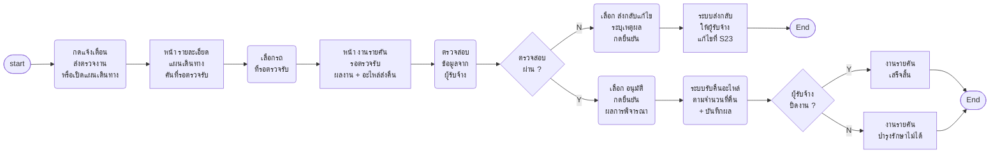

**Wireframe**
- **หน้า รายละเอียดแผนเดินทาง (ใบจ้างดำเนินการ มุม กบค.)** — หน้าเดียวกับ S10 · คอลัมน์สถานะงานแสดงสถานะของแผนจ้างดำเนินการ · คันที่ "รอตรวจรับ" มีบรรทัดรอง "ส่งเมื่อ {วันที่}"
- **หน้า งานรายคัน (รอตรวจรับ มุม กบค.)** — หัวหน้า = ทะเบียน ป้าย "รอตรวจรับ" · ข้อมูลยานพาหนะและการนัดหมายแบบ S10 · **คันที่ปิดงาน** ข้อมูลจากหน้าปิดงาน (อ่านอย่างเดียว) · **คันที่แจ้งบำรุงรักษาไม่ได้** สาเหตุ · ผู้แจ้ง · วันที่แจ้ง · ตาราง "อะไหล่ส่งคืน" ชื่ออะไหล่ · จำนวนตามแผน · จำนวนที่ใช้ · จำนวนที่คืน (ทั้งสองกรณี) · ส่วน "ผลการพิจารณา" Radio text card อนุมัติ · ส่งกลับแก้ไข · ช่องเหตุผลที่ส่งกลับ เมื่อเลือกส่งกลับ · ปุ่ม ย้อนกลับ · ยืนยันผลการพิจารณา

**Condition**

| ส่วน | เงื่อนไข | ที่มา |
|---|---|---|
| เข้าหน้า | แจ้งเตือนถึง กบค. เมื่อผู้รับจ้างส่งตรวจงาน ข้อความ "{ผู้รับจ้าง} ส่งตรวจงาน {ทะเบียน}" (ร่าง) กดแล้วเปิดหน้างานรายคันของคันนั้น · หรือเปิดหน้ารายละเอียดแผนเดินทางของใบจ้างดำเนินการแล้วกดแถวที่ "รอตรวจรับ" · ช่องทางแจ้งเตือน in-app · e-mail · push notification แบบ S8 | เจ้าของงาน 3 พ.ย. ("ส่งไปยัง จนท กบค") + เสนอ (ข้อความ · ช่องทาง) |
| ข้อมูลที่ตรวจ | อ่านอย่างเดียวทั้งหมด กบค. แก้ข้อมูลของผู้รับจ้างไม่ได้ · ข้อมูลไม่ถูกต้องหรือจำนวนอะไหล่ไม่ตรงให้ส่งกลับแก้ไข | เสนอ |
| อะไหล่ส่งคืน | คันที่ปิดงาน ใช้จำนวนที่คืนจากตารางรายการสภาพวัสดุอะไหล่ของหน้าปิดงาน · คันที่แจ้งบำรุงรักษาไม่ได้ ใช้ตาราง "อะไหล่ส่งคืน" จาก popup (S10) · ไม่มีอะไหล่คืน แสดง "ไม่มีอะไหล่ที่ต้องส่งคืน" | เจ้าของงาน 3 พ.ย. _"ตอนที่กบค รับเรื่องจะเห็นว่ามีอะไหล่อะไรคืนบ้าง"_ |
| ผลการพิจารณา | Radio text card 2 ใบ สูงเท่ากัน · อนุมัติ (บรรทัดรอง "งานของรถคันนี้ผ่านการตรวจรับ และรับคืนอะไหล่ตามรายการ") เลือกไว้เป็นค่าเริ่มต้น · ส่งกลับแก้ไข (บรรทัดรอง "แจ้งเหตุผลให้ผู้รับจ้างแก้ไขแล้วส่งตรวจงานใหม่") | เจ้าของงาน 3 พ.ย. (แบบการ์ด S2) + เสนอ (บรรทัดรอง) |
| เหตุผลที่ส่งกลับ | Text area แสดงเมื่อเลือกส่งกลับแก้ไข · บังคับ · placeholder "ระบุเหตุผลที่ส่งกลับ" · ไม่กรอก = error "กรุณาระบุเหตุผลที่ส่งกลับ" | เจ้าของงาน 3 พ.ย. (ส่งกลับพร้อมเหตุผล) · ข้อความตาม S2 |
| ปุ่ม | ย้อนกลับ · ยืนยันผลการพิจารณา → หน้าต่างยืนยันตามผลที่เลือก: อนุมัติ "ยืนยันอนุมัติงานบำรุงรักษา · {ทะเบียน}" ปุ่ม อนุมัติ · ส่งกลับ "ยืนยันส่งกลับแก้ไข — งานของรถคันนี้จะกลับไปให้ผู้รับจ้างแก้ไขตามเหตุผลที่ระบุ แล้วส่งตรวจงานใหม่" ปุ่ม ส่งกลับ | เสนอ ตามแบบ S2 |
| อนุมัติ | คันที่ปิดงาน สถานะเป็น "เสร็จสิ้น" · คันที่แจ้งบำรุงรักษาไม่ได้ สถานะเป็น "บำรุงรักษาไม่ได้" · ระบบบันทึกรับคืนอะไหล่ตามจำนวนที่คืน พร้อมผู้รับคืน (กบค. ที่อนุมัติ) และเวลา · คันที่เก็บตัวอย่างน้ำมัน เข้ารอผลตรวจน้ำมันที่ S12 · แจ้งหน่วยงานเจ้าของรถ (S13) และผู้รับจ้าง · กลับหน้ารายละเอียดแผนเดินทาง toast "อนุมัติงานบำรุงรักษาแล้ว" | บอร์ด (รับคืนอะไหล่) + เสนอ (ต่อ S12 S13 · toast) |
| ส่งกลับ | สถานะเป็น "ส่งกลับแก้ไข" · แจ้งผู้รับจ้าง · ผู้รับจ้างเห็นเหตุผลและแก้ที่ S23 (แถว "ถูกส่งกลับแก้ไข") · อะไหล่ยังไม่รับคืน · กลับหน้ารายละเอียดแผนเดินทาง toast "ส่งกลับให้ผู้รับจ้างแก้ไขแล้ว" | เจ้าของงาน 3 พ.ย. + เสนอ (toast) |
| คืนเข้าคลัง | อะไหล่ที่รับคืนกลับเข้าคลังทางไหน (ยังไม่รู้ — Q9 Q41) | ภาพ ก.ค. "ทำเรื่องคืนอะไหล่เข้าคลัง" |

**ยังไม่เคาะ** — จนท. กบค. ผู้ตรวจรับคือผู้สร้างแผนเดินทาง หรือ กบค. คนใดก็ได้ (Q50) · ส่งกลับได้กี่ครั้ง และต้องเห็นประวัติการส่งกลับครั้งก่อน ๆ ไหม · อนุมัติแล้วยกเลิกหรือแก้ไขได้ไหม · ตรวจรับหลายคันพร้อมกันได้ไหม · คันที่บำรุงรักษาไม่ได้แล้วอนุมัติ รถไปไหนต่อ (Q48) · อะไหล่ที่รับคืนกลับเข้าคลังทางไหน (Q9 Q41)

### Scenario 12 · กบค. บันทึกผลตรวจน้ำมันไฮโดรลิก

**ช่วงงาน:** ตรวจรับ · **เข้าจาก:** หน้าปิดงาน (S10 หรือ S23) ที่เลือกน้ำมันแบบมีการเก็บตัวอย่าง หรือภายหลังจากปุ่ม "…" ดูรายละเอียดของรถที่ขึ้นป้าย "รอผลตรวจน้ำมัน" · **จบที่:** ผลเก็บไว้ในข้อมูลรถคันนั้น (ยังไม่แจ้งเจ้าของรถ ตามเจ้าของงาน 3 พ.ย. 2569) · **ที่มา:** `[บอร์ด]` "ตรวจสภาพการนำไฟฟ้าน้ำมันไฮโดรลิก → บันทึกข้อมูลผลตรวจน้ำมันไฮโดรลิก" + เลนเจ้าของรถ "เจ้าของรถได้รับแจ้งเตือนผลตรวจน้ำมันไฮโดรลิก"
· **ปรับ 4 พ.ย. 2569 (เจ้าของงาน รีวิว S12):** _"ไม่ได้อยากเป็น popup อยากได้เป๋นส่วนหนึ่งของ flowเลย เช่น ถ้าเลือก เก็บตัวอย่างน้ำมันไฮดรอลิก ก็จะ มีให้เลืิอกเก็บผล แต่เป็น optional แต่ว่า ตอนที่จะเข้ามาเก็บผล หลังจากปิดงานไปแล้ว อยากให้ทางเข้า ทางแรกเป็นข้อมูลรถรายคัน แต่ว่าจะทำยังไงให้รู้ว่ารถคันนั้นต้องส่งผลการทดสอบ ยังนึกไม่ออก ช่วยคิด แล้วตอนนี้อยากให้ทางเข้าคือทางเดียวคือดูรายละเอียดแล้วเพิ่มในส่วนของรายละเอียด"_ + เลือกบอกรถที่รอผลด้วย **ป้ายที่สถานะงาน** (ป้ายที่ข้อมูลรถรายคันทำทีหลัง) ⇒ เลิก popup และเมนู "ผลการทดสอบน้ำมันไฮโดรลิก" · ใส่ผลได้ในหน้าปิดงาน (ไม่บังคับ) · หลังปิดงานบันทึกที่ section ในหน้ารายละเอียดงานรายคันที่เดียว · หน้ารายละเอียดเอาภาพตอนจบงานออกให้ตรงกับหน้าปิดงาน
· **ปรับ 3 พ.ย. 2569 (เจ้าของงาน รอบ 2):** _"ไฟล์แนบเป็น optional แก้ผลหลังปิดงานได้ เพราะการเอาน้ำมันมาตรวจอาจใช้เวลานาน แต่อยากให้สามารถไปเพิ่มผลการตรวจน้ำมันได้ ไม่ผ่านก็ใส่ผลไว้ในข้อมูลรถคันนั้น ยังไม่มีการแจ้งเจ้าของรถ"_ ⇒ ไฟล์ไม่บังคับ · แก้ผลได้ภายหลังจากเมนูเดิม · ผลเก็บไว้ในข้อมูลรถ · ไม่แจ้งเจ้าของรถ
· **ปรับ 3 พ.ย. 2569 (เจ้าของงาน):** _"ถ้าเลือกเก็บตัวอย่างแล้ว อยากให้สามารถกลับมาใส่ผลของการเทสน้ำมันที่เก็บตัวอย่าง โดยเป็นการเลือกเมนู ผลการทดสอบน้ำมันไฮดรอลิก แล้วก็มีให้เลือก radio ผ่าน ไม่ผ่าน และมีให้อัปโหลดไฟล์"_ ⇒ เข้าจากเมนู "…" ของรถ ไม่ใช่ปุ่มในหน้างานรายคัน · บันทึกใน popup แทนหน้าฟอร์มเต็ม · ผลเป็น ผ่าน หรือ ไม่ผ่าน ไม่กรอกค่าการนำไฟฟ้าและวันที่ตรวจแล้ว · แนบไฟล์ผล

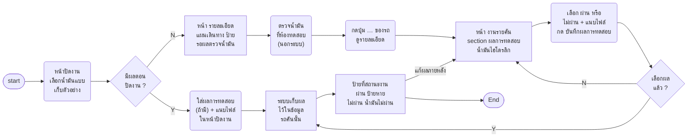

**Wireframe**
- **หน้า ปิดงานบำรุงรักษา (ส่วนน้ำมันไฮโดรลิก)** — การ์ดเลือก เก็บตัวอย่าง · เปลี่ยนน้ำมัน · เก็บตัวอย่างและเปลี่ยน + เปลี่ยนน้ำมันครั้งล่าสุด · เลือกแบบที่มีการเก็บตัวอย่างแล้วมี radio "ผลการทดสอบ (ถ้ามี)" ผ่าน · ไม่ผ่าน และอัปโหลด "ไฟล์ผลการทดสอบ (ถ้ามี)" ต่อท้ายในการ์ดเดียวกัน
- **หน้า รายละเอียดแผนเดินทาง** — คอลัมน์สถานะงานของคันที่เสร็จสิ้นแสดงสองป้าย "เสร็จสิ้น" + "รอผลตรวจน้ำมัน" (สีเหลือง) หรือ "น้ำมันไม่ผ่าน" (สีแดง) · มือถือป้ายที่สองเป็นแถว "ผลตรวจน้ำมัน" ในการ์ด · เมนู "…" ของคันที่เสร็จสิ้นมีแค่ "ดูรายละเอียด"
- **หน้า งานรายคัน (เสร็จสิ้น)** — ไม่มีภาพตอนจบงาน · ท้ายหน้า section "ผลการทดสอบน้ำมันไฮโดรลิก" (เฉพาะคันที่เก็บตัวอย่าง): radio ผลการทดสอบ ผ่าน · ไม่ผ่าน · อัปโหลดไฟล์ผลการทดสอบ (ถ้ามี) · เก็บตัวอย่างเมื่อ {วันที่} โดย {ผู้เก็บ} · บันทึกผลเมื่อ {วันเวลา} โดย {ผู้บันทึก} (เมื่อบันทึกแล้ว) · ปุ่ม "บันทึกผลการทดสอบ"

**Condition**

| ส่วน | เงื่อนไข | ที่มา |
|---|---|---|
| ผลการทดสอบในหน้าปิดงาน | แสดงเมื่อเลือกน้ำมันไฮโดรลิกแบบ "เก็บตัวอย่าง" หรือ "เก็บตัวอย่างและเปลี่ยน" · เลือก "เปลี่ยนน้ำมัน" อย่างเดียวไม่แสดง · radio "ผลการทดสอบ (ถ้ามี)" ผ่าน หรือ ไม่ผ่าน ไม่บังคับ ค่าเริ่มต้นยังไม่เลือก · ไฟล์ผลการทดสอบ ไม่บังคับ · ไม่เลือกผลก็ปิดงานได้ | เจ้าของงาน 4 พ.ย. _"มีให้เลือกเก็บผล แต่เป็น optional"_ |
| ป้ายที่สถานะงาน | หน้ารายละเอียดแผนเดินทาง คันที่เสร็จสิ้นและเก็บตัวอย่าง: ยังไม่มีผล = "เสร็จสิ้น" + "รอผลตรวจน้ำมัน" (Warning) · ผลไม่ผ่าน = "เสร็จสิ้น" + "น้ำมันไม่ผ่าน" (Error) · ผลผ่าน หรือไม่ได้เก็บตัวอย่าง = "เสร็จสิ้น" ป้ายเดียว · ใช้ Table cell Style=Multiple badges · มือถือป้ายที่สองเป็นแถว "ผลตรวจน้ำมัน" ในการ์ด | เจ้าของงานเลือกป้ายที่สถานะงาน 4 พ.ย. + เสนอ (ข้อความและสีป้าย) |
| ทางเข้าหลังปิดงาน | ทางเดียว: ปุ่ม "…" ของรถ แล้ว "ดูรายละเอียด" (หรือกดแถว) เปิดหน้ารายละเอียดงานรายคัน · ไม่มีเมนู "ผลการทดสอบน้ำมันไฮโดรลิก" และไม่มี popup แล้ว | เจ้าของงาน 4 พ.ย. _"ทางเข้าคือทางเดียวคือดูรายละเอียดแล้วเพิ่มในส่วนของรายละเอียด"_ |
| section ผลการทดสอบในหน้ารายละเอียด | แสดงเฉพาะคันที่เก็บตัวอย่าง · ค่าที่บันทึกไว้ (ทั้งจากหน้าปิดงานและที่นี่) ขึ้นในช่อง · กด "บันทึกผลการทดสอบ" ต้องเลือกผล ยังไม่เลือกขึ้น "กรุณาเลือกผลการทดสอบ" · ไฟล์ไม่บังคับ PDF JPG PNG สูงสุด 10 ไฟล์ อัปโหลดแล้วมีแถบความคืบหน้า · บันทึกสำเร็จ toast "บันทึกผลการทดสอบน้ำมันไฮโดรลิกสำเร็จ" แสดง บันทึกผลเมื่อ และผู้บันทึก · แก้ผลหรือเพิ่มไฟล์แล้วบันทึกใหม่ได้ภายหลัง | เจ้าของงาน 3–4 พ.ย. + เสนอ (บันทึกผลเมื่อ) |
| ผลเก็บที่ไหน | เก็บไว้ในข้อมูลรถคันนั้น ทั้งผ่านและไม่ผ่าน · **ยังไม่แจ้งเจ้าของรถ** | เจ้าของงาน 3 พ.ย. |

**ยังไม่เคาะ** — ป้ายรอผลที่ข้อมูลรถรายคัน (หน้าข้อมูลรถของระบบเดิม Vehicle Management) ทำเมื่อไหร่ ใครดูแลหน้านั้น (Q51) · แผนจ้างดำเนินการ ผู้รับจ้างใส่ผลตอนปิดงานได้ (หน้าเดียวกัน) แต่หลังจากนั้นใครเป็นคนใส่ผล · ผลไม่ผ่านมีผลต่อแผนรอบถัดไปไหม (Q21) · จะเริ่มแจ้งเจ้าของรถเมื่อไหร่ และทางไหน · แก้ผลได้ไม่จำกัดเวลาไหม · ต้องมีช่องคำแนะนำเมื่อผลไม่ผ่านไหม

### Scenario 13 · หน่วยงาน/เจ้าของรถ ยอมรับผลการตรวจบำรุงรถรายคัน

**ช่วงงาน:** ตรวจรับ · **เข้าจาก:** แจ้งเตือนหลังบันทึกงานแต่ละคัน (S10) · **จบที่:** ยอมรับผลรายคัน · **ที่มา:** `[บอร์ด]` เลนหน่วยงาน รอบแรก "ได้รับการแจ้งเตือนทาง e-mail และ VMS+ → กดยอมรับผลการตรวจบำรุงรถ → บำรุงรักษาครบทุกคันตามแผนหรือไม่?" + เลนเจ้าของรถ "แสดงรายการการตรวจบำรุงรถที่รอตรวจสอบ · รายการตรวจบำรุงรถ: ใบตรวจสภาพอะไหล่ · ใบตรวจสภาพงานบำรุงรักษา · ปุ่มยอมรับผลการตรวจบำรุงรถ"
· บอร์ดวางการยอมรับไว้ **2 รอบ** (รายคัน → ครบทุกคัน) scenario นี้คือรอบแรก · รอบสองดู S14

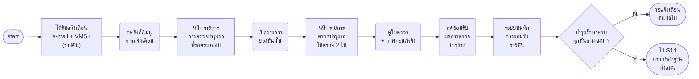

**Wireframe**
- **หน้า รายการการตรวจบำรุงรถที่รอตรวจสอบ** `[บอร์ด]` — ทะเบียน · วันที่บำรุง · ผู้ทำ (กบค./ผู้รับจ้าง) · สถานะ (รอยอมรับ · ยอมรับแล้ว) `[เสนอ]`
- **หน้า รายการตรวจบำรุงรถ (รายคัน)** — ใบตรวจสภาพอะไหล่ `[บอร์ด]` · ใบตรวจสภาพงานบำรุงรักษา `[บอร์ด]` · ภาพก่อน/หลัง + อะไหล่ที่ใช้จริง (จาก S10) `[เสนอ]` · กรณีบำรุงรักษาไม่ได้: สาเหตุ (จาก S10) `[บอร์ด]` · ปุ่ม "ยอมรับผลการตรวจบำรุงรถ" `[บอร์ด]`

**Condition**

| ส่วน | เงื่อนไข | ที่มา |
|---|---|---|
| แจ้งเตือน | e-mail และ VMS+ · ส่งเมื่อ S10 บันทึกงานคันนั้น | บอร์ด |
| ปุ่มยอมรับ | กดได้ทันที · ไม่มีปุ่มไม่ยอมรับ (Q23) | บอร์ด |
| กรณีบำรุงรักษาไม่ได้ | ใช้ฟอร์มเดียวกันหรือแยก (ยังไม่รู้ — Q19) | บอร์ด |
| ยอมรับแล้ว | สถานะคัน "หน่วยงานยอมรับแล้ว" · กบค. เห็นใน S15 | เสนอ |

### Scenario 14 · หน่วยงาน/เจ้าของรถ ตรวจสอบหลักฐานและประเมินความพึงพอใจ (ครบทุกคัน)

**ช่วงงาน:** ตรวจรับ · **เข้าจาก:** แจ้งเตือนเมื่อบำรุงรักษาครบทุกคันตามแผน · **จบที่:** ยอมรับผลทั้งแผน · **ที่มา:** `[บอร์ด]` เลนหน่วยงาน รอบสอง "บำรุงรักษาครบทุกคันตามแผนหรือไม่? → ได้รับการแจ้งเตือนทาง e-mail และ VMS+ → ตรวจสอบเอกสารหลักฐานการตรวจบำรุงรถ → ประเมินความพึงพอใจ → กดยอมรับผลการตรวจบำรุงรถ" + เลนเจ้าของรถ "ประเมินความพึงพอใจ (ต้องทำทุกครั้ง?)"

```mermaid
flowchart LR
    S([start]) --> D0["ได้รับแจ้งเตือน<br/>e-mail + VMS+<br/>(ครบทุกคัน)"]
    D0 --> A0("กดลิงก์/เมนู<br/>จากแจ้งเตือน")
    A0 --> D1["หน้า รายการ<br/>การตรวจบำรุงรถ<br/>ที่รอตรวจสอบ"]
    D1 --> A1("เปิดรายการ<br/>ของแผน")
    A1 --> D2["หน้า เอกสาร<br/>หลักฐานการตรวจ<br/>บำรุงรถทั้งแผน"]
    D2 --> A2("ตรวจสอบ<br/>เอกสาร<br/>หลักฐาน")
    A2 --> A3("ประเมิน<br/>ความพึงพอใจ")
    A3 --> A4("กดยอมรับ<br/>ผลการตรวจ<br/>บำรุงรถ")
    A4 --> D3["ระบบบันทึก<br/>การยอมรับ<br/>+ แจ้ง กบค."]
    D3 --> E([End])
    %% Q: A3 | Q22 ❓ (บอร์ด) ประเมินความพึงพอใจ (ต้องทำทุกครั้ง?) · แบบประเมินมีข้อ/สเกลอะไร
    %% Q: A4 | Q28 ❓ การยอมรับ 2 รอบ (รายคัน S13 + ทั้งแผน S14) จำเป็นทั้งคู่ไหม หรือรอบเดียวพอ
```

**Wireframe**
- **หน้า รายการการตรวจบำรุงรถที่รอตรวจสอบ** `[บอร์ด]` — หน้าเดียวกับ S13 เพิ่มแถวระดับแผน "ครบทุกคันแล้ว รอตรวจสอบหลักฐาน" `[เสนอ]`
- **หน้า เอกสารหลักฐานการตรวจบำรุงรถทั้งแผน** `[บอร์ด]` — สรุปรายคัน: ใบตรวจสภาพอะไหล่ · ใบตรวจสภาพงานบำรุงรักษา · การยอมรับรายคัน (S13) `[เสนอ]` · แบบประเมินความพึงพอใจ `[บอร์ด]` · ปุ่ม "ยอมรับผลการตรวจบำรุงรถ" `[บอร์ด]`

**Condition**

| ส่วน | เงื่อนไข | ที่มา |
|---|---|---|
| แจ้งเตือน | e-mail และ VMS+ · ส่งเมื่อทุกคันในแผนบันทึกงานแล้ว | บอร์ด |
| ประเมินความพึงพอใจ | บังคับทุกครั้งหรือไม่ (ยังไม่รู้ — Q22) · ข้อ/สเกล (ยังไม่รู้) | บอร์ด |
| ปุ่มยอมรับ | กดได้เมื่อประเมินแล้ว (ถ้าบังคับ) | เสนอ |
| ยอมรับแล้ว | แจ้ง กบค. → ส่งประวัติได้ (S15) | เสนอ |

### Scenario 15 · กบค. บันทึกและส่งประวัติงานบำรุงรักษา

**ช่วงงาน:** จัดทำรายงาน · **เข้าจาก:** แผน · **จบที่:** รอหัวหน้า กบค. ตรวจ · **ที่มา:** `[บอร์ด]` "บำรุงรักษาเสร็จทั้งหมดหรือไม่? → ใช่ → บันทึกประวัติงานบำรุงรักษา → ส่งประวัติงานบำรุงรักษา" + Display "แสดงข้อมูลประวัติงานบำรุงรักษาทั้งหมด"

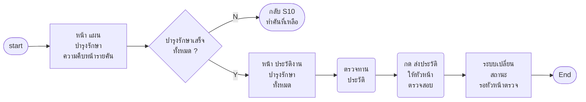

**Wireframe**
- **หน้า ประวัติงานบำรุงรักษาทั้งหมด** `[บอร์ด]` — รายคัน: วันที่ · งานที่ทำ · อะไหล่ที่ใช้ · ภาพ · ผลน้ำมัน · ผู้ทำ · การยอมรับของเจ้าของรถ (S13 · S14) `[เสนอ]` · ปุ่ม "ส่งประวัติให้หัวหน้าตรวจสอบ" `[บอร์ด]`

**Condition** — ส่งได้เมื่อครบทุกคัน `[บอร์ด]` (คันที่ทำไม่ได้ — Q24) · ส่งแล้วแก้ไม่ได้จนกว่าถูกตีกลับ `[เสนอ]`

### Scenario 16 · หัวหน้า กบค. ตรวจสอบประวัติงานบำรุงรักษา

**ช่วงงาน:** จัดทำรายงาน · **เข้าจาก:** เมนู/แจ้งเตือน · **จบที่:** ผ่าน หรือ ตีกลับ · **ที่มา:** `[บอร์ด]` "หัวหน้า กบค. ตรวจสอบประวัติงานบำรุงรักษา → ผ่านหรือไม่? → ใช่ → บันทึกประวัติ" · ไม่ผ่าน → "กบค. จัดการแก้ไข" `[ภาพ ก.ค.]`

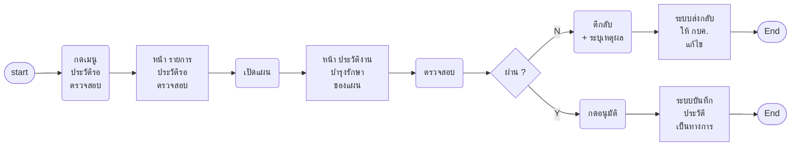

**Wireframe** — หน้า รายการประวัติรอตรวจสอบ `[เสนอ]`: แผน · กบค. ผู้ส่ง · จำนวนรถ · วันที่ส่ง · หน้า ประวัติของแผน = หน้าเดียวกับ S15 (Display) + ปุ่ม "ตีกลับ (ระบุเหตุผล)" `[เสนอ]` · "อนุมัติ" `[บอร์ด "ผ่าน"]`

**Condition** — เหตุผลตีกลับ Freetext บังคับ `[เสนอ]` · ตีกลับ → แผนกลับสถานะให้ กบค. แก้แล้วส่งใหม่ (S15) `[ภาพ ก.ค.]`

### Scenario 17 · กบค. ออกรายงานผลและปิดงาน

**ช่วงงาน:** จัดทำรายงาน · **เข้าจาก:** ประวัติผ่านแล้ว (S16) · **จบที่:** ปิดงาน · **ที่มา:** `[บอร์ด]` "รายงานผลการบำรุงรักษา → ปิดงาน" + Display "แสดงรายงานผลงานบำรุงรักษา (Download ได้)"


**Wireframe** — หน้า รายงานผลการบำรุงรักษา `[บอร์ด]`: สรุปรายคัน/รายแผน (หัวข้อ ยังไม่รู้ — Q25) · ปุ่ม "ดาวน์โหลด" `[บอร์ด]` · ปุ่ม "ปิดงาน" `[บอร์ด]`

**Condition** — ปิดงาน มี confirm modal `[เสนอ]` · ปิดแล้วแก้ไม่ได้ `[เสนอ]` · toast คำว่า (ยังไม่รู้)

### Scenario 18 · กบค. คำนวณต้นทุนการบำรุงรักษา

**ช่วงงาน:** คำนวณต้นทุน · **เข้าจาก:** แผนที่ปิดงานแล้ว · **จบที่:** Summary ต้นทุน · **ที่มา:** `[บอร์ด]` "คำนวณต้นทุนการบำรุงรักษา → ได้รับ Summary ต้นทุน" + Display "คำนวณต้นทุน: ค่าแรง · ค่าที่พัก · ค่าเดินทาง · สามารถ Download excel ได้ · แสดงผลลัพธ์ Summary ของต้นทุน"

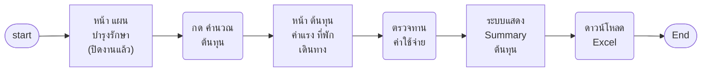

**Wireframe** — หน้า ต้นทุนการบำรุงรักษา `[บอร์ด]`: ตารางรายคัน/รายใบเดินทาง: ค่าแรง · ค่าที่พัก · ค่าเดินทาง · รวม `[บอร์ด]` · ยอดตั้งต้นดึงจากแผนเดินทาง S6 `[เสนอ]` · Summary ของต้นทุน `[บอร์ด]` · ปุ่ม "ดาวน์โหลด Excel" `[บอร์ด]`

**Condition** — ค่าใช้จ่าย Text number แก้ได้ก่อนยืนยัน `[เสนอ]` · Excel มีคอลัมน์อะไร (ยังไม่รู้)

### Scenario 19 · กบค. แก้ไขแผนบำรุงรักษา แล้วส่งอนุมัติใหม่

**ช่วงงาน:** เตรียมดำเนินการ · **เข้าจาก:** เมนู "…" ในรายการแผน หรือหน้ารายละเอียดแผน · **จบที่:** แผนกลับเป็นรออนุมัติ แล้วไป S2 · **ที่มา:** เจ้าของงาน 30 ต.ค. 2569 _"ตอนสร้างแผนเสร็จแล้ว อยากให้สามารถแก้ไขได้"_ + _"แก้ไขแล้วมีอนุมัติ อยากให้ใส่ไปก่อน"_ · จอยึดบล็อก C ของ Overhaul

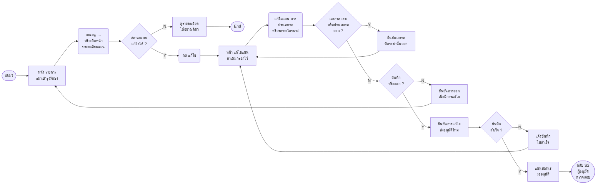

**Wireframe**
- **หน้า รายละเอียดแผน (ฝั่ง กบค.)** — หัวหน้า "เลขที่ MR …" + ป้ายสถานะ · ปุ่ม ลบแผน (เฉพาะก่อนอนุมัติ) · แก้ไข · แผนที่ถูกส่งกลับมีกล่องแจ้งเหตุผลบนสุด · เนื้อหาชุดเดียวกับหน้าฝั่งผู้อนุมัติ (ข้อมูลแผน · รถในแผนแยกแท็บไตรมาส)
- **หน้า แก้ไขแผน** — ฟอร์มเดียวกับ S1 ค่าเดิมกรอกไว้ · หัวหน้า "แก้ไขแผน <เลขที่ MR>" · ปีงบประมาณ Readonly · ปุ่ม ยกเลิก · บันทึกและส่งอนุมัติ

**Condition**

| ส่วน | เงื่อนไข | ที่มา |
|---|---|---|
| แก้ไขได้เมื่อ | สถานะ รออนุมัติ · ส่งกลับแก้ไข · อนุมัติแล้ว (ก่อนเริ่มงาน) · ดำเนินการขึ้นไป แก้ไม่ได้ เมนู "…" เหลือดูรายละเอียดอย่างเดียว | เสนอ · เจ้าของงานไม่ทักท้วง 30 ต.ค. |
| ปีงบประมาณ | Readonly แก้ไม่ได้ เพราะเลขที่ MR ผูกกับปี · ต้องการเปลี่ยนปีให้ลบแล้วสร้างใหม่ | เสนอ |
| เลขที่ MR | คงเลขเดิมหลังแก้ไข | เสนอ |
| เอาภาค เขต หรือประเภทรถออก | ถ้ามีรถที่ตรงค่านั้นจัดไว้ มี confirm "รถของ {ค่า} ที่จัดไว้ {n} คัน จะถูกเอาออกจากทุกไตรมาส" รถอื่นอยู่เหมือนเดิม | ตาม S1 |
| ช่องอื่น | เงื่อนไขและข้อความ error เหมือน S1 | ตาม S1 |
| แผนที่ถูกส่งกลับ | ฟอร์มแสดงเหตุผลจากผู้อนุมัติบนสุด | บอร์ด "กบค. จัดการแก้ไข" |
| แผนที่อนุมัติแล้ว | ฟอร์มแสดงคำเตือน "เมื่อบันทึก แผนจะกลับเป็นสถานะรออนุมัติ และต้องให้ผู้อนุมัติตรวจสอบอีกครั้ง" | เจ้าของงาน 30 ต.ค. |
| ยกเลิก | มีการแก้ไข มี confirm "ข้อมูลที่แก้ไขไว้จะไม่ถูกบันทึก" · ไม่มีการแก้ไข ออกทันที | ตามบล็อก C ของ Overhaul |
| บันทึกและส่งอนุมัติ | มี confirm "ยืนยันการแก้ไข" · ทุกสถานะกลับเป็น "รออนุมัติ" แล้วไป S2 · toast "บันทึกการแก้ไขแผนและส่งอนุมัติสำเร็จ" · ไม่สำเร็จ toast general error | เจ้าของงาน 30 ต.ค. |

### Scenario 20 · กบค. ลบแผนบำรุงรักษาที่ยังไม่อนุมัติ

**ช่วงงาน:** เตรียมดำเนินการ · **เข้าจาก:** เมนู "…" ในรายการแผน หรือหน้ารายละเอียดแผน · **จบที่:** แผนหายจากรายการ · **ที่มา:** เจ้าของงาน 30 ต.ค. 2569 _"ลบแผนได้"_ + _"ยกเลิกแผนไม่ต้องมีก็ได้ มีแก้ไข กับลบ"_ · จอยึดบล็อก D ของ Overhaul


**Wireframe** — ใช้หน้ารายการแผนและหน้ารายละเอียดแผน (S19) · ป๊อปอัปยืนยันการลบ · ไม่ต้องระบุเหตุผล

**Condition**

| ส่วน | เงื่อนไข | ที่มา |
|---|---|---|
| ลบได้เมื่อ | สถานะ รออนุมัติ · ส่งกลับแก้ไข · อนุมัติแล้วขึ้นไปไม่มีปุ่มลบ (ซ่อน ไม่ disable) | เสนอ · เจ้าของงานไม่ทักท้วง 30 ต.ค. |
| ยืนยันการลบ | modal "ยืนยันการลบแผน" "เมื่อลบแล้วจะไม่สามารถกู้คืนข้อมูลได้ ต้องการลบใช่หรือไม่" ปุ่ม ยกเลิก · ยืนยัน ทั้งหน้า List และ Detail | ตามบล็อก D ของ Overhaul |
| ลบสำเร็จ | กลับหน้ารายการ · toast "ลบแผนบำรุงรักษาสำเร็จ" | ตามบล็อก D ของ Overhaul |
| เลขที่ MR ของแผนที่ลบ | ไม่นำกลับมาใช้ซ้ำ ลำดับนับต่อไป | เสนอ |

### Scenario 21 · กบค. กำหนดอะไหล่ของรถแต่ละคันในแผน

**ช่วงงาน:** เตรียมดำเนินการ · **เข้าจาก:** ปุ่ม "เพิ่มอะไหล่" หรือไอคอนแก้ไขที่แถวอะไหล่ในไตรมาส หรือไอคอนแก้ไขที่แถวรถในฟอร์มสร้างแผน (S1) หรือแก้ไขแผน (S19) · **จบที่:** กลับฟอร์มเดิม · **ที่มา:** เจ้าของงาน 2 พ.ย. 2569 _"เพิ่มปุ่มเพิ่มอะไหล่ใน scen A"_ + _"แปลว่าจะมี scen ในการเลือกอะไหล่ของรถแต่ละคันด้วย"_ · ข้อกำหนด JO 7.3.2 กำหนดอะไหล่หรือวัสดุที่ต้องใช้ของรถแต่ละคันตามรอบ · แผงคลังอะไหล่ยึดขั้น S5
· **ปรับ 2 พ.ย. 2569 (เจ้าของงาน):** _"อะไหล่ในการบำรุงจะเป็นไส้กรอง และน้ำมันไฮดรอลิก โดยน้ำมันไฮดรอลิค จะไม่ได้เปลี่ยนทุกปี จะเปลี่ยนตามอายุการใช้งาน 1 เงื่อนไข และเงื่อนไข อายุ 3 ปี แปลว่า ถ้าปีนี้เปลี่ยนปีถัดไปจะเป็นการ เลือกเก็บตัวอย่าง แต่เพื่อให้การทำงานของระบบง่าย อยากให้ มีการเลือกว่า เป็นการเปลี่ยนหรือการเก็บตัวอย่างน้ำมันไฮดรอลิก และมีบอกว่า เปลี่ยนไปครั้งล่าสุดเมื่อไร"_ ⇒ ให้ กบค. เลือกรายคัน ระบบไม่ตัดสินแทน
· **ปรับ 2 พ.ย. 2569 (เจ้าของงาน):** _"พาทอะไหล่ อยากให้มีปุ่มเพิ่มอะไหล่ ไม่มี suggest มาให้เลย ให้เลือกเอง"_ + _"หัวข้ออะไหล่ เป็นอะไหล่ในไตรมาสนั้นๆ"_ ⇒ หน้านี้ตั้งต้นว่าง ไม่มีป้าย "แนะนำ" · เลือกรถได้เฉพาะคันในไตรมาสที่เปิดจากฟอร์ม
· ข้อที่ผู้เขียนถือตามที่เสนอ: ค่าเริ่มต้นเป็นเก็บตัวอย่าง · ขั้นนี้เป็นการวางแผน ยังไม่เบิกหรือจอง จึงไม่มีซื้อเพิ่มและเลือกผู้จัดซื้อ · กดปุ่ม "เพิ่มอะไหล่" แล้วเปิดรถคันแรกของไตรมาสนั้นให้ก่อน เปลี่ยนรถได้

```mermaid
flowchart LR
    S([start]) --> D1["อะไหล่ในไตรมาส<br/>บนฟอร์มแผน"]
    D1 --> A1("กดเพิ่มอะไหล่<br/>หรือไอคอนแก้ไข<br/>ที่แถวรถ")
    A1 --> D2["หน้า อะไหล่<br/>ของรถ"]
    D2 --> A2("เลือกรถ<br/>ในแผน")
    A2 --> D3["ระบบแสดง<br/>อะไหล่ที่เลือกไว้<br/>ของคันนี้ ตั้งต้นว่าง"]
    D3 --> A6("เลือกเก็บตัวอย่าง<br/>หรือเปลี่ยน<br/>น้ำมันไฮดรอลิก")
    A6 --> A3("ค้นคลังอะไหล่<br/>แล้วกดเลือก")
    A3 --> A7("กดระบุอะไหล่<br/>เพิ่มเติม ถ้าไม่มี<br/>ในคลัง")
    A7 --> A8("กรอกชื่อ รหัส<br/>ราคา จำนวน")
    A8 --> A4("แก้จำนวน<br/>หรือเอาออก")
    A4 --> Q1{"ครบ ?"}
    Q1 -->|N| A3
    Q1 -->|Y| A5("กดบันทึก<br/>อะไหล่ของรถ")
    A5 --> D4["กลับฟอร์มแผน<br/>อะไหล่ในไตรมาส<br/>เปลี่ยนตาม"]
    D4 --> E([End])
    %% Q: A6 | Q39 ❓ เงื่อนไขอายุการใช้งานของน้ำมันคืออะไร นอกจากอายุ 3 ปี · คันที่เลือกเปลี่ยนน้ำมัน ยังต้องเก็บตัวอย่างและบันทึกผลตรวจ (S10 S12) ไหม
    %% Q: D4 | Q38 ❓ เปลี่ยนรถออกจากแผนแล้ว อะไหล่ที่เพิ่มเองของคันนั้นหายไปด้วยใช่ไหม
```

**Wireframe** — **หน้า อะไหล่ของรถ:** ช่องเลือกรถ (เฉพาะรถของไตรมาสที่เปิดจากฟอร์ม) · ตัวเลือกน้ำมันไฮดรอลิก เก็บตัวอย่าง หรือ เปลี่ยนน้ำมัน · ช่อง เปลี่ยนน้ำมันครั้งล่าสุด (แสดงอย่างเดียว) · แผง "คลังอะไหล่" (ค้นชื่อหรือรหัส · Smart Inventory และคลังสำรอง · ปุ่มเลือก) · แผง "อะไหล่ของรถคันนี้" (ตั้งต้นว่าง · จำนวนแก้ได้ · เอาออกได้ · ปุ่ม "ระบุอะไหล่เพิ่มเติม" เปิดการ์ดกรอกเอง) · รวมค่าอะไหล่ · ปุ่ม ย้อนกลับ · บันทึกอะไหล่ของรถ

**Condition**

| ส่วน | เงื่อนไข | ที่มา |
|---|---|---|
| เลือกรถ | dropdown เฉพาะรถของไตรมาสที่เปิดจากฟอร์ม · ถ้าไตรมาสนั้นยังไม่มีรถ ปุ่มเข้าหน้านี้กดไม่ได้ | เจ้าของงาน 2 พ.ย. + เสนอ |
| น้ำมันไฮดรอลิก | เลือกรายคัน เก็บตัวอย่าง หรือ เปลี่ยนน้ำมัน · ค่าเริ่มต้นเก็บตัวอย่าง · ระบบไม่ตัดสินจากเงื่อนไขอายุ · แสดงวันที่เปลี่ยนครั้งล่าสุดของคันนั้น ไม่มีประวัติขึ้น "ไม่มีข้อมูล" · เลือกเปลี่ยนน้ำมันแล้วน้ำมันเข้ารายการอะไหล่ เลือกเก็บตัวอย่างแล้วน้ำมันออกจากรายการ | เจ้าของงาน 2 พ.ย. + เสนอ |
| รายการตั้งต้น | ว่าง ระบบไม่คำนวณและไม่แนะนำ กบค. เลือกเอง ไม่มีป้าย "แนะนำ" | เจ้าของงาน 2 พ.ย. |
| เลือกจากคลัง | แผงคลังอะไหล่แบบงานซ่อม (Smart Inventory · คลังสำรอง) | เจ้าของงาน 2 พ.ย. |
| เพิ่มแบบ manual | กด "ระบุอะไหล่เพิ่มเติม" แล้วขึ้นการ์ด "รายการเพิ่มเติม" ของงานซ่อม · ชื่ออะไหล่ บังคับ · รหัสอะไหล่ (ถ้ามี) · ราคาต่อหน่วย บังคับ · จำนวน · ราคารวมคำนวณให้ · ลบการ์ดได้ | เจ้าของงาน 2 พ.ย. + จอ Flow การซ่อม |
| ปุ่มย้อนกลับ | มีการแก้ไข มี confirm "ยืนยันการออก — อะไหล่ที่แก้ไขไว้จะไม่ถูกบันทึก" · ไม่มีการแก้ไข ออกทันที | เสนอ |
| บันทึก | สำเร็จ → กลับฟอร์มเดิม จำนวนรายการของรถคันนั้นและอะไหล่ในไตรมาสเปลี่ยนตาม · toast "บันทึกอะไหล่ของรถ {ทะเบียน} แล้ว" · ไม่สำเร็จ toast general error | เสนอ |
| เปลี่ยนรถในแผน | รถที่เอาออกจากแผน อะไหล่ที่เลือกไว้ของคันนั้น (ยังไม่รู้ — Q38) | เสนอ |

### Scenario 22 · กบค. คลัง รับทราบรายการอะไหล่รายไตรมาส

**ช่วงงาน:** เบิก/จัดหาอะไหล่ · **เข้าจาก:** แผนอนุมัติแล้ว (S2) ระบบส่งให้ทันที · **จบที่:** คลังรับทราบ แล้ว กบค. ติดตามและเบิกอะไหล่รายไตรมาสต่อ (S4) · **ที่มา:** เจ้าของงาน 2 พ.ย. 2569 _"scen ต่อมา เป็น scen ที่ต่อจากอนุมัติ คือ ส่งไปหา กบค. คลัง ว่าแต่ละไตรมาสมีเบิกอะไหล่อะไรบ้าง แยกเป็นไตรมาสให้ด้วย"_ + เลือก แทรกหลัง S2 ก่อน S4 · ดูและกดรับทราบ · ส่งทันทีที่อนุมัติทั้งปี
· **ปรับ 2 พ.ย. 2569 (เจ้าของงาน):** _"พอมี s22 ก็ต้องมี status ให้หน้าของ จนท กบค. ที่ทำเรื่องบำรุงรักษา รู้ว่า ไตรมาสไหน ได้รับการรับทราบแล้วด้วย"_ + เลือก รับทราบทีละไตรมาส · แสดงที่หน้ารายละเอียดแผนและหน้ารายการแผน ⇒ คลังกดรับทราบทีละไตรมาส (ไตรมาสที่ไม่มีรถไม่ต้องรับทราบ) · กบค. เห็นสถานะในหน้ารายการแผน (คอลัมน์ คลังรับทราบ x/n ไตรมาส) และหน้ารายละเอียดแผน (แถบบอกในแท็บไตรมาส)
· ข้อที่ผู้เขียนถือตามที่เสนอ: ยอดของแต่ละไตรมาสรวมจากอะไหล่ที่ กบค. เลือกให้รถของไตรมาสนั้น (S1 S21) · มีคงเหลือในคลังและจำนวนที่ไม่พอให้คลังเห็นล่วงหน้า · คลังไม่มีปุ่มส่งกลับหรือแก้รายการ

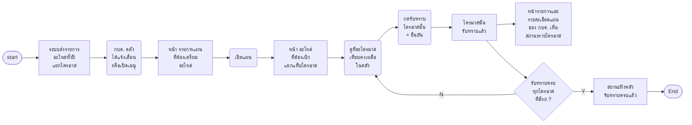

**Wireframe**
- **หน้า รายการแผนที่ต้องเตรียมอะไหล่** — เลขที่ MR · ชื่อแผน · ปีงบประมาณ · จำนวนรถ · วันที่อนุมัติ · สถานะ (รอรับทราบ · รับทราบ x/n ไตรมาส · รับทราบครบแล้ว) · ค้นหา (เลขที่ MR · ชื่อแผน)
- **หน้า อะไหล่ที่ต้องเบิกรายไตรมาส** — รายละเอียดแผน · แท็บไตรมาส 1 ถึง 4 (ป้ายบอกจำนวนรายการ) · ตาราง รายการอะไหล่ · รหัส · จำนวนที่ต้องเบิก · หน่วย · คงเหลือในคลัง · ไม่พอ · ไตรมาสที่ไม่มีรถ = Empty state "ไม่มีอะไหล่ที่ต้องเบิก" · ปุ่ม ย้อนกลับ · รับทราบไตรมาส n · ไตรมาสที่รับทราบแล้วมีแถบ "รับทราบไตรมาส n แล้ว" ไม่มีปุ่ม
- **ฝั่ง กบค.** — หน้ารายการแผน คอลัมน์ "คลังรับทราบ" (ก่อนอนุมัติ "-" · หลังอนุมัติ "x/n ไตรมาส") · หน้ารายละเอียดแผน แถบในแท็บไตรมาส "คลังรับทราบรายการอะไหล่ไตรมาส n แล้ว" หรือ "รอคลังรับทราบ…"

**Condition**

| ส่วน | เงื่อนไข | ที่มา |
|---|---|---|
| ส่งให้คลัง | ระบบส่งเองทันทีที่แผนอนุมัติ (S2) ทั้ง 4 ไตรมาส | เจ้าของงาน 2 พ.ย. |
| แยกไตรมาส | แท็บไตรมาส 1 ถึง 4 · ยอดรวมจากอะไหล่ที่ กบค. เลือกให้รถของไตรมาสนั้น รวมรายการที่ระบุเอง | เจ้าของงาน 2 พ.ย. |
| ไม่พอ | Display จำนวนที่เกินคงเหลือในคลัง ไม่พอ = "-" | เสนอ |
| รับทราบ | ทีละไตรมาส · ปุ่ม "รับทราบไตรมาส n" → confirm "ยืนยันรับทราบรายการอะไหล่ไตรมาส n" → แถบ "รับทราบไตรมาส n แล้ว" · toast "รับทราบรายการอะไหล่ไตรมาส n แล้ว" · ไตรมาสที่ไม่มีรถไม่ต้องรับทราบ · สถานะแผนฝั่งคลัง รอรับทราบ → รับทราบ x/n ไตรมาส → รับทราบครบแล้ว · ไม่มีส่งกลับ | เจ้าของงาน 2 พ.ย. |
| สถานะฝั่ง กบค. | หน้ารายการแผน คอลัมน์ คลังรับทราบ · หน้ารายละเอียดแผน (อนุมัติแล้ว) แถบในแท็บไตรมาส | เจ้าของงาน 2 พ.ย. |
| บทบาท | กบค. คลัง ใครและได้แจ้งเตือนทางไหน (ยังไม่รู้ — Q42) | — |

### Scenario 23 · ผู้รับจ้าง บันทึกงานรายคันและส่งตรวจงาน

**ช่วงงาน:** ดำเนินการบำรุงรักษา (ต่อจาก S7 S8 ของแผนเดินทางจ้างดำเนินการ S9 · อยู่ลำดับเดียวกับ S10) · **เข้าจาก:** แจ้งเตือนแผนเดินทางจ้างดำเนินการที่อนุมัติแล้ว หรือหน้ารายละเอียดแผนเดินทาง (เห็นเฉพาะใบที่ตนรับจ้าง) · **จบที่:** ส่งตรวจงานครบทุกคันในใบ แล้ว กบค. ตรวจรับที่ S11 · **เลขชั่วคราว:** แยกจาก S10 เมื่อ 4 พ.ย. 2569 เจ้าของงานจะจัดเรียงเลข scenario ใหม่ทั้งหมดตอนท้าย
· **แยกจาก S10 (4 พ.ย. 2569 เจ้าของงาน):** _"แยกเป็นอีก scen นึงได้ป่ะ"_ + _"เดี๋ยวสุดท้ายจะจัดเรียงใหม่ทั้งหมด"_ ⇒ ใช้เลข S23 ไปก่อน · หน้ารับรถ หน้าปิดงาน และ popup บำรุงรักษาไม่ได้ ใช้หน้าเดียวกับ S10 (เงื่อนไขอยู่ที่ S10)
· **ปรับ 4 พ.ย. 2569 รอบ 4 (เจ้าของงาน):** _"scen V ต้่องมีเพิ่มรายการได้ด้วย รวมทั้ง ตรง upload เอกสาร pdf และ ภาพ จะใช้สัญลักษณ์ไม่เหมือนกัน และ upload แล้ว จะมี progress bar ด้วย อิ้างอิงจากของเดิม"_ ⇒ ปุ่ม "เพิ่มอะไหล่" ที่หัวตารางอะไหล่ · รายการไฟล์ใช้ไอคอนภาพกับไอคอนเอกสารต่างกัน · มีแถบความคืบหน้าแบบปลั๊กอิน Overhaul
· **ปรับ 3 พ.ย. 2569 รอบ 2 (เจ้าของงาน) มุมผู้รับจ้าง:** _"กบค จะเห็นหน้าคนละหน้า เห็นสถานะ ว่ารถคันนั้น ดำเนินการบำรุงรักษาแล้ว ปุ่มจะแสดงให้ส่งตรวจงาน โดยหน้าจอนี้ก็จะส่งไปยัง จนท กบค"_ · _"คนตรวจงานเป็นผู้รับจ้าง ส่งตรวจงาน"_ · บำรุงรักษาไม่ได้ _"ถ้าเป็นกบค จะสามารถปิดงานได้เลยไม่ต้องส่งตรวจ กรอกแค่สาเหตุพอ"_ · อะไหล่ของคันที่ไม่ได้ทำ _"มีให้กดส่งคืน ตอนที่กบค รับเรื่องจะเห็นว่ามีอะไหล่อะไรคืนบ้าง"_ ⇒ แผนจ้างดำเนินการ: ผู้รับจ้างปิดงานหรือแจ้งบำรุงรักษาไม่ได้แล้วกด "ส่งตรวจงาน" รายคัน ไปตรวจรับที่ S11 · แผนที่ กบค. ดำเนินการเองจบที่ S10 เหมือนเดิม
· **ปรับ 4 พ.ย. 2569 (เจ้าของงาน) แยก view:** _"หน้าจอ ของ s10 น่าจะต้องมี 2 view คือ view ของ กบค และ view ของ vendor โดย vendor ดูรายละเอียดรายคัน จะเห็นแค่ ปุ่มเริ่มงาน และบำรุงรักษาได้ โดยไม่เห็นปุ้ม ลบ และแก้ไข แต่ว่า กบค จะเห็น อยากให้แยก view"_ ⇒ จอ S10 แบ่งเป็น 2 ชุด "กบค. —" และ "ผู้รับจ้าง —" · ผู้รับจ้างเห็นปุ่ม "บำรุงรักษาไม่ได้" กับ "เริ่มงาน" (หรือ "ปิดงาน") เหมือน กบค. แต่ไม่มีแก้ไข ลบ ทั้งเมนู "…" ของรถและตารางอะไหล่ตามแผน
· **ปรับ 4 พ.ย. 2569 รอบ 2 (เจ้าของงาน) ผู้รับจ้างแก้ไข ลบ อะไหล่และภาพ:** _"หน้า i22-i26 ส่วนที่เป็นอะใหล่ที่ใช้จริง และ อะใหล่ส่งคืน ต้องมีสัญลักณ์ให้แก้ไขได้ ลบรายการได้ รูปภาพ แก้ไขได้ ลบได้ และกดแล้ว จพสามาถแก้ไข"_ (I.22 อยู่ระหว่างบำรุงรักษา ถึง I.26 แจ้งบำรุงรักษาไม่ได้ ตามเลขจอตอนนั้น รวมรอตรวจรับ) ⇒ ตารางอะไหล่และอะไหล่ส่งคืนของผู้รับจ้างมีไอคอนแก้ไข ลบ ท้ายแถว · ภาพเป็นรายการไฟล์ลบได้และอัปโหลดใหม่ได้ · ยังไม่เริ่มยังดูอย่างเดียว

```mermaid
flowchart LR
    S([start]) --> D1["หน้า รายละเอียด<br/>แผนเดินทาง<br/>มุมผู้รับจ้าง"]
    D1 --> A1("เลือกรถ<br/>ทีละคัน")
    A1 --> D2["หน้า งานรายคัน<br/>ยังไม่เริ่ม<br/>ดูอย่างเดียว"]
    D2 --> Q1{"บำรุงรักษา<br/>ได้ ?"}
    Q1 -->|N| A3("กด บำรุงรักษา<br/>ไม่ได้ ระบุสาเหตุ<br/>+ อะไหล่ส่งคืน")
    Q1 -->|Y| A2("กด เริ่มงาน<br/>รับรถ + ลงนาม<br/>(หน้าเดียวกับ S10)")
    A2 --> D3["งานรายคัน<br/>อยู่ระหว่าง<br/>บำรุงรักษา"]
    D3 -->|ทำต่อไม่ได้| A3
    D3 --> A5("กด ปิดงาน<br/>กรอกผลงาน<br/>(หน้าเดียวกับ S10)")
    A5 --> D4["งานรายคัน<br/>ดำเนินการ<br/>บำรุงรักษาแล้ว"]
    A3 --> D5["งานรายคัน<br/>แจ้งบำรุงรักษา<br/>ไม่ได้"]
    D4 -->|แก้ไข ลบ<br/>อะไหล่ ภาพ| A6("popup แก้ไขอะไหล่<br/>หรือ ยืนยัน<br/>เอาออก")
    A6 --> D4
    D4 --> A8("กด ส่งตรวจงาน<br/>+ ยืนยัน")
    D5 --> A8
    A8 --> D6["งานรายคัน<br/>รอตรวจรับ<br/>(ต่อ S11)"]
    D6 --> Q2{"กบค. ตรวจรับ<br/>ผ่าน ?"}
    Q2 -->|Y| D7["เสร็จสิ้น หรือ<br/>บำรุงรักษาไม่ได้"]
    Q2 -->|N| D8["หน้า งานรายคัน<br/>ส่งกลับแก้ไข<br/>+ เหตุผลจาก กบค."]
    D8 -->|ปิดงานไว้| A6
    D8 -->|แจ้งไม่ได้ไว้| Q1
    D7 --> Q3{"มีคันอื่น<br/>ในใบ ?"}
    Q3 -->|Y| D1
    Q3 -->|N| E([End])
    %% Q: D1 | Q48 ❓ มุมผู้รับจ้างเห็นหน้าเดียวกันแบบกรองเฉพาะรถในใบไหม · ต้องมีเมนูรวมงานรายคันแบบ Job list ไหม
    %% Q: A8 | Q49 ❓ ส่งตรวจงานทีละคันอย่างเดียว หรือเลือกหลายคันส่งพร้อมกันได้ด้วย
```

**Wireframe**
- **หน้า รายละเอียดแผนเดินทาง (มุมผู้รับจ้าง)** — หน้าเดียวกับ S10 ข้อมูลใบจ้าง · ตารางรถในแผนเดินทางพร้อมสถานะงาน · ปุ่ม "…" ท้ายแถวมีแค่ "ดูรายละเอียด"
- **หน้า งานรายคัน (ยังไม่เริ่ม / อยู่ระหว่างบำรุงรักษา)** (4 พ.ย. 2569 แยก view) — หน้าเดียวกับของ กบค. ปุ่มหัวหน้าเหมือนกัน ("บำรุงรักษาไม่ได้" และ "เริ่มงาน" หรือ "ปิดงาน") · กล่อง "การนัดหมาย" เป็นข้อมูลใบจ้าง (แผนเดินทาง · ผู้รับจ้าง · ช่วงวันทำงาน · สถานที่บำรุงรักษา · เบอร์ติดต่อ · เริ่มงานและผู้เริ่มงานเมื่อเริ่มแล้ว) · ตาราง "รายการงานและอะไหล่ตามแผน" ยังไม่เริ่มดูอย่างเดียว ไม่มีปุ่ม "เพิ่มอะไหล่" และไม่มีคอลัมน์ไอคอนแก้ไข ลบ · อยู่ระหว่างบำรุงรักษามีไอคอนแก้ไข ลบ ท้ายแถว (ยังไม่มีปุ่มเพิ่มอะไหล่) และ "ภาพก่อนเริ่มงาน" เป็นรายการไฟล์ลบได้อัปโหลดใหม่ได้ (4 พ.ย. 2569 รอบ 2) · กดเริ่มงานและปิดงานไปหน้ารับรถและหน้าปิดงานเดียวกับ กบค.
- **หน้า งานรายคัน (ดำเนินการบำรุงรักษาแล้ว / แจ้งบำรุงรักษาไม่ได้)** `[เสนอ]` — หน้างานรายคันเดิม ป้ายสถานะตามกรณี · ข้อมูลที่บันทึกไว้ (ผลงานจากหน้าปิดงาน หรือสาเหตุที่บำรุงรักษาไม่ได้) · ตาราง "อะไหล่ส่งคืน" · ตาราง "รายการงานและอะไหล่ที่ใช้จริง" และ "อะไหล่ส่งคืน" มีไอคอนแก้ไข ลบ ท้ายแถว ภาพก่อนเริ่มงานเป็นรายการไฟล์ลบได้อัปโหลดใหม่ได้ (4 พ.ย. 2569 รอบ 2) · ปุ่ม "แก้ไขงาน" (เปิดหน้าปิดงานหรือ popup บำรุงรักษาไม่ได้ ค่าเดิมกรอกไว้) และปุ่มหลัก "ส่งตรวจงาน"
- **หน้า งานรายคัน (รอตรวจรับ)** — ไม่มีปุ่มที่หัวหน้า · อะไหล่ที่ใช้จริง อะไหล่ส่งคืน และภาพ แก้ไข ลบ ได้แบบเดียวกับก่อนส่ง (4 พ.ย. 2569 รอบ 2) · กล่อง "การนัดหมาย" ต่อท้าย "ส่งตรวจงานเมื่อ {วันที่ เวลา}" และ "ผู้ส่ง"
- **หน้า งานรายคัน (ส่งกลับแก้ไข)** — บนสุดกล่องแจ้ง "กบค. ส่งกลับให้แก้ไข" พร้อมเหตุผลที่ กบค. ระบุ (แบบกล่องแจ้งของแผนเดินทางที่ถูกส่งกลับ S6) · ปุ่มตามกรณีในตาราง Condition

**Condition**

| ส่วน | เงื่อนไข | ที่มา |
|---|---|---|
| เข้าหน้า | ผู้รับจ้างเห็นเฉพาะแผนเดินทางจ้างดำเนินการที่ตนรับจ้างและอนุมัติแล้ว · เปิดจากแจ้งเตือน หรือรายการแผนเดินทางของผู้รับจ้าง (ยังไม่รู้ว่ามีเมนูรวมงานไหม — Q48) | เสนอ |
| ปุ่ม "…" ท้ายแถวรถ | ทุกสถานะมีแค่ "ดูรายละเอียด" เปิดหน้างานรายคัน · ไม่มีแก้ไข ลบ รถในแผนเดินทาง (ทำได้เฉพาะ กบค. ที่ S10) | เจ้าของงาน 4 พ.ย. _"vendor … ไม่เห็นปุ้ม ลบ และแก้ไข แต่ว่า กบค จะเห็น"_ |
| ปุ่มที่หน้างานรายคัน | ยังไม่เริ่ม: "บำรุงรักษาไม่ได้" และ "เริ่มงาน" · อยู่ระหว่างบำรุงรักษา: "บำรุงรักษาไม่ได้" และ "ปิดงาน" · ดำเนินการบำรุงรักษาแล้ว หรือ แจ้งบำรุงรักษาไม่ได้: "แก้ไขงาน" และ "ส่งตรวจงาน" · รอตรวจรับ: ไม่มีปุ่ม · ส่งกลับแก้ไข: ดูแถว "ถูกส่งกลับแก้ไข" · เริ่มงาน ปิดงาน บำรุงรักษาไม่ได้ ใช้หน้าและเงื่อนไขเดียวกับ S10 ต่างที่ผลลัพธ์: ปิดงานแล้วเป็น "ดำเนินการบำรุงรักษาแล้ว" แจ้งไม่ได้แล้วเป็น "แจ้งบำรุงรักษาไม่ได้" รอผู้รับจ้างกดส่งตรวจงาน | เจ้าของงาน 3 พ.ย. (ปุ่มส่งตรวจงาน) + 4 พ.ย. (ปุ่มเหมือน กบค.) + เสนอ |
| อะไหล่ตามแผนในหน้างานรายคัน | ยังไม่เริ่ม: ดูอย่างเดียว ไม่มีปุ่ม "เพิ่มอะไหล่" และไม่มีคอลัมน์ไอคอนแก้ไข ลบ · อยู่ระหว่างบำรุงรักษา: มีไอคอนแก้ไข ลบ ท้ายแถว (ดูแถว "แก้ไข ลบ อะไหล่และภาพ") และปุ่ม "เพิ่มอะไหล่" (ดูแถว "เพิ่มอะไหล่ (ผู้รับจ้าง)") | เจ้าของงาน 4 พ.ย. + เสนอ (ซ่อนปุ่มเพิ่มอะไหล่) |
| เพิ่มอะไหล่ (ผู้รับจ้าง) | ปุ่ม "เพิ่มอะไหล่" ที่หัวตาราง "รายการงานและอะไหล่ตามแผน" (อยู่ระหว่างบำรุงรักษา) "รายการงานและอะไหล่ที่ใช้จริง" และ "อะไหล่ส่งคืน" เมื่อแก้ไขได้ · ยังไม่เริ่มไม่มีปุ่ม · กดแล้วเปิด popup "เพิ่มอะไหล่ที่ใช้จริง" ช่อง ชื่ออะไหล่ (บังคับ) · รหัสอะไหล่ (ถ้ามี) · จำนวนที่ใช้จริง (Text number บังคับ) · หน่วย (เลือก) ปุ่ม ยกเลิก · เพิ่ม · มือถือเป็น bottom sheet · เพิ่มแล้วขึ้นในอะไหล่ที่ใช้จริง จำนวนตามแผน 0 จำนวนที่คืน 0 · ข้อความ error (ยังไม่รู้) | เจ้าของงาน 4 พ.ย. _"ต้องมีเพิ่มรายการได้ด้วย"_ + เสนอ (กรอกเองแบบรายการเพิ่มเติมของ S21 · ช่องในฟอร์ม) |
| ไฟล์ที่อัปโหลด | รายการไฟล์ของช่องอัปโหลด (ภาพก่อนเริ่มงาน และไฟล์ในหน้าปิดงาน) ไอคอนตามชนิดไฟล์ ภาพ (JPG PNG) ใช้ไอคอนภาพ เอกสาร (PDF) ใช้ไอคอนเอกสาร · ระหว่างอัปโหลดแสดงแถบความคืบหน้าพร้อมเปอร์เซ็นต์ ยังไม่มีปุ่มดาวน์โหลด · อัปโหลดเสร็จแสดงแถบเต็ม 100% พร้อมปุ่มดาวน์โหลดและลบ · ไม่สำเร็จแสดงสถานะ error | เจ้าของงาน 4 พ.ย. _"upload เอกสาร pdf และ ภาพ จะใช้สัญลักษณ์ไม่เหมือนกัน และ upload แล้ว จะมี progress bar ด้วย อ้างอิงจากของเดิม"_ (ตามรายการไฟล์ของ File upload ในปลั๊กอิน Overhaul) |
| ส่งตรวจงาน | เฉพาะแผนจ้างดำเนินการ มุมผู้รับจ้าง · ปุ่ม "ส่งตรวจงาน" ที่หน้างานรายคันเมื่อสถานะ "ดำเนินการบำรุงรักษาแล้ว" หรือ "แจ้งบำรุงรักษาไม่ได้" · ก่อนส่ง กด "แก้ไขงาน" เปิดหน้าปิดงานหรือ popup บำรุงรักษาไม่ได้ (ค่าเดิมกรอกไว้) แก้แล้วบันทึกได้ สถานะไม่เปลี่ยน · กด "ส่งตรวจงาน" ขึ้นหน้าต่างยืนยัน "ยืนยันส่งตรวจงาน · {ทะเบียน}" ข้อความ "งานของรถคันนี้จะส่งให้ กบค. ตรวจรับ" (4 พ.ย. 2569 ตัด "ระหว่างรอตรวจรับจะแก้ไขไม่ได้" เพราะรอตรวจรับยังแก้อะไหล่และภาพได้) ปุ่ม ยกเลิก · ส่งตรวจงาน · สำเร็จ สถานะเป็น "รอตรวจรับ" ระบบบันทึกเวลาส่ง แจ้ง กบค. (S11) toast "ส่งตรวจงานแล้ว" · ส่งทีละคัน | เจ้าของงาน 3 พ.ย. (ปุ่มส่งตรวจงาน ผู้รับจ้างเป็นคนกด) + เสนอ (แก้ก่อนส่ง · ข้อความยืนยัน · toast) |
| ถูกส่งกลับแก้ไข | กบค. ส่งกลับที่ S11 สถานะเป็น "ส่งกลับแก้ไข" แจ้งผู้รับจ้าง · หน้างานรายคันบนสุดมีกล่องแจ้ง "กบค. ส่งกลับให้แก้ไข" พร้อมเหตุผล · **คันที่ปิดงานไว้** ปุ่ม "แก้ไขงาน" เปิดหน้าปิดงาน ค่าเดิมกรอกไว้ บันทึกแล้วสถานะกลับเป็น "ดำเนินการบำรุงรักษาแล้ว" แล้วส่งตรวจงานใหม่ · **คันที่แจ้งบำรุงรักษาไม่ได้** ปุ่มกลับเป็นแบบก่อนแจ้ง ("บำรุงรักษาไม่ได้" กับ "เริ่มงาน" ถ้ายังไม่เริ่ม หรือกับ "ปิดงาน" ถ้าเริ่มแล้ว) ผู้รับจ้างแก้สาเหตุแล้วแจ้งใหม่ หรือลงมือบำรุงรักษาต่อก็ได้ · กล่องแจ้งหายเมื่อส่งตรวจงานใหม่ | เสนอ ตามแบบแผนเดินทางที่ถูกส่งกลับ (S6) |
| แก้ไข ลบ อะไหล่และภาพ (ผู้รับจ้าง) | เฉพาะมุมผู้รับจ้างของแผนจ้างดำเนินการ เมื่อสถานะ อยู่ระหว่างบำรุงรักษา · ดำเนินการบำรุงรักษาแล้ว · แจ้งบำรุงรักษาไม่ได้ · รอตรวจรับ · ส่งกลับแก้ไข (ยังไม่เริ่มดูอย่างเดียว · มุม กบค. ที่ S11 ดูอย่างเดียว) · ตาราง "รายการงานและอะไหล่ที่ใช้จริง" (หรือ "รายการงานและอะไหล่ตามแผน" ตอนอยู่ระหว่างบำรุงรักษา) และ "อะไหล่ส่งคืน" มีไอคอนแก้ไขและลบท้ายแถว · **ไอคอนแก้ไข** ทั้งสองตารางเปิด popup "แก้ไขอะไหล่ · {ชื่ออะไหล่}" ช่อง รายการงาน (อ่านอย่างเดียว) · จำนวนตามแผน (อ่านอย่างเดียว) · จำนวนที่ใช้จริง (Text number 0 ถึงจำนวนตามแผน) · จำนวนที่คืน (= ตามแผน − ใช้จริง ระบบคำนวณ อ่านอย่างเดียว) ปุ่ม ยกเลิก · บันทึก · มือถือเป็น bottom sheet · **ไอคอนลบ** ขึ้นหน้าต่างยืนยันสีแดง "ยืนยันการเอาอะไหล่ออก" ข้อความ "{ชื่ออะไหล่} จะถูกเอาออกจากรถคันนี้" ปุ่ม ยกเลิก · เอาออก · **ภาพก่อนเริ่มงาน** แสดงเป็นรายการไฟล์ภาพ แต่ละไฟล์มีปุ่มลบ และอัปโหลดภาพใหม่แทนได้ (JPG, PNG · สูงสุด 10 ภาพ) | เจ้าของงาน 4 พ.ย. _"อะใหล่ที่ใช้จริง และ อะใหล่ส่งคืน ต้องมีสัญลักณ์ให้แก้ไขได้ ลบรายการได้ รูปภาพ แก้ไขได้ ลบได้ และกดแล้ว จพสามาถแก้ไข"_ + เสนอ (ช่องใน popup · ภาพใช้รายการไฟล์ของ File upload เพราะไลบรารีไม่มีภาพที่มีปุ่มแก้ไข ลบ) |

**ยังไม่เคาะ** — มุมผู้รับจ้างเห็นหน้าเดียวกันแบบกรองเฉพาะรถในใบไหม และต้องมีเมนูรวมงานรายคันแบบ Job list ไหม (Q48) · ส่งตรวจงานเลือกหลายคันพร้อมกันได้ไหม (Q49) · ~~ผู้รับจ้างแก้ไขงานหลังกด "ส่งตรวจงาน" แล้วได้ไหม~~ ได้ เฉพาะอะไหล่และภาพ (4 พ.ย. 2569 รอบ 2) — แก้ระหว่างรอตรวจรับแล้ว กบค. ต้องเห็นว่ามีการแก้หลังส่งไหม · แก้ภาพมีแค่ลบแล้วอัปโหลดใหม่ (รายการไฟล์ของ File upload ไม่มีปุ่มแก้ไข และ Images ของไลบรารีไม่มีปุ่มแก้ไข ลบ) พอไหม · อะไหล่ที่ผู้รับจ้างเพิ่มเอง กบค. ต้องอนุมัติแยกไหม และคิดค่าอะไหล่อย่างไร · ปุ่ม "แก้ไขงาน" ของผู้รับจ้างหลังปิดงาน (ก่อนส่งตรวจ) ยังคงไว้ไหม · ผู้ลงนามรับมอบรถฝั่งผู้รับเหมาในหน้ารับรถ (หน้าเดียวกับ S10 ที่ผู้รับมอบเป็น กบค.) · เลข scenario ชั่วคราว รอจัดเรียงใหม่ทั้งหมด

## 2.1 เส้นว่าจ้าง (ผู้รับจ้าง)

> เจ้าของงาน 3 พ.ย. 2569: _"เส้นว่าจ้าง จะเป็นอีก scen นึงที่ กบค จะเป็นผู้สร้างแผนให้ว่าในรถมีกี่คัน vendor list ใครเป็นผู้รับจ้าง และมีรถในแผนกี่คัน จะมีผลต่อว่าสามารถเห็นรถเท่าที่ กบค เลือกให้เท่านั้น และ กบค ก็สามารถเห็นกระบวนการทำงานของแต่ละคันว่าทำไปถึงใหน ตอนเสร็จ จนท กบค ต้องเข้ามา approver การทำของรถแต่ละคันด้วย"_

- สร้างแผน: **S9** (ทำแล้ว 3 พ.ย. 2569) ฟอร์มเดียวกับ S6 เลือก "จ้างดำเนินการ" แล้วเลือกผู้รับจ้างจาก vendor list ผ่าน S7 และ S8
- ผู้รับจ้างเห็นเฉพาะรถที่ กบค. เลือกให้ และบันทึกงานรายคัน: S23 (แยกจาก S10 4 พ.ย. 2569 · ปรับ 3 พ.ย. 2569: ปิดงานหรือแจ้งบำรุงรักษาไม่ได้แล้วกด "ส่งตรวจงาน" รายคัน · ถูกส่งกลับแก้แล้วส่งใหม่)
- กบค. ติดตามความคืบหน้ารายคัน และ approve งานรายคันเมื่อผู้รับจ้างทำเสร็จ: S11 (ปรับ 3 พ.ย. 2569: ตรวจรับรายคัน อนุมัติ หรือส่งกลับแก้ไขพร้อมเหตุผล · รับคืนอะไหล่ตอนอนุมัติ)

## 3. คำถาม — ❓ ทั้งชุด (Q บนบอร์ดเขียนกำกับว่า "บอร์ด")

| # | คำถาม | scenario | ถามใคร |
|---|---|---|---|
| Q1 | ~~ผพจ. ย่อจากอะไร · หัวหน้า ผพจ. แยกบทบาทไหม~~ ไม่ต้องตอบแล้ว 30 ต.ค. (อนุมัติไม่ผ่าน ผพจ. · S3 พักไว้) | — | — |
| Q2 | ~~รายการอะไหล่ที่ระบบคำนวณ ให้ กบค. แก้ได้ไหม~~ ✅ ตอบแล้ว 2 พ.ย. 2569: แก้ได้รายคันที่ S21 | S21 | — |
| Q3 | ~~"ตรวจ/เตรียมอะไหล่เพื่อใช้ในไตรมาส" ทำในระบบหรือนอกระบบ~~ ตัดขั้นนี้ออกจาก S2 แล้ว 30 ต.ค. | — | — |
| Q4 | ~~รูปแบบเลขงาน~~ ไม่ต้องตอบแล้ว S3 ตัดออก 2 พ.ย. 2569 (เลขที่ MR ออกตอนสร้างแผน) | — | — |
| Q5 | ~~ไม่อนุมัติรายการอะไหล่แล้ว "ทำเรื่องคืนอะไหล่" คือคืนอะไร~~ ไม่ต้องตอบแล้ว S3 ตัดออก 2 พ.ย. 2569 | — | — |
| Q6 | S3 ตัดออก 2 พ.ย. 2569 · ยังเหลือ: อะไหล่ที่คงเหลือไม่พอตอนเบิก (S4) จัดซื้อนอกระบบ หรือต้องบันทึกในระบบ | S4 | เจ้าของงาน |
| Q7 | ~~ความพร้อมรถใครตอบ~~ ไม่ต้องตอบแล้ว ตัดการตรวจรถที่ S4 2 พ.ย. 2569 | — | — |
| Q8 | ~~นำรถออกจากไตรมาสหลังอนุมัติ~~ ไม่ต้องตอบแล้ว ตัดการนำรถออกที่ S4 2 พ.ย. 2569 (เอารถออกให้แก้แผนที่ S19) | — | — |
| Q9 | "ระบบจองอะไหล่" คือระบบไหน เชื่อมกับ VMS+ ยังไง | S4 | กฟภ. |
| Q10 | ~~ตัดสินใจว่าจ้างต่อแผนทั้งใบ หรือต่อคัน/พื้นที่~~ ✅ ตอบแล้ว 3 พ.ย. 2569: เลือกต่อแผนเดินทาง (ฟอร์มแผนเดินทางมีรูปแบบดำเนินการ) ไตรมาสเดียวมีทั้งสองแบบได้ | S6 · S9 | — |
| Q11 | ~~สถานที่บำรุงรักษาคือจุดรวมงานไหม~~ ✅ ตอบแล้ว 2 พ.ย. 2569: ระบุรายคัน ค่าเริ่มต้นสำนักงานที่รถอยู่ · เรื่องวางอะไหล่ไม่ต้องตอบแล้ว (S9 ตัดออก 3 พ.ย.) | S6 | — |
| Q12 | ~~Notification ส่งช่องทางไหน · เจ้าของรถต้องตอบรับวันไหม~~ ✅ ตอบแล้ว: in-app · e-mail · push notification (2 พ.ย.) · ดูอย่างเดียว ไม่ต้องตอบรับ (3 พ.ย.) | S8 | — |
| Q13 | ผู้รับจ้างเข้า VMS+ ทางไหน มีบัญชีภายนอกไหม | S9 · S23 | กฟภ. |
| Q14 | "ทำเรื่องซื้ออะไหล่" ของผู้รับจ้าง ทำนอกระบบหรือบันทึกในระบบ | เส้นว่าจ้าง (2.1) | เจ้าของงาน |
| Q15 | (บอร์ด) ผู้รับจ้างต้องเสนอแผนใหม่? มี limit ไหม? ต้องบอกใครบ้าง? ใครต้องทำอะไรต่อบ้าง? (ของ S8 เดิม · ใช้กับเส้นว่าจ้างถ้ายังมีแผนเดินทางของผู้รับจ้าง) | เส้นว่าจ้าง (2.1) | กฟภ. |
| Q16 | ~~กรย. พบอะไหล่ไม่พร้อม แจ้งใคร ผ่านระบบไหม~~ ไม่ต้องตอบแล้ว: เตรียมอะไหล่ประสานกันเองนอกระบบ (S9 ตัดออก 3 พ.ย.) | — | — |
| Q17 | (บอร์ด) ระบบต้อง stamp ระยะเวลาจากภาพก่อนเริ่มถึงจบงานไหม | S10 | กฟภ. |
| Q18 | (บอร์ด) ชั่วโมงเครื่องจักร (ภาพถ่ายหรือกรอกข้อมูล?) · อะไหล่เก่า? · อะไหล่ใหม่ (ถ้าเหลือ?) | S10 | กฟภ. |
| Q19 | ~~(บอร์ด) กรณีที่ไม่สามารถบำรุงรักษาได้ จำเป็นต้องใช้ form รูปแบบเดียวกันไหม? หากแยกกันจะต้องมี field อะไรบ้าง?~~ ✅ ตอบแล้ว 3 พ.ย. 2569: แยกเป็น popup กรอกแค่สาเหตุ + รายการอะไหล่ส่งคืน | S10 · S13 | — |
| Q20 | ~~ตรวจสอบงานผู้รับจ้างไม่ผ่าน ส่งกลับยังไง~~ ✅ ตอบแล้ว 3 พ.ย. 2569: ผลการพิจารณาแบบ S2 เลือกส่งกลับแก้ไข กรอกเหตุผล ผู้รับจ้างเห็นเหตุผลที่หน้างานรายคัน แก้แล้วส่งตรวจงานใหม่ | S11 | — |
| Q21 | ผลตรวจน้ำมันเป็นตัวเลขหรือผ่าน/ไม่ผ่าน · แนบใบผลแล็บไหม | S12 | กฟภ. |
| Q22 | (บอร์ด) ประเมินความพึงพอใจ (ต้องทำทุกครั้ง?) · แบบประเมินมีข้อ/สเกลอะไร | S14 | กฟภ. |
| Q23 | เจ้าของรถไม่ยอมรับผล ทำยังไง · "หน่วยงาน" กับ "เจ้าของรถ" คนเดียวกันไหม | S13 | เจ้าของงาน |
| Q24 | คันที่บำรุงรักษาไม่ได้ นับว่าเสร็จไหม ส่งประวัติได้ไหม | S15 | เจ้าของงาน |
| Q25 | รายงานผลมีหัวข้ออะไร รูปแบบไฟล์ | S17 | กฟภ. |
| Q26 | "ค่าแรง" กับ "ค่าเบี้ยเลี้ยง" รายการเดียวกันไหม · ต้นทุนรวมอะไหล่/ค่าจ้างไหม | S18 | เจ้าของงาน |
| Q28 | การยอมรับผล 2 รอบ (รายคัน S13 + ครบทุกคัน S14) จำเป็นทั้งคู่ไหม หรือรอบเดียวพอ | S13 · S14 | เจ้าของงาน |
| Q29 | ~~เลือกได้ทีละภาคหรือหลายภาค · ประเภทรถเลือกได้หลายประเภทไหม~~ ✅ ตอบแล้ว 2 พ.ย. 2569: เลือกได้หลายค่าทั้งภาค เขต ประเภทรถ · ยังเหลือ: ประเภทรถอ้างรายการจากทะเบียนรถ VMS+ ชุดไหน | S1 | เจ้าของงาน |
| Q30 | รถสถานะรอยุบ/โอน ซ่อนตั้งแต่ตอนเลือก หรือแสดงแต่เลือกไม่ได้ | S1 | เจ้าของงาน |
| Q27 | ชื่อ scenario หัวบอร์ด "กบค.ทำงานรายการซ่อม หลังจากได้รับใบงานการแจ้งซ่อม" เป็นของบอร์ดนี้จริงไหม | — | เจ้าของงาน |
| Q31 | รายการปีงบประมาณในช่องเลือก แสดงย้อนหลังและล่วงหน้ากี่ปี (เจ้าของงานบอก "ไม่จำกัดปี") | S1 | เจ้าของงาน |
| Q32 | ผู้อนุมัติแผนคือใคร (ผู้บังคับบัญชาตามสาย หรือหัวหน้า กบค.) · อนุมัติกี่ชั้น · กบค. เลือกผู้อนุมัติเองไหม | S1 · S2 | เจ้าของงาน |
| Q34 | แผนที่อนุมัติแล้ว แก้เรื่องเล็กน้อย เช่น ชื่อแผน ต้องส่งอนุมัติใหม่ทุกครั้งหรือไม่ (ตอนนี้ใส่ไว้ก่อนว่าต้องส่งทุกครั้ง) | S19 | เจ้าของงาน |
| Q35 | แผนที่อนุมัติแล้วแต่ยังไม่เริ่มงาน จะเอาออกอย่างไร (ไม่มียกเลิกแผน · ตอนนี้ลบไม่ได้) | S20 | เจ้าของงาน |
| Q36 | ~~แผนเดียวมีรถได้หลายเขตไหม~~ ✅ ตอบแล้ว 2 พ.ย. 2569: ได้ เลือกเขตได้หลายเขต | S1 | — |
| Q37 | ~~ระบบคำนวณอะไหล่ของแต่ละคันจากข้อมูลอะไร~~ ✅ ตอบแล้ว 2 พ.ย. 2569: ระบบไม่คำนวณ กบค. เลือกเอง | S21 | — |
| Q38 | เอารถออกจากแผนแล้ว อะไหล่ที่เพิ่มเองของคันนั้นหายไปด้วยใช่ไหม | S21 | เจ้าของงาน |
| Q39 | เงื่อนไขอายุการใช้งานของน้ำมันคืออะไร นอกจากอายุ 3 ปี · คันที่เลือกเปลี่ยนน้ำมัน ยังต้องเก็บตัวอย่างและบันทึกผลตรวจ (S10 S12) ไหม | S21 · S10 · S12 | เจ้าของงาน |
| Q40 | ~~ต้องเลือกอะไหล่ครบทุกคันก่อนส่งอนุมัติไหม~~ ✅ ตอบแล้ว 2 พ.ย. 2569: ไม่บังคับ | S1 | — |
| Q41 | อะไหล่ที่เหลือจากไตรมาสหนึ่ง คืนคลังหรือยกไปใช้ไตรมาสถัดไป (ตอนนี้ใส่ไว้ก่อนว่าคืนคลังตามเดิม) | S4 · S11 | เจ้าของงาน |
| Q42 | กบค. คลัง คือบทบาทแยกในระบบ หรือ กบค. ที่ได้สิทธิ์คลัง · ได้แจ้งเตือนทางไหน | S22 | เจ้าของงาน |
| Q43 | แก้แผนหลังอนุมัติ (S19 ส่งอนุมัติใหม่) ต้องส่งรายการให้คลังรับทราบใหม่ไหม · อะไหล่ไม่พอ คลังต้องแจ้งกลับ กบค. ไหม | S22 | เจ้าของงาน |
| Q44 | แผนเดินทาง: ฟอร์มที่ยังไม่ยืนยันกันรถไว้ไหม · ยกเลิกหรือแก้ไขแผนเดินทางที่ยืนยันแล้ว รถกลับมาเลือกได้ไหม · ลบรถออกจากตารางต้องถามยืนยันไหม · รถครบทุกคันแล้วปุ่มสร้างแผนเดินทางกดไม่ได้ไหม | S6 | เจ้าของงาน |
| Q45 | ผู้อนุมัติแผนเดินทางที่ได้จาก API getUpperLower คือตำแหน่งไหน (หัวหน้า กบค. หรือไม่) · อนุมัติชั้นเดียวหรือหลายชั้น · ได้แจ้งเตือนทางไหน | S7 | เจ้าของงาน |
| Q46 | vendor list ของแผนเดินทางจ้างดำเนินการมาจากไหน (ทะเบียนผู้รับจ้างของ กฟภ. หรือ กบค. เพิ่มเอง) · กรองตามประเภทรถไหม · เลขที่สัญญา/ใบสั่งจ้างบังคับไหม | S9 | เจ้าของงาน |
| Q48 | งานรายคัน S23 (เดิม S10): มุมผู้รับจ้างเห็นหน้ารายละเอียดแผนเดินทางแบบกรองเฉพาะรถในใบไหม · ต้องมีเมนูรวมงานรายคันแบบ Job list (ค้นทะเบียน กรองสถานะ) ไหม · บำรุงรักษาไม่ได้แล้วรถไปไหนต่อ | S23 | เจ้าของงาน |
| Q49 | ผู้รับจ้างส่งตรวจงานทีละคันอย่างเดียว หรือเลือกหลายคันส่งพร้อมกันได้ด้วย | S23 · S11 | เจ้าของงาน |
| Q50 | จนท. กบค. ที่ตรวจรับงานผู้รับจ้างคือใคร ผู้สร้างแผนเดินทาง หรือ กบค. คนใดก็ได้ในหน่วย · ได้แจ้งเตือนทางไหน | S11 | เจ้าของงาน |
| Q51 | ป้าย "รอผลตรวจน้ำมัน" ที่หน้าข้อมูลรถรายคัน (Vehicle Management ของระบบเดิม) ทำเมื่อไหร่ ใครดูแลหน้านั้น · หลังปิดงานแผนจ้างดำเนินการ ใครเป็นคนใส่ผล | S12 | เจ้าของงาน |
| Q47 | เบอร์ติดต่อในแผนเดินทาง: เบอร์เจ้าของรถดึงจากข้อมูลไหน (ผู้รับผิดชอบหลักของรถแบบหน้า MA Appointment หรือเบอร์หน่วยงาน · มือถือหรือเบอร์ภายใน) · ตรวจรูปแบบเบอร์ไหม · หน้าอนุมัติ S7 และหน้าดูอย่างเดียว S8 ต้องแสดงเบอร์ด้วยไหม | S6 S9 | เจ้าของงาน |
| Q33 | ~~เลขที่ MR: Z คืออะไร · 69 คือปีไหน · ลำดับรีเซ็ตไหม~~ ✅ ตอบแล้ว 30 ต.ค. 2569: Z = เขตของการไฟฟ้า (Z = สำนักงานใหญ่) · 69 = ปีที่เลือกตอนสร้างแผน · ลำดับนับต่อกันภายในปีที่เลือก | S1 | — |

## 4. จุดที่บอร์ดขัดกับที่เคาะไว้ในต้นแบบ/ผัง 00–06 (ยังไม่แก้ฝั่งไหน — รอเคาะว่าอันไหนชนะ)

| เรื่อง | บอร์ด (ไฟล์นี้ยึดตาม) | ต้นแบบ / ผัง Diagram 00–06 | วันที่เคาะของเดิม |
|---|---|---|---|
| ใครอนุมัติแผน + ออกเลขงาน | ✅ **เคาะแล้ว 30 ต.ค. 2569** — อนุมัติแผนยังมี แต่ส่งเข้าสายอนุมัติทั่วไป ไม่ผ่าน ผพจ. (S2) · เลขงานไม่มีในระบบ แยกออกไปก่อน (S3 พักไว้) | กบค. ออกเลขเอง · ฝ่ายพัสดุแค่รับทราบ | 8 ส.ค. 2569 |
| สถานะรถตอนเข้าแผน | ต้องไม่ใช่รอยุบ/โอน (S4) | เลือกได้ทุกสถานะ เป็นแค่คำเตือน | 17 ส.ค. 2569 |
| ยืนยันรถกับหน่วยงาน | มีแค่ sticky "เห็นรถพร้อม/ไม่พร้อม" ไม่มีเลนตอบ (S4) | ถาม-ตอบ 2 รอบ (ยืนยันรถ · เลือกวันนัด) | 9 ส.ค. 2569 |
| ตรวจรับ | หลังบำรุง = หน่วยงาน/เจ้าของรถยอมรับผล 2 รอบ + ประเมินความพึงพอใจ (S13 · S14) | เปลี่ยนเป็น "ตรวจสภาพก่อนซ่อม" ย้ายไปก่อนลงมือ · ผัง 03 บอกผู้รับทราบคือ "หน่วยงานพัสดุ" | 20 ส.ค. 2569 |
| สายว่าจ้าง | ผู้รับจ้างทำแผนเดินทาง กบค. อนุมัติ (S7 · S8) | ยังไม่ทำในต้นแบบ | — |
| ต้นทุน | ค่าแรง · ที่พัก · เดินทาง หลังปิดงาน (S18) | เบี้ยเลี้ยง · ที่พัก · เดินทาง กรอกตอนรายงาน แล้วเฟสต้นทุนแสดงรวม + ส่งอนุมัติปิดแผนไตรมาส | 17 ส.ค. 2569 |
| โครงแผน | ✅ **เคาะแล้ว 30 ต.ค. 2569** — 1 แผน = 1 ปีงบประมาณ (เลือกปีได้ทุกปี) จัดรถลงไตรมาส 1 ถึง 4 ในฟอร์มสร้างแผน · 1 คันอยู่ไตรมาสเดียว · ขั้นหลังจากนั้นทำรายไตรมาส | 1 แผน = ทั้งปีงบ รถแยกรายไตรมาส · แผนล่วงหน้า 2 ปี · รอบทบทวน · หน้าไตรมาส 6 แท็บ — **โครงปี + ไตรมาสตรงกับของเดิมแล้ว เหลือต่างเรื่องแผนล่วงหน้า 2 ปีและรอบทบทวน** | 17–28 ส.ค. 2569 |
| ยื่นของบ / ทบทวนแผน | ✅ **เคาะแล้ว 22 ต.ค. 2569 — ไม่ทำ** เริ่มที่สร้างแผน (S1) · ไม่มีรอบทบทวน · (30 ต.ค.) ปีงบประมาณกลับมาเป็นช่องเลือกปีของแผน ไม่ผูกกับการของบ | แผนล่วงหน้า 2 ปี (ทำปี N ได้แผน N+2) + รอบทบทวน "สรุปแผนก่อนออกปฏิบัติงาน" ปลายปีงบ (ผัง 00 · 01 · 02 + ต้นแบบ maintainance-yearly) — **ยังไม่ได้แก้ผัง 00–02 และต้นแบบเดิม** | 17 ส.ค. 2569 |
