# บำรุงรักษาตามวาระ — swimlane ทั้งเส้น แบ่งแถวตามคนทำ

> **6 พ.ย. 2569 เปลี่ยนเป็นระดับกิจกรรม ไม่มีหน้าจอ** เจ้าของงาน _"อยากให้ทำ flow chart ยาวๆ ได้ป่ะ เป็นการเล่าเรื่องทั้งเส้น จะเขียนเป็น swinland ก็ได้ แต่ไม่เอาเป็น userflow แล้ว เป็น flowchart กับ swinlen แทน"_ แล้วเลือก "ทำทั้งสองแบบ" กับ "แทนด้วยแบบไม่มีจอ" ⇒ เอาภาพย่อจอและรหัสจอ (`%% screen`) ออกทั้งหมด · คำในกล่องเขียนตาม [27-บำรุงรักษา-flowchart-กิจกรรม.md](27-บำรุงรักษา-flowchart-กิจกรรม.md) ใช้คำธรรมดา คำถามลงท้าย "ไหม" (เจ้าของงาน _"ให้ใช้คำปกติเหมือนมนุษย์อ่าน"_) · หน้าจอดูแยกที่ userflow ไฟล์ 14
>
> ของเดิม: เจ้าของงานสั่ง 4 พ.ย. 2569 _"อยากให้ทำ user journey ยาวๆ เป็น swimlane ที่มี stakeholder ด้วย"_ · _"อยากได้เป็นสี่เหลี่ยม และทางแยกเป็นข้าวหลามตัด"_ · 1 แถว = 1 คนที่เกี่ยวข้อง · สี่เหลี่ยม = สิ่งที่ทำ (วงเล็บท้าย = scenario) · ข้าวหลามตัด = จุดที่ต้องเลือก · เส้นประ `-.->` = ย้อนกลับไปทำอีกครั้ง · แถบด้านบน = ช่วงงาน (`%% phase:`) · `%% row: N:` = ให้กล่องลงแถวย่อยที่ N ของเลน
>
> แก้ผังนี้แล้วรัน `node figma-export/build-plugin.js maintainance-plugin` ปลั๊กอินถึงจะวาดตาม (ติ๊ก "swimlane ทั้งเส้น" ในปลั๊กอินบำรุงรักษา) · จำนวนกล่องและเส้นเท่าเดิม (38 กล่อง 45 เส้น 6 แถว · 6 พ.ย. 2569 ตัด S22 และการเบิกใน S4)
>
> **5 พ.ย. 2569 S10 ปรับตามรีวิว** ขั้นที่ 1 ตรวจสภาพก่อนบำรุงรักษา และขั้นที่ 2 สรุปงานก่อนปิดงาน · **4 พ.ย. 2569 (ค่ำ) ตัด S23 และ S11** เจ้าของงาน _"อยากตัด scen ผู้รับจ้าง หรือ vendor ตรวจรับทีละคัน ออก"_ ⇒ ไม่มีเลนผู้รับจ้าง กบค. ปิดงานรายคันของแผนจ้างเองที่ S10

```mermaid
flowchart LR
  %% phase: เตรียมดำเนินการ (แผนปี): k1 k2 k3 a1 a2 a3 k4 k5 k6
  %% phase: เบิก จัดหาอะไหล่ (รายไตรมาส): y1 k7
  %% phase: จ้างดำเนินการ (แผนเดินทาง): k11 k12 k13 a4 a5 k14 y2 r1 o1
  %% phase: ดำเนินการบำรุงรักษา: k16 k17 k18 k19 k29
  %% phase: ตรวจรับ: k23 y3 o2 o3 o4
  %% phase: จัดทำรายงานการบำรุงรักษา: k24 h1 h2 k25 k26
  %% phase: คำนวณต้นทุน: k27
  %% phase: ติดตามรอบถัดไป: y4 k28

  subgraph L1["กบค."]
    k1["สร้างแผนประจำปี เลือกปีงบประมาณ และจัดยานพาหนะลงไตรมาส 1 ถึง 4 (S1)"]
    k2["กำหนดอะไหล่ของยานพาหนะทีละคัน (S21)"]
    k3["บันทึกและส่งอนุมัติแผน (S1)"]
    k4{"จะแก้หรือลบแผน"}
    k5["แก้แผนแล้วส่งอนุมัติใหม่ (S19)"]
    k6["ลบแผนที่ยังไม่อนุมัติ (S20)"]
    k7["ดูอะไหล่และความคืบหน้าของแผนที่อนุมัติแล้วในแดชบอร์ด (S4)"]
    k11{"ทำเองหรือจ้าง"}
    k12["ทำแผนเดินทาง เลือกยานพาหนะ ช่วงวัน และพนักงาน แล้วส่งอนุมัติ (S6)"]
    k13["ทำแผนเดินทางแบบจ้าง เลือกผู้รับจ้าง แล้วส่งอนุมัติ (S9)"]
    k14["แก้แผนเดินทางแล้วส่งใหม่ (S6)"]
    k16["เริ่มงานทีละคัน ขั้นที่ 1 ตรวจสภาพยานพาหนะก่อนบำรุงรักษาและลงชื่อ ทั้งงานที่ทำเองและงานจ้าง (S10)"]
    k17{"บำรุงรักษาคันนี้ได้ไหม"}
    k18["ขั้นที่ 2 สรุปงาน อะไหล่ที่ใช้จริง ศูนย์ต้นทุน และน้ำมัน แล้วปิดงาน (S10)"]
    k19["ใส่สาเหตุที่ทำไม่ได้ และยืนยันอะไหล่ที่ส่งคืน (S10)"]
    k23["บันทึกผลตรวจน้ำมันเมื่อได้ผล (S12)"]
    k24["ตรวจทานและส่งประวัติงานให้หัวหน้า (S15)"]
    k25["แก้ประวัติแล้วส่งใหม่ (S15)"]
    k26["ออกรายงานผลและปิดงาน (S17)"]
    k27["คำนวณต้นทุนของแผน ยังไม่ได้ออกแบบ (S18)"]
    k28["ดูยานพาหนะที่ใกล้หรือถึงกำหนดบำรุงรักษาครั้งถัดไป (S24)"]
    k29["ย้ายยานพาหนะที่ทำไม่ได้ไปไตรมาสถัดไป อะไหล่ย้ายไปด้วย (S25)"]
  end
  subgraph L2["ผู้อนุมัติ"]
    a1["ตรวจแผนบำรุงรักษา (S2)"]
    a2{"อนุมัติแผนไหม"}
    a3["เขียนเหตุผลที่ส่งกลับ (S2)"]
    a4["ตรวจแผนเดินทาง (S7)"]
    a5{"อนุมัติแผนเดินทางไหม"}
  end
  subgraph L4["ระบบ"]
    y1["แจ้งจำนวนอะไหล่ทั้งปีให้ Smart Inventory ทราบ ยังไม่ตัดของ (S2)"]
    y2["แจ้ง กรย. และเจ้าของยานพาหนะเรื่องแผนเดินทาง (S8)"]
    y3["แจ้งเจ้าของยานพาหนะทางอีเมลและในระบบให้ดูผลตรวจ (S13)"]
    y4["เก็บข้อมูลการบำรุงรักษาและคิดวันครั้งถัดไป (S24)"]
  end
  subgraph L5["กรย."]
    r1["ดูแผนเดินทาง (S8)"]
  end
  subgraph L7["หน่วยงานเจ้าของยานพาหนะ"]
    o1["ดูแผนเดินทางของยานพาหนะในหน่วยงาน (S8)"]
    o2["ยอมรับผลตรวจของยานพาหนะทีละคัน (S13)"]
    o3{"ครบทุกคันในแผนไหม"}
    o4["ดูหลักฐาน ให้คะแนนความพึงพอใจ และยอมรับผลทั้งแผน (S14)"]
  end
  subgraph L8["หัวหน้า กบค."]
    h1["ตรวจประวัติงานบำรุงรักษา (S16)"]
    h2{"ประวัติผ่านไหม"}
  end

  k1 --> k2 --> k3 --> a1 --> a2
  a2 -->|ส่งกลับไปแก้| a3 --> k4
  k4 -->|แก้| k5
  k4 -->|ลบ| k6
  k5 -.->|ส่งอนุมัติใหม่| a1
  a2 -->|อนุมัติ| y1 --> k11
  y1 -.->|ดูได้ตลอดปี| k7
  k11 -->|ทำเอง| k12 --> a4
  k11 -->|จ้าง| k13 --> a4
  a4 --> a5
  a5 -->|ส่งกลับไปแก้| k14
  k14 -.->|ส่งอนุมัติใหม่| a4
  a5 -->|อนุมัติ| y2
  y2 --> r1
  y2 --> o1
  y2 --> k16 --> k17
  k17 -->|ได้| k18
  k17 -->|ไม่ได้| k19
  k18 -->|เก็บตัวอย่างน้ำมัน| k23
  k18 --> y3
  k19 --> y3
  y3 --> o2 --> o3
  o3 -.->|รอคันถัดไป| o2
  o3 -->|ครบ| o4 --> k24 --> h1 --> h2
  h2 -->|ไม่ผ่าน| k25
  k25 -.->|ส่งใหม่| h1
  h2 -->|ผ่าน| k26 --> k27
  k18 --> y4
  y4 --> k28
  k28 -.->|ใส่แผนรอบหน้า| k1
  k19 -->|ย้ายไตรมาส| k29
  k29 -.->|ทำแผนเดินทางไตรมาสใหม่| k11
```

## ผู้เกี่ยวข้อง (lane)

| lane | ทำอะไรในงานนี้ | scenario |
|---|---|---|
| กบค. | สร้างแผน จัดยานพาหนะ อะไหล่ แผนเดินทาง บำรุงรักษาและปิดงานรายคัน (แผนจ้างปิดงานแทนผู้รับจ้าง) ผลน้ำมัน ส่งประวัติ รายงาน ติดตามกำหนดครั้งถัดไป | S1 S4 S6 S9 S10 S12 S15 S17 S18 S19 S20 S21 S24 S25 |
| ผู้อนุมัติ | อนุมัติแผนบำรุงรักษาและแผนเดินทาง | S2 S7 |
| ระบบ | แจ้งจำนวนอะไหล่ทั้งปีให้ Smart Inventory ตอนอนุมัติแผน · ส่งแจ้งเตือน · บันทึกข้อมูลการบำรุงรักษาและคำนวณครั้งถัดไป | S2 S8 S13 S24 |
| กรย. | รับแจ้งเตือนและดูแผนเดินทาง | S8 |
| หน่วยงานเจ้าของยานพาหนะ | ดูแผนเดินทาง ยอมรับผลรายคัน ประเมินทั้งแผน | S8 S13 S14 |
| หัวหน้า กบค. | ตรวจประวัติงานบำรุงรักษา | S16 |

## ยังไม่เคาะ

- ขั้นคำนวณต้นทุน (S18) ยังไม่ออกแบบ ใส่ไว้ให้เห็นปลายทาง
- ระบบแจ้งเตือน กบค. คลัง ตอนแผนอนุมัติหรือไม่ ยังไม่มีใน userflow จึงไม่ใส่กล่องแจ้งเตือน
- ผู้รับจ้างไม่มีเลนแล้ว (4 พ.ย. 2569 ตัด S23) · ถ้าเจ้าของงานเคาะให้ผู้รับจ้างรับแจ้งเตือนหรือดูข้อมูลในระบบ (Q13) หรือส่งผลงานและเอกสารให้ กบค. ในระบบ (Q52) ค่อยเพิ่มเลนกลับ
