# บำรุงรักษาตามวาระ — swimlane ทั้งเส้น แบ่งแถวตามคนทำ

> **6 พ.ย. 2569 เปลี่ยนเป็นระดับกิจกรรม ไม่มีหน้าจอ** เจ้าของงาน _"อยากให้ทำ flow chart ยาวๆ ได้ป่ะ เป็นการเล่าเรื่องทั้งเส้น จะเขียนเป็น swinland ก็ได้ แต่ไม่เอาเป็น userflow แล้ว เป็น flowchart กับ swinlen แทน"_ แล้วเลือก "ทำทั้งสองแบบ" กับ "แทนด้วยแบบไม่มีจอ" ⇒ เอาภาพย่อจอและรหัสจอ (`%% screen`) ออกทั้งหมด · คำในกล่องเขียนตาม [27-บำรุงรักษา-flowchart-กิจกรรม.md](27-บำรุงรักษา-flowchart-กิจกรรม.md) ใช้คำธรรมดา คำถามลงท้าย "ไหม" (เจ้าของงาน _"ให้ใช้คำปกติเหมือนมนุษย์อ่าน"_) · หน้าจอดูแยกที่ userflow ไฟล์ 14
>
> ของเดิม: เจ้าของงานสั่ง 4 พ.ย. 2569 _"อยากให้ทำ user journey ยาวๆ เป็น swimlane ที่มี stakeholder ด้วย"_ · _"อยากได้เป็นสี่เหลี่ยม และทางแยกเป็นข้าวหลามตัด"_ · 1 แถว = 1 คนที่เกี่ยวข้อง · สี่เหลี่ยม = สิ่งที่ทำ (วงเล็บท้าย = scenario) · ข้าวหลามตัด = จุดที่ต้องเลือก · เส้นประ `-.->` = ย้อนกลับไปทำอีกครั้ง · แถบด้านบน = ช่วงงาน (`%% phase:`) · `%% row: N:` = ให้กล่องลงแถวย่อยที่ N ของเลน
>
> แก้ผังนี้แล้วรัน `node figma-export/build-plugin.js maintainance-plugin` ปลั๊กอินถึงจะวาดตาม (ติ๊ก "swimlane ทั้งเส้น" ในปลั๊กอินบำรุงรักษา) · จำนวนกล่องและเส้น 38 กล่อง 45 เส้น 7 แถว (10 พ.ย. 2569 รอบต่อมา ตัด S16 S17 เอาเลนหัวหน้าหน่วยงานออก · ก่อนหน้า 41 กล่อง 49 เส้น 8 แถว หลังแยกเลนตามบทบาท ตัดกล่อง S14 S15 · ก่อนหน้า 43 กล่อง 51 เส้น 7 แถว หลังเอาเลนผู้รับจ้างกลับ S23 · เดิม 38 กล่อง 45 เส้น 6 แถว หลังตัด S22 และการเบิกใน S4 6 พ.ย. 2569)
>
> **5 พ.ย. 2569 S10 ปรับตามรีวิว** ขั้นที่ 1 ตรวจสภาพก่อนบำรุงรักษา และขั้นที่ 2 สรุปงานก่อนปิดงาน · **4 พ.ย. 2569 (ค่ำ) ตัด S23 และ S11** เจ้าของงาน _"อยากตัด scen ผู้รับจ้าง หรือ vendor ตรวจรับทีละคัน ออก"_ ⇒ ไม่มีเลนผู้รับจ้าง กบค. ปิดงานรายคันของแผนจ้างเองที่ S10 · **10 พ.ย. 2569 เอา S23 กลับ (R87)** เจ้าของงาน _"scen s23 อยากปรับ ui ให้เหมือนกับ s10 แต่ว่า เงื่อนไขการมองเห็น เมนูต่างๆ ยังเป็นเหมือนเดิม"_ ⇒ เลนผู้รับจ้างกลับมา 5 กล่อง (เริ่มงานขั้นที่ 1 · ทำได้ไหม · ขั้นที่ 2 ไม่มีค่าใช้จ่าย · แจ้งทำไม่ได้ · ส่งตรวจงาน) · ใครตรวจรับงานที่ส่งยังไม่เคาะ (S11 ยังตัด) จึงไม่มีกล่องตรวจรับ
>
> **10 พ.ย. 2569 (บ่าย) ผู้ทำเรียกตามบทบาท และตัด S14 S15** เจ้าของงาน: หน่วยงานเป็นข้อมูลสังกัด ไม่ใช่ผู้ทำ ⇒ เลน กบค. แยกเป็น **ผู้สร้างแผน** (S1 S19 S20 S21) กับ **ผู้ดำเนินการ** (S4 S6 S9 S10 S12 S16 S17 S18 S24 S25) · เลนหน่วยงานเจ้าของยานพาหนะเป็น **ผู้ดูแลยานพาหนะ** (คนที่ระบุรายคันในแผนเดินทาง) · S13 ผู้ดูแลยานพาหนะดูผล ให้คะแนนความพึงพอใจ และรับทราบทีละคัน รอบเดียว · ตัดกล่องดูหลักฐานทั้งแผน (S14) และส่งประวัติ (S15) · รับทราบครบทุกคันแล้วไปหัวหน้าหน่วยงานตรวจเลย · ตีกลับแล้วผู้ดำเนินการแก้แล้วส่งใหม่ (S16)
>
> **10 พ.ย. 2569 รอบต่อมา ตัด S16 S17** เจ้าของงาน _"s16 ตัดทิ้งไม่ต้องรับทราบทั้งแผน ตอนเสร็จงานแล้ว รับทราบรายคันก็พอ"_ · _"s17 ตัดทิ้ง"_ ⇒ เอาเลนหัวหน้าหน่วยงานออก (ตรวจประวัติ · ประวัติผ่านไหม) เอากล่องแก้ประวัติแล้วส่งใหม่ และออกรายงานผลและปิดงานออก · ผู้ดูแลยานพาหนะรับทราบรายคัน (S13) เป็นขั้นสุดท้ายของแต่ละคัน · รับทราบครบทุกคันแล้วระบบปิดงานแผนเอง สถานะปิดงานแล้ว (กล่องใหม่ในเลนระบบ) · ช่วงงานจัดทำรายงานไม่มีกล่องแล้วจึงเอาแถบออก · ต้นทุน (S18) ยังไม่ออกแบบ ทางเข้าจากแดชบอร์ดหรือเมนูยังไม่เคาะ เส้นจากปิดงานแผนไปต้นทุนเป็นเส้นประ

```mermaid
flowchart LR
  %% phase: เตรียมดำเนินการ (แผนปี): k1 k2 k3 a1 a2 a3 k4 k5 k6
  %% phase: เบิก จัดหาอะไหล่ (รายไตรมาส): y1 k7
  %% phase: จ้างดำเนินการ (แผนเดินทาง): k11 k12 k13 a4 a5 k14 y2 r1 o1
  %% phase: ดำเนินการบำรุงรักษา: k16 k17 k18 k19 k29 v1 v2 v3 v4 v5
  %% phase: ตรวจรับ: k23 y3 o2 o3 y5
  %% phase: คำนวณต้นทุน: k27
  %% phase: ติดตามรอบถัดไป: y4 k28

  subgraph L1["ผู้สร้างแผน"]
    k1["สร้างแผนประจำปี เลือกปีงบประมาณ และจัดยานพาหนะลงไตรมาส 1 ถึง 4 (S1)"]
    k2["กำหนดอะไหล่ของยานพาหนะทีละคัน (S21)"]
    k3["บันทึกและส่งอนุมัติแผน (S1)"]
    k4{"จะแก้หรือลบแผน"}
    k5["แก้แผนแล้วส่งอนุมัติใหม่ (S19)"]
    k6["ลบแผนที่ยังไม่อนุมัติ (S20)"]
  end
  subgraph L2["ผู้อนุมัติ"]
    a1["ตรวจแผนบำรุงรักษา (S2)"]
    a2{"อนุมัติแผนไหม"}
    a3["เขียนเหตุผลที่ส่งกลับ (S2)"]
    a4["ตรวจแผนเดินทาง (S7)"]
    a5{"อนุมัติแผนเดินทางไหม"}
  end
  subgraph L6["ผู้ดำเนินการ"]
    k7["ดูอะไหล่และความคืบหน้าของแผนที่อนุมัติแล้วในแดชบอร์ด (S4)"]
    k11{"ทำเองหรือจ้าง"}
    k12["ทำแผนเดินทาง เลือกยานพาหนะ ช่วงวัน และพนักงาน แล้วส่งอนุมัติ (S6)"]
    k13["ทำแผนเดินทางแบบจ้าง เลือกผู้รับจ้าง แล้วส่งอนุมัติ (S9)"]
    k14["แก้แผนเดินทางแล้วส่งใหม่ (S6)"]
    k16["เริ่มงานทีละคัน ขั้นที่ 1 ตรวจสภาพยานพาหนะก่อนบำรุงรักษาและลงชื่อ ทั้งงานที่ทำเองและงานจ้าง (S10)"]
    k17{"บำรุงรักษาคันนี้ได้ไหม"}
    k18["ขั้นที่ 2 สรุปงาน อะไหล่ที่ใช้จริง ศูนย์ต้นทุน และน้ำมัน แล้วปิดงาน (S10)"]
    k19["ใส่สาเหตุที่ทำไม่ได้ และยืนยันอะไหล่ที่ส่งคืน (S10)"]
    k23["บันทึกผลตรวจน้ำมันเมื่อได้ผล (S12)"]
    k27["คำนวณต้นทุนของแผน ยังไม่ได้ออกแบบ (S18)"]
    k28["ดูยานพาหนะที่ใกล้หรือถึงกำหนดบำรุงรักษาครั้งถัดไป (S24)"]
    k29["ย้ายยานพาหนะที่ทำไม่ได้ไปไตรมาสถัดไป อะไหล่ย้ายไปด้วย (S25)"]
  end
  subgraph L3["ผู้รับจ้าง"]
    v1["เริ่มงานทีละคัน ขั้นที่ 1 ตรวจสภาพยานพาหนะก่อนบำรุงรักษาและลงชื่อ งานจ้าง (S23)"]
    v2{"บำรุงรักษาคันนี้ได้ไหม"}
    v3["ขั้นที่ 2 สรุปงาน อะไหล่ที่ใช้จริง และน้ำมัน ไม่มีค่าใช้จ่าย แล้วปิดงาน (S23)"]
    v4["ใส่สาเหตุที่ทำไม่ได้ และยืนยันอะไหล่ที่ส่งคืน (S23)"]
    v5["ส่งตรวจงานทีละคัน รอตรวจรับ (S23)"]
  end
  subgraph L4["ระบบ"]
    y1["แจ้งจำนวนอะไหล่ทั้งปีให้ Smart Inventory ทราบ ยังไม่ตัดของ (S2)"]
    y2["แจ้ง กรย. และผู้ดูแลยานพาหนะของแต่ละคันเรื่องแผนเดินทาง (S8)"]
    y3["แจ้งผู้ดูแลยานพาหนะของคันนั้นให้ดูผลและรับทราบ (S13)"]
    y4["เก็บข้อมูลการบำรุงรักษาและคิดวันครั้งถัดไป (S24)"]
    y5["รับทราบครบทุกคันแล้ว ปิดงานแผนเอง สถานะปิดงานแล้ว (S13)"]
  end
  subgraph L5["กรย."]
    r1["ดูแผนเดินทาง (S8)"]
  end
  subgraph L7["ผู้ดูแลยานพาหนะ"]
    o1["ดูแผนเดินทาง เห็นเฉพาะยานพาหนะที่ตนดูแล (S8)"]
    o2["ดูผลการบำรุงรักษา ให้คะแนนความพึงพอใจ และรับทราบทีละคัน (S13)"]
    o3{"รับทราบครบทุกคันในแผนไหม"}
  end

  k1 --> k2 --> k3 --> a1 --> a2
  a2 -->|ส่งกลับไปแก้| a3 --> k4
  k4 -->|แก้| k5
  k4 -->|ลบ| k6
  k5 -.->|ส่งอนุมัติใหม่| a1
  a2 -->|อนุมัติ| y1 --> k11
  y1 -.->|ดูได้ตลอดปี| k7
  k11 -->|ทำเอง| k12 --> a4
  k11 -->|จ้าง| k13 --> a4
  a4 --> a5
  a5 -->|ส่งกลับไปแก้| k14
  k14 -.->|ส่งอนุมัติใหม่| a4
  a5 -->|อนุมัติ| y2
  y2 --> r1
  y2 --> o1
  y2 --> k16 --> k17
  y2 -->|งานจ้าง| v1 --> v2
  v2 -->|ได้| v3
  v2 -->|ไม่ได้| v4
  v3 --> v5
  v4 --> v5
  k17 -->|ได้| k18
  k17 -->|ไม่ได้| k19
  k18 -->|เก็บตัวอย่างน้ำมัน| k23
  k18 --> y3
  k19 --> y3
  y3 --> o2 --> o3
  o3 -.->|รอคันถัดไป| o2
  o3 -->|ครบ| y5
  y5 -.->|ดูต้นทุนของแผน| k27
  k18 --> y4
  y4 --> k28
  k28 -.->|ใส่แผนรอบหน้า| k1
  k19 -->|ย้ายไตรมาส| k29
  k29 -.->|ทำแผนเดินทางไตรมาสใหม่| k11
```

## ผู้เกี่ยวข้อง (lane)

| lane | ทำอะไรในงานนี้ | scenario |
|---|---|---|
| ผู้สร้างแผน | สร้างแผน จัดยานพาหนะลงไตรมาส กำหนดอะไหล่ แก้ และลบแผน | S1 S19 S20 S21 |
| ผู้อนุมัติ | อนุมัติแผนบำรุงรักษาและแผนเดินทาง | S2 S7 |
| ผู้ดำเนินการ | แดชบอร์ด แผนเดินทาง บำรุงรักษาและปิดงานรายคัน (แผนจ้างปิดงานแทนผู้รับจ้าง) ผลน้ำมัน ต้นทุน ย้ายไตรมาส ติดตามกำหนดครั้งถัดไป | S4 S6 S9 S10 S12 S18 S24 S25 |
| ผู้รับจ้าง | บำรุงรักษาและปิดงานรายคันของแผนจ้างดำเนินการ แจ้งทำไม่ได้ แล้วส่งตรวจงานทีละคัน (เอากลับ 10 พ.ย. 2569) | S23 |
| ระบบ | แจ้งจำนวนอะไหล่ทั้งปีให้ Smart Inventory ตอนอนุมัติแผน · ส่งแจ้งเตือน · ปิดงานแผนเองเมื่อรับทราบครบทุกคัน · บันทึกข้อมูลการบำรุงรักษาและคำนวณครั้งถัดไป | S2 S8 S13 S24 |
| กรย. | รับแจ้งเตือนและดูแผนเดินทาง | S8 |
| ผู้ดูแลยานพาหนะ | คนที่ระบุรายคันในแผนเดินทาง ดูแผนเดินทางของคันที่ตนดูแล ดูผล ให้คะแนนความพึงพอใจ และรับทราบรายคัน (10 พ.ย. 2569 แทนหน่วยงานเจ้าของยานพาหนะ) | S8 S13 |

## ยังไม่เคาะ

- ขั้นคำนวณต้นทุน (S18) ยังไม่ออกแบบ ใส่ไว้ให้เห็นปลายทาง · 10 พ.ย. 2569 S17 ตัดออก ทางเข้าหน้าต้นทุนจากแดชบอร์ดหรือเมนูยังไม่เคาะ (Q60)
- แผนปิดงานเองเมื่อรับทราบครบทุกคัน ต้องแจ้งผู้ดำเนินการหรือผู้สร้างแผนไหม · คันที่ยังรอผลตรวจน้ำมันนับให้ปิดงานได้ไหม (Q60)
- ระบบแจ้งเตือน กบค. คลัง ตอนแผนอนุมัติหรือไม่ ยังไม่มีใน userflow จึงไม่ใส่กล่องแจ้งเตือน
- ~~ผู้รับจ้างไม่มีเลนแล้ว (4 พ.ย. 2569 ตัด S23)~~ เลนผู้รับจ้างกลับมา 10 พ.ย. 2569 (S23) · ใครตรวจรับงานที่ผู้รับจ้างส่ง และตรวจแล้วไปต่อที่ไหน ยังไม่เคาะ (S11 ยังตัด) จึงยังไม่มีเส้นจากส่งตรวจงานไปขั้นถัดไป · แผนจ้างแจ้งผู้ดูแลยานพาหนะ (S13) ตอนผู้รับจ้างปิดงาน หรือหลังตรวจรับ ยังไม่เคาะ จึงยังไม่มีเส้นจากเลนผู้รับจ้างไปกล่องแจ้งผู้ดูแล
- คันที่บำรุงรักษาไม่ได้ ผู้ดูแลยานพาหนะต้องให้คะแนนความพึงพอใจไหม (Q59) · ผู้รับจ้างได้แจ้งเตือนแผนเดินทางทางไหน (Q13)
