# บำรุงรักษาตามวาระ — user journey แบบ swimlane ตามผู้เกี่ยวข้อง

> เจ้าของงานสั่ง 4 พ.ย. 2569: _"อยากให้ทำ user journey ยาวๆ เป็น swimlane ที่มี stakeholder ด้วย"_ · เลือกวางบนหน้า Figma "Maintainance" (ปุ่มติ๊ก "user journey swimlane" ในปลั๊กอินบำรุงรักษา) · ละเอียดระดับขั้นงาน · _"อยากได้เป็นสี่เหลี่ยม และทางแยกเป็นข้าวหลามตัด"_
>
> ต้นทางของขั้นงาน = ตารางภาพรวมและผังรายอันใน [14-บำรุงรักษา-userflow.md](14-บำรุงรักษา-userflow.md) (ไม่เพิ่มขั้นที่ userflow ไม่มี) · 1 ช่อง (lane) = 1 ผู้เกี่ยวข้อง · สี่เหลี่ยม = ขั้นงาน (วงเล็บท้าย = scenario) · ข้าวหลามตัด = ทางแยก · เส้นประ `-.->` = ย้อนกลับไปทำซ้ำ
>
> แก้ผังนี้แล้วรัน `node figma-export/build-plugin.js maintainance-plugin` ปลั๊กอินถึงจะวาดตาม · ภาพย่อจอในกล่อง = บรรทัด `%% screen: <กล่อง>: <รหัสจอ> …` (ตัวแรกเป็นภาพย่อ · ต้องสร้างจอ Desktop บนหน้าก่อน) · ช่วงงานด้านบน = บรรทัด `%% phase:` (ชื่อช่วง: รหัสกล่อง …) · `%% row: N:` = ให้กล่องลงแถวย่อยที่ N ของเลน
>
> **5 พ.ย. 2569 S10 ปรับตามรีวิว** กล่องเริ่มงานและปิดงานเปลี่ยนชื่อเป็นขั้นที่ 1 ตรวจสภาพก่อนบำรุงรักษา และขั้นที่ 2 สรุปงานก่อนปิดงาน · รหัสจอบล็อก I เลื่อน (k16 I.6 I.8 I.25 · k18 I.9 I.22 I.26 · k19 I.16 I.20) · จำนวนกล่องและเส้นเท่าเดิม
>
> **4 พ.ย. 2569 (ค่ำ) ตัด S23 และ S11** เจ้าของงาน _"อยากตัด scen ผู้รับจ้าง หรือ vendor ตรวจรับทีละคัน ออก คือ S23 และ S11 ที่อยากเอาออก"_ ⇒ เอากล่องของผู้รับจ้าง (บันทึกงาน ส่งตรวจงาน แก้งานที่ถูกส่งกลับ) และกล่องตรวจรับของ กบค. ออก · ทางแยก "แผนเดินทางแบบไหน?" เอาออก เพราะทั้งสองแบบไปขั้นเดียวกัน (กบค. ปิดงานรายคันของแผนจ้างแทนผู้รับจ้างที่ S10) · เลนผู้รับจ้างไม่มีกล่องเหลือ จึงเอาเลนออก

```mermaid
flowchart LR
  %% phase: เตรียมดำเนินการ (แผนปี): k1 k2 k3 a1 a2 a3 k4 k5 k6
  %% phase: เบิก จัดหาอะไหล่ (รายไตรมาส): w1 w2 k7 y1 k8 k9 k10
  %% phase: จ้างดำเนินการ (แผนเดินทาง): k11 k12 k13 a4 a5 k14 y2 r1 o1
  %% phase: ดำเนินการบำรุงรักษา: k16 k17 k18 k19 k29
  %% phase: ตรวจรับ: k23 y3 o2 o3 o4
  %% phase: จัดทำรายงานการบำรุงรักษา: k24 h1 h2 k25 k26
  %% phase: คำนวณต้นทุน: k27
  %% phase: ติดตามรอบถัดไป: y4 k28
  %% screen = จอของกล่อง (รหัสจอบนหน้า Maintainance · ตัวแรก = ภาพย่อ) — เจ้าของงาน 4 พ.ย. 2569 เลือก "ภาพย่อจอจริง + รหัสจอ"
  %% screen: k1: A.3 A.12
  %% screen: k2: T.2 T.5
  %% screen: k3: A.19
  %% screen: a1: B.2
  %% screen: a3: B.5 B.7
  %% screen: k5: R.3 R.8
  %% screen: k6: S.2 S.3
  %% screen: w1: U.2
  %% screen: w2: U.3 U.4
  %% screen: k7: C.1
  %% screen: y1: C.3 C.5
  %% screen: k9: C.2 C.4
  %% screen: k10: C.3
  %% screen: k12: E.4 E.13
  %% screen: k13: H.1 H.7
  %% screen: k14: E.17 E.18
  %% screen: a4: F.2
  %% screen: y2: G.1 G.2
  %% screen: r1: G.3
  %% screen: o1: G.5
  %% screen: k16: I.6 I.8 I.25
  %% screen: k18: I.9 I.22 I.26
  %% screen: k19: I.16 I.20
  %% screen: k23: K.4 K.7
  %% screen: y3: L.1
  %% screen: o2: L.2 L.5
  %% screen: o4: M.2 M.5
  %% screen: k24: N.2 N.4
  %% screen: h1: O.2
  %% screen: k25: N.3
  %% screen: k26: P.1 P.3
  %% screen: k28: W.1 W.7
  %% screen: k29: X.4 X.8

  subgraph L1["กบค."]
    k1["สร้างแผนบำรุงรักษาประจำปี เลือกปีงบประมาณ จัดรถลงไตรมาส 1 ถึง 4 (S1)"]
    k2["จัดการอะไหล่ของรถแต่ละคัน (S21)"]
    k3["บันทึกและส่งอนุมัติแผน (S1)"]
    k4{"แก้ไขหรือลบแผน?"}
    k5["แก้ไขแผนแล้วส่งอนุมัติใหม่ (S19)"]
    k6["ลบแผนที่ยังไม่อนุมัติ (S20)"]
    k7["ติดตามความคืบหน้าของไตรมาส (S4)"]
    k8{"อะไหล่คงเหลือพอเบิก?"}
    k9["เบิกอะไหล่ของไตรมาส (S4)"]
    k10["จัดซื้ออะไหล่ส่วนที่ขาด รอของเข้า (S4)"]
    k11{"ดำเนินการเองหรือจ้าง?"}
    k12["ทำแผนเดินทาง พนักงาน เบี้ยเลี้ยง ที่พัก สถานที่รายคัน แล้วส่งอนุมัติ (S6)"]
    k13["ทำแผนเดินทางจ้างดำเนินการ เลือกผู้รับจ้าง แล้วส่งอนุมัติ (S9)"]
    k14["แก้ไขแผนเดินทางแล้วส่งใหม่ (S6)"]
    k16["เริ่มงานรายคัน ขั้นที่ 1 ตรวจสภาพก่อนบำรุงรักษา ลงนามการตรวจสภาพ ภาพก่อนเริ่มงาน ทั้งแผนดำเนินการเองและแผนจ้าง (S10)"]
    k17{"บำรุงรักษาได้?"}
    k18["ขั้นที่ 2 สรุปงานก่อนปิดงาน อะไหล่ที่ใช้จริงและที่คืน ค่าใช้จ่าย งบที่ตัดและศูนย์ต้นทุน เลขไมล์ เอกสาร Safety Inspection ลงนามส่งคืน (S10)"]
    k19["แจ้งบำรุงรักษาไม่ได้ ระบุสาเหตุ ยืนยันอะไหล่ส่งคืน (S10)"]
    k23["บันทึกผลตรวจน้ำมันไฮโดรลิกเมื่อได้ผล (S12)"]
    k24["บันทึกและส่งประวัติงานบำรุงรักษา (S15)"]
    k25["แก้ไขประวัติแล้วส่งใหม่ (S15)"]
    k26["ออกรายงานผลและปิดงาน (S17)"]
    k27["คำนวณต้นทุนของแผน ยังไม่ออกแบบ (S18)"]
    k28["ติดตามรถที่ใกล้ครบหรือครบกำหนดบำรุงรักษา ค้นหาและกรองได้ (S24)"]
    k29["ย้ายรถที่บำรุงรักษาไม่ได้ไปไตรมาสถัดไป รถและอะไหล่ตามแผนย้ายตาม (S25)"]
  end
  subgraph L2["ผู้อนุมัติ"]
    a1["ตรวจสอบแผนบำรุงรักษา (S2)"]
    a2{"อนุมัติแผน?"}
    a3["ระบุเหตุผลที่ส่งกลับแก้ไข (S2)"]
    a4["ตรวจสอบแผนเดินทาง (S7)"]
    a5{"อนุมัติแผนเดินทาง?"}
  end
  subgraph L3["กบค. คลัง"]
    w1["ดูรายการอะไหล่ของไตรมาส (S22)"]
    w2["รับทราบรายการอะไหล่ (S22)"]
  end
  subgraph L4["ระบบ"]
    y1["ตรวจยอดคงเหลือใน Smart Inventory (S4)"]
    y2["แจ้งเตือนแผนเดินทางที่อนุมัติแล้ว (S8)"]
    y3["แจ้งเตือนผลการตรวจบำรุงรถทาง e-mail และ VMS+ (S13)"]
    y4["บันทึกข้อมูลการบำรุงรักษา คำนวณกำหนดครั้งถัดไป (S24)"]
  end
  subgraph L5["กรย."]
    r1["ดูแผนเดินทางแบบอ่านอย่างเดียว (S8)"]
  end
  subgraph L7["หน่วยงานเจ้าของรถ"]
    o1["ดูแผนเดินทางของรถในหน่วยงาน (S8)"]
    o2["ยอมรับผลการตรวจบำรุงรถรายคัน (S13)"]
    o3{"ครบทุกคันตามแผน?"}
    o4["ตรวจหลักฐาน ประเมินความพึงพอใจ ยอมรับผลทั้งแผน (S14)"]
  end
  subgraph L8["หัวหน้า กบค."]
    h1["ตรวจสอบประวัติงานบำรุงรักษา (S16)"]
    h2{"ประวัติผ่าน?"}
  end

  k1 --> k2 --> k3 --> a1 --> a2
  a2 -->|ส่งกลับแก้ไข| a3 --> k4
  k4 -->|แก้ไข| k5
  k4 -->|ลบ| k6
  k5 -.->|ส่งอนุมัติใหม่| a1
  a2 -->|อนุมัติ| w1 --> w2 --> k7 --> y1 --> k8
  k8 -->|ไม่พอ| k10
  k10 -->|ของเข้าแล้ว| k9
  k8 -->|พอ| k9
  k9 --> k11
  k11 -->|ดำเนินการเอง| k12 --> a4
  k11 -->|จ้างดำเนินการ| k13 --> a4
  a4 --> a5
  a5 -->|ส่งกลับแก้ไข| k14
  k14 -.->|ส่งอนุมัติใหม่| a4
  a5 -->|อนุมัติ| y2
  y2 --> r1
  y2 --> o1
  y2 --> k16 --> k17
  k17 -->|ได้| k18
  k17 -->|ไม่ได้| k19
  k18 -->|เก็บตัวอย่างน้ำมัน| k23
  k18 --> y3
  k19 --> y3
  y3 --> o2 --> o3
  o3 -.->|รอคันถัดไป| o2
  o3 -->|ครบ| o4 --> k24 --> h1 --> h2
  h2 -->|ตีกลับ| k25
  k25 -.->|ส่งใหม่| h1
  h2 -->|ผ่าน| k26 --> k27
  k18 --> y4
  y4 --> k28
  k28 -.->|เข้าแผนรอบถัดไป| k1
  k19 -->|ย้ายไตรมาส| k29
  k29 -.->|เบิกอะไหล่และทำแผนเดินทางไตรมาสใหม่| k7
```

## ผู้เกี่ยวข้อง (lane)

| lane | ทำอะไรในงานนี้ | scenario |
|---|---|---|
| กบค. | สร้างแผน จัดรถ อะไหล่ แผนเดินทาง บำรุงรักษาและปิดงานรายคัน (แผนจ้างปิดงานแทนผู้รับจ้าง) ผลน้ำมัน ส่งประวัติ รายงาน ติดตามกำหนดครั้งถัดไป | S1 S4 S6 S9 S10 S12 S15 S17 S18 S19 S20 S21 S24 S25 |
| ผู้อนุมัติ | อนุมัติแผนบำรุงรักษาและแผนเดินทาง | S2 S7 |
| กบค. คลัง | รับทราบรายการอะไหล่รายไตรมาส | S22 |
| ระบบ | ตรวจยอด Smart Inventory · ส่งแจ้งเตือน · บันทึกข้อมูลการบำรุงรักษาและคำนวณครั้งถัดไป | S4 S8 S13 S24 |
| กรย. | รับแจ้งเตือนและดูแผนเดินทาง | S8 |
| หน่วยงานเจ้าของรถ | ดูแผนเดินทาง ยอมรับผลรายคัน ประเมินทั้งแผน | S8 S13 S14 |
| หัวหน้า กบค. | ตรวจประวัติงานบำรุงรักษา | S16 |

## ยังไม่เคาะ

- ขั้นคำนวณต้นทุน (S18) ยังไม่ออกแบบ ใส่ไว้ให้เห็นปลายทาง
- ระบบแจ้งเตือน กบค. คลัง ตอนแผนอนุมัติหรือไม่ ยังไม่มีใน userflow จึงไม่ใส่กล่องแจ้งเตือน
- ผู้รับจ้างไม่มีเลนแล้ว (4 พ.ย. 2569 ตัด S23) · ถ้าเจ้าของงานเคาะให้ผู้รับจ้างรับแจ้งเตือนหรือดูข้อมูลในระบบ (Q13) หรือส่งผลงานและเอกสารให้ กบค. ในระบบ (Q52) ค่อยเพิ่มเลนกลับ
