# บำรุงรักษาตามวาระ — flowchart กิจกรรมราย scenario

> เจ้าของงานขอ 6 พ.ย. 2569: _"สร้าง แต่ละ scen ออกมาได้หรือไม่ แล้ว ทำ script ให้ export ใน figma ได้หรือเปล่า"_ + _"อยากได้ flowchart"_ + _"อยากให้แยกscen เลยนะ"_
> เนื้อหา: _"เอาเป็นแค่กิจกรรมนี้ ทำอะไรไปต่อมีทางเลือกอะไร ทางใหนบ้าง"_ + _"ไม่ต้องเอาหน้าจอไปรวม อยากให้อ่านแยกกัน"_ + _"ไม่ต้องใช้คำแปลกๆนะ ให้ใช้คำปกติเหมือนมนุษย์อ่าน"_ · export ลง Figma อย่างเดียว บนเว็บยังไม่ทำ
>
> ผังนี้บอกแค่ว่าใครทำอะไร ทำเสร็จแล้วไปต่อที่ไหน ตรงไหนต้องเลือก และเลือกแล้วไปทางไหน ไม่มีหน้าจอ หน้าจอดูแยกที่ userflow [14-บำรุงรักษา-userflow.md](14-บำรุงรักษา-userflow.md) และ wireframe
>
> เขียนตามผังในไฟล์ 14 ไม่เพิ่มขั้นที่ไฟล์นั้นไม่มี · เรียงตามลำดับงาน S1 S2 S19 S20 S21 S22 S4 S6 S9 S7 S8 S10 S25 S12 S13 S14 S15 S16 S17 S18 S24
>
> การเขียนป้าย: ใช้คำธรรมดา คำถามในข้าวหลามตัดลงท้ายด้วย "ไหม" ป้ายบนเส้นเป็นคำตอบจริง (ใช่ ไม่ใช่ · ครบ ยังไม่ครบ · มี ไม่มี) ไม่ใช้ Y N หรือเครื่องหมาย + · รหัส scenario ใส่ในวงเล็บท้ายข้อความเมื่อต้องอ้างถึงผังอื่น
>
> รูปทรง (แบบ swimlane ที่เจ้าของงานเคาะ 4 พ.ย.): `["…"]` สี่เหลี่ยม คือสิ่งที่ทำ · `{"…"}` ข้าวหลามตัด คือจุดที่ต้องเลือก · `(["…"])` วงกลม คือจุดเริ่ม และจุดจบหรือไปต่อผังถัดไป
>
> แก้ไฟล์นี้แล้วรัน `node figma-export/build-plugin.js maintainance-plugin` ปลั๊กอินถึงจะวาดตาม (ปุ่ม "สร้าง flowchart กิจกรรม" ในปลั๊กอินบำรุงรักษา) · หัวข้อต้องเป็น `### Scenario N · ชื่อ` · แก้ userflow ไฟล์ 14 เมื่อไหร่ ต้องตามมาแก้ผังของ scenario นั้นในคอมมิตเดียวกัน

### Scenario 1 · หน่วยงาน สร้างแผนบำรุงรักษาประจำปี และจัดยานพาหนะลงไตรมาส

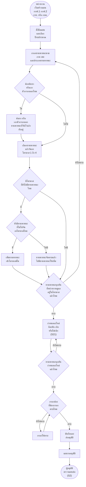

> ยานพาหนะที่หน่วยงานดูแล: กกฟ.1 กกฟ.2 กรย. คือยานพาหนะของหน่วยงานตัวเอง · กบค. คือยานพาหนะของ กบค. และยานพาหนะของ กฝซ. ที่ส่งมาให้ กบค. ดำเนินการ

### Scenario 2 · ผู้อนุมัติ ตรวจสอบและอนุมัติแผนบำรุงรักษา

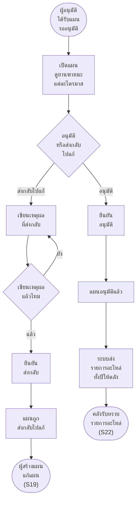

### Scenario 19 · หน่วยงาน แก้ไขแผนบำรุงรักษา แล้วส่งอนุมัติใหม่

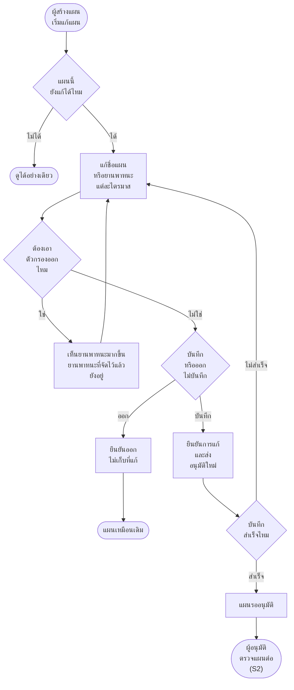

### Scenario 20 · หน่วยงาน ลบแผนบำรุงรักษาที่ยังไม่อนุมัติ


### Scenario 21 · หน่วยงาน จัดการอะไหล่ของยานพาหนะแต่ละคันในแผน

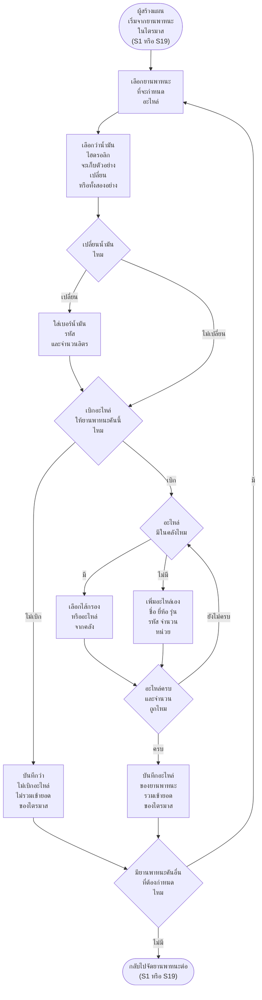

### Scenario 22 · กบค. คลัง รับทราบรายการอะไหล่รายไตรมาส

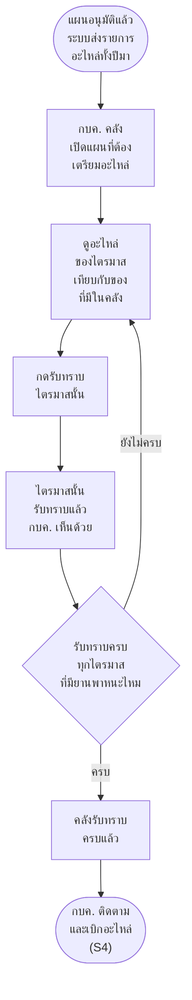

### Scenario 4 · กบค. ติดตามความคืบหน้าและเบิกอะไหล่ของไตรมาส

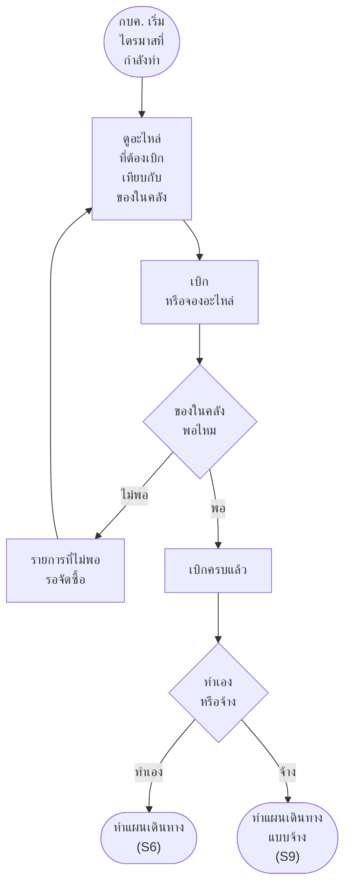

### Scenario 6 · กบค. ทำแผนเดินทาง (ตรวจเอง)

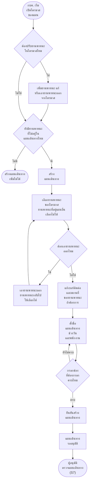

### Scenario 9 · กบค. สร้างแผนเดินทางจ้างดำเนินการ (vendor)

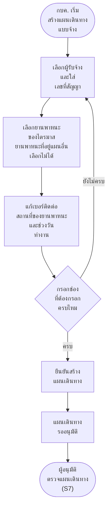

### Scenario 7 · ผู้อนุมัติ ตรวจสอบและอนุมัติแผนเดินทาง

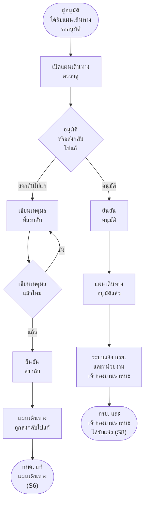

### Scenario 8 · กรย. และหน่วยงานเจ้าของยานพาหนะ ได้รับแจ้งเตือนแผนเดินทาง

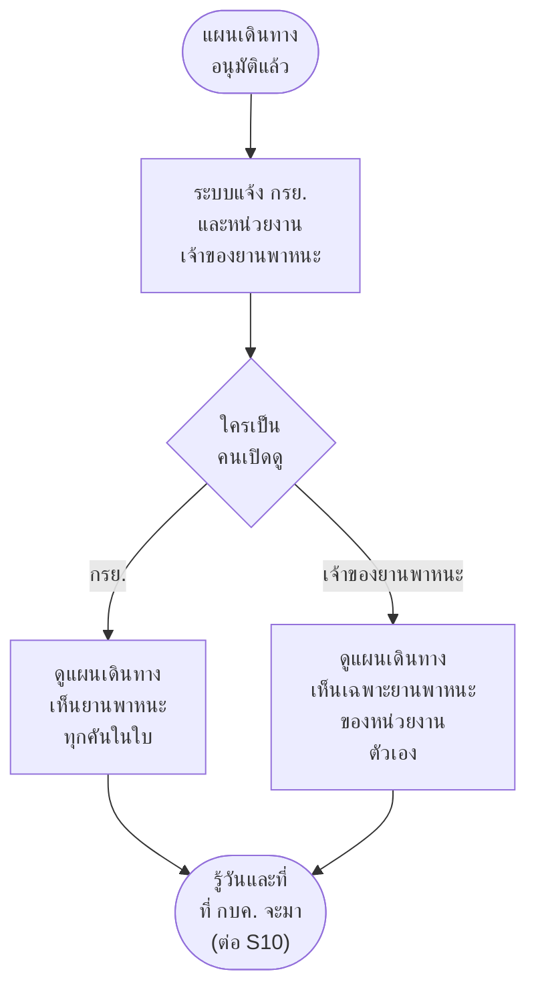

### Scenario 10 · กบค. บันทึกงานบำรุงรักษารายคัน

```mermaid
flowchart TD
    S(["กบค. เริ่ม<br/>แผนเดินทาง<br/>อนุมัติแล้ว"]) --> A0["ไปจุดนัด<br/>รับอะไหล่<br/>(ทำนอกระบบ)"]
    A0 --> Q0{"ต้องแก้<br/>ยานพาหนะในแผน<br/>เดินทางไหม"}
    Q0 -->|แก้ข้อมูล| A1["แก้เบอร์ติดต่อ<br/>และสถานที่<br/>ของยานพาหนะ"]
    Q0 -->|เอายานพาหนะออก| A2["เอายานพาหนะออก<br/>จาก<br/>แผนเดินทาง"]
    A1 --> A3
    A2 --> A3
    Q0 -->|ไม่ต้อง| A3["เลือกยานพาหนะ<br/>ที่ยังทำ<br/>ไม่เสร็จ"]
    A3 --> Q1{"บำรุงรักษา<br/>คันนี้ได้ไหม"}
    Q1 -->|ได้| A4["เริ่มงาน<br/>ยานพาหนะอยู่ระหว่าง<br/>บำรุงรักษา"]
    A4 --> A5["ขั้นที่ 1<br/>ตรวจสภาพยานพาหนะ<br/>ก่อนบำรุงรักษา<br/>และลงชื่อ"]
    A5 --> Q2{"ลงชื่อ<br/>ครบไหม"}
    Q2 -->|ยังไม่ครบ| A5
    Q2 -->|ครบ| Q3{"ทำต่อได้ไหม"}
    Q3 -->|ได้| A6["ตรวจ บำรุง<br/>และเก็บตัวอย่าง<br/>น้ำมัน<br/>(ทำนอกระบบ)"]
    A6 --> A7["ขั้นที่ 2<br/>สรุปงาน<br/>อะไหล่ที่ใช้จริง<br/>ศูนย์ต้นทุน<br/>และน้ำมัน"]
    A7 --> Q4{"ทำต่อได้ไหม"}
    Q4 -->|ได้| Q5{"กรอกครบไหม"}
    Q5 -->|ยังไม่ครบ| A7
    Q5 -->|ครบ| A8["ปิดงาน<br/>ยานพาหนะคันนี้เสร็จ<br/>ถ้าเก็บน้ำมัน<br/>จะรอผลตรวจ"]
    A8 --> A10["ระบบแจ้ง<br/>เจ้าของยานพาหนะให้<br/>ยอมรับผล<br/>(S13)"]
    Q1 -->|ไม่ได้| A9["ใส่สาเหตุ<br/>และยืนยัน<br/>อะไหล่ที่ส่งคืน<br/>ยานพาหนะคันนี้ทำ<br/>ไม่ได้"]
    Q3 -->|ไม่ได้| A9
    Q4 -->|ไม่ได้| A9
    A9 --> Q6
    A10 --> Q6{"ยังมียานพาหนะคันอื่น<br/>ในแผนไหม"}
    Q6 -->|มี| A3
    Q6 -->|ไม่มี| E(["ทำครบทุกคัน<br/>คันที่ทำไม่ได้<br/>ย้ายไตรมาส<br/>(S25)"])
```

### Scenario 25 · กบค. ย้ายยานพาหนะที่บำรุงรักษาไม่ได้ไปไตรมาสอื่น

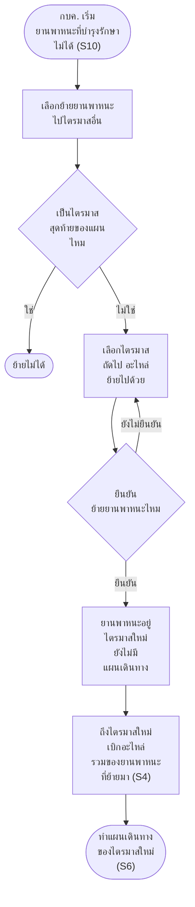

### Scenario 12 · กบค. บันทึกผลตรวจน้ำมันไฮโดรลิก


### Scenario 13 · หน่วยงาน/เจ้าของยานพาหนะ ยอมรับผลการตรวจบำรุงยานพาหนะรายคัน

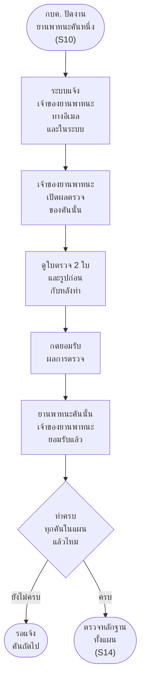

### Scenario 14 · หน่วยงาน/เจ้าของยานพาหนะ ตรวจสอบหลักฐานและประเมินความพึงพอใจ (ครบทุกคัน)

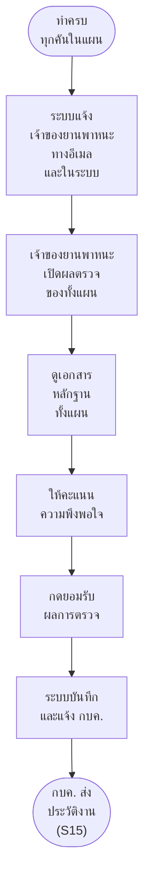

### Scenario 15 · กบค. บันทึกและส่งประวัติงานบำรุงรักษา

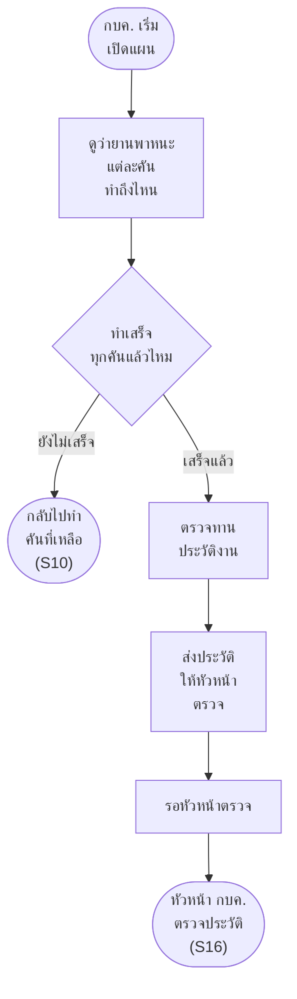

### Scenario 16 · หัวหน้า กบค. ตรวจสอบประวัติงานบำรุงรักษา

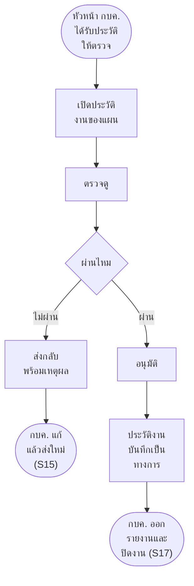

### Scenario 17 · กบค. ออกรายงานผลและปิดงาน

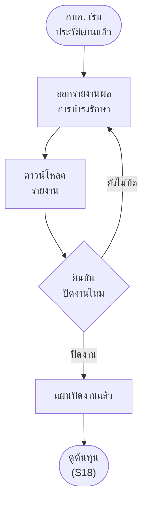

### Scenario 18 · กบค. คำนวณต้นทุนการบำรุงรักษา

> ยังไม่ได้ออกแบบ (เจ้าของงานบอก 4 พ.ย. 2569) ผังนี้ตามร่างเดิมในไฟล์ 14 ยังใช้เป็นแบบไม่ได้

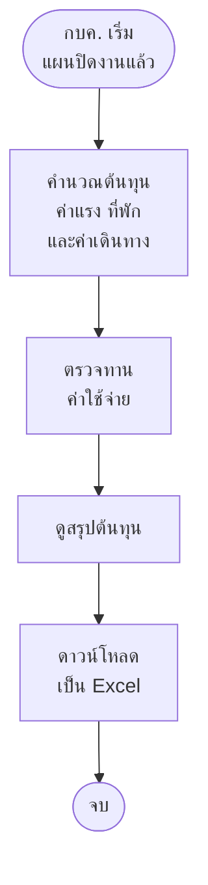

### Scenario 24 · กบค. ติดตามข้อมูลการบำรุงรักษารายคันและกำหนดครั้งถัดไป

```mermaid
flowchart TD
    S(["ปิดงานยานพาหนะแล้ว<br/>ระบบเก็บข้อมูล<br/>และคิดวัน<br/>ครั้งถัดไป"]) --> A1["กบค. ดูข้อมูล<br/>การบำรุงรักษา<br/>ของยานพาหนะทุกคัน"]
    A1 --> A2["ค้นหาจาก<br/>ทะเบียน<br/>ยี่ห้อ หรือรุ่น"]
    A2 --> Q1{"เจอยานพาหนะไหม"}
    Q1 -->|ไม่เจอ| A3["ล้างตัวกรอง<br/>แล้วค้นใหม่"]
    A3 --> A2
    Q1 -->|เจอ| Q2{"ต้องกรอง<br/>เพิ่มไหม"}
    Q2 -->|ใช่| A4["กรองตาม<br/>ประเภท สังกัด<br/>หรือกำหนดการ"]
    A4 --> A5
    Q2 -->|ไม่ใช่| A5["ดูยานพาหนะคันนั้น<br/>ครั้งถัดไป<br/>เมื่อไหร่<br/>และประวัติ"]
    A5 --> Q3{"ต้องดูงาน<br/>ครั้งก่อนไหม"}
    Q3 -->|ใช่| A6["เปิดงาน<br/>ครั้งก่อน<br/>ที่ทำเสร็จแล้ว"]
    A6 --> E
    Q3 -->|ไม่ใช่| E(["รู้ว่ายานพาหนะคันไหน<br/>ถึงกำหนด<br/>ใส่แผนรอบหน้า<br/>(S1)"])
```
