# บำรุงรักษาตามวาระ — flowchart กิจกรรมราย scenario

> เจ้าของงานขอ 6 พ.ย. 2569: _"สร้าง แต่ละ scen ออกมาได้หรือไม่ แล้ว ทำ script ให้ export ใน figma ได้หรือเปล่า"_ + _"อยากได้ flowchart"_ + _"อยากให้แยกscen เลยนะ"_
> เนื้อหา: _"เอาเป็นแค่กิจกรรมนี้ ทำอะไรไปต่อมีทางเลือกอะไร ทางใหนบ้าง"_ + _"ไม่ต้องเอาหน้าจอไปรวม อยากให้อ่านแยกกัน"_ + _"ไม่ต้องใช้คำแปลกๆนะ ให้ใช้คำปกติเหมือนมนุษย์อ่าน"_ · export ลง Figma อย่างเดียว บนเว็บยังไม่ทำ
>
> ผังนี้บอกแค่ว่าใครทำอะไร ทำเสร็จแล้วไปต่อที่ไหน ตรงไหนต้องเลือก และเลือกแล้วไปทางไหน ไม่มีหน้าจอ หน้าจอดูแยกที่ userflow [14-บำรุงรักษา-userflow.md](14-บำรุงรักษา-userflow.md) และ wireframe
>
> เขียนตามผังในไฟล์ 14 ไม่เพิ่มขั้นที่ไฟล์นั้นไม่มี · เรียงตามลำดับงาน S1 S2 S19 S20 S21 S4 S6 S9 S7 S8 S10 S23 S25 S12 S13 S27 S18 S24 (18 scenario · S27 ประเมินความพึงพอใจของ กบค. เพิ่ม 11 พ.ย. 2569 · S14 S15 S16 S17 ตัดออก 10 พ.ย. 2569 ผู้ดูแลยานพาหนะรับทราบรายคันเป็นขั้นสุดท้าย รับทราบครบทุกคันแล้วแผนปิดงานเอง)
>
> ผู้ทำเรียกตามบทบาท (เจ้าของงาน 10 พ.ย. 2569): ผู้สร้างแผน · ผู้อนุมัติ · ผู้ดำเนินการ · ผู้รับจ้าง · ผู้ดูแลยานพาหนะ · กรย. · หน่วยงานเป็นข้อมูลสังกัด ไม่ใช่ผู้ทำ
>
> การเขียนป้าย: ใช้คำธรรมดา คำถามในข้าวหลามตัดลงท้ายด้วย "ไหม" ป้ายบนเส้นเป็นคำตอบจริง (ใช่ ไม่ใช่ · ครบ ยังไม่ครบ · มี ไม่มี) ไม่ใช้ Y N หรือเครื่องหมาย + · รหัส scenario ใส่ในวงเล็บท้ายข้อความเมื่อต้องอ้างถึงผังอื่น
>
> รูปทรง (แบบ swimlane ที่เจ้าของงานเคาะ 4 พ.ย.): `["…"]` สี่เหลี่ยม คือสิ่งที่ทำ · `{"…"}` ข้าวหลามตัด คือจุดที่ต้องเลือก · `(["…"])` วงกลม คือจุดเริ่ม และจุดจบหรือไปต่อผังถัดไป
>
> แก้ไฟล์นี้แล้วรัน `node figma-export/build-plugin.js maintainance-plugin` ปลั๊กอินถึงจะวาดตาม (ปุ่ม "สร้าง flowchart กิจกรรม" ในปลั๊กอินบำรุงรักษา) · หัวข้อต้องเป็น `### Scenario N · ชื่อ` · แก้ userflow ไฟล์ 14 เมื่อไหร่ ต้องตามมาแก้ผังของ scenario นั้นในคอมมิตเดียวกัน

### Scenario 1 · ผู้สร้างแผน สร้างแผนบำรุงรักษาประจำปี และจัดยานพาหนะลงไตรมาส

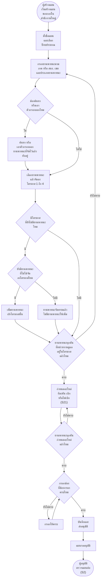

> ยานพาหนะที่หน่วยงานดูแล: กบผ. กปส. กรย. กส.1 กส.2 คือยานพาหนะของหน่วยงานตัวเอง · กบค. คือยานพาหนะของ กบค. และยานพาหนะของ กฝซ. ที่ส่งมาให้ กบค. ดำเนินการ

### Scenario 2 · ผู้อนุมัติ ตรวจสอบและอนุมัติแผนบำรุงรักษา

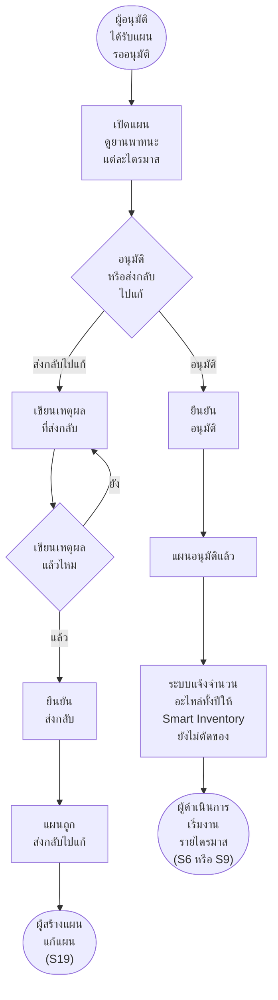

### Scenario 19 · ผู้สร้างแผน แก้ไขแผนบำรุงรักษา แล้วส่งอนุมัติใหม่

### Scenario 20 · ผู้สร้างแผน ลบแผนบำรุงรักษาที่ยังไม่อนุมัติ

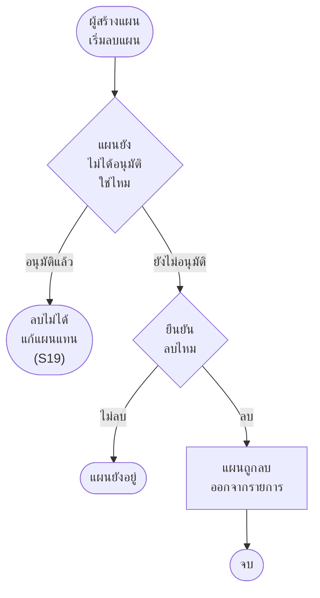

### Scenario 21 · ผู้สร้างแผน จัดการอะไหล่ของยานพาหนะแต่ละคันในแผน

### Scenario 4 · ผู้ดำเนินการ ดูอะไหล่และความคืบหน้าของแผนที่อนุมัติแล้ว (แดชบอร์ด)

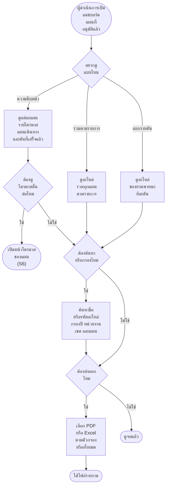

### Scenario 6 · ผู้ดำเนินการ ทำแผนเดินทาง (ดำเนินการเอง)

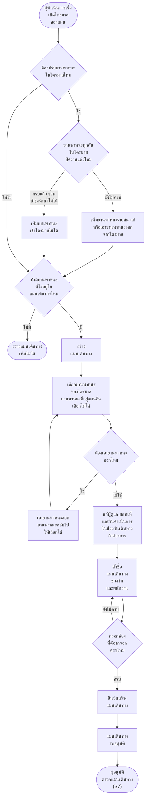

### Scenario 9 · ผู้ดำเนินการ สร้างแผนเดินทางจ้างดำเนินการ (vendor)

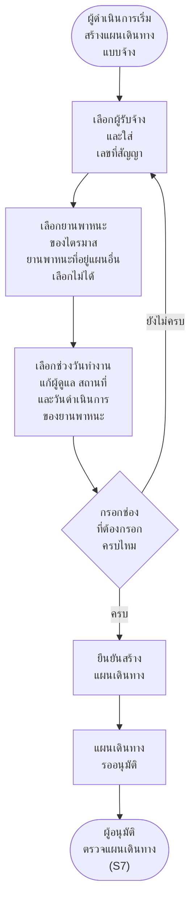

### Scenario 7 · ผู้อนุมัติ ตรวจสอบและอนุมัติแผนเดินทาง

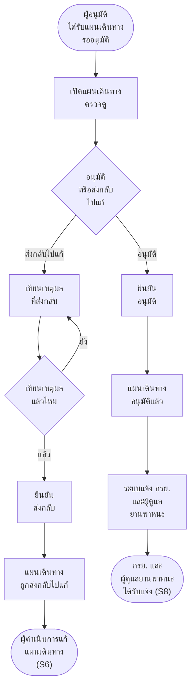

### Scenario 8 · กรย. และผู้ดูแลยานพาหนะ ได้รับแจ้งเตือนแผนเดินทาง

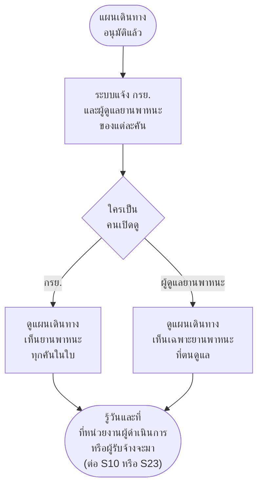

### Scenario 10 · ผู้ดำเนินการ บันทึกงานบำรุงรักษารายคัน

```mermaid
flowchart TD
    S(["ผู้ดำเนินการเริ่ม<br/>แผนเดินทาง<br/>อนุมัติแล้ว"]) --> A0["ไปจุดนัด<br/>รับอะไหล่<br/>(ทำนอกระบบ)"]
    A0 --> Q7{"ต้องส่งออก<br/>แผนเดินทาง<br/>ไหม"}
    Q7 -->|ใช่| A11["เลือก PDF<br/>หรือ Excel<br/>ได้ไฟล์ยานพาหนะ<br/>และอะไหล่"]
    A11 --> Q0
    Q7 -->|ไม่ใช่| Q0{"ต้องแก้<br/>ยานพาหนะในแผน<br/>เดินทางไหม"}
    Q0 -->|แก้ข้อมูล| A1["แก้ผู้ดูแล สถานที่<br/>และวันดำเนินการ<br/>ของยานพาหนะ"]
    Q0 -->|เอายานพาหนะออก| A2["เอายานพาหนะออก<br/>จาก<br/>แผนเดินทาง"]
    A1 --> A3
    A2 --> A3
    Q0 -->|ไม่ต้อง| A3["เลือกยานพาหนะ<br/>ที่ยังทำ<br/>ไม่เสร็จ"]
    A3 --> Q1{"บำรุงรักษา<br/>คันนี้ได้ไหม"}
    Q1 -->|ได้| A4["เริ่มงาน<br/>ยานพาหนะอยู่ระหว่าง<br/>บำรุงรักษา"]
    A4 --> A5["ขั้นที่ 1<br/>ตรวจสภาพยานพาหนะ<br/>ก่อนบำรุงรักษา<br/>และลงชื่อ"]
    A5 --> Q2{"ลงชื่อ<br/>ครบไหม"}
    Q2 -->|ยังไม่ครบ| A5
    Q2 -->|ครบ| Q3{"ทำต่อได้ไหม"}
    Q3 -->|ได้| A6["ตรวจ บำรุง<br/>และเก็บตัวอย่าง<br/>น้ำมัน<br/>(ทำนอกระบบ)"]
    A6 --> A7["ขั้นที่ 2<br/>สรุปงาน<br/>อะไหล่ที่ใช้จริง<br/>ศูนย์ต้นทุน<br/>และน้ำมัน"]
    A7 --> Q4{"ทำต่อได้ไหม"}
    Q4 -->|ได้| Q5{"กรอกครบไหม"}
    Q5 -->|ยังไม่ครบ| A7
    Q5 -->|ครบ| A8["ปิดงาน<br/>ยานพาหนะคันนี้เสร็จ<br/>ถ้าเก็บน้ำมัน<br/>จะรอผลตรวจ"]
    A8 --> A10["ระบบแจ้ง<br/>ผู้ดูแลยานพาหนะ<br/>ให้รับทราบผล<br/>(S13)"]
    Q1 -->|ไม่ได้| A9["ใส่สาเหตุ<br/>และยืนยัน<br/>อะไหล่ที่ส่งคืน<br/>ยานพาหนะคันนี้ทำ<br/>ไม่ได้"]
    Q3 -->|ไม่ได้| A9
    Q4 -->|ไม่ได้| A9
    A9 --> A10
    A10 --> Q6{"ยังมียานพาหนะคันอื่น<br/>ในแผนไหม"}
    Q6 -->|มี| A3
    Q6 -->|ไม่มี| E(["ทำครบทุกคัน<br/>คันที่ทำไม่ได้<br/>ย้ายไตรมาส<br/>(S25)"])
```

### Scenario 23 · ผู้รับจ้าง บันทึกงานรายคันและส่งตรวจงาน

> เอากลับ 10 พ.ย. 2569 (ตัดไป 4 พ.ย.) เจ้าของงาน _"scen s23 อยากปรับ ui ให้เหมือนกับ s10 แต่ว่า เงื่อนไขการมองเห็น เมนูต่างๆ ยังเป็นเหมือนเดิม"_ · ขั้นทำงานเหมือน S10 ต่างที่ผู้รับจ้างแก้หรือเอายานพาหนะออกจากแผนเดินทางไม่ได้ ไม่มีค่าใช้จ่ายและราคาอะไหล่ และต้องส่งตรวจงานทีละคัน · ใครเป็นคนตรวจรับยังไม่เคาะ (S11 ยังตัดอยู่)

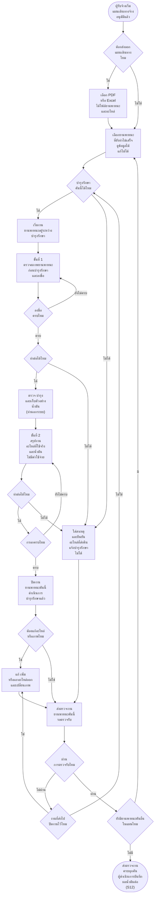

### Scenario 25 · ผู้ดำเนินการ ย้ายยานพาหนะที่บำรุงรักษาไม่ได้ไปไตรมาสอื่น

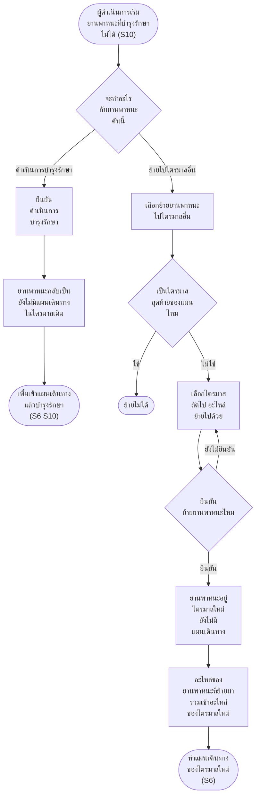

### Scenario 12 · ผู้ดำเนินการ บันทึกผลตรวจน้ำมันไฮดรอลิก

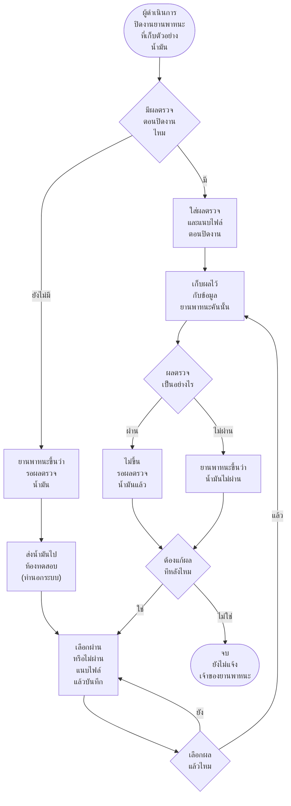

### Scenario 13 · ผู้ดูแลยานพาหนะ รับทราบผลการบำรุงรักษารายคัน

> ปรับ 10 พ.ย. 2569 ตามเจ้าของงาน ผู้ดูแลยานพาหนะที่ระบุรายคันในแผนเดินทางได้แจ้งเตือนของคันนั้น ดูผลที่บันทึกไว้ ให้คะแนน 1 ถึง 5 แล้วกดรับทราบ รับทราบอย่างเดียว รอบเดียวต่อคัน คันที่บำรุงรักษาไม่ได้ใช้ฟอร์มเดียวกัน ส่วนจะต้องให้คะแนนด้วยไหมยังไม่เคาะ (ผังนี้ใส่ไว้ก่อนว่าไม่ต้อง) · 10 พ.ย. 2569 รอบต่อมา S16 S17 ตัดออก รับทราบครบทุกคันแล้วระบบปิดงานแผนเอง ไม่มีหัวหน้าหน่วยงานตรวจประวัติและไม่มีขั้นออกรายงาน · 11 พ.ย. 2569 เจ้าของงานเคาะให้ย้ายการประเมินออกไปเป็นหน้าแยก (Scenario 27) ผังนี้เหลือดูผลแล้วกดรับทราบอย่างเดียว คันที่บำรุงรักษาเสร็จและรับทราบแล้วไปรอประเมินที่ Scenario 27

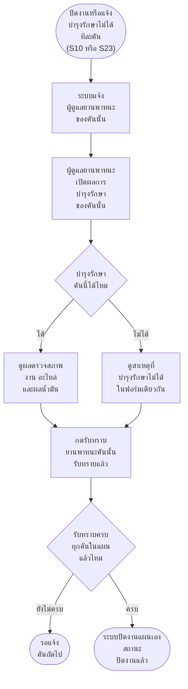

### Scenario 27 · ผู้ดูแลยานพาหนะ ประเมินความพึงพอใจการให้บริการของ กบค. รายคัน

> เจ้าของงาน 11 พ.ย. 2569 ให้แบบประเมินความพึงพอใจของ กบค. เป็นอีกหน้าหนึ่งแบบประเมินผู้รับจ้าง ยานพาหนะที่บำรุงรักษาเสร็จและผู้ดูแลยานพาหนะรับทราบผลแล้วคันละหนึ่งรายการ ผู้ดูแลยานพาหนะให้ดาว 1 ถึง 5 ครบทุกข้อแล้วจึงบันทึกได้ บันทึกแล้วแก้ไม่ได้ (เงื่อนไขเต็มอยู่ไฟล์ 14)

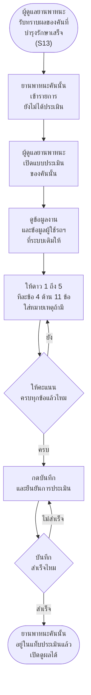

### Scenario 18 · ผู้ดำเนินการ คำนวณต้นทุนการบำรุงรักษา

> เจ้าของงานเคาะ 10 พ.ย. 2569: เข้าจากแท็บต้นทุนการบำรุงรักษาในหน้ารายละเอียดแผน ดูได้ตั้งแต่มีคันแรกปิดงาน · นับเฉพาะงานที่หน่วยงานทำเอง แผนจ้างไม่แสดง · ยานพาหนะที่บำรุงรักษาไม่ได้แยกบรรทัด (เงื่อนไขเต็มอยู่ไฟล์ 14)

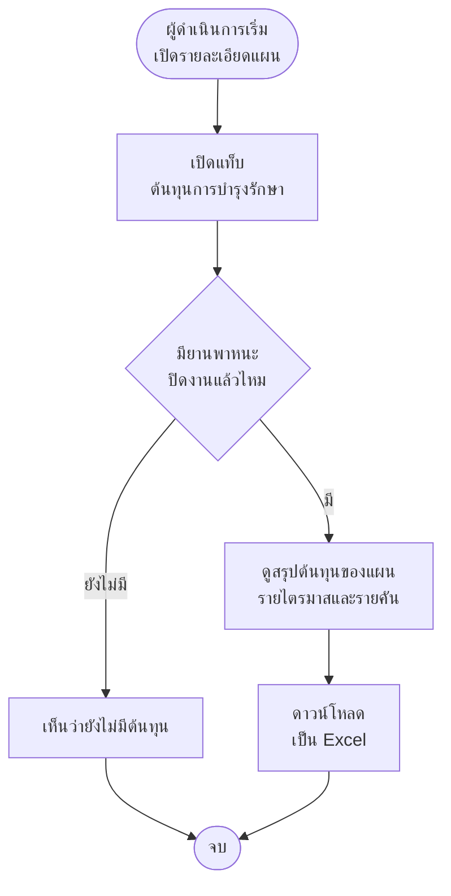

### Scenario 24 · ผู้ดำเนินการ ติดตามข้อมูลการบำรุงรักษารายคันและกำหนดครั้งถัดไป

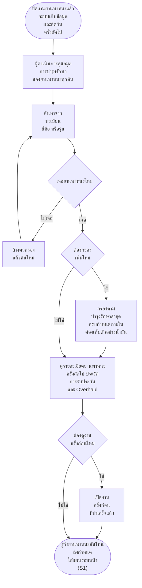
