# 05 — โอนย้ายยานพาหนะถาวร (เปลี่ยนสังกัด): ใครทำอะไร · ระบบทำอะไร · แสดงอะไร

> **ร่าง 6 ต.ค. 2569** — มุมมอง "ใครทำ / ระบบทำ" ของเส้นเดียวกับ [01-เปลี่ยนสังกัดถาวร](01-เปลี่ยนสังกัดถาวร.md) (T0–T13)
> โดยรวมข้อมูลที่ 01 ยังไม่มี คือ **สรุป Workshop/Q&A** (`../../../CLAUDE_UPDATED.md` ข้อ 3) — นัดส่งมอบ · ตรวจรับร่วม · checklist · รับแบบมีเงื่อนไข
> 01 ยังเป็นเจ้าของผัง PlantUML + scenario/use case CSV ⇒ ไฟล์นี้ไม่ได้แทนที่ ถ้าเคาะแล้วต้องไล่ให้ 01/03/04 ตรงกัน
>
> **ผัง FigJam:** https://www.figma.com/board/igZcpfUndwQbr3a6UIshdV — section "โอนย้ายยานพาหนะถาวร (เปลี่ยนสังกัด)" ใต้ผังจำหน่าย
> 7 เลน (เลนบัญชีเปลี่ยนชื่อเป็น **นักบัญชีทรัพย์สิน** 6 ต.ค. 2569 — ⚠️ ยังไม่ได้แก้ในไฟล์ FigJam เพราะโควตา Figma MCP หมด) · อ่านซ้าย→ขวา · รูปทรงตาม Template บอร์ด Planning 1-2 · คำถาม 13 ข้อเป็น sticky เหลืองข้างขั้นที่ถาม
> 🟧 **เลนล่างสุดสีส้ม = สถานะเปลี่ยน + แจ้งเตือน** (เพิ่ม 6 ต.ค. 2569) — ดูหัวข้อ "สถานะ + แจ้งเตือน"
>
> ⚠️ **ไม่รวม "ยืมใช้ชั่วคราว"** — ระเบียบแยกไว้คนละหมวด (ข้อ 11.2.5) ดู [02-ยืมใช้ชั่วคราว](02-ยืมใช้ชั่วคราว.md)

## ที่มาแต่ละแหล่งบอกอะไร

| แหล่ง | บอกอะไร |
|---|---|
| **ระเบียบ ข้อ 8.3** | ปลายทาง (ผู้รับโอน) แจ้ง กจย. แก้รหัสสังกัด **ภายใน 7 วันทำการ** · ปลายทางประทับตรารหัสใหม่ **ภายใน 7 วันทำการ** นับถัดจากวันได้รหัส |
| **ระเบียบ ข้อ 8.1** | กจย. เป็นผู้กำหนดรหัสยานพาหนะ |
| **ระเบียบ ข้อ 10** | ผู้กำหนดรหัสทรัพย์สิน: สนญ. → **กองบัญชีทรัพย์สิน** · กฟข. → **กองบัญชีและเศรษฐกิจพลังงานไฟฟ้า กฟข.** (ไม่ได้บอกว่าโอนแล้วรหัสเปลี่ยนไหม) |
| **ระเบียบ ข้อ 23 · 30** | ผู้ชำระภาษีประจำปีเปลี่ยนตามสังกัด · ผู้ต่อ พ.ร.บ. ปีถัดไปเปลี่ยน (30.1.2) · ทำประกัน ป.3 แล้วต้องแจ้ง กจย. (30.3.5) |
| **เคาะ 22 ก.ย. 2569** | ต้นทางเป็นผู้เปิดเรื่อง · เคสปลายทางอยากได้รถ = "แจ้งความต้องการ" ยังไม่สร้างใบ |
| **Workshop (CLAUDE_UPDATED.md ข้อ 3)** | ตรวจสถานะรถก่อน (งานซ่อมค้าง → **ห้ามโอน**) · อนุมัติ · **นัดส่งมอบ** · **ตรวจรับร่วม** ต้นทาง+ปลายทาง · checklist 10 ข้อ · ไม่ครบ → **หัวหน้าหน่วยงานอนุมัติรับแบบมีเงื่อนไข** · ปลายทางยืนยันรับ · อัปเดตต้นทาง/ปลายทาง/เจ้าของ/สถานที่/สถานะ · แจ้งทั้งสองฝั่ง · เอกสาร: ใบคำขอ · checklist · ใบส่ง/รับมอบ |
| **design-mock/transfer-01…04** | 4 จอ: รายการรถ → คำร้อง (มีกล่องรายการค้าง "ปิดก่อน หรือบันทึกข้อตกลง") → ปลายทางตรวจรับ → คิวงาน กจย. (2 นาฬิกา) |
| **บอร์ด Planning 1-2** | sticky "scen1 สร้างใบโอนย้าย สามารถเลือกรถที่ต้องการโอนย้ายได้" |
| **TOR / JO3 UC-01** | บันทึกโอนต้นทาง-ปลายทาง + ตรวจสอบสถานะ/ประวัติ |

### ⚠️ จุดที่แหล่งขัดกัน

| เรื่อง | Workshop (ก.ค.) | เคาะ 22 ก.ย. / mock | ในผังใช้ |
|---|---|---|---|
| ใครเปิดเรื่อง | ปลายทางยื่นคำขอ | ต้นทางเปิดเสมอ · ปลายทาง "แจ้งความต้องการ" | **ต้นทางเปิด + ทางเข้าแจ้งความต้องการ** `[เสนอ]` → Q1 |
| รถมีรายการค้าง | **ห้ามโอน** | ยังไม่เคาะว่าบล็อกหรือเตือน + บันทึกข้อตกลง | วาดทั้งสองทาง (ทางข้อตกลงเป็นเส้นประ) → Q3 🔴 |

**ทำไมเสนอให้ต้นทางเปิด:** รถเป็นทรัพย์สินในความรับผิดชอบของหน่วยงานที่ครอบครอง — ระเบียบให้หน่วยงานนั้นตั้งเรื่องทุกเรื่องที่เกี่ยวกับตัวรถ
(ข้อ 24 จำหน่าย · ข้อ 11.2.5 ผู้อนุมัติอยู่ฝั่งรถทั้งหมด) · ข้อ 8.3 ให้ปลายทางลงมือเฉพาะ*หลัง*ตกลงโอนแล้ว ·
และทางเข้า "แจ้งความต้องการ" ยังรองรับสิ่งที่ Workshop ขอได้ โดยใบโอนมีเจ้าของคนเดียว

## Flow

ที่มา: `[ข้อ xx]` ระเบียบ · `[Workshop]` · `[เคาะ 22 ก.ย.]` · `[mock]` · `[TOR]` · `[เสนอ]`

| # | ใคร | คนทำ | ระบบทำ / ระบบแสดง | สถานะรถ | ที่มา |
|---|---|---|---|---|---|
| P1 | ปลายทาง | แจ้งความต้องการรถ (ยังไม่สร้างใบ) | — | — | เคาะ 22 ก.ย. · Workshop |
| D0 ◆ | ต้นทาง | รับเรื่อง / ไม่รับ ❓ | — | — | เคาะ 22 ก.ย. · Q2 |
| N2 | ต้นทาง | **เปิดคำร้องโอน** เลือกรถ · ปลายทาง + เหตุผล · เอกสาร | — | — | บอร์ด scen1 · TOR UC-01 · เสนอ (Q1) |
| N3 | ระบบ | — | ตรวจสถานะรถ + รายการค้าง (ใบซ่อม · รอบบิล Fleet Card) | — | Workshop · mock |
| DK ◆ | ระบบ | — | รถพร้อมโอน? | — | Workshop |
| N3b | ต้นทาง | ปิดรายการค้าง หรือบันทึกข้อตกลงส่งมอบ ❓ | — | — | mock · Q3 |
| N5 | ผู้มีอำนาจ ❓ | **อนุมัติการโอน** | — | — | Workshop · Q4 |
| N6 ◆ | ปลายทาง | รับโอน / ไม่รับ ❓ | — | — | mock · Q5 |
| N8 | ปลายทาง (+ ต้นทาง) | **นัดหมายรับ-ส่งมอบรถ** | — | — | Workshop |
| N9 | ต้นทาง + ปลายทาง | **ตรวจรับร่วมกัน** checklist 10 ข้อ + รูปรอบคัน | — | — | Workshop · Q6 |
| N10 ◆ | ปลายทาง | เอกสาร / อุปกรณ์ครบ? | — | — | Workshop |
| N10b | หัวหน้าหน่วยงาน ❓ | อนุมัติรับแบบมีเงื่อนไข | — | — | Workshop · Q7 |
| N11 | ปลายทาง | **ยืนยันรับรถในระบบ** | — | — | Workshop |
| N12 | ระบบ | — | อัปเดตหน่วยงานเจ้าของ + สถานที่ประจำรถ · บันทึกประวัติการโอน | ดู T6 | Workshop · DB `vms_trn_vehicle_transfer` |
| N13 | ปลายทาง | **แจ้ง กจย. ขอรหัสสังกัดใหม่** ภายใน 7 วันทำการ | — | — | **ข้อ 8.3** |
| SQ | ระบบ | — | คิวงาน กจย. · นับ 7 วันทำการ 2 นาฬิกา (แจ้ง · ประทับตรา) | ดู T7–T8 | ข้อ 8.3 · mock |
| N14 | กจย. | **ออกรหัสสังกัดใหม่** | — | — | **ข้อ 8.1 · 8.3** · Q10 |
| N15 | ปลายทาง | **ประทับตรารหัสใหม่** ภายใน 7 วันทำการ | — | — | **ข้อ 8.3** |
| N16 | **นักบัญชีทรัพย์สิน** ❓ (สนญ. กองบัญชีทรัพย์สิน · กฟข. กองบัญชีฯ กฟข.) | ปรับทะเบียนทรัพย์สิน / cost center | — | ดู T9 | ข้อ 10 · Q11 |
| N17 | ระบบ | — | เปลี่ยนผู้ชำระภาษี + ผู้ต่อ พ.ร.บ. · ปรับข้อมูลสังกัดรถ | ดู T10 | ข้อ 23 · 30 · TOR UC-01 |

คอลัมน์ "สถานะรถ" ย้ายไปอยู่ตาราง **สถานะ + แจ้งเตือน** ข้างล่างทั้งหมด (6 ต.ค. 2569)

**ลำดับที่ยังไม่แน่:** N5 (อนุมัติ) กับ N6 (ปลายทางตอบรับ) อะไรก่อน — Q5 · การตรวจรับ (N9) เกิดก่อนหรือหลังได้รหัสใหม่ — Workshop วางไว้ก่อน ระเบียบไม่ได้พูด

## 🟧 สถานะ + แจ้งเตือน (เลนส้มในผัง)

ทุกจังหวะที่สถานะเปลี่ยน = กล่องส้ม 1 กล่อง วางตรงคอลัมน์ของขั้นที่ทำให้เปลี่ยน
**แถวบน** = เส้นปกติ ร้อยต่อกันเป็นไทม์ไลน์ (T1–T10) · **แถวล่าง** = เส้นยกเว้น (X1–X4)
`🔔` ใครได้รับแจ้ง · `⏰` เตือนล่วงหน้า · ชื่อสถานะ + ผู้รับแจ้ง **ทีมเสนอเกือบทั้งหมด** → Q13

| # | เกิดหลังขั้น | ใบโอน / รถ → | 🔔 แจ้งใคร | ⏰ | ที่มา |
|---|---|---|---|---|---|
| T1 | P1 แจ้งความต้องการ | คำขอ → **รอต้นทางพิจารณา** | ต้นทาง | — | เสนอ |
| X1 | D0 ไม่รับ | คำขอ → **ต้นทางไม่รับ** | ปลายทาง | — | เสนอ |
| T2 | N2 ส่งคำร้อง | ใบโอน → **รออนุมัติ** · รถ → **อยู่ระหว่างโอน** ❓ | ผู้อนุมัติ | — | mock · เสนอ |
| X2 | DK มีรายการค้าง | ใบโอน → **รอเคลียร์รายการค้าง** | ต้นทาง | — | mock · เสนอ |
| T3 | N5 อนุมัติ | ใบโอน → **รอปลายทางตอบรับ** | ปลายทาง | — | mock |
| T4 | N6 รับโอน | ใบโอน → **อนุมัติโอน – รอส่งมอบ** | ต้นทาง + ปลายทาง | — | Workshop |
| X3 | N6 ไม่รับ | ใบโอน → **ปลายทางไม่รับ** · รถ → **พร้อมใช้งาน** | ต้นทาง | — | เสนอ |
| T5 | N8 นัดหมาย | ใบโอน → **นัดส่งมอบแล้ว** | ต้นทาง + ปลายทาง | ก่อนวันนัด | Workshop · เสนอ |
| X4 | N10 ไม่ครบ | ใบโอน → **รออนุมัติรับแบบมีเงื่อนไข** | หัวหน้าหน่วยงาน | — | Workshop |
| T6 | N11 ยืนยันรับรถ | ใบโอน → **โอนแล้ว – รอรหัสสังกัดใหม่** | ต้นทาง + ปลายทาง | — | Workshop |
| T7 | N13 แจ้ง กจย. | ใบโอน → **รอ กจย. ออกรหัส** | กจย. | ใกล้ครบ 7 วันทำการ | ข้อ 8.3 |
| T8 | N14 ออกรหัส | ใบโอน → **รอประทับตรา** | ปลายทาง | ใกล้ครบ 7 วันทำการ | ข้อ 8.3 |
| T9 | N15 ประทับตรา | ใบโอน → **รอปรับทะเบียนทรัพย์สิน** ❓ | **นักบัญชีทรัพย์สิน** | — | ข้อ 10 · Q11 |
| T10 | N16 / N17 | ใบโอน → **เสร็จสิ้น** · รถ → **ใช้งาน (สังกัดใหม่)** | ต้นทาง + ปลายทาง (+ กบค. ถ้ามีเครื่องจักรกล) | — | Workshop · แจ้ง กบค. อนุมานจาก 25.5 |

## Mermaid (อ่านบน GitHub)

```mermaid
flowchart LR
    subgraph OWN["หน่วยงานต้นทาง"]
        S0(["เริ่ม"])
        D0{"รับเรื่อง?"}
        D0x(["ไม่รับ ❓"])
        N2["เปิดคำร้องโอน<br/>เลือกรถ · ปลายทาง · เหตุผล"]
        N3b["ปิดรายการค้าง<br/>หรือบันทึกข้อตกลง ❓"]
    end
    subgraph DST["หน่วยงานปลายทาง"]
        S1(["เริ่ม"])
        P1["แจ้งความต้องการรถ<br/>ยังไม่สร้างใบ"]
        N6{"รับโอน? ❓"}
        N6x(["ไม่รับ ❓"])
        N8["นัดหมายรับ-ส่งมอบ"]
        N9["ตรวจรับร่วมกัน<br/>checklist 10 ข้อ"]
        N10{"เอกสาร/อุปกรณ์ครบ?"}
        N11["ยืนยันรับรถ"]
        N13["แจ้ง กจย. ขอรหัสใหม่<br/>ภายใน 7 วันทำการ"]
        N15["ประทับตรารหัสใหม่<br/>ภายใน 7 วันทำการ"]
    end
    subgraph APPR["ผู้มีอำนาจ ❓ / หัวหน้าหน่วยงาน"]
        N5["อนุมัติการโอน ❓"]
        N10b["อนุมัติรับแบบมีเงื่อนไข"]
    end
    subgraph KJY["กจย."]
        N14["ออกรหัสสังกัดใหม่"]
    end
    subgraph ACC["นักบัญชีทรัพย์สิน ❓"]
        N16["ปรับทะเบียนทรัพย์สิน ❓"]
    end
    subgraph SYS["ระบบ VMS Plus"]
        N3["ตรวจสถานะรถ + รายการค้าง"]
        DK{"รถพร้อมโอน?"}
        N12["อัปเดตเจ้าของ + สถานที่<br/>บันทึกประวัติการโอน"]
        SQ["คิวงาน กจย. · นับ 7 วัน"]
        N17["เปลี่ยนผู้ชำระภาษี + พ.ร.บ.<br/>ปรับข้อมูลสังกัดรถ"]
        E(["จบ"])
    end
    S0 --> N2
    S1 --> P1 --> D0
    D0 -->|"รับเรื่อง"| N2
    D0 -.->|"ไม่"| D0x
    N2 --> N3 --> DK
    DK -->|"พร้อม"| N5
    DK -.->|"มีรายการค้าง"| N3b -.-> N5
    N5 --> N6
    N6 -->|"รับ"| N8
    N6 -.->|"ไม่"| N6x
    N8 --> N9 --> N10
    N10 -->|"ครบ"| N11
    N10 -->|"ไม่ครบ"| N10b --> N11
    N11 --> N12 --> N13 --> SQ --> N14 --> N15
    N15 -.-> N16 -.-> N17 --> E
    classDef sys fill:#C6FAF6,stroke:#5AD8CC,color:#101828
    classDef act fill:#C2E5FF,stroke:#3DADFF,color:#101828
    classDef dec fill:#DCCCFF,stroke:#874FFF,color:#101828
    class N3,N12,SQ,N17 sys
    class P1,N2,N3b,N5,N8,N9,N10b,N11,N13,N14,N15,N16 act
    class D0,DK,N6,N10 dec
    style N3b stroke-dasharray: 5 4
    style N5 stroke-dasharray: 5 4
    style N16 stroke-dasharray: 5 4
```

## คำถามที่ต้องถาม กฟภ. (เรียงตามลำดับขั้น)

| # | คำถาม | ขั้น | ถามใคร |
|---|---|---|---|
| **Q1** 🔴 | ยืนยันไหมว่า**ต้นทางเปิดคำร้องเสมอ** (ทีมเสนอ — Workshop เคยบอกปลายทาง) · ปลายทางแจ้งความต้องการผ่านช่องทางไหน | P1 · N2 | ผู้ใช้หน้างาน + ฝ่ายพัสดุ |
| **Q2** | ต้นทางปฏิเสธคำขอของปลายทางได้ไหม · ต้องให้เหตุผลไหม | D0 | ผู้ใช้หน้างาน |
| **Q3** 🔴 | รถมีงานซ่อม / รอบบิล Fleet Card ค้าง → **ห้ามโอน** (Workshop) หรือ**แค่เตือน + บันทึกข้อตกลง** (mock)? | N3 · DK · N3b | กบค. + การเงิน |
| **Q4** 🔴 | **ใครอนุมัติการโอน** — ต้นทาง / ปลายทาง / ส่วนกลาง · อนุมัติกี่ฝั่ง · สนญ. กับ กฟข. ต่างกันไหม | N5 | ฝ่ายพัสดุ |
| **Q5** | ปลายทางปฏิเสธการรับโอนได้ไหม · ตอบรับก่อนหรือหลังผู้มีอำนาจอนุมัติ | N6 | ฝ่ายพัสดุ |
| **Q6** | checklist รับมอบ 10 ข้อครบไหม · รถเครน/กระเช้าต้องเพิ่มใบรับรองความปลอดภัยไหม | N9 | กบค. |
| **Q7** | "หัวหน้าหน่วยงาน" ที่อนุมัติรับแบบมีเงื่อนไขคือฝั่งไหน · ของที่ค้างตามยังไง | N10b | ผู้ใช้หน้างาน |
| **Q8** | ยกเลิกการโอนกลางทางได้ไหม (ก่อน / หลังปลายทางรับรถ) · ย้อนสถานะยังไง | N11 | ฝ่ายพัสดุ |
| **Q9** | ใบซ่อม / แผนบำรุงรักษาที่ค้าง **ย้ายตามรถไหม** · หน่วยงานเดิมยังเห็นประวัติรถไหม | N12 | กบค. |
| **Q10** 🔴 | กจย. **ออกรหัสในระบบ VMS Plus เลย** หรือทำใน VMMS แล้วระบบแค่รับเลขมา | SQ · N14 | กจย. / ทีม VMMS |
| **Q11** 🔴 | ต้องปรับทะเบียนทรัพย์สิน / cost center ใน SAP ไหม · **รหัสทรัพย์สินเปลี่ยนไหม** · ใครทำ · มี API ไหม | N16 | กองบัญชีทรัพย์สิน / ทีม SAP |
| **Q12** | โอนข้าม สนญ. ↔ ภูมิภาค ต่างกันไหม · รถเช่า (รหัส 25) โอนสังกัดได้ไหม | N17 | กจย. |
| **Q13** | ชื่อสถานะ + ใครได้แจ้งเตือนในเลนส้ม (ทีมเสนอเกือบทั้งหมด) ถูกไหม · **ช่องทางแจ้งเตือน**: ในแอป / อีเมล / PEA Life? | T1–T10 · X1–X4 | ผู้ใช้หน้างาน + ทีม IT |

🔴 = บล็อกการออกแบบ ถามก่อน · คำถามที่เคยค้างใน [04-usecase](04-usecase-เปลี่ยนสังกัด-ยืมใช้.csv) (สถานะ "ยังไม่เคาะ") ถูกรวมไว้ใน Q2 · Q3 · Q5 · Q8 · Q9 · Q12 แล้ว
