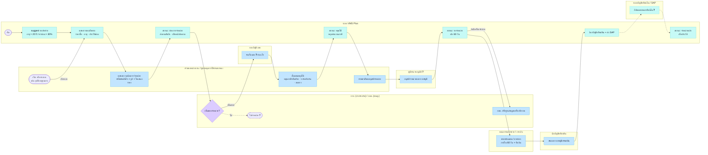

# 01 — จำหน่ายยานพาหนะออกจากบัญชีทรัพย์สิน (TOR ข้อ 4 · T10)

> **ร่าง 5 ต.ค. 2569** — เขียนจาก 3 แหล่ง:
> 1. **หลักเกณฑ์ยานพาหนะ พ.ศ. 2569 หมวดที่ 8 ข้อ 24–25** (PDF นอกรีโป `~/Workspace/หลักเกณฑ์ยานพาหนะ พ.ศ. 2569.pdf` หน้า 12)
> 2. **VMS plus – Project Board** (sticky ของ Anu.P หัวข้อ "กระบวนการจำหน่าย" · อ้างเป็น `[บอร์ด n]` = ข้อ n ในโน้ตสีเขียว)
> 3. ใบสั่งงาน JO3 (UC-02…UC-05) + ของที่มีอยู่แล้วในต้นแบบ
>
> 🔴 **ยังไม่ผ่านการยืนยันกับ กฟภ.** — ระเบียบบอก "ต้องทำอะไร" · บอร์ดบอก "ระบบต้องมีอะไร" · แต่ยังไม่มีใครบอก
> "ใครเซ็น · ลำดับไหน · ส่งอะไรเข้า SAP" ⇒ ❓ / เส้นประ = ยังไม่รู้ ดูคำถามท้ายไฟล์
>
> 🎨 **ยังไม่มีหน้าจอเรื่องนี้ใน Figma Component / UI Release#2** (ค้นแล้ว 14 ก.ย. 2569 · ดู `maintainance-yearly/overhaul-transfer-research.md` ข้อ 4)
> ⇒ ทำต้นแบบหน้าจอไม่ได้จนกว่าเจ้าของงานจะเคาะว่าใช้ pattern หน้าไหนของ UI Release#2 แทน

## สิ่งที่รู้แล้ว

### จากระเบียบ (ข้อ 24–25)

| เรื่อง | ระเบียบเขียนว่า | ที่มา |
|---|---|---|
| เกณฑ์เข้าข่าย | **ข้อใดข้อหนึ่ง:** ค่าซ่อม **> 30% ของมูลค่าที่ได้มา** · **ไม่สมควรซ่อม** · **อายุ > 20 ปี** (ไม่ใช่ "≥ 30 ปี" ที่เขียนใน `04-รถก่อสร้าง/FL-00-lifecycle.md`) | ข้อ 24 |
| ใครพิจารณา | **สนญ. → กบค.** · **กฟข. และการไฟฟ้าในสังกัด → กรย.** | ข้อ 24.1–24.2 |
| ใครลงมือทำขั้นต่อ ๆ ไป | **ผู้ควบคุมการใช้ยานพาหนะ** ของหน่วยงานที่ครอบครองรถ | ข้อ 25 |
| เส้นตาย | **90 วัน** ต้องขออนุมัติ (นับหลังได้รถทดแทน หรือหลังพิจารณาว่าใช้ไม่ได้) · **60 วัน** ต้องขายให้เสร็จ (นับจากวันอนุมัติ) | ข้อ 24 ท้าย · 25.6 |
| ขั้นตอนหยุดใช้ | หยุดชำระภาษี + **คืนป้ายทะเบียนให้ขนส่ง** · ระงับประกันภาคสมัครใจ + คืนป้าย พ.ร.บ. · ลบตรา/รหัส กฟภ. | ข้อ 25.1–25.3 |
| วิธีจำหน่าย | เขียนไว้แค่ **ขายพร้อมเล่มทะเบียน** หรือ **ขายซาก** | ข้อ 25.6 |
| ปิดเรื่อง | ได้เงินแล้วทำหนังสือแจ้งหน่วยงานบัญชีตัดออกจากบัญชี | ข้อ 25.7 |
| ขอบเขตรถ | **เฉพาะรถที่ กฟภ. จัดซื้อเอง** — รถเช่าไม่เข้าหมวดนี้ | ข้อ 24 |

### จาก Project Board (Anu.P)

| ข้อ | บอร์ดเขียนว่า | ลงผังเป็น |
|---|---|---|
| — | ต่างจังหวัด: **กรย. ต้องให้ความเห็นชอบ** แล้ว**ส่งต่อกองบัญชีเขต** | เลน กรย./กบค. → เลนกองบัญชีเขต · ระเบียบข้อ 10 ชี้ว่าน่าจะคือ **กองบัญชีและเศรษฐกิจพลังงานไฟฟ้า กฟข.** (สนญ. = กองบัญชีทรัพย์สิน) |
| — | **ใครเห็น:** เจ้าของหน่วยงาน · กรย. · กบค. | หมายเหตุหัวผัง + Q6 |
| เมนู | **เพิ่มเมนู "การจำหน่ายทรัพย์สิน"** | — |
| 1 | ระบบ **suggest** ว่าคันไหนเข้าข่ายจำหน่าย | N1 |
| 2 | แสดงรายละเอียดรถ — **ราคาซื้อรถ · จำนวนปีที่ใช้งาน · ประวัติซ่อม + ราคา** | N2 |
| 3 | **เลือกรถเองได้** เช่น ประสบอุบัติเหตุรุนแรง | S2 (ทางเข้าที่ 2) |
| 4 | **แสดงความต้องการจำหน่าย โดยยังไม่ตัดสินใจ** · แนบรูป · ใบเสนอราคาซ่อม | N3 |
| 5 | **ติดตามว่าทำอะไรไปแล้วบ้าง** เช่น ขอใบเสนอราคาหรือยัง · ทำหนังสือขออนุมัติจำหน่ายหรือยัง | หน้า "ติดตามความคืบหน้า" ทุกขั้น |
| 6 | **ลิงก์ไประบบบัญชีทรัพย์สิน และส่ง update SAP** | N14 → N15 |

## Flow — ใครทำอะไร · ระบบทำอะไร · แสดงอะไร

ที่มา: `[ข้อ xx]` ระเบียบ · `[บอร์ด n]` Project Board · `[TOR]` · `[เสนอ]` ทีมเสนอเอง

| # | ใคร | ทำอะไร (คน) | ระบบทำ / ระบบแสดง | สถานะรถ | ที่มา |
|---|---|---|---|---|---|
| S1 → N1 | ระบบ | — | **suggest** รถเข้าข่าย: อายุ > 20 ปี หรือค่าซ่อม > 30% ของมูลค่าที่ได้มา | ใช้งานได้ | ข้อ 24 · บอร์ด 1 |
| S2 | เจ้าของหน่วยงาน | **เลือกรถเอง** เช่น อุบัติเหตุรุนแรง (= "ไม่สมควรซ่อม") | — | ใช้งานได้ | ข้อ 24 · บอร์ด 3 |
| N2 | ระบบ | — | แสดงรายละเอียดรถ: **ราคาซื้อ · อายุใช้งาน · ประวัติซ่อม + ราคา** | 〃 | บอร์ด 2 · TOR 4.3 |
| N3 | เจ้าของหน่วยงาน | **แสดงความต้องการจำหน่าย** (ยังไม่ตัดสินใจ) + รูป + ใบเสนอราคาซ่อม | — | 〃 ❓ (Q4) | บอร์ด 4 |
| N4 | ระบบ | — | ส่งตามสังกัด: **ต่างจังหวัด → กรย. · สนญ. → กบค.** · เปิดหน้าติดตามความคืบหน้า | ดู T1 | ข้อ 24 · บอร์ด 4–5 |
| N5 ◆ | กรย. / กบค. | **เห็นชอบ / ไม่เห็นชอบ** | แสดงข้อมูล N2 ประกอบการพิจารณา | — | ข้อ 24 · บอร์ด |
| N5x | — | ไม่เห็นชอบ → ❓ | — | ❓ (Q7) | — |
| N6 | กองบัญชีเขต | **รับเรื่องต่อจาก กรย.** — ❓ ทำอะไร | — | — | บอร์ด · ❓ (Q8) |
| N7 | เจ้าของหน่วยงาน | **ขั้นตอนหยุดใช้:** หยุดภาษี + คืนป้าย · ระงับประกัน + คืนป้าย พ.ร.บ. · ลบตรา/รหัส (แนบหลักฐานทุกข้อ) | — | — | ข้อ 25.1–25.3 · ลำดับ ❓ (Q9) |
| N8 | ระบบ | — | เช็กลิสต์ 25.1–25.3 ✓ · **หยุดคำนวณภาษีประจำปี** | ดู T3 | ข้อ 25 · TOR T7 |
| N9 | เจ้าของหน่วยงาน | **ทำหนังสือขออนุมัติจำหน่าย** | — | — | ข้อ 25.4 · บอร์ด 5 |
| N10 | ผู้มีอำนาจ ❓ | **อนุมัติจำหน่ายออกจากบัญชี** | — | — | ข้อ 25.4 · ❓ (Q10) |
| N11 | ระบบ | — | นับ **60 วัน**ขาย · ถ้ารถมีเครื่องจักรกลทุ่นแรง → แจ้ง กบค. | ดู T5 | ข้อ 25.5–25.6 |
| N12a | กบค. | ปรับฐานข้อมูลเครื่องจักรกลทุ่นแรง (ถ้ามี) | — | — | ข้อ 25.5 |
| N12 | คณะกรรมการขาย / การเงิน | **ขายพร้อมเล่ม หรือขายซาก** ภายใน 60 วัน + รับเงิน | — | — | ข้อ 25.6–25.7 · ❓ (Q11–12) |
| N13 | **นักบัญชีทรัพย์สิน** | **ตัดออกจากบัญชีทรัพย์สิน** (หน่วยงานทำหนังสือแจ้ง) | — | ดู T6–T7 | ข้อ 25.7 · Q14 |
| N14 → N15 | ระบบ → SAP | — | **ลิงก์ระบบบัญชีทรัพย์สิน + ส่ง update SAP** | — | บอร์ด 6 · ❓ (Q13) |
| N16 | ระบบ | — | เอารถออกจากทุกลิสต์ใช้งาน · เก็บประวัติให้ค้นย้อนหลัง | ดู T8 · ⚠ ยังไม่มีสถานะ "จำหน่ายแล้ว" ใน `common.js` | TOR UC-05 |

**ที่ตัดออกจากร่างแรก (ไม่มีทั้งในระเบียบและบอร์ด):** ทางเข้าจาก Overhaul (`JO1-Tech-Data-Spec.md` `DISPOSE`) ·
ทางเข้า "แจ้งเลิกใช้เอง" (TOR UC-02 — ตอนนี้รวมอยู่ใน S2 "เลือกรถเอง") · การวาดข้อ 25.1–25.3 แบบคู่ขนาน

## 🟧 สถานะ + แจ้งเตือน (เลนส้ม)

ทุกจังหวะที่สถานะเปลี่ยน / มีแจ้งเตือน = กล่องส้ม 1 กล่อง วางตรงคอลัมน์ของขั้นที่ทำให้เปลี่ยน
**แถวบน** = เส้นปกติ ร้อยต่อกันเป็นไทม์ไลน์ (T0–T8) · **แถวล่าง** = เส้นยกเว้น (X1) · `🔔` แจ้งใคร · `⏰` เตือนล่วงหน้า
ผู้รับแจ้งยึด "ใครเห็นเรื่องนี้" ของบอร์ด (เจ้าของหน่วยงาน · กรย. · กบค.) · ชื่อสถานะบางส่วนทีมเสนอ → Q15

| # | เกิดหลังขั้น | รถ / เรื่อง → | 🔔 แจ้งใคร | ⏰ | ที่มา |
|---|---|---|---|---|---|
| T0 | N1 ระบบ suggest | รถ → **เข้าข่ายจำหน่าย** (ป้าย) | เจ้าของหน่วยงาน | — | ข้อ 24 · บอร์ด 1 |
| T1 | N3 / N4 แสดงความต้องการ | รถ → **ต้องการจำหน่าย** | กรย. / กบค. ตามสังกัด | — | บอร์ด 4 |
| T2 | N5 เห็นชอบ | เรื่อง → **เห็นชอบแล้ว** | เจ้าของหน่วยงาน + กองบัญชีเขต | — | บอร์ด |
| X1 | N5 ไม่เห็นชอบ | เรื่อง → **ไม่เห็นชอบ** · รถ → **กลับใช้งาน** ❓ | เจ้าของหน่วยงาน | — | เสนอ · Q7 |
| T3 | N7 / N8 หยุดใช้ครบ | รถ → **หยุดใช้** | เจ้าของหน่วยงาน | — | ข้อ 25 |
| T4 | N9 ทำหนังสือ | เรื่อง → **รออนุมัติจำหน่าย** | ผู้มีอำนาจ ❓ | — | ข้อ 25.4 · บอร์ด 5 |
| T5 | N10 / N11 อนุมัติ | รถ → **รอจำหน่าย** | คณะกรรมการขาย + กบค. (ถ้ามีเครื่องจักรกล) | ใกล้ครบ 60 วัน | ข้อ 25.5–25.6 |
| T6 | N12 ขายแล้ว | เรื่อง → **ขายแล้ว – รอตัดบัญชี** | **นักบัญชีทรัพย์สิน** | — | ข้อ 25.7 |
| T7 | N13 / N14 ตัดบัญชี | เรื่อง → **ตัดบัญชีแล้ว – ส่ง SAP** | เจ้าของหน่วยงาน | — | ข้อ 25.7 · บอร์ด 6 |
| T8 | N16 ปิดเรื่อง | รถ → **จำหน่ายแล้ว** · เรื่อง → **เสร็จสิ้น** | เจ้าของหน่วยงาน · กรย. · กบค. | — | บอร์ด · TOR UC-05 |

## ฉบับ FigJam

ผังที่อ่านง่ายที่สุดอยู่ใน FigJam — **9 เลน (ใครทำ + นักบัญชีทรัพย์สิน + 🟧 สถานะ/แจ้งเตือน) × อ่านซ้าย→ขวา** (⚠️ 6 ต.ค. 2569 ยังวาดเลนใหม่ลงไฟล์ไม่ได้ — โควตา Figma MCP หมด) · รูปทรงตาม Template ของบอร์ด
[Planning 1-2 หน้า "โอนย้าย--จำหน่าย"](https://www.figma.com/board/F7fvpwbTkpR4u8FAujNUaw/Planning-1-2?node-id=3337-35921)
(🔵 คนทำ · 🟩 ระบบทำ/แสดง · 🟣 ตัดสินใจ · ⚪ เริ่ม/จบ) · คำถาม 13 ข้อเป็น sticky เหลืองท้ายผัง

- **ไฟล์ร่าง:** https://www.figma.com/board/igZcpfUndwQbr3a6UIshdV — วาดผ่าน MCP 5 ต.ค. 2569
  (บัญชีที่ต่อ MCP ไม่มีสิทธิ์แก้บอร์ด Planning 1-2 ⇒ copy section จากไฟล์ร่างไปวางเอง)
- ฟอนต์ **IBM Plex Sans Thai** ไม่ใช่ Inter ตาม Template — Inter ไม่มีอักษรไทย เรนเดอร์ฝั่งเซิร์ฟเวอร์แล้วข้อความหาย
- ⚠️ `figma-export/6-flow-disposal.js` (ท่อปลั๊กอิน) **ยังเป็นผังรุ่นแรก** ไม่มีเลนและเนื้อหาจากบอร์ด — อย่าใช้จนกว่าจะอัปเดตตาม

## ฉบับ Mermaid (อ่านบน GitHub)

## คำถามที่ต้องถาม กฟภ. (เรียงตามลำดับขั้น)

| # | คำถาม | ขั้น | ถามใคร |
|---|---|---|---|
| **Q1** | เลือกรถเองได้ด้วยเหตุผลอะไรบ้าง (นอกจากอุบัติเหตุรุนแรง) · ต้องมีรายการเหตุผลให้เลือกไหม · ต้องแนบอะไร | S2 | กรย. / กบค. |
| **Q2** 🔴 | 30% คิดจาก **"ใบเสนอราคาซ่อมครั้งนี้"** หรือ **"ค่าซ่อมสะสม"**? รวมค่าแรง/ค่าเดินทางไหม — บอร์ดมีทั้งใบเสนอราคาและประวัติซ่อม ระเบียบอ่านได้ทั้งสองแบบ | N1 | กบค. + กรย. |
| **Q3** | ราคาซื้อรถ (มูลค่าที่ได้มา) ดึงจาก SAP ได้ไหม · อายุ 20 ปีนับจากวันจดทะเบียนหรือวันรับมอบ | N1–N2 | บัญชี / ทีม SAP |
| **Q4** | ช่วง "แสดงความต้องการ" **รถยังใช้งานได้ไหม** · ยกเลิกได้ไหม ใครยกเลิก | N3 | กรย. / กบค. |
| **Q5** | ใบเสนอราคาซ่อม ขอจากใคร (กบค. / อู่) · บังคับต้องมีไหม | N3 | กบค. |
| **Q6** | **ใครเห็นบ้าง** — กรย. เห็นเฉพาะเขตตัวเองไหม · กบค. เห็นทั้งประเทศไหม · หน่วยงานอื่นเห็นไหม | ทุกขั้น | กรย. / กบค. |
| **Q7** 🔴 | "เห็นชอบ" ของ กรย./กบค. **= "อนุมัติในหลักการ"** (หัวข้อข้อ 25) เลยไหม · ไม่เห็นชอบ → รถกลับไปสถานะไหน | N5 | ฝ่ายพัสดุ |
| **Q8** 🔴 | **กองบัญชีเขต** (= กองบัญชีและเศรษฐกิจพลังงานไฟฟ้า กฟข. ตามข้อ 10?) ได้รับเรื่องแล้วทำอะไร · ฝั่ง สนญ. ส่งหน่วยไหน (กองบัญชีทรัพย์สิน?) | N6 | กองบัญชี |
| **Q9** 🔴 | ขั้นตอนหยุดใช้ (คืนป้าย / ระงับประกัน / ลบตรา) ทำ**ก่อนหรือหลัง**อนุมัติจำหน่าย — ระเบียบเรียง 25.1–25.3 ไว้ก่อน 25.4 | N7–N10 | ฝ่ายพัสดุ |
| **Q10** 🔴 | หนังสือขออนุมัติจำหน่าย **ใครเซ็น** · ระบบออกหนังสือให้ (template) หรือแนบไฟล์ที่ทำนอกระบบ | N9–N10 | ฝ่ายพัสดุ |
| **Q11** 🔴 | ระบบต้อง**ทำการขาย/ประมูลเอง** หรือแค่บันทึกผล (ผู้ซื้อ · ราคา · สัญญา) · ขายไม่ออกใน 60 วันทำยังไง — กระทบ Man-day มาก | N12 | ฝ่ายพัสดุ |
| **Q12** | บริจาค / โอนให้หน่วยงานรัฐ / ทำลาย ใช้ระเบียบพัสดุฉบับไหน (ระเบียบยานพาหนะมีแค่ "ขาย") · **ขอเอกสาร** | N12 | ฝ่ายพัสดุ |
| **Q13** 🔴 | **ระบบบัญชีทรัพย์สิน**คือระบบไหน (SAP AA?) · มี API ไหม · VMS Plus ต้องส่งข้อมูลอะไร · อ่านผลกลับไหม | N14–N15 | ทีม SAP / บัญชี |
| **Q14** | **นักบัญชีทรัพย์สิน**อยู่หน่วยไหน — คนเดียวกับกองบัญชีเขตไหม · ต้องให้ "มูลค่าที่ได้มา" (Q3) ตั้งแต่ต้นเรื่องด้วยไหม | N13 | กองบัญชี |
| **Q15** | ชื่อสถานะ + ใครได้แจ้งเตือนในเลนส้มถูกไหม · **ช่องทางแจ้งเตือน**: ในแอป / อีเมล / PEA Life? | T0–T8 · X1 | ผู้ใช้หน้างาน + ทีม IT |

🔴 = บล็อกการออกแบบ ถามก่อน

**ยังค้างจากร่างแรก (ถามได้ทีหลัง):** ต้องแจ้ง กจย. ปลดรหัสยานพาหนะไหม (ข้อ 8.1) · Fleet Card ยกเลิกเมื่อไหร่ ·
ใบซ่อม / ยืมใช้ / โอนสังกัดที่ค้างอยู่ทำยังไง · เอกสารตัวไหนต้องเป็นกระดาษตัวจริง · VMMS อัปเดตสถานะยังไง ·
คืนรถเช่าเมื่อหมดสัญญาอยู่ในขอบเขตไหม

## ผลพ่วงกับฟีเจอร์อื่นในแอป

| ฟีเจอร์ | ผลเมื่อรถเข้าสถานะต้องการจำหน่าย / หยุดใช้ | ในต้นแบบ |
|---|---|---|
| แผนบำรุงรักษาตามวาระ | ห้ามเลือกเข้าแผน | ✅ `MYD.canJoinPlan()` กันหมดสภาพ/รอจำหน่ายอยู่แล้ว |
| Overhaul | เตือน "ควรพิจารณาว่าคุ้ม overhaul หรือควรจำหน่าย" | ✅ `overhaul.js` `disposalFlag` |
| คำนวณภาษีประจำปี (T7) | หยุดคำนวณเมื่อหยุดใช้ (N8) | ⬜ |
| สถานะรถ | ต้องเพิ่ม **"ต้องการจำหน่าย"** กับ **"จำหน่ายแล้ว"** — `common.js` มีแค่ `decommissioned` / `disposal` | ⬜ |

## ที่มา

- หลักเกณฑ์ยานพาหนะ พ.ศ. 2569 หมวดที่ 8 ข้อ 24–25 (หน้า 12) · ข้อ 23 (ผู้ชำระภาษี) · ข้อ 8.1 (กจย. ถือทะเบียนรหัส)
- VMS plus – Project Board (Anu.P) — โน้ต "กระบวนการจำหน่าย" (export PDF ส่งมา 5 ต.ค. 2569)
- `../../ใบสั่งงาน JO3 - โอนย้ายและจำหน่ายทรัพย์สินยานพาหนะ.md` (นอกรีโป) — UC-02…UC-05
- `maintainance-yearly/overhaul-transfer-research.md` — รีเสิร์ชเดิม + ผลค้น Figma
