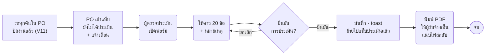

# ออกแบบ "ประเมินผู้รับจ้าง (อู่/ศูนย์บริการ)" ใน VMS+ — อ้างอิงจาก "ประเมินพนักงานขับรถ" ของ VMS+ เดิม

> ร่าง 22 ต.ค. 2569 · สถานะ: **รอเคาะ** (ดูหัวข้อ 9)
> เรื่องนี้ **คนละเรื่องกับ "ประเมินพนักงานขับรถ"** ที่มีอยู่แล้วใน VMS+ — ของเดิมผู้ใช้รถให้ดาวคนขับหลังคืนรถ ·
> ของใหม่ผู้ควบคุมงานของ กฟภ. ให้คะแนน **ผู้รับจ้าง (อู่/บริษัท) ต่อ 1 ใบสั่งจ้าง** หลังส่งมอบงานซ่อม/Overhaul ครบ
>
> ไฟล์ในโฟลเดอร์นี้
> | ไฟล์ | คืออะไร |
> |---|---|
> | `01-ออกแบบ-ประเมินผู้รับจ้าง-อู่-เทียบกับ-ประเมินพนักงานขับรถ-VMS+เดิม.md` | ไฟล์นี้ — แบบเดิมทำอะไร · แบบใหม่ยกอะไรมา · ต่างกันตรงไหน · หน้าจอ · ข้อมูล · คำถามค้าง |
> | `02-ข้อประเมินผู้รับจ้าง-6หมวด-20ข้อ.csv` | ข้อประเมินลอกจากแบบประเมินกระดาษ (ใช้เป็น master data) |
> | `../../design-mock/contractor-eval.html` | ต้นแบบหน้าจอ (รายการ 2 แท็บ · ฟอร์มประเมิน · ดูผลประเมิน) |

---

## 1. ที่มา

| แหล่ง | ได้อะไร |
|---|---|
| แบบประเมินผู้รับจ้าง (กระดาษ/Excel ที่ลูกค้าส่งมา) | หัวฟอร์ม 5 ช่อง · 6 หมวด 20 ข้อ · คะแนน 1–5 + หมายเหตุรายข้อ · รวมเต็ม 100 · ลงนาม 2 ฝ่าย |
| VMS+ เดิม (โค้ด `code-maintainD`) — เมนู **"ประเมินพนักงานขับรถ"** | แพทเทิร์นหน้าจอ/ข้อมูล/แจ้งเตือน (หัวข้อ 2) |
| `https://vmsplus-dev.pea.co.th/` | เปิดจากเครื่องนี้ไม่ได้ (ต้อง VPN/login) ⇒ อ่านจากซอร์สโค้ดของเว็บเดิมแทน ซึ่งเป็นโค้ดชุดเดียวกับที่ deploy |
| Userflow บำรุงรักษา S14 (`../01-บำรุงรักษาตามวาระ/14-บำรุงรักษา-userflow.md`) | บอร์ดมีขั้น "ประเมินความพึงพอใจ" ก่อนกดยอมรับผล · คำถามค้าง Q22 "ต้องทำทุกครั้ง? · แบบประเมินมีข้อ/สเกลอะไร" ⇒ แบบประเมินนี้ตอบ "ข้อ/สเกล" ได้แล้ว |

## 2. ของเดิม — "ประเมินพนักงานขับรถ" ใน VMS+ ทำงานยังไง

| ส่วน | ของเดิม | ไฟล์อ้างอิง (`code-maintainD/…`) |
|---|---|---|
| เมนู/หน้า | เมนูข้าง "ประเมินพนักงานขับรถ" → หน้า breadcrumb + หัวหน้า + แท็บ | `web/vms-plus-main-fe/app/driver-evaluation/page.tsx` |
| แท็บ | **ยังไม่ได้ประเมิน** (มีตัวเลขจำนวนเป็น badge) · **ประเมินแล้ว** | `components/tabs/driverEvaluationTabs.tsx` |
| ตาราง "ยังไม่ได้ประเมิน" | # · เลขที่คำขอ · พนักงานขับรถ (รูป+ชื่อ+ชื่อเล่น) · ทะเบียนรถ · วันที่คืนรถ · ปุ่ม **ประเมิน** (ไอคอน star) | 〃 |
| ตาราง "ประเมินแล้ว" | # · เลขที่คำขอ · พนักงานขับรถ · ทะเบียนรถ · วันที่ประเมิน · **คะแนนเฉลี่ย** (ดาว + ตัวเลข 2 ตำแหน่ง) | 〃 `ScoreStars` |
| มือถือ | ตารางเปลี่ยนเป็นการ์ด · ป้าย "รอประเมิน" · ปุ่มเต็มความกว้าง | 〃 |
| ไม่มีรายการ | Empty state รูป + "ไม่มีรายการที่ต้องประเมิน" + ปุ่มไปแท็บประวัติ | 〃 `ZeroRecord` |
| ฟอร์มประเมิน | **Modal กว้าง 500px** · หัว: รูป + "ให้คะแนนการบริการของผู้ขับขี่" + ชื่อ + เลขที่คำขอ · ข้อละ 1 แถว: **ไอคอน + หัวข้อ (ตัวหนา) + คำอธิบาย + ดาว 1–5** · ปุ่ม ยกเลิก / ยืนยัน | 〃 `EvaluationModal` + `components/rating.tsx` |
| ค่าเริ่มต้น | ทุกข้อ **ตั้งไว้ 5 ดาว** | 〃 |
| ยืนยัน | Modal ซ้อน "ยืนยันการประเมิน — คุณต้องการบันทึกคะแนนการประเมินสำหรับ <ชื่อ> ใช่หรือไม่?" | 〃 |
| สำเร็จ | แถบเขียว "ประเมินพนักงานขับรถสำเร็จ (<เลขที่คำขอ>)" หาย 4 วินาที | 〃 |
| ข้อคำถาม | ตาราง master `vms_mas_satisfaction_survey_questions` (uid · question_title · questions_description) — ไม่มีหมวด ไม่มีลำดับ | `api/vms-plus-main-be/models/mas_model.go` |
| คำตอบ | `vms_trn_satisfaction_survey_answers` — 1 แถวต่อ 1 ข้อ · score 1–5 · ผู้ประเมิน · วันที่ · driver_id | `models/driver_evaluation_model.go` |
| ใครเห็นรายการ | ผู้สร้างคำขอ หรือ ผู้ใช้รถ · คำขอสถานะ 60/70/71/80 · ยังไม่เคยตอบ | `handlers/driver_evaluation_handler.go` |
| API | `GET /api/driver-evaluation/pending` · `GET …/completed` · `POST …/submit` · `GET …/driver/{id}/summary` | `main.go` |
| แจ้งเตือน | Job เตือนวันละ 2 รอบ (09:00, 17:00) สำหรับรายการภายใน 7 วันที่ยังไม่ประเมิน | `funcs/job.go` `JobSendDailyEvaluationReminder` |
| รายงาน | Excel คะแนนบริการคนขับ + ประวัติคะแนน | `handlers/service_quality_report_handler.go` |

## 3. ของใหม่ — ยกอะไรจากของเดิมมาใช้ตรงๆ

| ยกมา | เหตุผล |
|---|---|
| เมนูแยก + 2 แท็บ **ยังไม่ได้ประเมิน / ประเมินแล้ว** + ตัวเลขค้างบนแท็บ | ผู้ใช้ VMS+ คุ้นแล้ว · เห็นงานค้างทันที |
| ให้คะแนนด้วย **ดาว 1–5** ตามคอมโพเนนต์ `Rating` ของไลบรารี | ไลบรารีมี (`Rating` 107:2628 · ดาวเต็มสี warning-600 `#F79009` · ว่าง gray-300 `#D0D5DD`) และเว็บเดิมใช้อยู่ |
| ข้อประเมินเก็บเป็น **master data** ไม่ฝังในโค้ด | ปรับข้อได้โดยไม่แก้โปรแกรม (เหมือน `vms_mas_satisfaction_survey_questions`) |
| คำตอบ 1 แถวต่อ 1 ข้อ · ผู้ประเมิน · วันที่ | โครงเดียวกับ `vms_trn_satisfaction_survey_answers` ทำรายงานแบบเดิมได้ |
| Modal ยืนยันก่อนบันทึก + toast สำเร็จพร้อมเลขอ้างอิง | ข้อความรูปแบบเดียวกัน |
| ตาราง "ประเมินแล้ว" แสดงคะแนนเป็นดาว + ตัวเลข | ดูภาพรวมเร็ว |
| แจ้งเตือนรายการที่ยังไม่ประเมิน | ใช้ job เดิมเป็นแม่แบบ |
| รายงาน Excel | ใช้แพทเทิร์น service-quality-report |

## 4. ของใหม่ — ต่างจากของเดิมตรงไหน (และทำไม)

| เรื่อง | ประเมินพนักงานขับรถ (เดิม) | **ประเมินผู้รับจ้าง (ใหม่)** | ทำไมต้องต่าง |
|---|---|---|---|
| ประเมินใคร | พนักงานขับรถ (คน) | ผู้รับจ้าง = อู่/บริษัท (นิติบุคคล) | — |
| ประเมินต่ออะไร | 1 คำขอใช้รถ | **1 ใบสั่งจ้าง (PO)** — แบบกระดาษมี "ใบสั่งจ้างเลขที่ / สัญญาเลขที่" | 1 PO = 1 อู่ หลายคัน · ประเมินทีเดียวหลังส่งมอบครบ |
| ใครประเมิน | ผู้ใช้รถ/ผู้ขอ | ผู้ตรวจประเมินของ กฟภ. (เสนอ: กบค. ผู้ดูแล PO) — **รอเคาะ Q1** | — |
| จำนวนข้อ | ~6 ข้อ เรียงเดี่ยว | **20 ข้อ ใน 6 หมวด** | ตามแบบกระดาษ |
| ไอคอน | ไอคอนต่อข้อ | **ไอคอนต่อหมวด** (หัวหมวด) ข้อย่อยไม่มีไอคอน | 20 ไอคอนไม่สื่อความหมาย · หมวดช่วยไล่อ่าน |
| คำอธิบายข้อ | มี title + description | ข้อความข้อเดียว (แบบกระดาษไม่มีคำอธิบายแยก) | — |
| หมายเหตุ | ไม่มี | **หมายเหตุรวมช่องเดียวท้ายฟอร์ม (ไม่บังคับ)** · ไม่มีหมายเหตุรายข้อ | เจ้าของงานสั่ง 22 ต.ค. 2569 _"แค่มี หมายเหตุ แค่ล่างสุดอย่างเดียว แต่ละข้อไม่ต้องให้เพิ่มหมายเหตุได้"_ (แบบกระดาษมีคอลัมน์หมายเหตุรายข้อ แต่ไม่เอา) |
| ค่าเริ่มต้น | 5 ดาวทุกข้อ | **ว่างทุกข้อ ต้องกดเองครบ 20 ข้อ** ปุ่มบันทึกจึงกดได้ — **รอเคาะ Q3** | เป็นเอกสารทางการ ค่าเริ่ม 5 ทำให้กดผ่านโดยไม่อ่าน |
| คะแนนรวม | ค่าเฉลี่ย (เช่น 4.67) | **ผลรวม เต็ม 100** (20 ข้อ × 5) + แสดงค่าเฉลี่ยเป็นดาวคู่กัน + คะแนนรายหมวด | แบบกระดาษกำหนด "คะแนนเต็ม 100" — 20×5 = 100 พอดี ไม่ต้องแปลงสเกล |
| รูปแบบฟอร์ม | Modal 500px | **หน้าเต็ม** (ยาว 20 ข้อ + หัวฟอร์ม + หมายเหตุ) · มือถือเป็นหน้าเลื่อน | Modal สั้นเกินกว่าจะใส่ 20 ข้อ |
| หัวฟอร์ม | รูป + ชื่อคนขับ | ผู้รับจ้าง · ที่อยู่ · ใบสั่งจ้างเลขที่ · สัญญาเลขที่ · วันที่ประเมิน (ระบบเติมให้จาก PO แก้ไม่ได้ ยกเว้นสัญญาเลขที่ถ้า PO ไม่มี) | ตามแบบกระดาษ |
| ลงนาม | ไม่มี | ผู้ตรวจประเมิน = ผู้ที่กดบันทึก (ชื่อ+วันที่อัตโนมัติ) · ผู้รับการประเมิน/ผู้รับจ้าง ไม่ใช่ผู้ใช้ระบบ ⇒ ~~พิมพ์ไปเซ็นแล้วแนบกลับ~~ **ไม่มีการแนบแบบที่ลงนาม** (เจ้าของงานสั่ง 22 ต.ค. 2569 _"กับส่วนที่ต้องอัพโหลด อนุมัติ ไม่มี"_ — ตอบ Q4) | ผู้รับจ้างไม่มีบัญชี VMS+ |
| ส่งออก | ไม่มี | ปุ่ม **พิมพ์แบบประเมิน (PDF)** หน้าตาเหมือนแบบกระดาษ | ใช้เข้าแฟ้ม/ส่งพัสดุ |
| แก้ไขหลังบันทึก | ทำไม่ได้ | ทำไม่ได้ (ดูอย่างเดียว) — **รอเคาะ Q5** | — |
| ผลต่อขั้นถัดไป | ไม่มี | (ถ้าบังคับ) ประเมินแล้วจึงกด "ยอมรับผล/ปิดงาน" ได้ — **Q2** | ตามบอร์ด S14 |

## 5. จุดที่วางในโฟลว์

- **Overhaul:** เงื่อนไขเข้าแท็บ "ยังไม่ได้ประเมิน" = ทุกคันใน PO สถานะ V11 ปิดงานแล้ว (ใช้สถานะใน `../01-บำรุงรักษาตามวาระ/12-overhaul-สถานะ.md`)
- **บำรุงรักษาตามวาระ (S14):** ใช้แบบประเมินชุดเดียวกัน ต่อใบสั่งจ้างของแผนนั้น ก่อนกด "ยอมรับผลการตรวจบำรุงรถ"
- จุดเข้า 3 ทาง: เมนู "ประเมินผู้รับจ้าง" · แจ้งเตือน · ปุ่ม "ประเมินผู้รับจ้าง" ในหน้ารายละเอียด PO (เมื่อเข้าเงื่อนไข)

## 6. หน้าจอ (ต้นแบบ `design-mock/contractor-eval.html`)

### 6.1 หน้ารายการ "ประเมินผู้รับจ้าง"
- แท็บ **ยังไม่ได้ประเมิน** (badge จำนวน) · **ประเมินแล้ว**
- คอลัมน์ "ยังไม่ได้ประเมิน": ใบสั่งจ้าง (PO) · ผู้รับจ้าง · งาน (ชื่อ PO + แผน) · จำนวนรถ · วันที่ปิดงานครบ · ปุ่ม **ประเมิน**
- คอลัมน์ "ประเมินแล้ว": ใบสั่งจ้าง (PO) · ผู้รับจ้าง · งาน · วันที่ประเมิน · ผู้ตรวจประเมิน · **คะแนน (เต็ม 100)** + ดาวเฉลี่ย · ปุ่ม **ดู**
- ค้นหา: เลข PO, ชื่อผู้รับจ้าง · ไม่มีรายการ → Empty state แบบเดิม

### 6.2 หน้าฟอร์ม "ประเมินผู้รับจ้าง"
1. หัวฟอร์ม (อ่านอย่างเดียว): ผู้รับจ้าง · ที่อยู่ · ใบสั่งจ้างเลขที่ · สัญญาเลขที่ · วันที่ประเมิน · ผู้ตรวจประเมิน
2. แถบอธิบายสเกล: 1 = ต้องปรับปรุงมาก · 2 = ต้องปรับปรุง · 3 = พอใช้ · 4 = ดี · 5 = ดีมาก — **ชื่อระดับรอเคาะ Q6** (แบบกระดาษเขียนแค่ "1 - 5")
3. 6 การ์ดหมวด: หัวหมวด (ไอคอน + ชื่อ + คะแนนหมวด x/เต็ม) · ข้อละแถว: เลขข้อ + ข้อความ + ดาว 1–5 (ไม่มีหมายเหตุรายข้อ)
4. หมายเหตุ/ข้อเสนอแนะเพิ่มเติม (ไม่บังคับ)
5. แถบสรุปติดล่างจอ: ตอบแล้ว x/20 · คะแนนรวม xx/100 · ปุ่ม ยกเลิก / บันทึกการประเมิน (กดได้เมื่อครบ 20 ข้อ)
6. Modal "ยืนยันการประเมิน" → toast **"ประเมินผู้รับจ้างสำเร็จ (<เลข PO>)"**
7. ออกจากหน้าตอนกรอกค้าง → Modal "ยืนยันการออก — ข้อมูลที่กรอกไว้จะไม่ถูกบันทึก" (ใช้แบบเดียวกับหน้างาน Overhaul)

### 6.3 หน้าดูผลประเมิน
- หัวฟอร์มเดิม + **สรุปคะแนน**: รวม xx/100 · ค่าเฉลี่ยดาว · ตารางคะแนนรายหมวด
- รายข้อแสดงคะแนนอ่านอย่างเดียว (ตาราง ข้อ · รายการ · คะแนน) · หมายเหตุรวมอยู่ในสรุปผล
- ปุ่ม **พิมพ์แบบประเมิน (PDF)** · ไม่มีส่วนแนบแบบที่ลงนาม (ตัด 22 ต.ค. 2569)

### 6.4 ปรับ style ตามหน้าจริง (22 ต.ค. 2569 ดึก · ปลั๊กอิน Figma `figma-export/contractor-eval-plugin/`)
อ่านจาก https://vmsplus-dev.pea.co.th/driver-evaluation (เจ้าของงานล็อกอินให้) — เจ้าของงานสั่ง _"เอาแค่ style มาเฉยๆ นะ เนื้อหายังใช้ตามเอกสาร"_
- รายการ: ไม่มีช่องค้นหา · แท็บ 2 แท็บ (แท็บแรกมีตัวเลข) · คอลัมน์แรก # · ท้ายแถว "ยังไม่ได้ประเมิน" = ไอคอนดาว (หน้าจริงเป็นปุ่มสีหลัก "★ ประเมิน" — ช่องตาราง component ไม่มีปุ่ม ⏳ รอเคาะ) · แท็บ "ประเมินแล้ว" คะแนนเป็นข้อความ "88 / 100 · เฉลี่ย 4.40" (หน้าจริงดาวเล็ก + ตัวเลข)
- ฟอร์ม: **คงหน้าเต็ม** (เจ้าของงานเลือก — หน้าจริงเป็น modal 500) · หัวหมวด = Featured icon สีหลัก + ชื่อหมวด · ข้อ = ข้อความตัวหนา แล้วดาว 5 ดวง**ใต้ข้อความ** (ตัด "เพิ่มหมายเหตุ" รายข้อออก 22 ต.ค. 2569 — หมายเหตุมีช่องเดียวท้ายฟอร์ม) · **ดาวเริ่มว่าง ต้องกดครบ 20 ข้อ** (เจ้าของงานเลือก — หน้าจริงเริ่ม 5 ดวง ⇒ ตอบ Q3 แล้ว)
- **บริบทคอลัมน์ = งานซ่อม/บำรุงรักษา/Overhaul ไม่ใช่การจองรถ** (เจ้าของงาน: _"คอลัมน์ตารางพวกคนขับรถ ให้เอาบริบทของงานบำรุงรักษา งานซ่อมมาทำ — ตัวอย่างที่ให้ไปดูเป็นการจองรถ บริบทจะไม่เหมือนกัน"_) ⇒ ประเมินผู้รับจ้างต่อ 1 ใบสั่งจ้างของ **งานซ่อม (ส่งอู่ · อ้างใบแจ้งซ่อม) · บำรุงรักษาตามวาระ (ว่าจ้าง · อ้างเลขงาน) · Overhaul (อ้างแผน)** · ตารางยังไม่ได้ประเมิน: # · ใบสั่งจ้าง · ประเภทงาน · ผู้รับจ้าง · เลขที่อ้างอิง · ทะเบียนรถ · วันที่ส่งมอบงาน · ดำเนินการ · ประเมินแล้ว: # · ใบสั่งจ้าง · ประเภทงาน · ผู้รับจ้าง · ทะเบียนรถ · วันที่ประเมิน · คะแนน · ดู · หัวฟอร์มเพิ่ม ประเภทงาน · เลขที่อ้างอิง · ทะเบียนรถ · วันที่ส่งมอบงาน (หัวข้อ 4–5 ที่เขียนว่า "ต่อ PO Overhaul" ⇒ ขยายเป็นทั้ง 3 งาน — จุดที่วางในโฟลว์งานซ่อม/บำรุงรักษายังไม่เคาะ)
- ต้นแบบ HTML `design-mock/contractor-eval.html` ยังเป็นแบบก่อนปรับ (ดาวขวาของข้อความ · มีช่องค้นหา)

## 7. ข้อความ (toast/modal) — ร่าง

| จุด | ข้อความ | ที่มา |
|---|---|---|
| บันทึกสำเร็จ | ประเมินผู้รับจ้างสำเร็จ (<เลข PO>) | รูปแบบเดียวกับ "ประเมินพนักงานขับรถสำเร็จ (<เลขที่คำขอ>)" |
| บันทึกไม่สำเร็จ | บันทึกการประเมินไม่สำเร็จ กรุณาลองใหม่อีกครั้ง | เสนอ |
| Modal ยืนยัน | ยืนยันการประเมิน — คุณต้องการบันทึกคะแนนการประเมินสำหรับ <ผู้รับจ้าง> (<เลข PO>) ใช่หรือไม่? | ของเดิม + เลข PO |
| ยังตอบไม่ครบ | กรุณาให้คะแนนให้ครบทุกข้อ (เหลือ x ข้อ) | เสนอ |

## 8. ข้อมูล (เสนอ — โครงตามตารางเดิม)

| ตาราง | คอลัมน์หลัก | เทียบของเดิม |
|---|---|---|
| `vms_mas_contractor_survey_group` | group_code · group_title · icon · sort_order | ใหม่ (เดิมไม่มีหมวด) |
| `vms_mas_contractor_survey_questions` | question_uid · group_code · sort_order · question_title · is_active | `vms_mas_satisfaction_survey_questions` + หมวด/ลำดับ |
| `vms_trn_contractor_survey` (หัวแบบประเมิน 1 แถวต่อ PO) | survey_uid · po_no · vendor_uid · contract_no · evaluator_emp_id · evaluated_at · total_score · remark | ใหม่ (เดิมเก็บแค่คำตอบ) |
| `vms_trn_contractor_survey_answers` | survey_uid · question_uid · score (1–5) | `vms_trn_satisfaction_survey_answers` (ไม่มีหมายเหตุรายข้อ) |

API (ตั้งชื่อตามของเดิม): `GET /api/contractor-evaluation/pending` · `GET …/completed` · `GET …/{survey_uid}` · `POST …/submit` · `GET …/{survey_uid}/pdf`

## 9. รอเคาะ (ถามลูกค้า)

| # | คำถาม | ข้อเสนอในต้นแบบ |
|---|---|---|
| Q1 | ใครเป็น "ผู้ตรวจประเมิน" — กบค. ผู้ดูแล PO / หน่วยงานเจ้าของรถ / กรรมการตรวจรับ · ถ้ามีหลายคนประเมิน 1 PO ได้หลายใบไหม | กบค. 1 ใบต่อ PO |
| Q2 | ต้องประเมินทุก PO ไหม (ตอบ Q22 ของบอร์ด) · ต้องประเมินก่อนปิดงาน/ยอมรับผลหรือไม่ | บังคับทุก PO แต่ไม่ล็อกการปิดงาน (ทำหลังปิดงานครบ) |
| Q3 | ค่าเริ่มต้นดาว ว่าง (ต้องกดเอง) หรือ 5 แบบเว็บเดิม | ✅ เคาะแล้ว 22 ต.ค. — ว่าง ต้องกดครบ 20 ข้อ |
| Q4 | ต้องมีลายเซ็นผู้รับจ้างในระบบไหม · พิมพ์ไปเซ็นแล้วแนบกลับพอไหม | ✅ เคาะ 22 ต.ค. 2569 — ไม่มีส่วนแนบ/อนุมัติ |
| Q5 | แก้ไข/ประเมินซ้ำหลังบันทึกได้ไหม | ไม่ได้ |
| Q6 | ชื่อระดับคะแนน 1–5 | ต้องปรับปรุงมาก · ต้องปรับปรุง · พอใช้ · ดี · ดีมาก |
| Q7 | มีเกณฑ์ผ่าน/ไม่ผ่าน หรือระดับผลประเมิน (เช่น ≥ 80 ดีมาก) และผลมีผลต่อการจ้างครั้งถัดไปไหม | ยังไม่แสดงเกณฑ์ |
| Q8 | ใช้กับงานไหนบ้าง — Overhaul · บำรุงรักษาตามวาระ · แจ้งซ่อมที่ส่งอู่ภายนอก | Overhaul + บำรุงรักษาตามวาระ |
| Q9 | "สัญญาเลขที่" มาจากไหน (PO ยังไม่มีช่องนี้) | เพิ่มช่องในฟอร์ม PO (ไม่บังคับ) |
| Q10 | แก้คำพิมพ์ในแบบกระดาษ "ลักษณงาน" → "ลักษณะงาน" · "ให้คำแนะการให้บริการ" → "ให้คำแนะนำการให้บริการ" ใช้ได้ไหม | แก้แล้วใน CSV |

## 10. ที่มาการออกแบบ (ตามกติกา CLAUDE.md)

- ไฟล์ Component: `Rating` (107:2628 — ดาว Fill=Full warning-600 / Empty gray-300) · Tabs (`.tabs/.tab-btn`) · Table (`.tbl`) · Badge (`.badge`) · Section header (`.sect`) · Content item (`.incident-summary`) · Alert (`.note`) · Modal Destructive centered / Modal Form · Notification (`.notif`) · Empty state (`.filter-empty`) · File upload (`.fu`)
- ไฟล์ UI Release#2: ไม่มีหน้าประเมิน (ค้น "ประเมิน"/"Rating" ได้ 0 หน้า) ⇒ แพทเทิร์นหน้าอิงหน้า Overhaul v2 (รายการแผน · รายละเอียด PO · หน้างาน) และอิงพฤติกรรมจากเว็บ VMS+ เดิม
- ดาวในต้นแบบประกอบจาก `.ms` star + Tailwind (`text-warning-600` / `text-gray-300`) ยังไม่ได้ทำเป็นคลาสกลาง `.rating` ใน `components.css` — ถ้าเคาะใช้ ให้ยกเข้า components.css ตามสเต็ปบังคับข้อ 5–7
