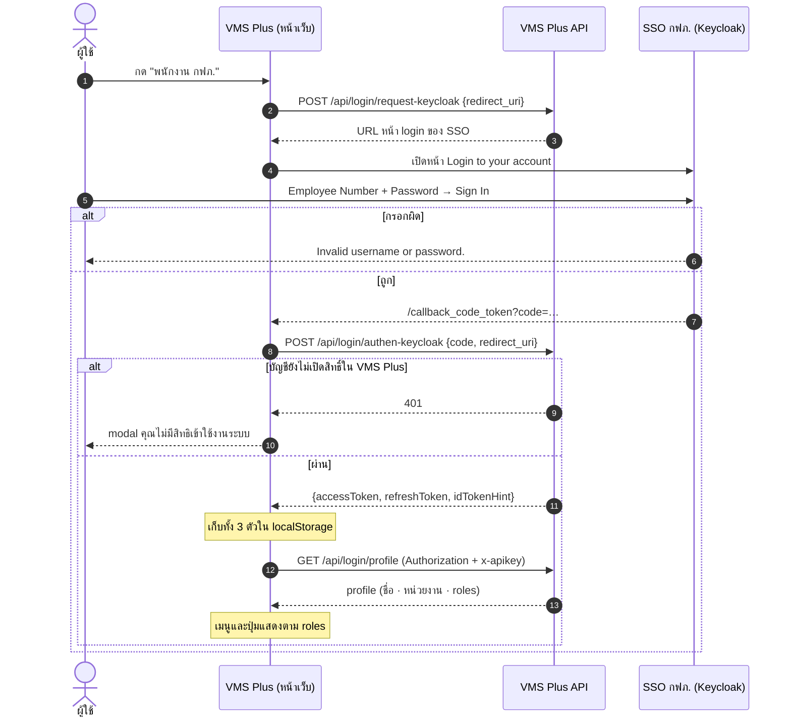

# Login ของ VMS Plus — ลำดับจริง + payload (30 ต.ค. 2569)

> **ที่มา:** ล็อกอินระบบจริง https://vmsplus-dev.pea.co.th (เปิด VPN · บัญชีทดสอบของ dev ที่เจ้าของงานให้) 30 ต.ค. 2569
> และโค้ด `code-maintainD/web/vms-plus-main-fe/services/authService.ts` · `api/vms-plus-main-be/models/login_model.go`
>
> - Maintain-D เป็นโมดูลใน VMS Plus **ไม่มีระบบ login ของตัวเอง** ใช้ login และ token ชุดเดียวกับ VMS Plus
> - payload จริงที่ตัดข้อมูลส่วนตัวแล้ว และภาพหน้าจริง เก็บนอกรีโป ที่ `~/PEA/Maintain-D/vmsplus-login/`
> - ข้อมูลจำลองรูปเดียวกันสำหรับทำต้นแบบ อยู่ที่ [`design-mock/auth/personas.json`](../../design-mock/auth/personas.json)
>   - สร้างด้วย `node design-mock/auth/build-personas.js`
>   - ตัวช่วยในหน้าเว็บ [`design-mock/auth/mock-login.js`](../../design-mock/auth/mock-login.js)

## 1. หน้าเข้าสู่ระบบ — 3 ทาง

| ทาง | ใครใช้ | หน้า | ช่อง / ปุ่ม |
|---|---|---|---|
| พนักงาน กฟภ. | พนักงานทุกคน (กบค. · กรย. · หน่วยงานเจ้าของรถ) | หน้าแรก VMS Plus → SSO กฟภ. `sso2.pea.co.th` (Keycloak realm `pea-users` · client `pea-VMS-Plus`) | Employee Number · Password · Remember me · Sign In · กรอกผิด "Invalid username or password." · "If you have trouble logging in, please contact PEA Service Desk or call 9960" |
| บุคคลภายนอก | พนักงานขับรถจ้างเหมา | `/login-os` "ลงชื่อเข้าใช้งาน สำหรับพนักงานขับรถ" | เบอร์โทรศัพท์ → ส่งรหัส OTP · หรือ ลงชื่อเข้าใช้งานผ่าน ThaID |
| ไม่มีสิทธิ์ | login ผ่าน แต่ VMS Plus ไม่รับ | modal บนหน้า login | "คุณไม่มีสิทธิเข้าใช้งานระบบ" · "กรุณาติดต่อผู้ดูแลหากต้องการเข้าใช้งาน" |

หน้าแรกมีหัว "ระบบจัดการยานพาหนะ VMS Plus" บรรทัดรอง "เรื่องเดินทางไม่ใช่ปัญหา ยืมรถสะดวก ง่าย เร็ว ทันใจ (Version 2.1.1)" ตามด้วย "เข้าสู่ระบบด้วยบัญชี" และการ์ด 2 ใบ พนักงาน กฟภ. · บุคคลภายนอก

## 2. ลำดับ API

ทางบุคคลภายนอก: `POST login/request-otp {phone}` → `POST login/verify-otp {otp, otpId}` · ThaID: `POST login/request-thaiid` → `/callback_code_token_thai` → `POST login/authen-thaiid` · ได้ token รูปเดียวกัน

## 3. ข้อมูลใน token และ profile — ใช้ตัดสินอะไร

**accessToken** (JWT HS256 · iss `vms-plus` · aud `vms-plus-client` · อายุ 10 ชม.) · refreshToken อายุ 60 วัน · idTokenHint = ID token ของ SSO (RS256)

| ฟิลด์ | ตัวอย่าง (จำลอง) | ใช้ตัดสิน |
|---|---|---|
| `roles[]` | `admin-super`, `admin-region`, `admin-department`, `vehicle-user` | **ทำอะไรได้** — เห็นเมนูไหน กดปุ่มไหนได้ |
| `dept_sap` · `bureau_dept_sap` | 8352 · 835 | **เห็นรถคันไหน** — หน่วยงานเจ้าของรถเห็นเฉพาะรถที่ `vehicle_owner_dept_sap` ตรงกับตัวเอง |
| `business_area` | L000 | **เห็นรถในเขต** — กรย. (`admin-region`) เห็นรถที่ business area ขึ้นต้นตัวอักษรเดียวกัน (`db-schema/map-06`) |
| `dept_sap_short` · `full_name` · `position` | ผบร. กฟฟ.สงขลา กฟต.3 | แสดงชื่อและหน่วยงานของผู้ใช้ · ชื่อผู้บันทึก |
| `emp_id` | 530862 | ผู้สร้าง / ผู้แก้ไข / ผู้ลงนาม |
| `level_code` · `is_employee` · `login_by` | 08 · true · keycloak | ระดับตำแหน่ง · พนักงานหรือบุคคลภายนอก |

`GET /api/login/profile` ให้ฟิลด์ชุดเดียวกัน (`posi_text` แทน `position`) เพิ่มข้อมูลใบอนุญาตขับรถประจำปี (`license_status*` · `annual_licenses[]`) และ `id_token_hint`

## 4. role ทั้งระบบ (ถอดจากโค้ด VMS Plus)

`vehicle-user` (ทุกคนได้อัตโนมัติ) · `driver` · `level1-approval` · `license-approval` · `approval-department` · `approval-carpool` · `admin-department` · `admin-department-main` · `admin-carpool` · `admin-super` · `admin-region` · `executive`

- role มาจาก 2 ทาง
  - Keycloak / UserHub: `admin-super`, `admin-region`, `driver`
  - ตารางใน VMS Plus: `vms_mas_department_admin`, `vms_mas_carpool_admin` และอื่น ๆ
- ระบบเป็น role-based ล้วน ยังไม่มีตาราง permission แยก
- สิทธิ์ของ Overhaul ตาม role อยู่ที่ [02-overhaul-สิทธิ์ตาม-role.md](02-overhaul-สิทธิ์ตาม-role.md)

## 5. ยังไม่รู้
1. role ใหม่ของ Maintain-D (เช่น กบค. แยกจาก `admin-super` ของหน่วยงานอื่น) จะกำหนดผ่าน UserHub/Keycloak หรือตารางใน VMS Plus
2. `admin-super` ของหน่วยงานอื่น (เช่น กกฟ.) ต้องแยกจาก กบค. ด้วย `dept_sap` ใช่ไหม หรือจะมี role เฉพาะ
3. executive และ driver ต้องเห็นงาน Overhaul ไหม (ชีต CF ยังเป็น ❓)
