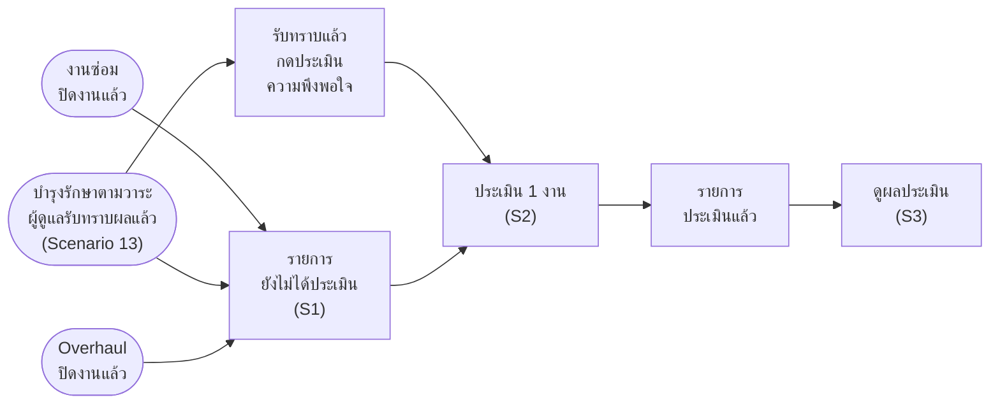

# แบบประเมินความพึงพอใจ (XCHO) — userflow 3 scenario

> **เรื่องแยก ตั้งแต่ 12 พ.ย. 2569** เจ้าของงาน: _"เรื่องการประเมินเป็นเรื่องแยกที่จะไปผูกตาม flow ต่างๆ เลยอยากแยกใว้"_
> เดิมอยู่ในบำรุงรักษาตามวาระเป็น Scenario 27 (11 พ.ย. 2569) ตอนนี้ย้ายออกมาเป็นเรื่องของตัวเอง งานซ่อม บำรุงรักษาตามวาระ และ Overhaul ผูกเข้ามาที่เรื่องนี้
>
> **ที่มา**
> - เนื้อหา: แบบสำรวจ "VMS+" ที่ กบค. ใช้อยู่ในระบบจัดการแบบฟอร์ม XCHO (หน่วยงานผู้สร้างแบบ ผซก.1 กบค. ฝบร. ผชก.(ป-บส) · 5 ขั้น · ไฟล์ VMS+ _ Xcho-1.pdf ถึง -5.pdf ที่เจ้าของงานส่ง 11 พ.ย. 2569)
> - โครงหน้าจอ: เฟรมประเมินผู้รับจ้าง บล็อก A B C ที่เจ้าของงานวาง 12 พ.ย. 2569 (ข้อความดิบนอกรีโป `~/PEA/Maintain-D/userflow/figma-ref/contractor-eval-ABC-2569-11-12.txt`) ใช้โครงจอ แต่เนื้อหาเป็นแบบสำรวจ XCHO
> - จอ Figma: ปลั๊กอิน `figma-export/satisfaction-plugin/` · กติกา component `figma-export/component-rules.md` หัวข้อ 5.43 (R105)
> - flowchart กิจกรรม: [02-ประเมินความพึงพอใจ-flowchart-กิจกรรม.md](02-ประเมินความพึงพอใจ-flowchart-กิจกรรม.md)
> - ต้นแบบเว็บ (12 พ.ย. 2569 รอบ 2): รีโป maintenance-utility-vehicle commit db7bf4a หน้า `/satisfaction/` `/satisfaction/form/` `/satisfaction/result/` · ข้อมูลจำลองและข้อความบนจอของ Figma ยึดตามเว็บ ข้อความสองฝั่งต้องเหมือนกันตรงตัว
>
> **ป้ายที่มา:** `[เจ้าของงาน]` = เจ้าของงานพูดหรือเคาะแล้ว · `[แบบสำรวจ]` = ลอกจากแบบสำรวจ XCHO · `[ประเมินผู้รับจ้าง]` = ใช้ตามที่เคาะกับหน้าประเมินผู้รับจ้างแล้ว · `[เสนอ]` = ผู้เขียนเติมให้หน้าจอเดินได้ ยังไม่เคาะ

## 0. ภาพรวม

| # | scenario | ผู้ทำ | บล็อกในปลั๊กอิน | จอต่ออุปกรณ์ |
|---|---|---|---|---|
| S1 | ผู้ดูแลยานพาหนะ ดูรายการประเมินความพึงพอใจ | ผู้ดูแลยานพาหนะ | A | 4 |
| S2 | ผู้ดูแลยานพาหนะ ประเมินความพึงพอใจการให้บริการ 1 งาน | ผู้ดูแลยานพาหนะ | B | 9 |
| S3 | ผู้ดูแลยานพาหนะ ดูผลประเมินความพึงพอใจ | ผู้ดูแลยานพาหนะ | C | 4 |

**งานไหนเข้ามาที่เรื่องนี้** — 1 แถว = 1 งานของยานพาหนะ 1 คัน `[เจ้าของงาน]`

| ประเภทงาน | เข้ารายการเมื่อ | หน่วยงานให้บริการ (ถูกประเมิน · ระบบเติมให้) | เลขที่งานที่แสดง |
|---|---|---|---|
| บำรุงรักษาตามวาระ | ผู้ดูแลยานพาหนะรับทราบผลของคันนั้นแล้ว (บำรุงรักษาตามวาระ Scenario 13) · คันที่บำรุงรักษาไม่ได้ไม่เข้า `[เสนอ]` | แผนที่ กบค. ดำเนินการ = กบค. · แผนของกองอื่น (กบผ. กปส. กรย. กส.1 กส.2) = กองที่ดำเนินการแผนนั้น `[เจ้าของงาน]` | เลขที่ MR |
| งานซ่อม | ยังไม่เคาะ (หลังปิดงานซ่อม หรือหลังหน่วยงานรับยานพาหนะคืน) | กบค. `[เจ้าของงาน]` | เลขที่ใบแจ้งซ่อม |
| Overhaul | ยังไม่เคาะ (หลังปิดงานรายคัน หรือหลังปิดงานทั้งใบสั่งจ้าง) | กบค. `[เจ้าของงาน]` | หมายเลขแผน |

## 1. ใคร ทำอะไรได้

| บทบาท | เห็นอะไร | ทำอะไรได้ |
|---|---|---|
| ผู้ดูแลยานพาหนะ (หน่วยงานเจ้าของยานพาหนะ) | งานของยานพาหนะที่ตนดูแล ทั้งที่ยังไม่ได้ประเมินและประเมินแล้ว | ประเมิน ดูผล `[เจ้าของงาน]` |
| กบค. | เฉพาะงานที่หน่วยงานที่ให้บริการเป็น กบค. (ต้นแบบเว็บ) | ดูอย่างเดียว ไม่มีไอคอนดาว ฟอร์มไม่มีปุ่มบันทึก `[เสนอ]` |
| บทบาทอื่น (กบผ. กปส. กรย. กส.1 กส.2 · ผู้อนุมัติ · ผู้รับจ้าง) | ทุกงาน (ต้นแบบเว็บ) | ดูอย่างเดียว ไม่มีปุ่มประเมิน `[เสนอ]` |

ทั้งสองแถวล่างตามตารางสิทธิ์ของต้นแบบเว็บ (PERMISSIONS.md หัวข้อแบบประเมินความพึงพอใจ) · ใครดูสรุปผลในระบบจริงยังไม่เคาะ · ปลั๊กอิน Figma มีจอมุมผู้ดูแลยานพาหนะอย่างเดียว

## 2. Scenario

### S1 · ผู้ดูแลยานพาหนะ ดูรายการประเมินความพึงพอใจ

**เข้าจาก:** เมนู "แบบประเมินความพึงพอใจ" ใน Sidebar (เมนูชั้นบนก่อน "รายงาน" ไม่อยู่ใต้งานซ่อมและบำรุงรักษา `[เจ้าของงาน]` · Badge จำนวนที่ยังไม่ได้ประเมิน) · **จบที่:** เลือกงานไปประเมิน (S2) หรือเปิดดูผล (S3)

| state | หน้าจอ | สิ่งที่เห็น |
|---|---|---|
| A.1 | แท็บยังไม่ได้ประเมิน | หัว "แบบประเมินความพึงพอใจ" · แท็บ "ยังไม่ได้ประเมิน" (ตัวเลข 4) · "ประเมินแล้ว" · ช่องค้นหา "ค้นหาเลขที่งาน, ทะเบียน" + ปุ่ม "ตัวกรอง" · ตาราง เลขที่งาน · ประเภทงาน (ป้ายสี) · ทะเบียน (บรรทัดรองเป็นประเภทยานพาหนะ) · งาน · หน่วยงานที่ให้บริการ · วันที่ปิดงาน · ดำเนินการ (ไอคอนดาว) · 4 แถว MRZ7100004 · MRZ7000001 · MTD-691003-014 · ORZ6900002 |
| A.2 | แท็บประเมินแล้ว | ตาราง เลขที่งาน · ประเภทงาน · ทะเบียน · หน่วยงานที่ให้บริการ · วันที่ประเมิน · ผู้ประเมิน · คะแนน (เต็ม 55) เช่น "47 / 55 · เฉลี่ย 4.27" · ไอคอนดูผล · 3 แถว MRZ7000001 82-1145 · MTD-690716-031 · MRZ6900011 |
| A.3 | ไม่มีรายการที่ต้องประเมิน | แท็บยังไม่ได้ประเมิน (ตัวเลข 0) · "ไม่มีรายการที่ต้องประเมิน" · "งานจะเข้ามาที่นี่เมื่อปิดงานแล้ว" · ปุ่ม "ดูรายการที่ประเมินแล้ว" · ไม่มีช่องค้นหา |
| A.4 | กดตัวกรอง แผงตัวกรอง | แผงขวา (มือถือเป็นแผ่นล่าง) "ตัวกรอง" · "กรองข้อมูลให้แสดงเฉพาะข้อมูลที่ต้องการ" · ประเภทงาน (ถ้ามี) · หน่วยงานที่ให้บริการ (ถ้ามี) เลือกได้หลายค่า ค่าเริ่ม "ทั้งหมด" · ล้างตัวกรอง · ยกเลิก · ตกลง |

**เงื่อนไข**
- ค้นหาจากเลขที่งาน ทะเบียน งาน และหน่วยงานที่ให้บริการ · ตัวกรอง ประเภทงาน และหน่วยงานที่ให้บริการ (หลายค่า) แสดงเป็นชิปใต้ช่องค้นหา · ค้นหาหรือกรองไม่เจอ = Empty state/Search not found + ปุ่มล้างตัวกรอง (ต้นแบบเว็บ · 12 พ.ย. 2569 แทน "ไม่มีช่องค้นหาและตัวกรอง" ของประเมินผู้รับจ้าง)
- ป้ายประเภทงาน: งานซ่อม สีฟ้า · บำรุงรักษาตามวาระ สีเขียว · Overhaul สีหลัก `[ประเมินผู้รับจ้าง]`
- เรียงวันที่ปิดงานใหม่สุดก่อน · แบ่งหน้าใต้ตาราง หน้าละ 10 "แสดง 1 ถึง n จาก n รายการ"

### S2 · ผู้ดูแลยานพาหนะ ประเมินความพึงพอใจการให้บริการ 1 งาน

**เข้าจาก:** ไอคอนดาวท้ายแถวในแท็บยังไม่ได้ประเมิน · ปุ่ม "ประเมินความพึงพอใจ" ในหน้าผลการบำรุงรักษาหลังผู้ดูแลยานพาหนะรับทราบแล้ว (บำรุงรักษาตามวาระ Scenario 13 จอ L.5 · ต้นแบบเว็บ 12 พ.ย. 2569 `[เสนอ]`) · **จบที่:** งานนั้นย้ายไปแท็บประเมินแล้ว

| state | หน้าจอ | สิ่งที่เห็น |
|---|---|---|
| B.1 | ฟอร์มประเมิน (ยังไม่ให้คะแนน) บำรุงรักษาตามวาระ หน่วยงานที่ให้บริการ กบผ. | หัว "แบบประเมินความพึงพอใจ MRZ7000001" ลิงก์ แบบประเมินความพึงพอใจ › MRZ7000001 · ข้อมูลงาน · ข้อมูลผู้ใช้รถฯ · แถบ "ให้คะแนนทุกข้อ 1 ถึง 5 ดาว" / "1 ต้องปรับปรุงมาก · 2 ต้องปรับปรุง · 3 พอใช้ · 4 ดี · 5 ดีมาก · คะแนนรวมเต็ม 55 (11 ข้อ × 5) · หมายเหตุไม่บังคับ" · 4 ด้าน 11 ข้อ ดาวว่าง ข้อละช่อง "หมายเหตุข้อ n" (ถ้ามี) · หมายเหตุ/ข้อเสนอแนะเพิ่มเติม · สรุปคะแนน · ปุ่มบันทึกการประเมินกดไม่ได้ |
| B.2 | ให้คะแนนบางข้อ + กรอกหมายเหตุท้ายฟอร์ม | 2 ด้านแรก 6 ข้อ · คะแนนรวม 26 / 55 · หมายเหตุ "ช่างมาตรงเวลา" · ปุ่มยังกดไม่ได้ |
| B.3 | ให้คะแนนครบ 11 ข้อ + หมายเหตุข้อ 8 | ค่าเดียวกับปุ่ม "กรอกข้อมูลตัวอย่าง" ของเว็บ · คะแนนรวม 46 / 55 · ค่าเฉลี่ย 4.18 จาก 5 · หมายเหตุข้อ 8 "รออะไหล่ไส้กรองไฮดรอลิก 2 วัน" · หมายเหตุท้ายฟอร์ม "ช่างมาตรงเวลา อธิบายงานที่ทำก่อนส่งคืนยานพาหนะ" · ปุ่มบันทึกการประเมินกดได้ |
| B.4 | ยืนยันการประเมิน | popup "ยืนยันการประเมิน" · "คุณต้องการบันทึกคะแนนการประเมินสำหรับ กบผ. (MRZ7000001) ใช่หรือไม่? คะแนนรวม 46 / 55 · บันทึกแล้วแก้ไขไม่ได้" · ยกเลิก / ยืนยัน |
| B.5 | บันทึกไม่สำเร็จ | toast "บันทึกการประเมินไม่สำเร็จ กรุณาลองใหม่อีกครั้ง" · ข้อมูลที่กรอกยังอยู่ |
| B.6 | บันทึกสำเร็จ ย้ายไปแท็บประเมินแล้ว | toast "ประเมินความพึงพอใจสำเร็จ (MRZ7000001)" · แท็บยังไม่ได้ประเมินเหลือ 3 · แท็บประเมินแล้ว 4 แถว (82-6789 ขอนแก่น 07/11/2569 46 / 55 · เฉลี่ย 4.18) |
| B.7 | ยกเลิกระหว่างกรอก ยืนยันการออก | popup "ยืนยันการออก" · "ข้อมูลที่กรอกไว้จะไม่ถูกบันทึก" · ปิด / ออก |
| B.8 | ฟอร์มประเมินงานซ่อม หน่วยงานที่ให้บริการ กบค. | "แบบประเมินความพึงพอใจ MTD-691003-014" · ข้อมูลงานเป็นช่องของงานซ่อม (82-1145 ขอนแก่น · RAM000245 · ระบบไฮดรอลิกกระเช้ารั่วซึม) |
| B.9 | ฟอร์มประเมิน Overhaul หน่วยงานที่ให้บริการ กบค. | "แบบประเมินความพึงพอใจ ORZ6900002" · ข้อมูลงานเป็นช่องของ Overhaul (72-6648 สงขลา · รถกระเช้า · PO-690201 · HINO FG1J) · ผู้ประเมิน นายอดิศักดิ์ ทองสุข (12 พ.ย. 2569 รอบ 2 ต่อท้าย) |

**ข้อมูลงาน (ระบบเติมให้ ช่องต่างกันตามประเภทงาน · ชุดเดียวกับ jobPairs ของเว็บ)**

| ประเภทงาน | ช่อง |
|---|---|
| บำรุงรักษาตามวาระ (มาจาก Scenario 13) | ประเภทงาน · เลขที่ MR · ทะเบียน · ประเภทยานพาหนะ · ชื่อแผน · แผนเดินทาง · ผู้ดำเนินการ · รับทราบผลเมื่อ · วันที่ปิดงาน · หน่วยงานที่ให้บริการ |
| บำรุงรักษาตามวาระ (งานที่มีอยู่ก่อน เช่น MRZ6900011 · MRZ7100004) | ประเภทงาน · เลขที่ MR · ทะเบียน · ประเภทยานพาหนะ · ชื่อแผน · ไตรมาส · ผู้ดำเนินการ · วันที่ปิดงาน · หน่วยงานที่ให้บริการ |
| งานซ่อม | ประเภทงาน · เลขที่ใบแจ้งซ่อม · ทะเบียน · ประเภทยานพาหนะ · หมายเลขงานซ่อม · อาการที่แจ้ง · วันที่ / เวลาที่ซ่อมเสร็จ · วันที่ปิดงาน · หน่วยงานที่ให้บริการ |
| Overhaul | ประเภทงาน · หมายเลขแผน · ทะเบียน · ประเภทยานพาหนะ · ชื่อแผน · ใบสั่งจ้างเลขที่ · ชื่อ Purchase Order · ยี่ห้อ/รุ่น · วันที่ปิดงาน · หน่วยงานที่ให้บริการ |

ฟอร์มต่อท้ายด้วย วันที่ประเมิน · ผู้ประเมิน · หน้าผลไม่มีสองช่องนี้ในกล่องข้อมูลงาน (อยู่ในสรุปผลการประเมิน)

**แบบสำรวจ `[แบบสำรวจ]`** (ข้อความตรงตัว ทุกข้อติดเครื่องหมายจำเป็นต้องตอบ)

| ส่วน | ข้อ |
|---|---|
| ข้อมูลผู้ใช้รถฯ (ระบบเติมให้) | ทะเบียนรถ · ชื่อผู้ตอบแบบสอบถาม · นามสกุลผู้ตอบแบบสอบถาม · ตำแหน่ง ผู้ตอบแบบสอบถาม · สังกัด |
| ด้านระบบการให้บริการ (เต็ม 10) | 1. ความรวดเร็วในการรับบริการ · 2. ความสะดวกในการติดต่อเพื่อขอรับบริการ |
| ด้านเจ้าหน้าที่และ/หรือผู้ให้บริการ (เต็ม 20) | 1. อัธยาศัยของผู้ให้บริการ · 2. ความรู้ของผู้ให้บริการ · 3. การให้ความรู้และคำแนะนำแก่ผู้รับบริการ · 4. ความตั้งใจในการดำเนินการให้ผู้รับบริการ |
| ด้านคุณภาพของสินค้าและ/หรือบริการ (เต็ม 15) | 1. คุณภาพของอะไหล่และการบริการ · 2. ระยะเวลาในการได้รับอะไหล่และการบริการ · 3. อุปกรณ์ เครื่องมือและเทคโนโลยีในการให้บริการ |
| ด้านสภาพแวดล้อมต่างๆ (เต็ม 10) | 1. การทำความสะอาดพื้นที่หลังการให้บริการ · 2. การทำความสะอาดเครื่องจักรกลหลังการให้บริการ |
| สเกล | "โดย 1 คือคะแนนแย่สุด และ 5 คือคะแนนดีสุด" · บนจอใช้ชื่อระดับ 1 ต้องปรับปรุงมาก · 2 ต้องปรับปรุง · 3 พอใช้ · 4 ดี · 5 ดีมาก (ข้อความที่เจ้าของงานกำหนดกับเฟรมประเมินผู้รับจ้าง 12 พ.ย. 2569) |

**เงื่อนไข**

| ส่วน | เงื่อนไข | ที่มา |
|---|---|---|
| ช่องคะแนน | ดาว 1 ถึง 5 ต่อข้อ เริ่มว่าง ไม่มีค่าเริ่มต้น | `[ประเมินผู้รับจ้าง]` |
| คะแนน | ด้านละเต็ม 10 · 20 · 15 · 10 · รวมเต็ม 55 ไม่แปลงเป็นร้อย · ค่าเฉลี่ยทศนิยม 2 ตำแหน่ง · ผลระดับแสดง "รอเคาะเกณฑ์" | `[เสนอ]` |
| หมายเหตุ | ข้อละช่อง "หมายเหตุข้อ n" (ถ้ามี) ใต้ดาว + ช่อง "หมายเหตุ/ข้อเสนอแนะเพิ่มเติม" ท้ายฟอร์ม · ไม่บังคับทั้งหมด | เฟรม B ของเจ้าของงาน 12 พ.ย. 2569 ("แต่ละข้อ = Rating ดาว + หมายเหตุข้อ n (ถ้ามี)") · ต้นแบบเว็บ |
| บันทึก | กดได้เมื่อครบ 11 ข้อ · popup ยืนยัน · บันทึกแล้วแก้ไม่ได้ · ไม่สำเร็จข้อมูลยังอยู่ | `[ประเมินผู้รับจ้าง]` |
| ออกกลางทาง | กรอกแล้วกดยกเลิกหรือย้อนกลับ = popup ยืนยันการออก · ยังไม่กรอก = ออกทันที | `[ประเมินผู้รับจ้าง]` |
| บันทึกสำเร็จ | กลับหน้ารายการ แท็บประเมินแล้ว · toast ขวาบน | ต้นแบบเว็บ |
| หน่วยงานให้บริการ | ระบบเติมจากผู้ดำเนินการงาน แก้ไม่ได้ · ฟอร์มเดียวกันทุกหน่วยงาน | `[เจ้าของงาน]` |

### S3 · ผู้ดูแลยานพาหนะ ดูผลประเมินความพึงพอใจ

**เข้าจาก:** ไอคอนดูผลในแท็บประเมินแล้ว · **จบที่:** ย้อนกลับไปหน้ารายการ

| state | หน้าจอ | สิ่งที่เห็น |
|---|---|---|
| C.1 | ผลประเมิน บำรุงรักษาตามวาระ หน่วยงานที่ให้บริการ กบผ. | หัว "แบบประเมินความพึงพอใจ MRZ7000001" ป้าย "ประเมินแล้ว" · 82-1145 ขอนแก่น · ข้อมูลงาน · ข้อมูลผู้ใช้รถฯ · สรุปผลการประเมิน (คะแนนรวม 47 / 55 · ค่าเฉลี่ย 4.27 จาก 5 · ผู้ประเมิน · วันที่ประเมิน 06/11/2569 14:20 น. · คะแนนรายด้าน "8 / 10" · หมายเหตุ/ข้อเสนอแนะเพิ่มเติม) · ตารางต่อด้าน ข้อ · รายการประเมิน · คะแนน "4 · ดี" · หมายเหตุ ("-" เมื่อไม่มี) · ปุ่มย้อนกลับ |
| C.2 | ผลประเมิน บำรุงรักษาตามวาระ หน่วยงานที่ให้บริการ กรย. | MRZ6900011 · 80-4458 แพร่ · 48 / 55 · ผู้ประเมิน นายพิชิต ปัญญาดี · หมายเหตุ "-" |
| C.3 | ผลประเมิน งานซ่อม หน่วยงานที่ให้บริการ กบค. | MTD-690716-031 · 82-6789 ขอนแก่น · 45 / 55 |
| C.4 | ผลประเมินที่เพิ่งบันทึก มีหมายเหตุรายข้อ | MRZ7000001 · 82-6789 ขอนแก่น · 46 / 55 · ข้อ 2 ของด้านคุณภาพ "3 · พอใช้" หมายเหตุ "รออะไหล่ไส้กรองไฮดรอลิก 2 วัน" (12 พ.ย. 2569 รอบ 2 ต่อท้าย) |

**เงื่อนไข** — ดูอย่างเดียว · ไม่มีปุ่มพิมพ์แบบประเมิน (PDF) และไม่มีส่วนแนบแบบที่ลงนาม (ตอบออนไลน์ ไม่มีผู้ลงนามฝั่งผู้ให้บริการ) `[เสนอ]`

## 3. คำที่ใช้บนจอ (ตรงตัวกับต้นแบบเว็บ)

- ข้อความของเราใช้ "ยานพาหนะ" ไม่ใช้ "รถ" (กติกาเดียวกับบำรุงรักษา R80)
- "ข้อมูลผู้ใช้รถฯ" และ "ทะเบียนรถ" เป็นข้อความที่ลอกจากแบบสำรวจตรงตัว คงไว้ (เปลี่ยนไหมอยู่ในยังไม่เคาะ) · "รถกระเช้า" เป็นประเภทยานพาหนะและชื่อแผนจากข้อมูล Overhaul ไม่แก้
- ชื่อเมนูและหัวหน้ารายการ "แบบประเมินความพึงพอใจ" · หัวฟอร์มและหน้าผล "แบบประเมินความพึงพอใจ {เลขที่งาน}" · แท็บ "ยังไม่ได้ประเมิน" "ประเมินแล้ว" · ช่องค้นหา "ค้นหาเลขที่งาน, ทะเบียน" · ตัวกรอง "ประเภทงาน" "หน่วยงานที่ให้บริการ"
- ปุ่ม "บันทึกการประเมิน" "ยกเลิก" "ย้อนกลับ" "ดูรายการที่ประเมินแล้ว" · ป้าย "ประเมินแล้ว" · คะแนนในหน้าผล "5 · ดีมาก"
- popup "ยืนยันการประเมิน" / "คุณต้องการบันทึกคะแนนการประเมินสำหรับ {หน่วยงานที่ให้บริการ} ({เลขที่งาน}) ใช่หรือไม่? คะแนนรวม {x} / 55 · บันทึกแล้วแก้ไขไม่ได้" · "ยืนยันการออก" / "ข้อมูลที่กรอกไว้จะไม่ถูกบันทึก" ปิด / ออก
- toast สำเร็จ "ประเมินความพึงพอใจสำเร็จ ({เลขที่งาน})" · ไม่สำเร็จ "บันทึกการประเมินไม่สำเร็จ กรุณาลองใหม่อีกครั้ง"

## 4. ข้อมูลจำลอง (ชุดเดียวกับต้นแบบเว็บ ?sample=S27)

| งาน | ยานพาหนะ | หน่วยงานที่ให้บริการ | สถานะในตัวอย่าง | อ้างจาก |
|---|---|---|---|---|
| บำรุงรักษาตามวาระ MRZ7100004 แผนของ กบค. ไตรมาส 1 | 73-5019 เพชรบุรี กระเช้าแก้ไฟ | กบค. | ยังไม่ได้ประเมิน (ปิดงาน 05/11/2569) | เว็บ seed (PLAN_UNIT กบค.) ผู้ดูแล นายธนกร ศรีสมุทร |
| บำรุงรักษาตามวาระ MRZ7000001 แผนเดินทาง ตรวจยานพาหนะ ขอนแก่น อุดรธานี ลำปาง | 82-6789 ขอนแก่น กระเช้าแก้ไฟ | กบผ. | ยังไม่ได้ประเมิน → ประเมิน 46 / 55 | ปลั๊กอินบำรุงรักษา Scenario 13 (ผู้ดำเนินการ นายวิชัย ทองดี) |
| งานซ่อม MTD-691003-014 | 82-1145 ขอนแก่น กระเช้าฮอทไลน์ | กบค. | ยังไม่ได้ประเมิน (ซ่อมเสร็จ 15/10/2569) | ปลั๊กอินประเมินผู้รับจ้าง RAM000245 |
| Overhaul ORZ6900002 ใบสั่งจ้าง PO-690201 | 72-6648 สงขลา รถกระเช้า HINO FG1J | กบค. | ยังไม่ได้ประเมิน (ปิดงาน 05/10/2569) | ปลั๊กอินประเมินผู้รับจ้าง REC.oh · ผู้ดูแล นายอดิศักดิ์ ทองสุข |
| บำรุงรักษาตามวาระ MRZ7000001 | 82-1145 ขอนแก่น กระเช้าฮอทไลน์ | กบผ. | ประเมินแล้ว 47 / 55 (06/11/2569) | ปลั๊กอินบำรุงรักษา Scenario 13 |
| งานซ่อม MTD-690716-031 | 82-6789 ขอนแก่น กระเช้าแก้ไฟ | กบค. | ประเมินแล้ว 45 / 55 (27/09/2569) | ใบแจ้งซ่อม Maintain-D RAM000198 |
| บำรุงรักษาตามวาระ MRZ6900011 | 80-4458 แพร่ กระเช้าฮอทไลน์ | กรย. | ประเมินแล้ว 48 / 55 (03/10/2568) | ปลั๊กอินบำรุงรักษา S24 ผู้ดูแล นายพิชิต ปัญญาดี |

ผู้ประเมินส่วนใหญ่คือผู้ดูแลยานพาหนะ นายสมชาย แก้วมณี ตำแหน่ง ชก.7 สังกัด กฟฉ.1 ขอนแก่น · ตำแหน่ง ชก.7 เป็นค่าสมมติของทุกคน

## 5. ยังไม่เคาะ

- เกณฑ์ผลระดับ (ตอนนี้แสดง "รอเคาะเกณฑ์") และต้องแสดงเป็นร้อยไหม
- ใครดูสรุปผล: กบค. และกองที่ดำเนินการแผนเห็นผลที่ตัวเองถูกประเมินไหม ผู้บริหารเห็นภาพรวมไหม ดูที่หน้าไหน
- ส่งผลเข้าระบบ XCHO ไหม และงานเลขที่ในแบบสำรวจเดิม (ตัวอย่าง 9/D 2705/69) ใช้เลขอะไรของแต่ละงาน
- ผูกกับงานซ่อมตอนไหน (หลังปิดงานซ่อม หรือหลังหน่วยงานรับยานพาหนะคืน) และผูกกับ Overhaul ตอนไหน (รายคันหรือทั้งใบสั่งจ้าง)
- ฟอร์มหน้าเดียว (ตอนนี้) หรือแบ่งขั้นตามแบบสำรวจเดิม 5 ขั้น
- ข้อมูลผู้ใช้รถฯ ให้แก้ได้ไหม · ตำแหน่งของผู้ดูแลยานพาหนะมาจากข้อมูลส่วนไหน
- หมายเหตุควรมีไหม (แบบสำรวจเดิมไม่มี)
- ต้องประเมินภายในกี่วัน มีเตือนไหม · ไม่ประเมินแล้วเป็นอย่างไร
- คันที่บำรุงรักษาไม่ได้ต้องประเมินไหม (บำรุงรักษา Q59 · ตอนนี้ไม่เข้ารายการ)
- "ทะเบียนรถ" "ข้อมูลผู้ใช้รถฯ" คงคำตามแบบสำรวจ หรือเปลี่ยนเป็นยานพาหนะ
- ทางเข้าจากบำรุงรักษา Scenario 13 (ปุ่มประเมินความพึงพอใจหลังรับทราบ) ต้นแบบเว็บเสนอ ยังไม่เคาะ · ผูกกับงานซ่อมและ Overhaul ยังไม่มีทางเข้าจากหน้าของ flow นั้น
