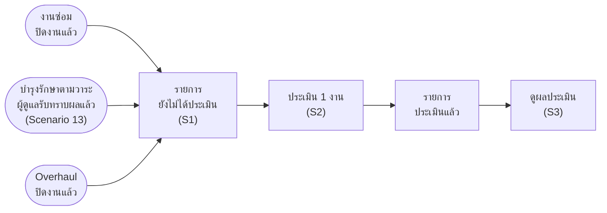

# แบบประเมินความพึงพอใจ (XCHO) — userflow 3 scenario

> **เรื่องแยก ตั้งแต่ 12 พ.ย. 2569** เจ้าของงาน: _"เรื่องการประเมินเป็นเรื่องแยกที่จะไปผูกตาม flow ต่างๆ เลยอยากแยกใว้"_
> เดิมอยู่ในบำรุงรักษาตามวาระเป็น Scenario 27 (11 พ.ย. 2569) ตอนนี้ย้ายออกมาเป็นเรื่องของตัวเอง งานซ่อม บำรุงรักษาตามวาระ และ Overhaul ผูกเข้ามาที่เรื่องนี้
>
> **ที่มา**
> - เนื้อหา: แบบสำรวจ "VMS+" ที่ กบค. ใช้อยู่ในระบบจัดการแบบฟอร์ม XCHO (หน่วยงานผู้สร้างแบบ ผซก.1 กบค. ฝบร. ผชก.(ป-บส) · 5 ขั้น · ไฟล์ VMS+ _ Xcho-1.pdf ถึง -5.pdf ที่เจ้าของงานส่ง 11 พ.ย. 2569)
> - โครงหน้าจอ: เฟรมประเมินผู้รับจ้าง บล็อก A B C ที่เจ้าของงานวาง 12 พ.ย. 2569 (ข้อความดิบนอกรีโป `~/PEA/Maintain-D/userflow/figma-ref/contractor-eval-ABC-2569-11-12.txt`) ใช้โครงจอ แต่เนื้อหาเป็นแบบสำรวจ XCHO
> - จอ Figma: ปลั๊กอิน `figma-export/satisfaction-plugin/` · กติกา component `figma-export/component-rules.md` หัวข้อ 5.43 (R105)
> - flowchart กิจกรรม: [02-ประเมินความพึงพอใจ-flowchart-กิจกรรม.md](02-ประเมินความพึงพอใจ-flowchart-กิจกรรม.md)
>
> **ป้ายที่มา:** `[เจ้าของงาน]` = เจ้าของงานพูดหรือเคาะแล้ว · `[แบบสำรวจ]` = ลอกจากแบบสำรวจ XCHO · `[ประเมินผู้รับจ้าง]` = ใช้ตามที่เคาะกับหน้าประเมินผู้รับจ้างแล้ว · `[เสนอ]` = ผู้เขียนเติมให้หน้าจอเดินได้ ยังไม่เคาะ

## 0. ภาพรวม

| # | scenario | ผู้ทำ | บล็อกในปลั๊กอิน | จอต่ออุปกรณ์ |
|---|---|---|---|---|
| S1 | ผู้ดูแลยานพาหนะ ดูรายการประเมินความพึงพอใจ | ผู้ดูแลยานพาหนะ | A | 3 |
| S2 | ผู้ดูแลยานพาหนะ ประเมินความพึงพอใจการให้บริการ 1 งาน | ผู้ดูแลยานพาหนะ | B | 8 |
| S3 | ผู้ดูแลยานพาหนะ ดูผลประเมินความพึงพอใจ | ผู้ดูแลยานพาหนะ | C | 3 |

**งานไหนเข้ามาที่เรื่องนี้** — 1 แถว = 1 งานของยานพาหนะ 1 คัน `[เจ้าของงาน]`

| ประเภทงาน | เข้ารายการเมื่อ | หน่วยงานให้บริการ (ถูกประเมิน · ระบบเติมให้) | เลขที่งานที่แสดง |
|---|---|---|---|
| บำรุงรักษาตามวาระ | ผู้ดูแลยานพาหนะรับทราบผลของคันนั้นแล้ว (บำรุงรักษาตามวาระ Scenario 13) · คันที่บำรุงรักษาไม่ได้ไม่เข้า `[เสนอ]` | แผนที่ กบค. ดำเนินการ = กบค. · แผนของกองอื่น (กบผ. กปส. กรย. กส.1 กส.2) = กองที่ดำเนินการแผนนั้น `[เจ้าของงาน]` | เลขที่ MR |
| งานซ่อม | ยังไม่เคาะ (หลังปิดงานซ่อม หรือหลังหน่วยงานรับยานพาหนะคืน) | กบค. `[เจ้าของงาน]` | เลขที่ใบแจ้งซ่อม |
| Overhaul | ยังไม่เคาะ (หลังปิดงานรายคัน หรือหลังปิดงานทั้งใบสั่งจ้าง) | กบค. `[เจ้าของงาน]` | หมายเลขแผน |

## 1. ใคร ทำอะไรได้

| บทบาท | เห็นอะไร | ทำอะไรได้ |
|---|---|---|
| ผู้ดูแลยานพาหนะ (หน่วยงานเจ้าของยานพาหนะ) | งานของยานพาหนะที่ตนดูแล ทั้งที่ยังไม่ได้ประเมินและประเมินแล้ว | ประเมิน ดูผล `[เจ้าของงาน]` |
| หน่วยงานให้บริการ (กบค. และกองที่ดำเนินการแผน) | ยังไม่เคาะ | ยังไม่เคาะ (ใครดูสรุปผล) |
| บทบาทอื่น | ยังไม่เคาะ | ไม่มีปุ่มประเมิน `[เสนอ]` |

## 2. Scenario

### S1 · ผู้ดูแลยานพาหนะ ดูรายการประเมินความพึงพอใจ

**เข้าจาก:** เมนู "ประเมินความพึงพอใจ" (เมนูแยก ไม่อยู่ใต้บำรุงรักษา `[เจ้าของงาน]`) · **จบที่:** เลือกงานไปประเมิน (S2) หรือเปิดดูผล (S3)

| state | หน้าจอ | สิ่งที่เห็น |
|---|---|---|
| A.1 | แท็บยังไม่ได้ประเมิน | ตาราง # · ประเภทงาน (ป้ายสี) · เลขที่งาน · ทะเบียน (บรรทัดรองเป็นยี่ห้อ/รุ่น) · หน่วยงานให้บริการ · วันที่ปิดงาน · ไอคอนดาวท้ายแถว · แท็บมีตัวเลขจำนวนที่ยังไม่ได้ประเมิน |
| A.2 | แท็บประเมินแล้ว | ตาราง # · ประเภทงาน · เลขที่งาน · ทะเบียน · หน่วยงานให้บริการ · วันที่ประเมิน · คะแนน (เต็ม 55) เช่น "47 / 55 · เฉลี่ย 4.27" · ไอคอนดูผล |
| A.3 | ไม่มีรายการที่ต้องประเมิน | "ไม่มีรายการที่ต้องประเมิน" · "งานซ่อม บำรุงรักษาตามวาระ และ Overhaul ของยานพาหนะที่ท่านดูแลจะเข้ามาที่นี่เมื่อปิดงานแล้ว" · ปุ่ม "ดูรายการที่ประเมินแล้ว" |

**เงื่อนไข**
- ไม่มีช่องค้นหาและตัวกรอง `[ประเมินผู้รับจ้าง]` (หน้าประเมินผู้รับจ้างเคาะ 22 ต.ค. 2569 ตามหน้าประเมินพนักงานขับรถของ VMS+ เดิม)
- ป้ายประเภทงาน: งานซ่อม สีฟ้า · บำรุงรักษาตามวาระ สีเขียว · Overhaul สีหลัก `[ประเมินผู้รับจ้าง]`
- แบ่งหน้าใต้ตาราง "แสดง 1 ถึง n จาก n รายการ"

### S2 · ผู้ดูแลยานพาหนะ ประเมินความพึงพอใจการให้บริการ 1 งาน

**เข้าจาก:** ไอคอนดาวท้ายแถวในแท็บยังไม่ได้ประเมิน · **จบที่:** งานนั้นย้ายไปแท็บประเมินแล้ว

| state | หน้าจอ | สิ่งที่เห็น |
|---|---|---|
| B.1 | ฟอร์มประเมิน (ยังไม่ให้คะแนน) งานบำรุงรักษาตามวาระ หน่วยงานให้บริการ กบผ. | หัว "ประเมินความพึงพอใจ MRZ7000001 · 82-6789 ขอนแก่น" · ข้อมูลงาน · ข้อมูลผู้ใช้รถฯ · แถบ "ให้คะแนนการให้บริการของ กบผ. ทุกข้อ 1 ถึง 5 ดาว" · 4 ด้าน 11 ข้อ ดาวว่าง · ปุ่มบันทึกการประเมินกดไม่ได้ |
| B.2 | ให้คะแนนบางข้อ + กรอกหมายเหตุท้ายฟอร์ม | 2 ด้านแรก 6 ข้อ · คะแนนรวม 26 / 55 · หมายเหตุ "ช่างมาตรงเวลา" · ปุ่มยังกดไม่ได้ |
| B.3 | ให้คะแนนครบ 11 ข้อ | คะแนนรวม 46 / 55 · ค่าเฉลี่ย 4.18 จาก 5 · ปุ่มบันทึกการประเมินกดได้ |
| B.4 | ยืนยันการประเมิน | popup "ยืนยันการประเมิน" · "คุณต้องการบันทึกการประเมินความพึงพอใจการให้บริการของ กบผ. (MRZ7000001 · 82-6789 ขอนแก่น) ใช่หรือไม่? คะแนนรวม 46 / 55 · บันทึกแล้วแก้ไขไม่ได้" · ยกเลิก / ยืนยัน |
| B.5 | บันทึกไม่สำเร็จ | toast "บันทึกการประเมินไม่สำเร็จ กรุณาลองใหม่อีกครั้ง" · ข้อมูลที่กรอกยังอยู่ |
| B.6 | บันทึกสำเร็จ ย้ายไปแท็บประเมินแล้ว | toast "ประเมินความพึงพอใจสำเร็จ (MRZ7000001 · 82-6789 ขอนแก่น)" · แท็บยังไม่ได้ประเมินเหลือ 1 |
| B.7 | ยกเลิกระหว่างกรอก ยืนยันการออก | popup "ยืนยันการออก" · "ข้อมูลที่กรอกไว้จะไม่ถูกบันทึก" · ปิด / ออก |
| B.8 | ฟอร์มประเมินงานซ่อม หน่วยงานให้บริการ กบค. | ฟอร์มเดียวกัน ข้อมูลงานเป็นช่องของงานซ่อม · แถบ "ให้คะแนนการให้บริการของ กบค. …" |

**ข้อมูลงาน (ระบบเติมให้ ช่องต่างกันตามประเภทงาน)**

| ประเภทงาน | ช่อง |
|---|---|
| บำรุงรักษาตามวาระ | ประเภทงาน · เลขที่ MR · ชื่อแผน · แผนเดินทาง · ทะเบียน · ยี่ห้อ/รุ่น · หน่วยงานให้บริการ · ผู้ดำเนินการ · วันดำเนินการ · รับทราบเมื่อ |
| งานซ่อม | ประเภทงาน · เลขที่ใบแจ้งซ่อม · หมายเลขงานซ่อม · ทะเบียน · ยี่ห้อ/รุ่น · หน่วยงานให้บริการ · ผู้รับจ้าง · วันที่ / เวลาที่ซ่อมเสร็จ |
| Overhaul | ประเภทงาน · หมายเลขแผน · ใบสั่งจ้างเลขที่ · ทะเบียน · ยี่ห้อ/รุ่น · หน่วยงานให้บริการ · ผู้รับจ้าง · วันที่ปิดงาน |

**แบบสำรวจ `[แบบสำรวจ]`** (ข้อความตรงตัว ทุกข้อติดเครื่องหมายจำเป็นต้องตอบ)

| ส่วน | ข้อ |
|---|---|
| ข้อมูลผู้ใช้รถฯ (ระบบเติมให้) | ทะเบียนรถ · ชื่อผู้ตอบแบบสอบถาม · นามสกุลผู้ตอบแบบสอบถาม · ตำแหน่ง ผู้ตอบแบบสอบถาม · สังกัด |
| ด้านระบบการให้บริการ (เต็ม 10) | 1. ความรวดเร็วในการรับบริการ · 2. ความสะดวกในการติดต่อเพื่อขอรับบริการ |
| ด้านเจ้าหน้าที่และ/หรือผู้ให้บริการ (เต็ม 20) | 1. อัธยาศัยของผู้ให้บริการ · 2. ความรู้ของผู้ให้บริการ · 3. การให้ความรู้และคำแนะนำแก่ผู้รับบริการ · 4. ความตั้งใจในการดำเนินการให้ผู้รับบริการ |
| ด้านคุณภาพของสินค้าและ/หรือบริการ (เต็ม 15) | 1. คุณภาพของอะไหล่และการบริการ · 2. ระยะเวลาในการได้รับอะไหล่และการบริการ · 3. อุปกรณ์ เครื่องมือและเทคโนโลยีในการให้บริการ |
| ด้านสภาพแวดล้อมต่างๆ (เต็ม 10) | 1. การทำความสะอาดพื้นที่หลังการให้บริการ · 2. การทำความสะอาดเครื่องจักรกลหลังการให้บริการ |
| สเกล | "โดย 1 คือคะแนนแย่สุด และ 5 คือคะแนนดีสุด" |

**เงื่อนไข**

| ส่วน | เงื่อนไข | ที่มา |
|---|---|---|
| ช่องคะแนน | ดาว 1 ถึง 5 ต่อข้อ เริ่มว่าง ไม่มีค่าเริ่มต้น | `[ประเมินผู้รับจ้าง]` |
| คะแนน | ด้านละเต็ม 10 · 20 · 15 · 10 · รวมเต็ม 55 ไม่แปลงเป็นร้อย · ค่าเฉลี่ยทศนิยม 2 ตำแหน่ง · ผลระดับแสดง "รอเคาะเกณฑ์" | `[เสนอ]` |
| หมายเหตุ | ช่องเดียวท้ายฟอร์ม ไม่บังคับ · ไม่มีหมายเหตุรายข้อ (แบบสำรวจเดิมไม่มีหมายเหตุ) | `[ประเมินผู้รับจ้าง]` |
| บันทึก | กดได้เมื่อครบ 11 ข้อ · popup ยืนยัน · บันทึกแล้วแก้ไม่ได้ · ไม่สำเร็จข้อมูลยังอยู่ | `[ประเมินผู้รับจ้าง]` |
| ออกกลางทาง | กรอกแล้วกดยกเลิกหรือย้อนกลับ = popup ยืนยันการออก · ยังไม่กรอก = ออกทันที | `[ประเมินผู้รับจ้าง]` |
| หน่วยงานให้บริการ | ระบบเติมจากผู้ดำเนินการงาน แก้ไม่ได้ · ฟอร์มเดียวกันทุกหน่วยงาน | `[เจ้าของงาน]` |

### S3 · ผู้ดูแลยานพาหนะ ดูผลประเมินความพึงพอใจ

**เข้าจาก:** ไอคอนดูผลในแท็บประเมินแล้ว · **จบที่:** ย้อนกลับไปหน้ารายการ

| state | หน้าจอ | สิ่งที่เห็น |
|---|---|---|
| C.1 | ผลประเมิน บำรุงรักษาตามวาระ หน่วยงานให้บริการ กบผ. | หัว "ผลประเมินความพึงพอใจ MRZ7000001 · 82-6789 ขอนแก่น" ป้าย "ประเมินแล้ว" · ข้อมูลงาน · ข้อมูลผู้ใช้รถฯ · สรุปผลการประเมิน (คะแนนรวม 46 / 55 · ค่าเฉลี่ย · ผู้ประเมิน · วันที่ประเมิน · คะแนนรายด้าน · หมายเหตุ) · ตารางต่อด้าน ข้อ · รายการประเมิน · คะแนน |
| C.2 | ผลประเมิน บำรุงรักษาตามวาระ หน่วยงานให้บริการ กบค. | MRZ6900014 · 82-1145 ขอนแก่น · 47 / 55 |
| C.3 | ผลประเมิน Overhaul หน่วยงานให้บริการ กบค. | ORZ6800001 · 71-9902 ขอนแก่น · 50 / 55 |

**เงื่อนไข** — ดูอย่างเดียว · ไม่มีปุ่มพิมพ์แบบประเมิน (PDF) และไม่มีส่วนแนบแบบที่ลงนาม (ตอบออนไลน์ ไม่มีผู้ลงนามฝั่งผู้ให้บริการ) `[เสนอ]`

## 3. คำที่ใช้บนจอ

- ข้อความของเราใช้ "ยานพาหนะ" ไม่ใช้ "รถ" (กติกาเดียวกับบำรุงรักษา R80)
- "ข้อมูลผู้ใช้รถฯ" และ "ทะเบียนรถ" เป็นข้อความที่ลอกจากแบบสำรวจตรงตัว คงไว้ (เปลี่ยนไหมอยู่ในยังไม่เคาะ)
- ชื่อหน้าและเมนู "ประเมินความพึงพอใจ" · ชื่อแท็บ "ยังไม่ได้ประเมิน" "ประเมินแล้ว" · ปุ่ม "บันทึกการประเมิน" "ยกเลิก" · ป้าย "ประเมินแล้ว"
- toast สำเร็จ "ประเมินความพึงพอใจสำเร็จ ({เลขที่งาน} · {ทะเบียน})" · ไม่สำเร็จ "บันทึกการประเมินไม่สำเร็จ กรุณาลองใหม่อีกครั้ง"

## 4. ข้อมูลจำลอง (ตรงกับปลั๊กอินอื่น)

| งาน | ยานพาหนะ | หน่วยงานให้บริการ | สถานะในตัวอย่าง | อ้างจาก |
|---|---|---|---|---|
| บำรุงรักษาตามวาระ MRZ7000001 แผนเดินทาง ตรวจยานพาหนะ ขอนแก่น อุดรธานี ลำปาง | 82-6789 ขอนแก่น | กบผ. | ยังไม่ได้ประเมิน → ประเมิน 46 / 55 | ปลั๊กอินบำรุงรักษา (แผนของ กบผ. · ผู้ดำเนินการ นายวิชัย ทองดี) |
| งานซ่อม MTD-691003-014 | 82-1145 ขอนแก่น | กบค. | ยังไม่ได้ประเมิน | ปลั๊กอินประเมินผู้รับจ้าง (อู่ ช.เจริญยนต์ ขอนแก่น) |
| บำรุงรักษาตามวาระ MRZ6900014 | 82-1145 ขอนแก่น | กบค. (ค่าสมมติของเรื่องนี้) | ประเมินแล้ว 47 / 55 | ปลั๊กอินบำรุงรักษา ข้อมูลบำรุงรักษารายคัน (18/06/2569) |
| Overhaul ORZ6800001 ใบสั่งจ้าง PO-680101 | 71-9902 ขอนแก่น | กบค. | ประเมินแล้ว 50 / 55 | ปลั๊กอิน Overhaul (ปิดงาน 20/12/2568) |

ผู้ประเมินในตัวอย่างคือผู้ดูแลยานพาหนะ นายสมชาย แก้วมณี ตำแหน่ง ชก.7 สังกัด กฟฉ.1 ขอนแก่น (ดูแล 82-6789 และ 82-1145 ตามปลั๊กอินบำรุงรักษา · 71-9902 ค่าสมมติ)

## 5. ยังไม่เคาะ

- เกณฑ์ผลระดับ (ตอนนี้แสดง "รอเคาะเกณฑ์") และต้องแสดงเป็นร้อยไหม
- ใครดูสรุปผล: กบค. และกองที่ดำเนินการแผนเห็นผลที่ตัวเองถูกประเมินไหม ผู้บริหารเห็นภาพรวมไหม ดูที่หน้าไหน
- ส่งผลเข้าระบบ XCHO ไหม และงานเลขที่ในแบบสำรวจเดิม (ตัวอย่าง 9/D 2705/69) ใช้เลขอะไรของแต่ละงาน
- ผูกกับงานซ่อมตอนไหน (หลังปิดงานซ่อม หรือหลังหน่วยงานรับยานพาหนะคืน) และผูกกับ Overhaul ตอนไหน (รายคันหรือทั้งใบสั่งจ้าง)
- ฟอร์มหน้าเดียว (ตอนนี้) หรือแบ่งขั้นตามแบบสำรวจเดิม 5 ขั้น
- ข้อมูลผู้ใช้รถฯ ให้แก้ได้ไหม · ตำแหน่งของผู้ดูแลยานพาหนะมาจากข้อมูลส่วนไหน
- หมายเหตุควรมีไหม (แบบสำรวจเดิมไม่มี)
- ต้องประเมินภายในกี่วัน มีเตือนไหม · ไม่ประเมินแล้วเป็นอย่างไร
- คันที่บำรุงรักษาไม่ได้ต้องประเมินไหม (บำรุงรักษา Q59 · ตอนนี้ไม่เข้ารายการ)
- "ทะเบียนรถ" "ข้อมูลผู้ใช้รถฯ" คงคำตามแบบสำรวจ หรือเปลี่ยนเป็นยานพาหนะ
- หน่วยงานเจ้าของแผน MRZ6900014 (ปลั๊กอินบำรุงรักษายังไม่ระบุ เรื่องนี้ใส่ กบค. เป็นค่าสมมติ)
