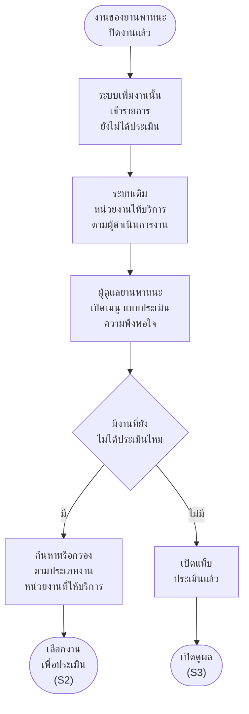
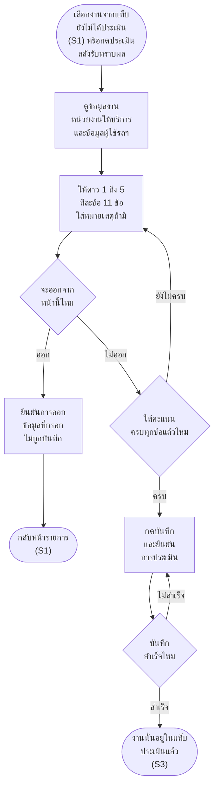
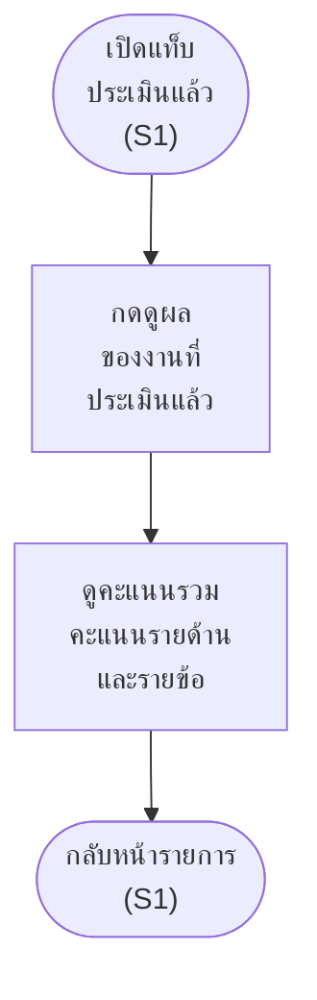

# แบบประเมินความพึงพอใจ (XCHO) — flowchart กิจกรรมราย scenario

> เรื่องแยกตั้งแต่ 12 พ.ย. 2569 เจ้าของงาน: _"เรื่องการประเมินเป็นเรื่องแยกที่จะไปผูกตาม flow ต่างๆ เลยอยากแยกใว้"_ · เงื่อนไขเต็มอยู่ที่ [01-ประเมินความพึงพอใจ-userflow.md](01-ประเมินความพึงพอใจ-userflow.md)
>
> ผังนี้บอกแค่ว่าใครทำอะไร ทำเสร็จแล้วไปต่อที่ไหน ตรงไหนต้องเลือก และเลือกแล้วไปทางไหน ไม่มีหน้าจอ · รูปทรง `["…"]` สิ่งที่ทำ · `{"…"}` จุดที่ต้องเลือก · `(["…"])` จุดเริ่ม จุดจบ หรือไปต่อผังอื่น
>
> ปลั๊กอิน `figma-export/satisfaction-plugin/` วางผังของ scenario ไว้ซ้ายของบล็อกจอ (A = Scenario 1 · B = Scenario 2 · C = Scenario 3) · แก้ไฟล์นี้แล้วรัน `node figma-export/build-plugin.js satisfaction-plugin` ผังใน Figma ถึงจะตาม · หัวข้อต้องเป็น `### Scenario N · ชื่อ`

### Scenario 1 · ผู้ดูแลยานพาหนะ ดูรายการประเมินความพึงพอใจ

> งานของยานพาหนะที่ปิดแล้ว (งานซ่อม บำรุงรักษาตามวาระ Overhaul) เข้ารายการ 1 งาน 1 แถว ระบบเติมหน่วยงานให้บริการจากผู้ดำเนินการงานนั้น

### Scenario 2 · ผู้ดูแลยานพาหนะ ประเมินความพึงพอใจการให้บริการ 1 งาน

> ให้ดาว 1 ถึง 5 ครบทุกข้อแล้วจึงบันทึกได้ บันทึกแล้วแก้ไม่ได้ ออกกลางทางต้องยืนยันการออก · เข้าได้อีกทางจากบำรุงรักษา Scenario 13 กดประเมินความพึงพอใจหลังรับทราบผล (12 พ.ย. 2569 ตามต้นแบบเว็บ)

### Scenario 3 · ผู้ดูแลยานพาหนะ ดูผลประเมินความพึงพอใจ

> ดูอย่างเดียว ไม่มีแก้ไข ไม่มีพิมพ์ ไม่มีแนบไฟล์

