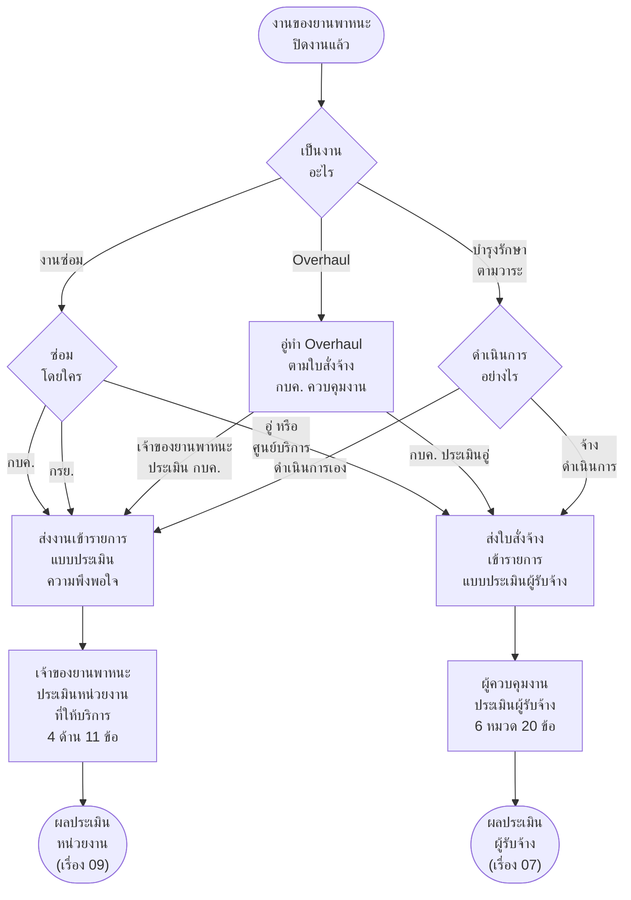

# ผังเลือกแบบประเมินหลังปิดงาน — งานซ่อม · Overhaul · บำรุงรักษาตามวาระ

> เจ้าของงาน 13 พ.ย. 2569: _"แบบประเมินความพึงพอใจ จะเป็นแบบประเมินที่ ประเมินหน่วยงาน เช่น เรื่องการซ่อม ทางแยกของการซ่อม มีซ่อมโดย กบค ซ่อมโดย กรย ซ่อมโดยอู่ ศูนย์บริการ แบบประเมิณก็จะต่างกัน โดยถ้าประเมิน กรย กบค ก็จะเป็นแบบปะรเมินความพอใจ แต่ถ้าเป็น ซ่อมโดยอู่หรือศูนย์บริการ จะเป็นแบบประเมินผู้รับจ้าง"_
> + _"overhaul จะมี condition จะมีการประเมิน 2 ส่วน คือ กบค ประเมินอู่ และ เจ้าของรถ ประเมิน กบค แบบประเมินก็จะเป็น 2 แบบประเมิน"_
> + ช่องทาง "ดำเนินการซ่อมเอง" ของฟอร์มแจ้งซ่อม _"ความหมายคือ นำไปซ่อมเอง คือนำไปซ่อมอู่นั่นแหละ ส่วนมากไม่มีการซ่อมเอง"_

กติกาข้อเดียว: **ดูว่าใครเป็นผู้ทำงาน**
- หน่วยงานของ กฟภ. ทำงาน (กบค. กรย. หรือกองที่สร้างแผนบำรุงรักษา) ใช้ **แบบประเมินความพึงพอใจ** เจ้าของยานพาหนะประเมินหน่วยงานนั้น
- อู่ ศูนย์บริการ หรือบริษัททำงาน ใช้ **แบบประเมินผู้รับจ้าง** ผู้ควบคุมงานประเมินผู้รับจ้าง 1 ใบสั่งจ้าง 1 แบบ
- **Overhaul ไม่ต้องเลือก ได้ทั้ง 2 แบบทุกงาน** อู่เป็นผู้ทำ กบค. เป็นผู้ควบคุมงาน กบค. จึงประเมินอู่ และเจ้าของยานพาหนะประเมิน กบค.

ผังนี้บอกแค่ว่างานแบบไหนไปแบบประเมินไหน ไม่มีหน้าจอ · รูปทรง `["…"]` สิ่งที่ทำ · `{"…"}` จุดที่ต้องเลือก · `(["…"])` จุดเริ่ม จุดจบ หรือไปต่อเรื่องอื่น
ขั้นของแต่ละแบบประเมินดูต่อที่ [เรื่อง 09 แบบประเมินความพึงพอใจ](../09-ประเมินความพึงพอใจ/02-ประเมินความพึงพอใจ-flowchart-กิจกรรม.md) และ [เรื่อง 07 แบบประเมินผู้รับจ้าง](../07-ประเมินผู้รับจ้าง/01-ออกแบบ-ประเมินผู้รับจ้าง-อู่-เทียบกับ-ประเมินพนักงานขับรถ-VMS+เดิม.md)

## ผัง

> Overhaul ออกจากกล่องสิ่งที่ทำ ไม่ใช่จุดที่ต้องเลือก เพราะได้ทั้ง 2 เส้นทุกงาน · งานซ่อมและบำรุงรักษาได้แบบเดียวตามผู้ทำงาน
> อู่ หรือศูนย์บริการ รวมช่องทาง "ดำเนินการซ่อมเอง" ที่หน่วยงานนำไปซ่อมอู่ · ดำเนินการเอง ของบำรุงรักษาคือ กบค. หรือกองที่สร้างแผน (รายละเอียดในตารางสรุป)

## ตารางสรุป

ผู้ทำงาน คือหน่วยงานหรืออู่ที่ลงมือทำงาน ใช้เลือกแบบประเมิน · ผู้ดำเนินการ คือคนหรือหน่วยงานของ กฟภ. ที่รับผิดชอบงานนั้นในระบบ (ช่อง "ผู้ดำเนินการ" ในข้อมูลงานของแบบประเมิน เช่น นายวิชัย ทองดี (กบค.)) เพิ่ม 13 พ.ย. 2569 ตามเจ้าของงาน

| งาน | ผู้ทำงาน | ผู้ดำเนินการ | แบบประเมิน | ใครประเมิน | ประเมินใคร |
|---|---|---|---|---|---|
| งานซ่อม | กบค. | ช่างของ กบค. ที่รับงานซ่อม | ความพึงพอใจ | เจ้าของยานพาหนะ (ผู้ดูแลยานพาหนะ) | กบค. 1 งานซ่อม |
| งานซ่อม | กรย. | ช่างของ กรย. ที่รับงานซ่อม | ความพึงพอใจ | เจ้าของยานพาหนะ (ผู้ดูแลยานพาหนะ) | กรย. 1 งานซ่อม |
| งานซ่อม | อู่ หรือศูนย์บริการ รวมช่องทาง "ดำเนินการซ่อมเอง" ที่หน่วยงานนำไปซ่อมอู่ และงานที่ กบค. ส่งกลับให้ไปซ่อมอู่ | หน่วยงานเจ้าของยานพาหนะที่นำไปซ่อมอู่ | ผู้รับจ้าง | ผู้ควบคุมงาน (ยังไม่เคาะ) | อู่ หรือศูนย์บริการ 1 ใบสั่งจ้าง |
| Overhaul | อู่ทำตามใบสั่งจ้าง | กบค. (ผู้ควบคุมงานของใบสั่งจ้าง) | ผู้รับจ้าง | กบค. | อู่ 1 ใบสั่งจ้าง |
| Overhaul | (งานเดียวกับแถวบน ทำทั้ง 2 แบบ) | กบค. (ผู้ควบคุมงานของใบสั่งจ้าง) | ความพึงพอใจ | เจ้าของยานพาหนะ (ผู้ดูแลยานพาหนะ) | กบค. 1 งาน Overhaul |
| บำรุงรักษาตามวาระ | ดำเนินการเอง กบค. หรือกองที่สร้างแผน (กบผ. กปส. กรย. กส.1 กส.2) | ผู้ดำเนินการของแผน (คนของกองที่สร้างแผน) | ความพึงพอใจ | เจ้าของยานพาหนะ (ผู้ดูแลยานพาหนะ) | กองที่ดำเนินการ ยานพาหนะ 1 คัน |
| บำรุงรักษาตามวาระ | จ้างดำเนินการ (ผู้รับจ้างในแผนเดินทางแบบจ้าง) | ผู้ดำเนินการของแผนที่สร้างแผนเดินทางแบบจ้าง | ผู้รับจ้าง | ผู้ควบคุมงาน (ยังไม่เคาะ) | ผู้รับจ้าง 1 ใบสั่งจ้าง |

## เทียบ 2 แบบประเมิน

| เรื่อง | แบบประเมินความพึงพอใจ (XCHO) | แบบประเมินผู้รับจ้าง |
|---|---|---|
| ประเมินใคร | หน่วยงานของ กฟภ. ที่ให้บริการ | อู่ ศูนย์บริการ หรือบริษัทผู้รับจ้าง |
| ใครประเมิน | เจ้าของยานพาหนะ (ผู้ดูแลยานพาหนะ) | ผู้ควบคุมงาน (กบค.) |
| หัวข้อ | ด้านระบบการให้บริการ · ด้านเจ้าหน้าที่และ/หรือผู้ให้บริการ · ด้านคุณภาพของสินค้าและ/หรือบริการ · ด้านสภาพแวดล้อมต่างๆ | สถานประกอบการ · เครื่องมืออุปกรณ์ · ผู้ปฏิบัติงาน · การให้บริการ · คุณภาพของผลงาน · การส่งมอบงาน |
| จำนวนข้อ คะแนน | 4 ด้าน 11 ข้อ ดาว 1 ถึง 5 เต็ม 55 | 6 หมวด 20 ข้อ คะแนน 1 ถึง 5 เต็ม 100 |
| 1 แบบต่อ | 1 งานของยานพาหนะ 1 คัน | 1 ใบสั่งจ้าง |
| จอต้นแบบ | เว็บ `/satisfaction/` · ปลั๊กอิน Figma "แบบประเมิน 2 แบบ" แบบที่ 2 | ปลั๊กอิน Figma "แบบประเมิน 2 แบบ" แบบที่ 1 · `design-mock/contractor-eval.html` |
| เอกสาร | [เรื่อง 09](../09-ประเมินความพึงพอใจ/01-ประเมินความพึงพอใจ-userflow.md) | [เรื่อง 07](../07-ประเมินผู้รับจ้าง/01-ออกแบบ-ประเมินผู้รับจ้าง-อู่-เทียบกับ-ประเมินพนักงานขับรถ-VMS+เดิม.md) · [ข้อประเมิน 20 ข้อ](../07-ประเมินผู้รับจ้าง/02-ข้อประเมินผู้รับจ้าง-6หมวด-20ข้อ.csv) |

## ยังไม่เคาะ

- คอลัมน์ผู้ดำเนินการของงานซ่อมและ Overhaul เป็นข้อเสนอ ข้อมูลจำลองของงานซ่อมและ Overhaul ยังไม่มีช่องผู้ดำเนินการ (มีเฉพาะบำรุงรักษาตามวาระ)
- งานซ่อมที่หน่วยงานนำไปซ่อมอู่เอง ใครเป็นผู้ประเมินผู้รับจ้าง หน่วยงานเจ้าของยานพาหนะ หรือ กบค.
- บำรุงรักษาตามวาระที่กองอื่น (ไม่ใช่ กบค.) จ้างดำเนินการ ใครเป็นผู้ประเมินผู้รับจ้าง
- งานซ่อมหรือบำรุงรักษาที่ กบค. ประสานให้ผู้รับจ้างทำ ต้องประเมิน 2 แบบเหมือน Overhaul ด้วยหรือไม่ ตอนนี้ 2 แบบเฉพาะ Overhaul
- Overhaul 2 แบบ ประเมินพร้อมกันหลังปิดงาน หรือมีลำดับ เช่น กบค. ประเมินอู่ก่อน
- ต้นแบบยังไม่ได้ทำตามผังนี้ทั้งหมด เช่น รายการแบบประเมินความพึงพอใจของเว็บยังไม่ได้แยกงานที่ใช้ผู้รับจ้างออก และเว็บยังไม่มีแบบประเมินผู้รับจ้าง
